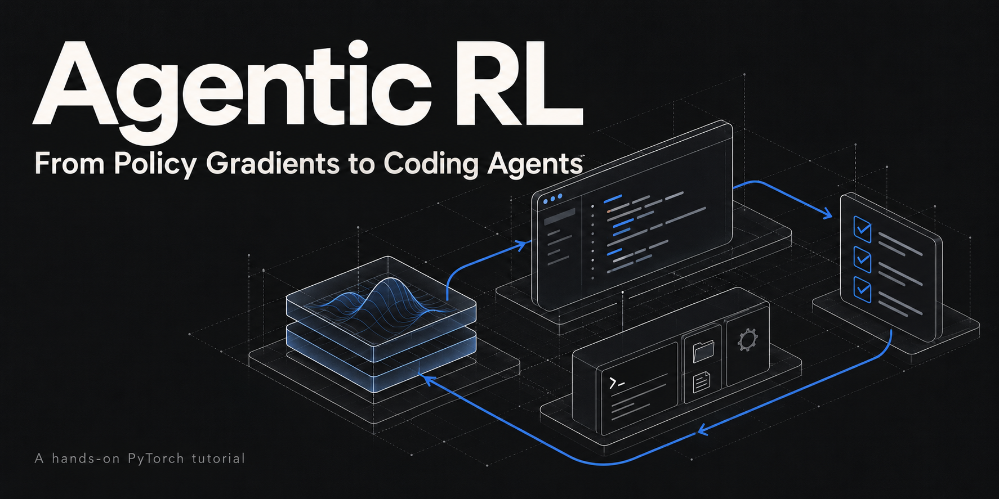

# Agentic RL：From Policy Gradients to Coding Agents

I've spent years training foundation models, but agentic RL has not been my main focus. As agentic RL and post-training evolve, I've found it hard to find a systematic explanation that connects the theory, code, and practical decisions. This tutorial grew out of that gap. I created it together with GPT-6 to work through the subject carefully and share what I learn along the way.

*Agentic RL: From Policy Gradients to Coding Agents* is an executable, PyTorch-based tutorial for anyone who already trains language models and wants to understand how to train agents. It connects RL theory to the details of a working post-training system: tool interactions, trajectory tensors, reward signals, policy updates, and evaluation.

The repository builds a small coding agent one chapter at a time. The agent reads Python code, runs tests, makes edits, and submits a fix. We follow that interaction all the way from generated tokens to a reward and a gradient update. Each mechanism is derived, implemented from scratch, and run, with checked output directly below the code. Reusable implementations become the `agentrl` package. The curriculum also covers SFT, preference learning, and on-policy distillation, so readers can reason about how these training signals fit together.

## What you should be able to do

After working through the code and exercises, you should be able to:

- **Build a training loop:** define a coding environment and verifier, collect multi-turn rollouts, construct training tensors, update the policy, and evaluate on held-out tasks.
- **Explain the objective:** derive policy gradients, advantages, PPO, and GRPO; trace which tokens contribute to the loss and how masks, normalization, and KL regularization change the update.
- **Make engineering decisions:** reason about tool budgets, reward design, long-horizon credit assignment, rollout freshness, and consistency between inference and training.
- **Diagnose failures:** investigate rising reward without better task performance, reward hacking, entropy collapse, and unstable updates using logs and controlled experiments.
- **Evaluate new methods:** separate established results from implementation choices and open questions, then design an experiment to test an alternative.

The goal is to prepare readers to contribute to post-training research and engineering through a system they can inspect and modify. Small experiments make mechanisms visible; the real-model lab connects them to Qwen3-0.6B. These runs teach implementation and diagnosis; they do not establish performance at frontier scale.

Start with the [English edition](tutorial/README.md) or the [中文版](tutorial/zh/README.md).

## Repository layout

| Path | Contents |
| --- | --- |
| `tutorial/chapters/` | Canonical chapters (Markdown). Every Python block is executed and its output checked. |
| `tutorial/zh/` | Optional Simplified Chinese edition: translated prose, identical code, outputs, and figures. Checked by `scripts/check_translation.py`. |
| `tutorial/figures/` | SVG figures, generated by `scripts/figures/` or drawn with `scripts/svgplot.py`. |
| `tutorial/labs/` | Optional real-model labs and their recorded results. |
| `tutorial/editorial-guide.md`, `tutorial/outline.md` | Writing contract and chapter/library plan. |
| `agentrl/` | **Generated** library of every `#@save` block. Do not edit; run `scripts/build_library.py`. |
| `scripts/` | Checker, library builder, figure toolkit, site builder, remote runners. |
| `website/` | **Generated** Mintlify reading edition. Do not edit; run `scripts/build_tutorial_site.py`. |

## License

Unless otherwise noted, the original code and tutorial content in this repository are licensed under the [MIT License](LICENSE). Third-party materials retain their respective licenses and attribution requirements.
