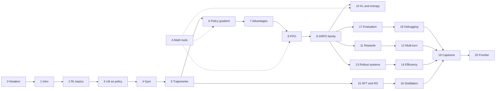

# 0. Notation and How to Use This Book

This book teaches reinforcement learning for language-model agents by building a complete, small training system. Each chapter derives a mechanism, implements it in a few lines of PyTorch, runs it, and reads the output. This front matter explains who the book is for, how to run it, the notation used throughout, how claims are labeled, and how the chapters depend on one another.

## 0.1 Prerequisites

The book assumes that you train or fine-tune large models. You should be comfortable with transformers, cross-entropy, optimizers, mixed precision, and the basics of distributed training; none of that is explained here. You should also be comfortable with probability at the level of expectations, conditional distributions, and variance. [Appendix A](A-math.md) collects the specific tools used in the RL chapters (importance sampling, the log-derivative trick, KL identities, and Monte Carlo error bars) with short derivations and numeric checks.

The book does *not* assume any reinforcement learning background. [Chapter 2](02-rl-fundamentals.md) builds MDPs, value functions, and the RL objective from the definitions, and [Chapter 6](06-policy-gradient.md) derives the policy gradient from scratch. The pace is set for a reader who learns quickly but wants every step justified.

## 0.2 How a Chapter Works

Every chapter follows the same cycle. A section opens with a problem left open by the previous section, states a mechanism, implements it in a short code block, runs it, and interprets the printed output. Each chapter closes with a **Design problems in practice** section, a **Summary**, and **Exercises**. The design problems are written as a senior engineer would present them in a design review: the symptom you would see on a dashboard, the cause in terms of the chapter's math, the options and their costs, and a default labeled as the book's recommendation.

Code blocks are short and do one thing each. Tensor shapes are written in comments using fixed axis names:

| Axis | Meaning |
| --- | --- |
| `B` | batch of trajectories |
| `G` | group size: samples per prompt or task |
| `T` | sequence length in tokens |
| `V` | vocabulary size |
| `D` | model width |
| `S`, `A` | number of states and actions in a tabular MDP |

For example, per-token log-probabilities of a batch are `logp: [B, T]`, and a mask that marks the policy's own tokens has the same shape.

```python
import torch

B, T = 2, 6
logp = torch.full((B, T), -0.5)                     # logp: [B, T]
action_mask = torch.tensor([[0, 1, 1, 0, 0, 1],     # action_mask: [B, T], 1 = policy token
                            [0, 1, 1, 1, 0, 0]])
masked_sum = (logp * action_mask).sum(-1)           # [B]
print('logp shape:', tuple(logp.shape), ' mask shape:', tuple(action_mask.shape))
print('sum of policy-token log-probs per trajectory:', masked_sum.tolist())
```

Output:

```text
logp shape: (2, 6)  mask shape: (2, 6)
sum of policy-token log-probs per trajectory: [-1.5, -1.5]
```

The output is printed by running the block, never typed by hand. A checker re-executes every chapter and fails if any printed output differs from the text.

## 0.3 Running the Code

Each chapter is a Markdown file whose Python code blocks run in order in a fresh namespace. Everything runs on CPU, and a chapter finishes in about a minute.

**The `agentrl` library.** A block whose first line is `#@save` becomes part of a generated Python package called `agentrl`. A saved block contains only imports, function and class definitions, and constants. It prints nothing. In the chapter that defines a function, you call it by its bare name. Later chapters begin with

```text
import torch
import agentrl as arl
```

and call `arl.policy_evaluation(...)`, `arl.TinyAgent(...)`, and so on. This is how the book becomes one build: by the capstone, every component of the training stack has been derived, implemented, and saved once, and the capstone imports it. A chapter may use only Python, PyTorch, the standard library, its own earlier blocks, and functions saved by *earlier* chapters. The checker enforces this by building `agentrl` from the preceding chapters only. To build the package locally, run

```text
python3 scripts/build_library.py          # writes agentrl/__init__.py from all #@save blocks
```

Never edit `agentrl/__init__.py` by hand; edit the chapter and rebuild.

**Checking a chapter.** `scripts/check_tutorial_snippets.py` executes chapters and compares every block's stdout with the `Output:` block that follows it. Authors run it on the book's check host, which has PyTorch installed, through a wrapper that copies the repository to a private directory:

```text
scripts/remote_check.sh <workdir> --refresh 02    # run chapter 02 and rewrite its Output blocks
scripts/remote_check.sh <workdir> 02              # verify that recorded outputs match
```

Readers can run the checker locally with any recent PyTorch: `python3 scripts/check_tutorial_snippets.py --chapters 02`. Chapters that use the real Qwen3-0.6B tokenizer or model read it from a local Hugging Face cache with `HF_HUB_OFFLINE=1` and never download.

**Figures.** Data figures are computed from book code by modules in `scripts/figures/` and rendered to SVG; they are regenerated, not drawn by hand.

## 0.4 Notation

The same symbols mean the same things in every chapter. When the literature uses a symbol differently, the chapter says so.

| Symbol | Meaning |
| --- | --- |
| $\pi_\theta$ | the policy (the language model) with parameters $\theta$ |
| $\pi_{\text{old}}$ | the policy that generated a batch of data, before the current update |
| $\mu$ | the behavior policy when it differs from a stale $\pi_\theta$, for example the inference engine's sampling distribution |
| $\pi_{\text{ref}}$ | a frozen reference policy used for KL regularization |
| $s_t, a_t, o_t$ | state, action, and observation at step $t$ (turn level) |
| $y_i$, $c_i$ | the $i$-th generated token and its prefix (token level) |
| $r_t$ | reward at step $t$; when $r$ would be ambiguous, ratios use $\rho$ |
| $\tau$ | a trajectory $(s_0, a_0, r_0, s_1, \dots)$; $R(\tau)$ its total reward |
| $G_t$ | the return from step $t$: $\sum_{k \ge 0} \gamma^k r_{t+k}$ |
| $J(\theta)$ | the RL objective, $\mathbb{E}_{\tau \sim \pi_\theta}[R(\tau)]$ |
| $P(s' \mid s, a)$, $R(s,a)$ | transition probabilities and expected reward of an MDP |
| $V^\pi, Q^\pi$ | state-value and action-value functions of policy $\pi$ |
| $A_t$, $\hat A_t$ | advantage $Q^\pi - V^\pi$ and its estimate |
| $\rho_t$ | the probability ratio $\pi_\theta(a_t \mid s_t) / \pi_{\text{old}}(a_t \mid s_t)$; some papers write $r_t$ |
| $G$ | group size: samples per prompt (distinct from the return $G_t$ by its subscript) |
| $\gamma, \lambda$ | discount factor and GAE parameter |
| $\epsilon$ | clipping half-width; $\epsilon_{\text{low}}, \epsilon_{\text{high}}$ when asymmetric |
| $\beta$ | KL coefficient |
| $\mathrm{KL}(p \,\Vert\, q)$ | $\mathbb{E}_{x \sim p}[\log p(x) - \log q(x)]$ |
| $\mathcal{H}(\pi)$ | entropy of a distribution, $-\mathbb{E}_{a \sim \pi}[\log \pi(a)]$ |
| $\mathbb{E}$, $\mathrm{Var}$, $\hat{\ }$ | expectation, variance, and an estimate of a quantity |

Two conventions recur. Log-probabilities are natural logarithms. Masks and per-token log-probabilities are aligned to *predicted* positions, so `logp[:, i]` is the log-probability of token `ids[:, i + 1]` ([Chapter 5](05-trajectories-and-templates.md)).

## 0.5 Evidence Labels

A book about training systems makes three kinds of claims, and confusing them is how folklore spreads. Every quantitative claim in this book belongs to one of the following categories, and callouts say which.

- **Measured here.** A number printed by a code block in the book, or saved by a lab under `tutorial/labs/results/`. These are exact for the code that produced them. Almost all are tiny CPU experiments that demonstrate a mechanism. They are not benchmark results, and the text says so wherever a reader could confuse the two.
- **Reported by a source.** A claim made by a paper, technical report, or official repository, cited with a link. Every source is recorded in [sources.md](../sources.md) with the date it was checked and the boundary of what was checked. Reported numbers are not reproduced unless the text says so. Vendor-private training recipes are treated as unknown unless they are publicly documented.
- **Hypothesis or recommendation.** The book's interpretation, or a default suggested in a design problem. These are labeled as recommendations, not universal rules.

Inside chapters, `> **Evidence.**` callouts state the status of a claim, `> **Pitfall.**` marks a mistake that runs and gives a wrong answer, and `> **In production.**` describes how large systems implement an idea, with a source or a statement that it is a general engineering observation.

## 0.6 The Running System and the Chapter Graph

The book builds one system. The **BugFix gym** ([Chapter 4](04-environments-and-tools.md)) is a family of small Python repair tasks with the tools `read`, `test`, `edit <op>`, and `submit`, called with the grammar `<call> tool [arg] </call>`. The `clamp` bug from [Chapter 1](01-introduction.md) is its task 0. **TinyAgent** ([Chapter 3](03-language-models-as-policies.md)) is a small transformer policy that is trained with RL on the gym on CPU. Where model-specific behavior matters, such as chat templates, tokenization, and log-probability mismatch between engines, chapters use the real Qwen3-0.6B tokenizer or model.

The chapters depend on one another as follows. An arrow means that the later chapter uses saved code or ideas from the earlier one.



Chapters 1–9 form the spine and should be read in order. After Chapter 9, the branches are largely independent: a reader focused on infrastructure can go from 9 to 13 and 14, and a reader focused on reward design can go from 9 to 11 and 12. Appendix A can be read on demand when a derivation in Chapters 6, 8, or 10 uses one of its tools. Appendix B collects design-review problems that draw on the whole book.

## Summary

- The reader is assumed to know deep learning well and RL not at all; RL is built from definitions.
- Each chapter cycles through mechanism, code, output, and interpretation, and ends with design problems, a summary, and exercises.
- `#@save` blocks build the `agentrl` library; later chapters use `import agentrl as arl`, and the checker enforces that chapters only use earlier saved code.
- Every claim is measured here, reported by a dated source, or labeled as a hypothesis or recommendation.

## Exercises

1. Run `python3 scripts/build_library.py` and open `agentrl/__init__.py`. Which chapter defines each function?
2. Change one printed number in a chapter's `Output:` block and run the checker on that chapter. Read the error message it produces.
3. In the code block of Section 0.2, change the mask so that the first trajectory includes its first token. Predict the new masked sum before running it. Which kind of token is usually at position 0, and why should it be masked?
4. Pick one claim in [Chapter 1, Section 1.6](01-introduction.md#16-public-reference-points) and find its entry in [sources.md](../sources.md). What does the entry say was *not* checked?
