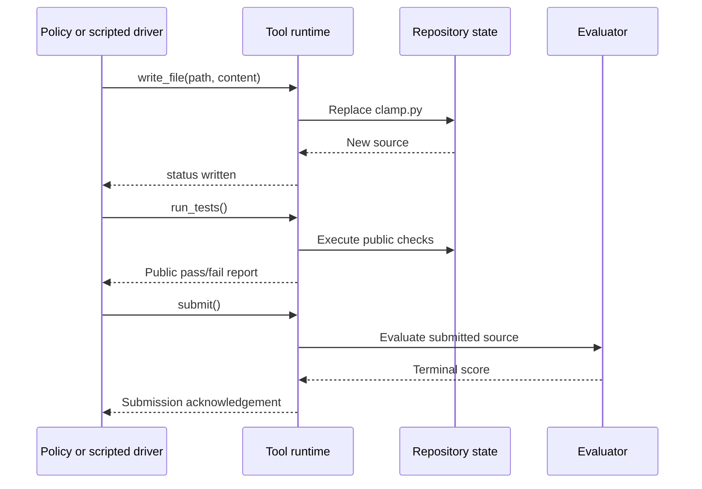

# Build the coding environment before training the policy

Chapter 1 established the broken file and success criterion. A model cannot repair a repository merely by knowing a reward formula: it needs a callable interface. We now define that interface, its backend, and a complete scripted interaction. The model-facing action selects a tool and arguments; the environment executes it and returns an observation.

## Define the boundary

Our tools are `read_file`, `write_file`, `run_tests`, and `submit`. Only `clamp.py` is writable. Running public tests provides feedback. Submission invokes evaluator checks and ends the episode. The evaluator's source is present in this teaching notebook for inspection, but it is never included in a tool response to the agent. This is an application access distinction, not security enforced by hiding a variable name.

Each declaration contains a name, a description, and an argument schema. Those dictionaries advertise an interface; the runtime still needs validation and executable functions. We use an application-level schema illustration rather than claiming a provider-specific message protocol.

```python
import json

def tool_declaration(name, description, properties, required):
    return {
        "name": name,
        "description": description,
        "parameters": {
            "type": "object",
            "properties": properties,
            "required": required,
            "additionalProperties": False,
        },
    }

path_parameter = {"type": "string", "enum": ["clamp.py"]}
tools = [
    tool_declaration("read_file", "Read the current source", {"path": path_parameter}, ["path"]),
    tool_declaration("write_file", "Replace the source", {"path": path_parameter, "content": {"type": "string"}}, ["path", "content"]),
    tool_declaration("run_tests", "Run public checks", {}, []),
    tool_declaration("submit", "Submit the current patch", {}, []),
]
print("tool names:", [tool["name"] for tool in tools])
print("write declaration:", json.dumps(tools[1], sort_keys=True))
```

Output:

```text
tool names: ['read_file', 'write_file', 'run_tests', 'submit']
write declaration: {"description": "Replace the source", "name": "write_file", "parameters": {"additionalProperties": false, "properties": {"content": {"type": "string"}, "path": {"enum": ["clamp.py"], "type": "string"}}, "required": ["path", "content"], "type": "object"}}
```

`tool_declaration` constructs data, not an executable callable. The dictionaries describe allowed arguments. Below, `validate_arguments` implements matching runtime checks: exact keys, types, and the path allowlist. Never rely on a schema description alone to authorize a filesystem operation.

## Construct execution and grading from scratch

`execute_checks` compiles a candidate in a fresh namespace and returns named pass/fail results. Public tests use one issue-reproduction case; evaluator checks add edges and reversed bounds. This intentionally makes an overfit patch observable in later examples.

```python
buggy_source = "def clamp(value, lower, upper):\n    return min(lower, max(value, upper))\n"
fixed_source = (
    "def clamp(value, lower, upper):\n"
    "    if lower > upper:\n"
    "        raise ValueError('reversed bounds')\n"
    "    return max(lower, min(value, upper))\n"
)
public_cases = [("inside", (3, 0, 5), 3)]
evaluator_cases = public_cases + [
    ("below", (-2, 0, 5), 0),
    ("above", (8, 0, 5), 5),
    ("negative bounds", (-3, -5, -1), -3),
    ("equal bounds", (8, 2, 2), 2),
    ("reversed bounds", (3, 5, 0), ValueError),
]

def execute_checks(source, cases):
    namespace = {}
    try:
        exec(source, namespace)
        function = namespace["clamp"]
    except Exception:
        return {name: False for name, _, _ in cases}
    results = {}
    for name, arguments, expected in cases:
        try:
            actual = function(*arguments)
        except Exception as error:
            passed = isinstance(expected, type) and isinstance(error, expected)
        else:
            passed = not isinstance(expected, type) and actual == expected
        results[name] = passed
    return results

def validate_arguments(name, arguments):
    expected_keys = {
        "read_file": {"path"}, "write_file": {"path", "content"},
        "run_tests": set(), "submit": set(),
    }
    if name not in expected_keys or not isinstance(arguments, dict):
        raise ValueError("unknown tool or invalid arguments")
    if set(arguments) != expected_keys[name]:
        raise ValueError("unexpected argument keys")
    if "path" in arguments and arguments["path"] != "clamp.py":
        raise ValueError("path is not permitted")
    if "content" in arguments and not isinstance(arguments["content"], str):
        raise ValueError("content must be text")

print("baseline public results:", execute_checks(buggy_source, public_cases))
print("fixed evaluator results:", execute_checks(fixed_source, evaluator_cases))
```

Output:

```text
baseline public results: {'inside': False}
fixed evaluator results: {'inside': True, 'below': True, 'above': True, 'negative bounds': True, 'equal bounds': True, 'reversed bounds': True}
```

## State and observation have different jobs

State stores the current file, history, steps remaining, and stop status. An observation reveals only the current tool result. Reading changes history; editing changes both history and file contents. An episode reset creates a new copy of the broken repository, so one rollout cannot inherit another rollout's patch.

`step` checks the budget and arguments, dispatches the action, and appends the observation. Submission gives binary reward only if every evaluator test passes. Public testing returns its report without a positive task reward. Invalid calls raise here; a production harness may instead return a structured error and charge a step. Budget exhaustion is recorded separately from deliberate submission.

```python
class CodingEnvironment:
    def __init__(self, max_steps=8):
        self.max_steps = max_steps
        self.reset()

    def reset(self):
        self.files = {"clamp.py": buggy_source}
        self.history = []
        self.remaining = self.max_steps
        self.done = False
        self.stop_reason = None
        return {"issue": "Fix clamp, including reversed and negative bounds"}

    def step(self, name, arguments):
        if self.done or self.remaining == 0:
            raise RuntimeError("episode ended")
        validate_arguments(name, arguments)
        self.remaining -= 1
        reward = 0.0
        if name == "read_file":
            observation = {"content": self.files[arguments["path"]]}
        elif name == "write_file":
            self.files[arguments["path"]] = arguments["content"]
            observation = {"status": "written"}
        elif name == "run_tests":
            observation = {"results": execute_checks(self.files["clamp.py"], public_cases)}
        else:  # Only validated submit can reach this branch.
            results = execute_checks(self.files["clamp.py"], evaluator_cases)
            reward = float(all(results.values()))
            observation = {"status": "submitted"}
            self.done = True
            self.stop_reason = "submitted"
        self.history.append({"call": {"name": name, "arguments": dict(arguments)}, "result": observation})
        if not self.done and self.remaining == 0:
            self.done = True
            self.stop_reason = "budget_exhausted"
        return observation, reward

env = CodingEnvironment()
scripted_calls = [
    ("read_file", {"path": "clamp.py"}),
    ("run_tests", {}),
    ("write_file", {"path": "clamp.py", "content": fixed_source}),
    ("run_tests", {}),
    ("submit", {}),
]
for name, arguments in scripted_calls:
    observation, reward = env.step(name, arguments)
    summary = "source returned" if name == "read_file" else observation
    print(name, "->", summary, "reward:", reward, "remaining:", env.remaining)
print("stop reason:", env.stop_reason)
print("trace length:", len(env.history))
disclosed_names = {
    name for item in env.history for name in item["result"].get("results", {})
}
private_names = {name for name, _, _ in evaluator_cases} - {name for name, _, _ in public_cases}
print("evaluator-only test names disclosed:", bool(disclosed_names & private_names))
fresh = CodingEnvironment()
print("reset restores broken file:", fresh.files["clamp.py"] == buggy_source)
```

Output:

```text
read_file -> source returned reward: 0.0 remaining: 7
run_tests -> {'results': {'inside': False}} reward: 0.0 remaining: 6
write_file -> {'status': 'written'} reward: 0.0 remaining: 5
run_tests -> {'results': {'inside': True}} reward: 0.0 remaining: 4
submit -> {'status': 'submitted'} reward: 1.0 remaining: 3
stop reason: submitted
trace length: 5
evaluator-only test names disclosed: False
reset restores broken file: True
```

This trace executes real trusted Python code with scripted actions. The environment does not sample an LLM, and it is not the rLLM/R2E-Gym runtime. The separation lets us inspect the interaction contract before involving tokenization, containers, or training.



## Where the model enters

The runtime inserts tool descriptions and retained history into the model's next input. A real policy generates reasoning and a tool request instead of consuming our `scripted_calls` list. The backend resolves the requested name and arguments, performs the operation, and returns the observation. Merely keeping a result in a Python dictionary does not make it visible to the model.

**Exercises.** Write a patch that passes the public test but fails evaluator edges. Attempt to write `tests.py` and inspect rejection. Exhaust a one-step budget by reading a file: why is that stop different from submission?

**Next question.** Which pieces of this trace were generated by the policy? Read [trajectory ownership](03-trajectories-and-masks.md) before discussing probabilities.
