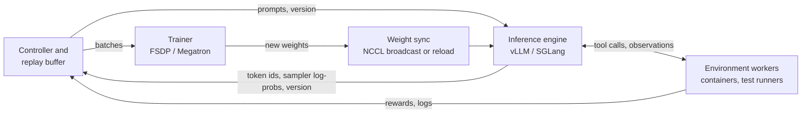

# 13. Rollout Systems and Off-Policy Correction

Every training loop so far ran in one process. `train_rl` sampled 64 episodes with the current weights, waited for the last one to finish, took its gradient steps, and sampled again with the new weights. Sampling and training never overlapped, the sampler and the trainer were the same Python object, and `sample_logp` agreed with the trainer's recomputation to $2 \times 10^{-6}$ ([Section 8.6](08-ppo.md#86-design-problems-in-practice)). None of that survives contact with a real coding agent. An episode takes minutes of container time, episode durations have a long tail, generation runs on an inference engine with its own kernels, and the trainer runs on a different set of accelerators with a different parallelism layout. The system that connects them decides how much of the hardware does useful work, and it also decides *which policy actually generated the data*. The second consequence is the subject of this chapter as much as the first.

We build four things. A discrete-event simulator of a rollout pipeline measures what synchronous, one-step-ahead, and fully asynchronous designs buy in throughput and what they cost in staleness. A training loop that samples with a policy $k$ updates old measures what staleness does to TinyAgent, with and without importance correction. A measurement on the real Qwen3-0.6B shows that an inference-style forward pass and a trainer-style forward pass disagree about log-probabilities even with identical weights. And two corrections for that disagreement, truncated and masked importance sampling, are derived, simulated, and tested on TinyAgent with a deliberately mismatched sampler.

```python
#@save
import copy
import heapq
import math
import torch
import agentrl as arl
```

```python
torch.set_num_threads(4)                       # the shared check host is heavily loaded
tok = arl.build_tokenizer(arl.make_tasks('all'))
train_tasks, heldout_tasks = arl.make_tasks('train'), arl.make_tasks('heldout')
rl_base = arl.make_rl_base(tok)
```

## 13.1 The components of an RL system

A production RL system for agents has four kinds of component. Their names vary between frameworks; their jobs do not.



- **The inference engine** (vLLM, SGLang) generates tokens. It owns the KV cache, batches thousands of concurrent sequences with continuous batching, and returns token ids together with the log-probability of each sampled token under the distribution it sampled from. Its kernels are tuned for decode throughput: paged attention, fused sampling, often bf16 or FP8 weights. *Failure modes:* out-of-memory from KV-cache growth on long episodes, preemption and recomputation of sequences under memory pressure, and log-probabilities that differ from the trainer's (Section 13.6).
- **The trainer** (FSDP or Megatron, inside frameworks such as verl, slime, OpenRLHF, or AReaL) recomputes log-probabilities, computes advantages, and takes gradient steps. It shards parameters, gradients, and optimizer states across accelerators. *Failure modes:* memory blow-up on long sequences ([Chapter 14](14-scaling-and-efficiency.md)), gradient-normalization bugs across microbatches, and silent divergence when its data came from a policy other than the one it assumes.
- **Environment workers** run the tools: a container per episode with the repository checked out, a shell, a test runner. They are CPU-bound, slow, and unreliable. *Failure modes:* container start-up latency, hung test processes, flaky tests, worker crashes in the middle of an episode, and resource exhaustion when thousands of episodes run at once.
- **Weight synchronization** moves new parameters from the trainer to the engine after each update, by an NCCL broadcast between the two process groups, by resharding in place when they share accelerators ("colocated"), or by writing a checkpoint that the engine reloads. *Failure modes:* the sync takes seconds to minutes and stalls generation; a partial sync leaves the engine with a mixture of old and new layers; a version counter that is not attached to every sample makes staleness unmeasurable.

A **controller** ties them together: it tracks the policy version, decides when to launch episodes and when to train, and holds finished episodes in a buffer. The framework documentation cited in [Chapter 20](20-frontier.md#206-asynchronous-rl-and-traininginference-mismatch) describes these pieces for verl, slime, and OpenRLHF; we read their documentation and READMEs, not their code.

In this book's code, the four components are already present in miniature: `rollout_batch` is the engine, `BugFixEnv` is an environment worker, `rl_update` is the trainer, and weight synchronization is free because sampler and trainer are the same `nn.Module`. What a real sync moves is the parameters. The block counts them for TinyAgent and does the arithmetic for real model sizes, under labeled assumptions about bandwidth.

```python
n_params = sum(p.numel() for p in rl_base.parameters())
print(f'TinyAgent: {n_params:,} parameters, {4 * n_params / 1e6:.2f} MB in fp32')
# Assumed effective bandwidths: 100 GB/s within a node, 10 GB/s across nodes, 1 GB/s via a checkpoint reload.
for name, billions in [('Qwen3-0.6B', 0.6), ('Qwen3-8B', 8.2), ('Qwen3-32B', 32.8)]:
    gigabytes = 2 * billions                                   # bf16 weights
    times = ', '.join(f'{gigabytes / bw:6.2f} s at {bw:>3} GB/s' for bw in (100, 10, 1))
    print(f'{name:<11} {gigabytes:5.1f} GB in bf16 | {times}')
```

Output:

```text
TinyAgent: 157,244 parameters, 0.63 MB in fp32
Qwen3-0.6B    1.2 GB in bf16 |   0.01 s at 100 GB/s,   0.12 s at  10 GB/s,   1.20 s at   1 GB/s
Qwen3-8B     16.4 GB in bf16 |   0.16 s at 100 GB/s,   1.64 s at  10 GB/s,  16.40 s at   1 GB/s
Qwen3-32B    65.6 GB in bf16 |   0.66 s at 100 GB/s,   6.56 s at  10 GB/s,  65.60 s at   1 GB/s
```

The weights of a 32B model are 66 GB in bf16. Within a node that is under a second; across nodes it is several seconds; through a checkpoint reload it is about a minute, every step. Those numbers, not the model's FLOPs, are why colocated designs reshard in place and why disaggregated designs broadcast over NCCL. They are also inputs to the simulator: the sync cost is part of every step's critical path.

## 13.2 Where the time goes: long-tailed episodes

The second input is the duration of an episode. An agent episode alternates generation and tool calls. Each turn generates a few hundred tokens at a per-sequence decode rate of tens of tokens per second (the engine's aggregate throughput is high, but each sequence advances one token per decode step), then waits for a tool: a file read returns in milliseconds, a test suite in seconds to minutes. The number of turns varies by task and by attempt. `agent_episode_durations` samples durations from that structure: a geometric number of turns, a uniform number of tokens per turn, and a log-normal tool latency. The defaults are assumptions chosen to look like a coding agent, not measurements of one.

```python
#@save
def agent_episode_durations(n, generator, mean_turns=8, max_turns=40, tokens_per_turn=(100, 600),
                            decode_rate=40.0, tool_median=2.0, tool_sigma=1.0):
    """Simulated wall-clock seconds of n agent episodes -> [n]. Turns ~ geometric, tool latency ~ log-normal."""
    u = torch.rand(n, generator=generator)
    turns = (torch.log1p(-u) / math.log(1 - 1 / mean_turns)).ceil().clamp(1, max_turns)     # [n]
    lo, hi = tokens_per_turn
    decode = (lo + (hi - lo) * torch.rand(n, max_turns, generator=generator)) / decode_rate  # [n, max_turns]
    tool = tool_median * torch.exp(tool_sigma * torch.randn(n, max_turns, generator=generator))
    used = torch.arange(max_turns) < turns[:, None]                                         # [n, max_turns]
    return ((decode + tool) * used).sum(-1)
```

What matters for a synchronous step is not the mean duration but the duration of the slowest of the $B$ episodes in the batch, because the trainer cannot start until it has all of them. We draw a large pool and compare the mean with the expected maximum of a batch, estimated by splitting the pool into batches.

```python
durations = agent_episode_durations(65_536, torch.Generator().manual_seed(0))      # [N] seconds
q = durations.quantile(torch.tensor([0.5, 0.9, 0.99]))
print(f'mean {durations.mean():.0f} s | median {q[0]:.0f} s | p90 {q[1]:.0f} s | p99 {q[2]:.0f} s | max {durations.max():.0f} s')
for B in [8, 64, 512]:
    batch_max = durations.view(-1, B).max(-1).values.mean()
    print(f'B = {B:3d}: expected slowest episode {batch_max:4.0f} s = {batch_max / durations.mean():.1f} x the mean')
```

Output:

```text
mean 96 s | median 68 s | p90 215 s | p99 430 s | max 624 s
B =   8: expected slowest episode  251 s = 2.6 x the mean
B =  64: expected slowest episode  415 s = 4.3 x the mean
B = 512: expected slowest episode  515 s = 5.4 x the mean
```

The median episode takes about a minute and the mean about a minute and a half, but one episode in a hundred takes several times that. The slowest of a batch grows with the batch size like a high quantile of the distribution: the expected straggler is 2.6 times the mean at $B = 8$, 4.3 times at $B = 64$, and 5.4 times at $B = 512$. A synchronous system spends each step waiting for that straggler, and while it waits, the slots whose episodes have already finished do nothing. This is the straggler problem, and it gets *worse* as the batch grows, which is the opposite of what scaling the batch is supposed to do.

## 13.3 Synchronous, one-step-ahead, and asynchronous pipelines

Three designs answer the straggler problem differently.

- **Synchronous** (on-policy). Sample a batch with version $v$, train on it, sync to $v+1$, repeat. Every episode is trained by the version that generated it, so the gradient is exactly the on-policy estimator of [Chapter 6](06-policy-gradient.md). The step time is $\mathbb{E}[\max_{i \le B} d_i] + t_{\text{train}} + t_{\text{sync}}$, and generation and training never overlap.
- **One step ahead** (one-step off-policy). While the trainer trains on batch $n$, the engine already samples batch $n+1$ with version $v_n$. Training overlaps generation, and every episode is exactly one version stale. verl documents this mode ([Chapter 20](20-frontier.md#206-asynchronous-rl-and-traininginference-mismatch)).
- **Fully asynchronous.** Generation slots never wait: whenever an episode finishes, the slot starts another with the newest weights. The trainer takes the oldest $B$ finished episodes whenever it is free. A **staleness bound** $\eta$ throttles generation so it cannot run more than $\eta$ batches ahead of training; AReaL's condition, quoted in Chapter 20, allows a new episode only while the number started is below $(v + 1 + \eta) B$. With $\eta = 0$ the design reduces to synchronous.

A weight sync in an asynchronous system meets episodes that are still running. Either the engine **drains** (stops starting episodes, waits for the in-flight ones to finish under the old weights, then syncs), or it **interrupts** them: in-flight episodes pause during the sync and continue under the new weights. The second option is called **partial rollout** (AReaL calls these interruptible rollouts; Kimi k1.5's partial rollouts cap the token budget per iteration and resume later). An interrupted episode's early tokens come from version $v$ and its later tokens from $v+1$ or later, so no single policy generated it.

The simulator below models exactly these choices. It has `n_slots` generation slots (concurrent episodes in the engine), one trainer that consumes `batch_size` episodes per step and takes `train_time` seconds, and a sync that takes `sync_time` seconds and pauses all generation. It is a discrete-event simulation: time jumps from one event (an episode finishing, a training step finishing, a sync finishing) to the next. Episode durations are consumed in order from one tensor, so every design sees the same episodes. It records every interval it simulates, so we can draw the timeline, and it reports throughput, slot utilization, and the staleness of every trained episode: the trainer's version at the start of its step minus the version that started the episode.

```python
#@save
def simulate_pipeline(durations, n_slots, batch_size, train_time, sync_time, max_staleness=0,
                      interrupt=True, steps=10):
    """Discrete-event rollout/trainer pipeline; durations [N] s -> dict(events, time, throughput, staleness, ...)."""
    durs, t, version, started = iter(durations.tolist()), 0.0, 0, 0
    running, buffer, events, trained = {}, [], [], []    # slot -> [end, start, version, duration]
    train_end = sync_end = None
    pending = False                                      # trained, waiting to sync
    while version < steps:
        while (sync_end is None and not (pending and not interrupt) and len(running) < n_slots
               and started < (version + 1 + max_staleness) * batch_size):          # staleness throttle
            slot, d = min(set(range(n_slots)) - set(running)), next(durs)
            running[slot], started = [t + d, t, version, d], started + 1
        if train_end is None and sync_end is None and not pending and len(buffer) >= batch_size:
            batch, buffer = buffer[:batch_size], buffer[batch_size:]          # oldest finished first
            trained += [(version - v, d) for v, d in batch]
            train_end = t + train_time
            events.append(('train', 0, t, train_end, version))
        t = min([r[0] for r in running.values()] + [x for x in (train_end, sync_end) if x is not None])
        if sync_end == t:
            sync_end, version = None, version + 1
        if train_end == t:
            train_end, pending = None, True
        for slot in [s for s, r in running.items() if r[0] == t]:
            end, start, v, d = running.pop(slot)
            buffer.append((v, d))
            events.append(('gen', slot, start, end, v))
        if pending and (interrupt or not running):                          # drain mode waits for in-flight
            pending, sync_end = False, t + sync_time
            events.append(('sync', 0, t, sync_end, version))
            for r in running.values():
                r[0] += sync_time                                            # generation pauses during sync
    stale = torch.tensor([s for s, _ in trained], dtype=torch.float)
    busy = sum(e[3] - e[2] for e in events if e[0] == 'gen')
    return dict(events=events, time=t, throughput=steps * batch_size / t * 3600, gen_util=busy / (n_slots * t),
                staleness_mean=stale.mean().item(), staleness_max=int(stale.max()),
                trained_duration=sum(d for _, d in trained) / len(trained))
```

Each pass of the outer loop does four things. It fills free slots while the throttle allows, unless a sync is running or, in drain mode, waiting. It starts a training step if the trainer is idle and at least `batch_size` episodes are finished, recording each one's staleness. It advances time to the earliest pending event. And it processes that event: a finished sync publishes the next version, a finished training step requests a sync, a finished episode joins the buffer. A requested sync starts at once with partial rollouts, pushing the end time of every in-flight episode back by `sync_time`, or, in drain mode, only when no episode is in flight. Slot utilization counts an interrupted episode's pause as busy time, a small overstatement.

We run five designs on the same 64 slots, 64 episodes per step, 60 seconds of training, and 10 seconds of sync, for 20 steps.

```python
DESIGNS = {'synchronous': dict(max_staleness=0), 'one step ahead, drain': dict(max_staleness=1, interrupt=False),
           'async eta=1, partial': dict(max_staleness=1), 'async eta=2, partial': dict(max_staleness=2),
           'async eta=4, drain': dict(max_staleness=4, interrupt=False)}
print(f'{"design":<22} | episodes/hour | slot util | staleness mean, max | trained episode mean (s)')
for name, kw in DESIGNS.items():
    r = simulate_pipeline(durations, 64, 64, 60.0, 10.0, steps=20, **kw)
    print(f'{name:<22} | {r["throughput"]:13.0f} | {r["gen_util"]:9.2f} | {r["staleness_mean"]:8.2f}, {r["staleness_max"]:2d}'
          f'      | {r["trained_duration"]:6.1f}')
```

Output:

```text
design                 | episodes/hour | slot util | staleness mean, max | trained episode mean (s)
synchronous            |           451 |      0.19 |     0.00,  0      |   97.7
one step ahead, drain  |           506 |      0.22 |     0.95,  1      |   97.7
async eta=1, partial   |          1836 |      0.81 |     0.93,  5      |   94.1
async eta=2, partial   |          2077 |      0.95 |     1.50,  7      |   93.2
async eta=4, drain     |           490 |      0.25 |     3.19,  4      |   97.7
```

The synchronous pipeline trains 451 episodes per hour, and its slots are busy 19% of the time. Both numbers follow from Section 13.2: a step lasts about as long as the slowest of 64 episodes (415 s expected) plus 70 s of training and sync, and $64 / 485\ \text{s} \approx 475$ episodes per hour; the simulation is slightly lower because the slowest episode varies from batch to batch. Overlapping training with generation but still draining before every sync ("one step ahead, drain") gains only 12%, since training is 60 s of a step that is mostly straggler wait. Without draining, the picture changes completely. With partial rollouts and $\eta = 1$, slots are busy 81% of the time and throughput is 4.1 times the synchronous one; at $\eta = 2$, 95% and 4.6 times. Here the bound is no longer the straggler but generation capacity: 64 slots finishing a 96-second episode each give at most $64 / 96 \times 3600 \approx 2{,}400$ episodes per hour, less the time the syncs pause them. A loose bound that drains ($\eta = 4$, drain) is as slow as the synchronous design, because every sync still waits for the longest episode in flight.

Two columns show the cost. The mean staleness of trained episodes is about 1 at $\eta = 1$ and 1.5 at $\eta = 2$, but the *maximum* is 5 and 7: the throttle counts episodes started, so a straggler that started at version 0 keeps running while newer episodes pass it, and is trained four or five versions later. And the trained episodes are slightly shorter on average than the synchronous ones (93 to 94 s against 98 s): taking the oldest *finished* episodes first means a batch is filled with fast ones, and the slow ones are trained later or, at the end of a run, never. Both effects are invisible in a throughput dashboard.


Figure 13.1 draws the simulator's events for a small pipeline with 8 slots. In the synchronous half, every step has the same shape: most slots finish early and wait, idle, until the longest episode of the batch completes; then the trainer runs while all slots wait again. The four steps take 1,130 simulated seconds. In the asynchronous half, a slot starts a new episode as soon as its previous one finishes, the trainer starts as soon as 8 episodes are done, and the four steps take 493 s. Look at the long bars that cross the yellow sync bands: those are partial rollouts, episodes started under one version and finished under the next, and the label on each bar is only the version that *started* it.


Figure 13.2 sweeps the bound. Throughput with partial rollouts rises steeply from $\eta = 0$ to $\eta = 2$ and is flat after that, because generation capacity becomes the limit; draining keeps throughput near the synchronous level for every bound. On the right, the mean staleness of trained episodes stays below the bound and stops growing at 1.5, but the maximum exceeds the bound for $\eta \le 6$. The design lesson is that most of the throughput of asynchrony is available at a staleness bound of 1 or 2, and that a bound on generation does not bound the age of the oldest data unless it is also enforced when the trainer consumes episodes.

> **Evidence.** Everything in this section is a simulation under stated assumptions: the duration model of Section 13.2, a fixed training time, and a sync that pauses all generation. It shows mechanisms (straggler waits, overlap, the drain penalty, staleness that a count-based throttle does not bound). Speedups reported by real systems (2.77x for AReaL, 2.72x for ROLL Flash on agentic tasks; Chapter 20) come from different workloads and are not reproduced here.

## 13.4 Importance correction for a behavior policy

Asynchrony changes the estimator. Let $\mu$ be the **behavior policy**, whatever actually produced the tokens: a version of the weights $k$ updates old, an inference engine with different numerics, or a mixture of versions within one interrupted episode. The trainer holds $\pi_\theta$. The policy gradient of [Chapter 6](06-policy-gradient.md) is an expectation under $\pi_\theta$, and the data come from $\mu$. Per token, with the per-token approximation of [Section 8.1](08-ppo.md#81-off-policy-reuse-and-importance-sampling),

$$
\nabla_\theta J \approx \mathbb{E}_{y \sim \mu}\Big[\frac{\pi_\theta(y \mid c)}{\mu(y \mid c)}\, \hat A\, \nabla_\theta \log \pi_\theta(y \mid c)\Big].
$$

Ignoring the ratio, which is what `rl_update` does when it recomputes `old_logp` with the trainer, estimates $\mathbb{E}_\mu[\hat A \nabla \log \pi_\theta]$ instead. That is a biased estimator of the gradient we want, and the bias grows with the distance between $\mu$ and $\pi_\theta$. Including the full ratio removes the bias and brings back Chapter 8's problem: the ratio is unbounded, and its variance explodes where $\mu$ puts little mass on tokens that $\pi_\theta$ likes.

PPO's clip does not solve this. The clip bounds $\pi_\theta / \pi_{\text{old}}$, where $\pi_{\text{old}}$ is the trainer's copy of the policy at the start of the update. When $\mu \ne \pi_{\text{old}}$, there are two ratios, and AReaL's **decoupled** objective (Chapter 20) keeps them apart: a behavior weight $\pi_{\text{old}}/\mu$ that corrects *which distribution sampled the data*, and PPO's clipped ratio $\pi_\theta/\pi_{\text{old}}$ that limits *how far this update moves*. With $w = \pi_{\text{old}}/\mu$ treated as a constant,

$$
L(\theta) = -\,\mathbb{E}_{y\sim\mu}\Big[\, w \cdot \min\big(\rho\, \hat A,\ \mathrm{clip}(\rho, 1-\epsilon_{\text{low}}, 1+\epsilon_{\text{high}})\, \hat A\big)\Big], \qquad \rho = \frac{\pi_\theta}{\pi_{\text{old}}}.
$$

Since $w \ge 0$, $w \min(\rho \hat A, \mathrm{clip}(\rho)\hat A) = \min(\rho\, w\hat A, \mathrm{clip}(\rho)\, w \hat A)$, so the decoupled loss is Chapter 8's `ppo_policy_loss` with per-token advantages $w \hat A$. That is how the code below implements it. Two ways to tame $w$ are in use:

- **Truncated importance sampling (TIS)**: $w = \min(\pi_{\text{old}}/\mu,\ C)$. The TIS blog post (Yao et al., 2025; Chapter 20) proposes it for the sampler–trainer mismatch, and verl's rollout-correction presets use $C = 2$. Truncation bounds the second moment of each weighted term by $C^2$ times the unweighted one, and it leaves a bias: tokens with $\pi_{\text{old}}/\mu > C$ are under-weighted, which means tokens that the sampler under-sampled relative to the trainer stay under-represented.
- **Masked importance sampling (MIS)**, IcePop in the Ring-1T report: $w = \pi_{\text{old}}/\mu$ inside a band $[\alpha, \beta]$ and $0$ outside, with $\alpha = 0.5$ and $\beta = 5$ in the report. A token whose two probabilities disagree by more than the band is treated as noise and removed from the gradient, rather than kept with a capped weight.

Both are saved as functions of the two log-probability tensors and the action mask. They return detached weights, zero off the mask.

```python
#@save
def tis_weights(logp_trainer, logp_sampler, mask, cap=2.0):
    """Truncated IS weights min(pi/mu, cap) per token, detached: [B, T] -> [B, T], 0 where mask is 0."""
    log_ratio = (logp_trainer - logp_sampler).detach()
    return log_ratio.clamp(max=math.log(cap)).exp() * mask


def mis_weights(logp_trainer, logp_sampler, mask, low=0.5, high=5.0):
    """Masked IS weights (IcePop): pi/mu inside [low, high], else 0; detached [B, T] -> [B, T]."""
    ratio = (logp_trainer - logp_sampler).detach().exp()
    return ratio * ((ratio >= low) & (ratio <= high)) * mask
```

How much bias and variance does each weight leave? A one-step problem answers that exactly, because there the true gradient is known. Take a softmax policy over $V = 100$ tokens with logits $z$ and a fixed reward per token. The gradient of $\mathbb{E}_{\pi}[r]$ with respect to $z$ is $\pi \odot (r - \mathbb{E}_\pi r)$. The sampler's logits are $z$ plus Gaussian noise of scale $\sigma$, a stand-in for a mismatch of growing size. Each estimate uses 64 sampled tokens with a batch-mean baseline, and we repeat it 4,000 times to measure its squared bias and its variance, both relative to the squared norm of the true gradient.

```python
gen = torch.Generator().manual_seed(0)
V, N, REPS = 100, 64, 4000
z, reward = 2.0 * torch.randn(V, generator=gen), torch.randn(V, generator=gen)
logpi = torch.log_softmax(z, -1)                                        # [V]
true_grad = logpi.exp() * (reward - (logpi.exp() * reward).sum())       # [V]

def estimator_error(logmu, weight_fn):
    """Relative squared bias and variance of the weighted score-function gradient from mu's samples."""
    a = torch.multinomial(logmu.exp().expand(REPS, V), N, replacement=True, generator=gen)   # [REPS, N]
    adv = reward[a] - reward[a].mean(-1, keepdim=True)
    w = weight_fn(logpi[a], logmu[a], torch.ones_like(adv))
    grads = ((w * adv)[..., None] * (torch.nn.functional.one_hot(a, V) - logpi.exp())).mean(1)  # [REPS, V]
    scale = true_grad.pow(2).sum()
    return ((grads.mean(0) - true_grad).pow(2).sum() / scale).item(), (grads.var(0).sum() / scale).item()
```

```python
WEIGHTS = {'none': lambda lp, lm, m: m, 'full IS': lambda lp, lm, m: (lp - lm).exp() * m,
           'TIS C=2': tis_weights, 'MIS [0.5, 5]': mis_weights}
print(f'{"sigma":>5} {"KL(mu||pi)":>10} | ' + ' | '.join(f'{k:>14}' for k in WEIGHTS) + '   (bias^2, variance)')
for sigma in [0.1, 0.5, 1.0, 2.0]:
    logmu = torch.log_softmax(z + sigma * torch.randn(V, generator=gen), -1)
    kl = (logmu.exp() * (logmu - logpi)).sum().item()
    cells = [estimator_error(logmu, fn) for fn in WEIGHTS.values()]
    print(f'{sigma:5.1f} {kl:10.3f} | ' + ' | '.join(f'{b:6.3f}, {v:6.3f}' for b, v in cells))
```

Output:

```text
sigma KL(mu||pi) |           none |        full IS |        TIS C=2 |   MIS [0.5, 5]   (bias^2, variance)
  0.1      0.008 |  0.012,  0.166 |  0.000,  0.133 |  0.000,  0.131 |  0.000,  0.132
  0.5      0.033 |  0.046,  0.166 |  0.000,  0.152 |  0.001,  0.138 |  0.002,  0.150
  1.0      0.161 |  0.291,  0.117 |  0.000,  1.300 |  0.265,  0.163 |  0.368,  0.190
  2.0      0.425 |  0.737,  0.043 |  0.005, 10.202 |  0.741,  0.074 |  0.819,  0.127
```

Read each cell as (squared bias, variance), both relative to $\lVert\nabla J\rVert^2$; the mean squared error is their sum. For a small mismatch ($\sigma \le 0.5$, a KL of about 0.03 nats or less), ignoring the ratio already leaves a bias of 1% to 5% of the gradient's squared norm, and all three corrections remove it at no cost in variance, because almost no ratio comes near the cap or the band edges. For a large mismatch, the three corrections separate. Full IS stays unbiased and its variance grows to 1.3 and then 10.2 times the squared gradient: a single token that $\mu$ rarely samples but $\pi$ likes carries an enormous weight. TIS keeps the variance near the uncorrected one and gives up most of the bias correction, since the tokens that need weights above 2 get 2. MIS is worse than no correction at $\sigma \ge 1$: it removes exactly the tokens that carry the largest correction. Truncated and masked IS are tools for a *small* mismatch with occasional outliers, which Section 13.6 will show is the regime of numerical mismatch; they are not a cure for a policy that has moved far from the data.

## 13.5 Stale policies on TinyAgent

The simulator says how stale the data get; it cannot say what staleness does to learning. For that we train TinyAgent with a behavior policy that lags the trainer by a fixed number of updates. `offpolicy_update` is `rl_update` of Chapter 9 with one change: the batch's `sample_logp`, the behavior policy's log-probabilities recorded at sampling time, enters through the decoupled weights. With `correction='none'` the weights are the action mask, and the update is exactly `rl_update`: the trainer recomputes `old_logp` and never looks at $\mu$. It also reports the mean absolute log-ratio between $\pi_{\text{old}}$ and $\mu$ (`mismatch`) and the share of policy tokens whose ratio exceeds the cap (`over_cap`).

```python
#@save
def offpolicy_update(model, optimizer, batch, advantages, cfg, correction='none', cap=2.0, generator=None):
    """Decoupled clipped update on data from a behavior policy mu (batch['sample_logp']) -> dict of stats."""
    ids, mask, sampler_logp = batch['ids'], batch['action_mask'], batch['sample_logp']        # [B, T], [B, T-1]
    with torch.no_grad():
        old_logp = arl.selected_log_probs(model(ids)[:, :-1] / cfg.temperature, ids[:, 1:])   # pi_old, [B, T-1]
    if correction == 'tis':
        weights = tis_weights(old_logp, sampler_logp, mask, cap)
    elif correction == 'mis':
        weights = mis_weights(old_logp, sampler_logp, mask)
    else:
        weights = mask                                                       # 'none': ignore mu entirely
    logs = []
    for rows in torch.randperm(len(ids), generator=generator).chunk(cfg.minibatches):
        logp = arl.selected_log_probs(model(ids[rows])[:, :-1] / cfg.temperature, ids[rows, 1:])
        loss, stats = arl.policy_loss(logp, old_logp[rows], advantages[rows, None] * weights[rows], mask[rows], cfg)
        optimizer.zero_grad()
        loss.backward()
        torch.nn.utils.clip_grad_norm_(model.parameters(), cfg.max_grad_norm)
        optimizer.step()
        logs.append(stats)
    log_ratio, n = (old_logp - sampler_logp) * mask, mask.sum()
    return dict({k: sum(s[k] for s in logs) / len(logs) for k in logs[0]},
                mismatch=(log_ratio.abs().sum() / n).item(),
                over_cap=((log_ratio > math.log(cap)).float() * mask).sum().item() / n.item())
```

`train_offpolicy` keeps the last `lag + 1` versions of the weights and samples every step with the oldest, so after the first `lag` steps every batch is exactly `lag` updates stale, the situation of a one-step-ahead pipeline at `lag=1` and of an asynchronous one with a fixed staleness. An optional `sampler` function transforms the behavior model before sampling; Section 13.6 uses it to make a numerically different sampler.

```python
#@save
def train_offpolicy(model, tasks, tok, cfg, steps, lag=0, correction='none', cap=2.0, sampler=None):
    """train_rl with a behavior policy `lag` updates old (optionally sampler(model)) -> history of dicts."""
    torch.manual_seed(cfg.seed)
    gen = torch.Generator().manual_seed(cfg.seed)
    optimizer = torch.optim.Adam(model.parameters(), lr=cfg.lr)
    versions, behavior, history = [copy.deepcopy(model.state_dict())], copy.deepcopy(model), []
    for step in range(steps):
        behavior.load_state_dict(versions[0])                                  # oldest kept version
        kept, sampled = arl.sample_step(sampler(behavior) if sampler else behavior, lambda: arl.make_env(cfg),
                                        tasks, tok, cfg, gen)
        batch = arl.collate(kept, tok.pad_id)
        record = dict(step=step, staleness=len(versions) - 1, **arl.behavior_stats(sampled))
        record.update(offpolicy_update(model, optimizer, batch, arl.compute_advantages(batch, cfg), cfg,
                                       correction, cap, gen))
        versions = (versions + [copy.deepcopy(model.state_dict())])[-(lag + 1):]
        history.append(record)
    return history
```

With `lag=0` and no correction, this must be `train_rl` step for step, since both consume the same random streams in the same order. Checking that before trusting any comparison costs five steps.

```python
reference = arl.train_rl(copy.deepcopy(rl_base), train_tasks, tok, arl.RLConfig(), steps=5)
same = train_offpolicy(copy.deepcopy(rl_base), train_tasks, tok, arl.RLConfig(), steps=5)
print('train_rl        rewards:', [round(h['reward'], 3) for h in reference])
print('train_offpolicy rewards:', [round(h['reward'], 3) for h in same])
```

Output:

```text
train_rl        rewards: [0.172, 0.172, 0.219, 0.203, 0.344]
train_offpolicy rewards: [0.172, 0.172, 0.219, 0.203, 0.344]
```

The rewards agree to the last digit at every step, so any difference in the experiment below comes from staleness and correction, not from the loop.

Now the experiment: 40 steps of the default configuration from the RL base agent, with the behavior policy 0, 2, 4, or 8 updates stale, without correction, and at 4 and 8 with TIS ($C = 2$) and at 8 with MIS ($[0.5, 5]$).

```python
def stale_run(lag, correction, steps=40, **kw):
    """Train a copy of the RL base agent with stale sampling -> (history, held-out stats with 8 episodes per task)."""
    model, cfg = copy.deepcopy(rl_base), arl.RLConfig()
    history = train_offpolicy(model, train_tasks, tok, cfg, steps, lag, correction, **kw)
    held = arl.evaluate(model, heldout_tasks, tok, 8, generator=torch.Generator().manual_seed(0), cfg=cfg)
    return history, held

print(f'{"lag":>3} {"correction":<10} | reward by 10-step window | mismatch | over cap | clip_frac | held-out | reads')
stale = {}
for lag, correction in [(0, 'none'), (2, 'none'), (4, 'none'), (8, 'none'), (4, 'tis'), (8, 'tis'), (8, 'mis')]:
    hist, held = stale[lag, correction] = stale_run(lag, correction)
    window = ' '.join(f'{sum(h["reward"] for h in hist[i:i + 10]) / 10:.2f}' for i in range(0, 40, 10))
    mean = lambda key: sum(h[key] for h in hist) / len(hist)
    print(f'{lag:3d} {correction:<10} | {window:<24} | {mean("mismatch"):8.3f} | {mean("over_cap"):8.3f} |'
          f' {mean("clip_frac"):9.4f} | {held["pass_rate"]:8.3f} | {held["reads"]:5.2f}')
```

Output:

```text
lag correction | reward by 10-step window | mismatch | over cap | clip_frac | held-out | reads
  0 none       | 0.25 0.55 0.66 0.71      |    0.000 |    0.000 |    0.0016 |    0.700 |  0.95
  2 none       | 0.22 0.34 0.52 0.72      |    0.072 |    0.003 |    0.0070 |    0.762 |  1.02
  4 none       | 0.20 0.24 0.43 0.62      |    0.197 |    0.016 |    0.0169 |    0.438 |  0.99
  8 none       | 0.17 0.17 0.30 0.38      |    0.695 |    0.029 |    0.0255 |    0.000 |  0.14
  4 tis        | 0.20 0.28 0.48 0.62      |    0.142 |    0.016 |    0.0084 |    0.700 |  0.99
  8 tis        | 0.17 0.21 0.30 0.56      |    0.275 |    0.022 |    0.0067 |    0.550 |  0.99
  8 mis        | 0.17 0.24 0.30 0.29      |    0.308 |    0.030 |    0.0035 |    0.637 |  1.52
```

Without correction, staleness 2 did no harm in this run: the held-out pass rate is 0.76 against 0.70 for the on-policy baseline, a difference inside single-seed noise (about 0.05 standard error on 80 episodes). Staleness 4 slowed learning, with training reward 0.43 against 0.66 in steps 20 to 29, and ended at 0.44 held-out. Staleness 8 destroyed the skill: reads per episode fell to 0.14 and the held-out pass rate to 0.00, below the 0.20 of a blind guess. The mismatch column explains the dose response. The mean $|\log \pi_{\text{old}} - \log \mu|$ per policy token is 0.07 nats at lag 2, 0.20 at lag 4, and 0.70 at lag 8: TinyAgent's policy moves fast (its entropy falls from 0.57 to about 0.1 within 40 steps of Chapter 9's run), so eight updates are a large distance, and an uncorrected gradient computed from samples of a policy that read less pushes the current one in the wrong direction.

Correction recovers most of the loss. With TIS ($C = 2$), lag 4 reaches 0.70 held-out, the on-policy number, and lag 8 reaches 0.55; with MIS at lag 8, 0.64. Only 1.6% to 3% of policy tokens had a ratio above 2, so the cap is not what did the work. The weights below 1 did. This is a different regime from the one-step simulation of Section 13.4, where the mismatch was symmetric noise on the logits and large ratios above the cap were what carried the bias. Staleness is a systematic shift: the current policy has sharpened, so with a mean absolute log-ratio of 0.14 to 0.70 nats in these runs but few ratios above 2, most of the disagreement is ratios below 1, which TIS passes through unchanged: tokens that the stale policy liked and the current one does not are down-weighted, which is the bias that the uncorrected update cannot see. The MIS run also shows a side effect: 1.5 reads per episode, more than any other run. A plausible cause, which we did not test, is that masking drops the gradient of exactly the tokens whose probability changed most, including the ones that would have suppressed a redundant read.

> **Evidence.** Measured here, one seed per configuration, 40 steps on a 157k-parameter policy. The ordering (no correction degrades with lag; TIS and MIS recover much of it) is the mechanism this section is about. The specific lags at which TinyAgent breaks reflect its learning rate and how fast its policy changes; a large model trained with a learning rate of $10^{-6}$ moves far less per update, which is why public asynchronous systems tolerate staleness bounds of 4 to 8 (AReaL's reported defaults, Chapter 20).

## 13.6 The training–inference mismatch

Staleness is a mismatch we choose. The second kind arrives without being chosen. In a production system the behavior policy is the inference engine, and even at the same weights its probabilities are not the trainer's. The engine computes each sampled token's distribution in a decode step: one new token per sequence, attention over a KV cache, a batch whose composition changes from step to step as sequences start and finish, kernels chosen for that shape. The trainer computes the same distributions in one forward pass over the whole sequence, with a different batch, different padding, often different parallelism and kernels. Floating-point addition is not associative, so different reduction orders give different results, and bf16's 8-bit mantissa makes the differences visible. [Section 3.6](03-language-models-as-policies.md#36-real-vocabularies-qwen3-06b) measured the precision part on one sequence; here we measure the whole path on the real Qwen3-0.6B, loaded from the check host's cache, on its GPU when one is available.

```python
from transformers import AutoTokenizer, AutoModelForCausalLM
device = 'cuda' if torch.cuda.is_available() else 'cpu'
qtok = AutoTokenizer.from_pretrained('Qwen/Qwen3-0.6B')
qwen16 = AutoModelForCausalLM.from_pretrained('Qwen/Qwen3-0.6B', dtype=torch.bfloat16).to(device).eval()
prompts = [f'{t.issue}\n{t.source}# the bug is' for t in arl.make_tasks('all')]       # 30 gym prompts
```

`engine_sample` imitates an inference engine without being one: a left-padded batch, a KV cache, one decode step per token, sampling at temperature 1, and the sampled token's log-probability taken from that step's logits (normalized in fp32, as `selected_log_probs` does). vLLM and SGLang add paged attention, continuous batching, and fused sampling kernels, which change the numbers further; this is the minimal version of the same computation path.

```python
def engine_sample(model, prompts, n_new=32, seed=0):
    """Engine-style sampling: left-padded batch, KV cache, one decode step per token -> prompts, ids, logp."""
    enc = qtok(prompts, return_tensors='pt', padding=True, padding_side='left').to(device)
    attn, gen = enc.attention_mask, torch.Generator(device=device).manual_seed(seed)
    pos = (attn.cumsum(-1) - 1).clamp(min=0)                                    # positions skip the padding
    new_ids, new_logp, past, step_ids = [], [], None, enc.input_ids
    with torch.no_grad():
        for _ in range(n_new):
            out = model(input_ids=step_ids, attention_mask=attn, position_ids=pos, past_key_values=past,
                        use_cache=True)
            logp = torch.log_softmax(out.logits[:, -1].float(), -1)            # [B, V]
            step_ids = torch.multinomial(logp.exp(), 1, generator=gen)          # [B, 1]
            new_ids.append(step_ids)
            new_logp.append(logp.gather(-1, step_ids))
            past, pos = out.past_key_values, pos[:, -1:] + 1
            attn = torch.cat([attn, torch.ones_like(step_ids)], -1)
    prompt_ids = [row[mask.bool()] for row, mask in zip(enc.input_ids, enc.attention_mask)]
    return prompt_ids, torch.cat(new_ids, -1), torch.cat(new_logp, -1)          # [B, n_new] x 2

prompt_ids, new_ids, engine_logp = engine_sample(qwen16, prompts)
```

The trainer side recomputes the sampled tokens' log-probabilities with one full forward pass per batch of complete sequences, right-padded, as a trainer does. `batch_size` sets how many sequences share a forward pass.

```python
def trainer_log_probs(model, prompt_ids, new_ids, batch_size=1):
    """Trainer-style recomputation: full forward over prompt + sampled tokens -> logp [B, n_new]."""
    seqs, n_new, out = [torch.cat([p, n]) for p, n in zip(prompt_ids, new_ids)], new_ids.shape[1], []
    for start in range(0, len(seqs), batch_size):
        chunk = seqs[start:start + batch_size]
        T = max(len(s) for s in chunk)
        ids = torch.stack([torch.nn.functional.pad(s, (0, T - len(s)), value=qtok.pad_token_id) for s in chunk])
        attn = torch.stack([torch.arange(T, device=device) < len(s) for s in chunk]).long()
        with torch.no_grad():
            logits = model(input_ids=ids, attention_mask=attn).logits                  # [b, T, V]
        for row, s in enumerate(chunk):
            P = len(s) - n_new
            out.append(arl.selected_log_probs(logits[row, P - 1:len(s) - 1], s[P:]))
    return torch.stack(out)
```

We compare the engine with a bf16 trainer that scores each sequence alone and one that scores all 30 in one padded batch, and repeat with fp32 weights. The last two rows compare trainers with each other: the same weights and precision, only the batch composition differs.

```python
qwen32 = AutoModelForCausalLM.from_pretrained('Qwen/Qwen3-0.6B', dtype=torch.float32).to(device).eval()
scores = {'engine': engine_logp}
for name, model in [('bf16', qwen16), ('fp32', qwen32)]:
    for b in [1, 30]:
        scores[f'{name} trainer, batch {b}'] = trainer_log_probs(model, prompt_ids, new_ids, b)

def mismatch_row(name, a, b):
    d = (a - b).float().cpu()                                                 # [30, 32] log-prob differences
    q = d.abs().flatten().quantile(torch.tensor([0.5, 0.99]))
    print(f'{name:<38} | {d.abs().mean():.1e} | {q[0]:.1e} | {q[1]:.1e} | {d.abs().max():.1e} | {d.sum(-1).abs().max():.2f}')

print(f'{"comparison (960 sampled tokens)":<38} | mean|d| |  median |     p99 |     max | max |seq sum|')
for name in ['bf16 trainer, batch 1', 'bf16 trainer, batch 30', 'fp32 trainer, batch 1']:
    mismatch_row(f'{name} vs engine', scores[name], engine_logp)
mismatch_row('bf16 trainer: batch 1 vs batch 30', scores['bf16 trainer, batch 1'], scores['bf16 trainer, batch 30'])
mismatch_row('fp32 trainer: batch 1 vs batch 30', scores['fp32 trainer, batch 1'], scores['fp32 trainer, batch 30'])
```

Output:

```text
comparison (960 sampled tokens)        | mean|d| |  median |     p99 |     max | max |seq sum|
bf16 trainer, batch 1 vs engine        | 3.1e-02 | 1.9e-02 | 1.3e-01 | 2.3e-01 | 0.68
bf16 trainer, batch 30 vs engine       | 2.9e-02 | 1.7e-02 | 1.2e-01 | 2.5e-01 | 0.69
fp32 trainer, batch 1 vs engine        | 2.5e-02 | 1.8e-02 | 1.0e-01 | 2.0e-01 | 0.58
bf16 trainer: batch 1 vs batch 30      | 3.1e-02 | 1.8e-02 | 1.3e-01 | 2.0e-01 | 0.58
fp32 trainer: batch 1 vs batch 30      | 5.6e-06 | 3.8e-06 | 2.4e-05 | 3.1e-05 | 0.00
```

The engine-style and trainer-style passes disagree by 0.03 nats per token on average in bf16, with a median of 0.019 and a 99th percentile of 0.13; the largest single-token gap is 0.23 nats, a probability ratio of 1.26. Summed over a 32-token continuation, the gap reaches 0.68 nats, a sequence-level ratio of about 2. Three comparisons locate the source. Recomputing in fp32 instead of bf16 reduces the mismatch with the bf16 engine only a little (mean 0.025), because the engine's own bf16 numbers are as far from fp32 as the bf16 trainer's are. The fourth row is the most important one for practice: the *same* bf16 trainer gives log-probabilities that differ by 0.03 nats on average depending only on whether each sequence is scored alone or in a padded batch of 30, which is as large as the whole engine–trainer mismatch. In fp32, the same comparison differs by $6 \times 10^{-6}$. bf16 kernels are not **batch-invariant**: the batch shape changes the matmul tiling and reduction order, and the 8-bit mantissa makes the difference visible. An inference engine changes its batch composition at every decode step, so its numbers cannot match any one trainer pass.

The measurement was deterministic: rerunning it in a fresh process on the same GPU reproduced every number. Nondeterminism here means dependence on the batch, not randomness between runs.

Where does the mismatch sit? We bin the 960 tokens by their engine probability.

```python
p = engine_logp.exp().flatten().cpu()
gap = (scores['bf16 trainer, batch 1'] - engine_logp).abs().flatten().cpu()
for lo, hi in [(0, 0.1), (0.1, 0.5), (0.5, 0.9), (0.9, 1.01)]:
    inside = (p >= lo) & (p < hi)
    print(f'engine probability in [{lo:.1f}, {min(hi, 1):.1f}): {int(inside.sum()):3d} tokens | mean |d| {gap[inside].mean():.4f}')
ratios = (scores['bf16 trainer, batch 1'] - engine_logp).exp()
print(f'token ratios pi/mu in [{ratios.min():.3f}, {ratios.max():.3f}];'
      f' sequence ratios in [{ratios.prod(-1).min():.3f}, {ratios.prod(-1).max():.3f}]')
```

Output:

```text
engine probability in [0.0, 0.1): 354 tokens | mean |d| 0.0446
engine probability in [0.1, 0.5): 308 tokens | mean |d| 0.0361
engine probability in [0.5, 0.9): 181 tokens | mean |d| 0.0157
engine probability in [0.9, 1.0): 117 tokens | mean |d| 0.0017
token ratios pi/mu in [0.792, 1.223]; sequence ratios in [0.505, 1.641]
```

The mismatch is concentrated on uncertain tokens: tokens the engine sampled with probability below 0.1 differ by 0.045 nats on average, those above 0.9 by 0.002. This is consistent with the report in *When Speed Kills Stability* that the mismatch concentrates on low-probability tokens (Chapter 20). In ratio terms, every token-level ratio $\pi/\mu$ lies in $[0.79, 1.22]$, far inside a TIS cap of 2 and IcePop's band $[0.5, 5]$, so at this model size and step, token-level TIS and MIS change nothing beyond reweighting by ratios near 1. Sequence-level ratios range from 0.51 to 1.64 over only 32 tokens; a sequence-level correction for a 30,000-token agent trajectory would see ratios spread over orders of magnitude, which is why public proposals for long sequences mask or truncate at the sequence level rather than weight by the raw product.


Figure 13.3 shows both facts as distributions. The cumulative distributions of the bf16 engine-versus-trainer gap and of the gap between two bf16 trainers lie on top of each other, with the fp32 trainer only slightly to the left: the mismatch is a property of bf16 kernels under changing batch shapes, and higher precision in only one of the two engines does not remove it. The right panel shows its dependence on the token's probability. At the left end, about 3% of tokens differ by less than $10^{-4}$ nats in every comparison.

### A mismatched sampler on TinyAgent

Does a mismatch of this size hurt training, and do the corrections help? TinyAgent runs sampler and trainer in one process, so we make the sampler different on purpose. FP8 rollouts are one motivation in the TIS post: the engine runs with low-precision weights for speed while the trainer keeps full precision. `fp8_copy` rounds every weight of a copy to `float8_e4m3fn` and back, a 3-bit mantissa.

```python
def fp8_copy(model):
    """Copy of model whose weights are rounded to float8 (e4m3) and back: a cheaper, different sampler."""
    rounded = copy.deepcopy(model)
    with torch.no_grad():
        for p in rounded.parameters():
            p.copy_(p.to(torch.float8_e4m3fn).float())
    return rounded

fp8 = {c: stale_run(0, c, sampler=fp8_copy) for c in ['none', 'tis']}
for c, (hist, held) in fp8.items():
    mean = lambda key: sum(h[key] for h in hist) / len(hist)
    print(f'fp8 sampler, {c:<4} | mismatch {mean("mismatch"):.4f} | over cap {mean("over_cap"):.3f} |'
          f' last-10 reward {sum(h["reward"] for h in hist[-10:]) / 10:.3f} | held-out {held["pass_rate"]:.3f}')
```

Output:

```text
fp8 sampler, none | mismatch 0.0087 | over cap 0.000 | last-10 reward 0.730 | held-out 0.750
fp8 sampler, tis  | mismatch 0.0074 | over cap 0.000 | last-10 reward 0.806 | held-out 0.750
```

The FP8-rounded sampler differs from the trainer by 0.009 nats per policy token, less than a third of Qwen3-0.6B's bf16 mismatch, and no token's ratio exceeded the cap. Both runs reach 0.75 held-out, against 0.70 for the exact sampler in Section 13.5; the reward curves differ by sampling noise. TIS had nothing to correct. This agrees with the TIS post's own report that where the probability difference is small, TIS brings no gain (Chapter 20). It is also a useful negative result for a design review: before adding a correction, measure the mismatch distribution and the share of tokens whose ratio leaves the band. A correction that never activates costs nothing but proves nothing either, and the mismatch that matters in practice is the one that grows, through staleness, quantization of a larger model, or a mixture-of-experts router that flips (Appendix B, Problem 20).

## 13.7 Design problems in practice

> **Problem: straggler episodes.** *Symptom:* accelerator utilization of the inference fleet falls as the batch grows; step time tracks the slowest episode; the tail of the episode-duration histogram moves with every change of task mix. *Cause:* a synchronous step waits for $\max_i d_i$ over the batch, which grows like a high quantile of the duration distribution (Section 13.2). *Options:* (a) asynchronous generation with partial rollouts, which removes the wait and adds staleness. (b) A wall-clock or turn **timeout** that truncates the tail, which changes the task: truncated episodes need a policy ([Chapter 12](12-multi-turn-and-long-horizons.md)), and masking them out of the loss (DeepSWE's compact filtering) biases training toward tasks that finish quickly. (c) **Over-sampling**: launch more than $B$ episodes and train on the first $B$ to finish, which is the same length bias in a different form. *Default:* the book recommends (a) with the duration of trained versus launched episodes logged, plus a generous timeout as a safety net. The block below measures what a timeout at the 95th percentile buys a synchronous pipeline.

```python
cap95 = durations.quantile(0.95).item()
for name, d in [('no timeout', durations), (f'timeout at p95 ({cap95:.0f} s)', durations.clamp(max=cap95))]:
    r = simulate_pipeline(d, 64, 64, 60.0, 10.0, max_staleness=0, steps=20)
    print(f'synchronous, {name:<24} | {r["throughput"]:5.0f} episodes/hour | slot utilization {r["gen_util"]:.2f}')
print(f'episodes truncated by the timeout: {(durations > cap95).float().mean():.1%}')
```

Output:

```text
synchronous, no timeout               |   451 episodes/hour | slot utilization 0.19
synchronous, timeout at p95 (279 s)   |   661 episodes/hour | slot utilization 0.27
episodes truncated by the timeout: 5.0%
```

Truncating the 5% longest episodes at 279 s raises synchronous throughput from 451 to 661 episodes per hour, a 47% gain that asynchrony beats by a factor of three, and it changes the training data: every truncated episode needs a reward decision, and the truncated ones are not a random 5%.

> **Problem: choosing a staleness limit.** *Symptom:* an asynchronous run is faster per hour and worse per sample than its synchronous baseline; `mismatch` between the trainer's `old_logp` and the sampler's log-probs rises with throughput; in the worst case the policy collapses. *Cause:* the gradient is estimated from $\mu \ne \pi_{\text{old}}$. Section 13.5 measured the dose response on TinyAgent: staleness 2 was harmless, 4 cost about a third of the held-out pass rate without correction, and 8 destroyed the skill. *Options:* (a) a tight bound (1 or 2), which caps throughput (Figure 13.2 shows most of the gain arrives by then). (b) A looser bound with decoupled TIS or MIS. (c) Enforce the bound at *consumption* too, dropping episodes older than $\eta$, since a count-based throttle bounds the mean staleness but not the maximum. *Default:* the book recommends $\eta \in \{1, 2\}$ with TIS from the start, and logging the staleness histogram of every trained batch, not just its mean. Policy speed matters as much as the bound: staleness is measured in updates, and a larger learning rate makes each update a bigger step.

> **Problem: the cost of weight synchronization.** *Symptom:* step time has a fixed floor that does not shrink with more inference capacity; the engine's throughput graph shows periodic gaps. *Cause:* every update must reach every engine replica, and generation pauses while it does (Section 13.1 estimated seconds to a minute per sync for a 32B model). *Options:* (a) colocate engine and trainer and reshard in place, which avoids the network but serializes generation and training. (b) Broadcast over NCCL from the trainer to a disaggregated engine. (c) Sync less often (several updates per sync), which raises staleness. (d) Overlap the broadcast with generation and swap weights atomically, which costs memory for two copies. *Default:* (b) with the sync time logged as its own phase. The block shows how the synchronous and asynchronous designs respond to the sync cost.

```python
print(f'{"sync time (s)":>13} | synchronous | async eta=2, partial   (episodes/hour)')
for sync_time in [1.0, 10.0, 60.0]:
    rows = [simulate_pipeline(durations, 64, 64, 60.0, sync_time, steps=20, **kw)['throughput']
            for kw in [dict(max_staleness=0), dict(max_staleness=2)]]
    print(f'{sync_time:13.0f} | {rows[0]:11.0f} | {rows[1]:11.0f}')
```

Output:

```text
sync time (s) | synchronous | async eta=2, partial   (episodes/hour)
            1 |         459 |        2261
           10 |         451 |        2077
           60 |         410 |        1432
```

Raising the sync cost from 1 s to 60 s costs the synchronous design 11% of its throughput, because its step is dominated by the straggler. It costs the asynchronous one 37%, because in a design that has removed the straggler wait, the sync pause is a large part of what remains. The faster the pipeline, the more the sync matters.

> **Problem: environment worker failures and retries.** *Symptom:* a few percent of episodes end with a worker error (container crash, hung test process, out-of-memory); the reward of the surviving episodes looks better than it should, or the trained batch drifts toward short tasks. *Cause:* failures are not independent of the episode. If a worker fails with a constant hazard per second, a long episode is more likely to fail, so dropping failed episodes removes long ones preferentially, and retrying them silently doubles their cost. *Options:* (a) drop failed episodes and accept the bias. (b) Retry on a fresh worker, from the start or from a checkpointed state, and count the retry's cost. (c) Mark the episode as an environment failure, give it no gradient, and keep its task in the next batch so the task mix is preserved. *Default:* (c), with infrastructure failures logged separately from agent failures, never scored as reward 0: a reward of 0 for a crashed container teaches the policy to avoid whatever made containers crash. The block measures the length bias of dropping failures under a hazard of one failure per 2,000 seconds.

```python
fail = torch.rand(len(durations), generator=torch.Generator().manual_seed(1)) < 1 - torch.exp(-durations / 2000)
long = durations > durations.quantile(0.9)
print(f'episodes failing: {fail.float().mean():.1%} | among the longest 10%: {fail[long].float().mean():.1%}')
print(f'mean duration: all {durations.mean():.0f} s | survivors {durations[~fail].mean():.0f} s')
```

Output:

```text
episodes failing: 4.5% | among the longest 10%: 13.6%
mean duration: all 96 s | survivors 92 s
```

With a constant hazard, 4.5% of all episodes fail, but 13.6% of the longest tenth do, three times the average. Dropping failures shortens the mean surviving episode from 96 to 92 s. If length correlates with difficulty, as it does for coding tasks, dropping failures also drops hard tasks.

> **Problem: nondeterminism.** *Symptom:* the same seed gives different rollouts on a rerun; the ratio $\pi_{\text{old}}/\mu$ is not exactly 1 at step 0; a bug cannot be reproduced. *Cause:* Section 13.6 measured it: in bf16, the same trainer with the same weights gives log-probabilities that differ by about 0.03 nats per token depending only on which other sequences share the batch, while in fp32 the two agree exactly on this GPU. Inference engines change batch composition at every decode step. *Options:* (a) accept it, recompute `old_logp` in the trainer, and correct the remaining sampler mismatch with TIS or MIS. (b) Batch-invariant kernels, which make results independent of batch composition at a throughput cost; the Thinking Machines post reports a bitwise-identical sampler and trainer and a KL of exactly 0 (Chapter 20). (c) Higher precision for the parts that matter most (the LM head and log-softmax in fp32, as MiniMax-M1 reports). *Default:* (a) plus (c), and monitor the step-0 mismatch distribution (mean, p99, max of $|\log \pi_{\text{old}} - \log \mu|$) as a health metric: a sudden rise means a kernel, precision, or version bug, not learning.

## Summary

- A production RL system has an inference engine, a trainer, environment workers, and weight synchronization. Each has its own failure modes, and the version of the policy that generated each sample must be recorded, or staleness cannot be measured.
- Agent episode durations are long-tailed, so a synchronous step waits for its slowest episode: 4.3 times the mean duration at 64 episodes per step in the simulator, with slots busy 19% of the time. Asynchronous generation with partial rollouts raised simulated throughput 4.1 to 4.6 times; draining before each sync removed almost all of the gain. A count-based staleness bound limited the mean staleness but not the maximum.
- Off-policy data need the decoupled view: a behavior weight $\pi_{\text{old}}/\mu$ for the sampling distribution, PPO's clip for the update. In a one-step simulation, TIS and MIS removed the bias of a small mismatch at no variance cost and did not fix a large one; full IS fixed the bias at exploding variance.
- On TinyAgent, sampling with a policy 8 updates old collapsed the held-out pass rate to 0.00; TIS recovered 0.55 and MIS 0.64 (one seed each). Staleness 2 did no harm.
- On Qwen3-0.6B with identical weights, engine-style and trainer-style bf16 log-probabilities differed by 0.03 nats per token on average (99th percentile 0.13), concentrated on low-probability tokens, and two bf16 trainer passes differed by as much from batch composition alone; fp32 passes agreed to $10^{-5}$. Token-level ratios stayed within $[0.79, 1.22]$.

## Exercises

1. Derive the expected synchronous step time $\mathbb{E}[\max_{i \le B} d_i] + t_{\text{train}} + t_{\text{sync}}$ for exponentially distributed durations with mean $m$, and show that it grows like $m \ln B$. Check the prediction against `simulate_pipeline` with exponential durations.
2. Extend `simulate_pipeline` so the trainer drops episodes whose staleness exceeds `max_staleness` at consumption. Plot throughput and the fraction of episodes discarded against $\eta$. At what bound does discarding stop costing throughput?
3. Change an assumption: rerun the staleness experiment of Section 13.5 with `RLConfig(lr=3e-4)`. Does lag 8 still collapse? Explain the result in terms of the `mismatch` column.
4. Implement sequence-level TIS: one weight per episode, $\min(\exp(\sum_t \log \pi_{\text{old}} - \log \mu), C)$, broadcast to its tokens. Compare it with token-level TIS at lag 8. Which one has more weights at the cap, and why?
5. Measure the Qwen3-0.6B mismatch with the LM head and log-softmax in fp32 but the rest of the model in bf16 (on both sides). How much of the mismatch does it remove? Relate your result to the MiniMax-M1 report cited in Chapter 20.
6. In `engine_sample`, decode the same 30 prompts in batches of 1, 10, and 30. How large is the engine's own batch-composition mismatch? What does this imply for comparing log-probs between two runs of the same engine?
7. Design review: your asynchronous agent run with $\eta = 4$ trains 3 times faster per hour than the synchronous baseline but reaches a lower held-out pass rate at the same number of samples. List the measurements you would ask for (staleness histogram, mismatch distribution, length of trained versus launched episodes, capped-ratio fraction) and the decision each one informs.
