# 16. Distillation for Agents

[Chapter 15](15-sft-and-rejection-sampling.md) trained TinyAgent on demonstrations, on its own filtered successes, and on preference pairs. Each of those signals is sparse in one way or another: a demonstration says what one expert did on one path, a filter says only pass or fail, and a pair says only which of two episodes was better. A **teacher model** offers something richer. At any prefix it can be asked for its whole next-token distribution, so every token the student writes can receive a graded correction. **Distillation** turns that into a training signal.

Distillation is how most small open models are now post-trained from larger ones, and for agents it raises a question that single-turn distillation can ignore: *whose prefixes are we training on?* An agent's prefix contains the observations its own earlier actions produced. A student trained only on the teacher's episodes never sees the consequences of its own mistakes. This chapter builds both forms of distillation on the BugFix gym, derives the per-token reverse-KL signal and its gradient, measures exposure bias directly, and compares distillation with outcome RL at the same number of student steps.

```python
#@save
import torch
import torch.nn.functional as F
import agentrl as arl
```

```python
import copy
import random
from collections import Counter
tasks = arl.make_tasks('all')
tok = arl.build_tokenizer(tasks)
train, heldout = arl.make_tasks('train'), arl.make_tasks('heldout')
oracle_demos = [arl.scripted_rollout(arl.scripted_policy('oracle'), arl.BugFixEnv(), t, tok) for t in train]
weak_play = [arl.scripted_rollout(arl.scripted_policy(kind, seed=s), arl.BugFixEnv(), t, tok)
             for kind in ['blind', 'random'] for s in range(4) for t in train]
print('oracle demos:', len(oracle_demos), '| weak-play episodes:', len(weak_play))
```

Output:

```text
oracle demos: 20 | weak-play episodes: 160
```

The block above rebuilds the data of [Section 15.2](15-sft-and-rejection-sampling.md#152-warm-starts-format-first-then-skill): one oracle demonstration per training task, and 160 episodes of well-formed but unskilled play.

## 16.1 Off-policy and on-policy distillation

Let $q$ be the teacher and $p_\theta$ the student, both distributions over the same token vocabulary. There are two natural ways to make $p_\theta$ resemble $q$ on agent trajectories.

**Off-policy distillation** samples episodes from the teacher and fine-tunes the student on them with the masked SFT loss of [Section 15.1](15-sft-and-rejection-sampling.md#151-trajectory-sft-and-the-action-mask). Since the environment terms cancel, its expected loss is

$$
\mathbb{E}_{\tau\sim q}\big[-\log p_\theta(\tau)\big] = \mathrm{KL}\big(q(\tau)\,\|\,p_\theta(\tau)\big) + H\big(q(\tau)\big),
$$

the **forward** KL between trajectory distributions, plus a constant. Forward KL is *mode-covering*: it penalizes the student wherever the teacher has mass and the student does not. The catch is in the subscript. The expectation is over the teacher's episodes, so the student is trained only on prefixes the teacher visits.

**On-policy distillation** samples episodes from the student, asks the teacher for its distribution at every student prefix $c_i$, and minimizes a per-token divergence there. The book's default is the per-token **reverse** KL,

$$
\mathcal{L}_{\text{OPD}}(\theta) = \mathbb{E}_{\tau\sim p_\theta}\Big[\sum_{i\in\text{actions}(\tau)} \mathrm{KL}\big(p_\theta(\cdot\mid c_i)\,\|\,q(\cdot\mid c_i)\big)\Big],
$$

which is *mode-seeking*: the student is penalized for putting mass where the teacher has little. The prefixes $c_i$ now come from the student, including the observations its own mistakes produced, so the teacher's corrections arrive exactly where the student will be at deployment. On-policy distillation is the soft-label version of DAgger, the imitation-learning algorithm that queries an expert on the states the learner itself visits ([Ross, Gordon, and Bagnell, 2010](https://arxiv.org/abs/1011.0686)). The same paper's motivation applies: in sequential prediction, future inputs depend on past outputs, which breaks the i.i.d. assumption behind supervised learning.

On-policy distillation only helps if the teacher knows what to do at the student's prefixes, including bad ones. We therefore build a teacher that has seen mistakes. `with_mistake` wraps the oracle so that it makes one given mistake at one turn and then continues as if that turn had not happened. In the resulting demonstrations, the mistaken turn is masked out of the loss, so the teacher learns to *recover from* the mistake, not to make it.

```python
def with_mistake(mistake, at):
    oracle = arl.scripted_policy('oracle')
    def policy(observations):
        k = len(observations) - 1
        if k == at:
            return mistake
        return oracle(observations if k < at else observations[:at + 1] + observations[at + 2:])
    return policy

def noop_op(task):
    """A wrong repair op that leaves this task's source unchanged."""
    return next(op for op in arl.FIX_OPS if arl.EDIT_OPS[op](task.source, task.public_tests) == task.source)

def recovery_demo(task, mistake, at):
    traj = arl.scripted_rollout(with_mistake(mistake, at), arl.BugFixEnv(), task, tok)
    traj.action_mask = traj.action_mask * (traj.turn[1:] != at)       # no loss on the mistake itself
    return traj
```

Three kinds of mistakes, each injected at turns 0, 1, and 2, give 180 recovery demonstrations: an unterminated call, a call with an invalid argument, and a wrong edit that changes nothing. Here is one of them.

```python
mistakes = lambda t: ['<call> read', '<call> submit read </call>', f'<call> edit {noop_op(t)} </call>']
recovery_demos = [recovery_demo(t, m, at) for t in train for at in range(3) for m in mistakes(t)]
example = recovery_demos[5]
print('demos:', len(recovery_demos), '| all reward 1:', all(d.reward == 1.0 for d in recovery_demos))
print(tok.decode(example.ids[7:].tolist()).replace('\n', ' '))
print('masked-out tokens:', tok.decode(example.ids[1:][(example.action_mask == 0) & (example.owner[1:] == 2)].tolist()))
```

Output:

```text
demos: 180 | all reward 1: True
<call> read </call> <obs> def clamp ( value , lower , upper ) : return min ( lower , max ( value , upper ) ) </obs> <call> edit fix_range_end </call> <obs> no change </obs> <call> edit swap_minmax </call> <obs> ok </obs> <call> test </call> <obs> pass ( -6 , -3 , -3 ) pass ( 5 , -2 , 3 ) pass ( 1 , -3 , 2 ) </obs> <call> submit </call>
masked-out tokens: <call> edit fix_range_end </call>
```

In this `clamp` demonstration the mistake comes at turn 1: after reading, the expert applies `fix_range_end`, which leaves the source unchanged (`no change`), and then continues with the correct `swap_minmax`, a test, and a submit. Only the four tokens of the mistaken call are masked out of the loss. All 180 demonstrations end with reward 1.

The teacher is a full-size TinyAgent (157k parameters) trained on weak play for format, then on the oracle and recovery demonstrations. A second, **clean teacher** sees only the 20 oracle demonstrations; Section 16.4 uses it to show why the recovery data matters. The **student** is a smaller TinyAgent, with width 32 and one layer, trained on weak play only, the analog of a small pretrained model that knows the format but not the skill.

```python
torch.manual_seed(0)
teacher = arl.TinyAgent(tok.vocab_size)
arl.sft_train(teacher, weak_play, tok, steps=150)
clean_teacher = copy.deepcopy(teacher)
arl.sft_train(clean_teacher, oracle_demos, tok, steps=150)
arl.sft_train(teacher, oracle_demos + recovery_demos, tok, steps=300)
torch.manual_seed(1)
base = arl.TinyAgent(tok.vocab_size, d_model=32, n_layers=1, n_heads=2)
arl.sft_train(base, weak_play, tok, steps=150)
evaluate = lambda m: (arl.pass_rate(m, train, tok, 4, seed=11)[0], arl.pass_rate(m, heldout, tok, 4, seed=12)[0])
for name, m in [('teacher', teacher), ('clean teacher', clean_teacher), ('student base', base)]:
    n_params = sum(p.numel() for p in m.parameters())
    print(f'{name:<14} params {n_params:>7,} | train/held-out pass {evaluate(m)[0]:.2f}/{evaluate(m)[1]:.2f}')
```

Output:

```text
teacher        params 157,244 | train/held-out pass 0.99/1.00
clean teacher  params 157,244 | train/held-out pass 0.99/0.90
student base   params  41,500 | train/held-out pass 0.14/0.05
```

Both teachers pass 0.99 of training tasks, and the teacher with recovery data passes all held-out tasks (the clean teacher 0.90). The student base starts at 0.14 on train and 0.05 on held-out, at or below the guessing level, with about a quarter of the teacher's parameters (41,500 against 157,244).

## 16.2 Per-token reverse KL as a dense signal

Outcome RL gives one number per episode. On-policy distillation gives one number per action token, $\mathrm{KL}(p_\theta(\cdot\mid c_i)\,\|\,q(\cdot\mid c_i))$, and it is available whether or not the episode succeeded. To use it, we need its gradient.

Fix a prefix $c$ and write $p_v = p_\theta(v\mid c)$, $q_v = q(v\mid c)$. Then $\mathrm{KL}(p\|q) = \sum_v p_v(\log p_v - \log q_v)$, and with $\nabla p_v = p_v \nabla\log p_v$,

$$
\nabla_\theta\,\mathrm{KL}(p\,\|\,q) = \sum_v p_v \nabla\log p_v\,(\log p_v - \log q_v) + \sum_v p_v \nabla \log p_v
= \mathbb{E}_{y\sim p}\big[(\log p_y - \log q_y)\,\nabla_\theta\log p_y\big],
$$

because the second sum is $\nabla\sum_v p_v = 0$. This is a policy gradient for a single token with reward $r_y = \log q_y - \log p_y$, the negative log-ratio, minimized instead of maximized. Two implementations follow. The **sampled-token** form uses only the token $y$ the student actually generated and the teacher's log-probability of it, $r_i = \log q(y_i\mid c_i) - \log p_\theta(y_i\mid c_i)$, as a per-token advantage in an ordinary policy-gradient loss. It needs one teacher number per token. The **full-vocabulary** form computes the sum over $v$ exactly and lets autograd differentiate it. It has no sampling noise at the token, but it needs the teacher's whole distribution at every position.

The derivation holds at a *fixed* prefix. The full objective $\mathcal{L}_{\text{OPD}}$ also depends on $\theta$ through which prefixes the student visits, which adds a score-function term in which every token is credited with the KL of all later tokens (a return-to-go of per-token KLs). Practical recipes drop it. Thinking Machines' implementation uses "a discount factor of zero", so each token is credited only with its own KL (Section 16.6). GKD-style training computes the per-token divergence on student-generated sequences and does not differentiate through the sampling. We follow the same convention, and state it as an approximation: the student is pushed toward the teacher at the prefixes it visits, not toward prefixes on which the teacher would agree with it later.

At the logit level, the two KL directions also differ. Differentiating with respect to the student's logits $z$,

$$
\frac{\partial\,\mathrm{KL}(p\|q)}{\partial z_v} = p_v\big(\log p_v - \log q_v - \mathrm{KL}(p\|q)\big), \qquad \frac{\partial\,\mathrm{KL}(q\|p)}{\partial z_v} = p_v - q_v .
$$

The reverse-KL gradient on a token is proportional to the student's own probability $p_v$. If the student gives the teacher's preferred token almost no mass, reverse KL barely pulls it up; it mostly pushes down whatever the student currently prefers. Forward KL pulls the teacher's token up with force $q_v - p_v$ regardless. The next block verifies the sampled-token identity by enumeration and prints both logit gradients for a student that misses the teacher's mode.

```python
student_z = torch.tensor([3.0, 0.0, -1.0, -3.0], dtype=torch.float64, requires_grad=True)   # [V]
teacher_z = torch.tensor([-2.0, 0.0, 0.0, 3.0], dtype=torch.float64)                       # mode = token 3
logp, logq = student_z.log_softmax(-1), teacher_z.log_softmax(-1)
reverse = (logp.exp() * (logp - logq)).sum()
g_exact, = torch.autograd.grad(reverse, student_z, retain_graph=True)
surrogate = (logp.exp().detach() * (logp - logq).detach() * logp).sum()   # E_y~p[(log p - log q) grad log p]
g_sampled, = torch.autograd.grad(surrogate, student_z, retain_graph=True)
forward = (logq.exp() * (logq - logp)).sum()
g_forward, = torch.autograd.grad(forward, student_z)
print('p:', [round(v, 3) for v in logp.exp().tolist()], '| q:', [round(v, 3) for v in logq.exp().tolist()])
print('reverse KL grad:', [round(v, 4) for v in g_exact.tolist()], '| matches sampled form:', torch.allclose(g_exact, g_sampled))
print('forward KL grad:', [round(v, 4) for v in g_forward.tolist()])
```

Output:

```text
p: [0.934, 0.047, 0.017, 0.002] | q: [0.006, 0.045, 0.045, 0.904]
reverse KL grad: [0.3369, -0.2158, -0.0965, -0.0246] | matches sampled form: True
forward KL grad: [0.928, 0.0015, -0.0279, -0.9016]
```

The student puts 0.93 of its mass on token 0, and the teacher puts 0.90 on token 3. Gradient descent moves each logit against its gradient. Under reverse KL, the largest component, +0.34, pushes token 0 down, and token 3, the teacher's mode, receives only $-0.025$, because the student gives it probability 0.002. Under forward KL, token 3 receives $-0.90$, almost the full gap $q_3 - p_3$. Both gradients would eventually move the student to the teacher, but reverse KL first clears away the student's own preference and only then finds the teacher's mode. The enumerated score-function form matches the exact reverse-KL gradient, as derived.

`distill_loss` saves the full-vocabulary version. It takes student and teacher logits at the same positions (aligned to the predicted positions, as everywhere in the book), detaches the teacher, computes the per-position divergence in either direction, and averages over the action mask.

```python
#@save
def distill_loss(student_logits, teacher_logits, mask, kind='reverse_kl'):
    """Per-token KL between student and (detached) teacher: logits [B, T, V], mask [B, T] -> masked mean."""
    logp = torch.log_softmax(student_logits.float(), dim=-1)            # [B, T, V]
    logq = torch.log_softmax(teacher_logits.detach().float(), dim=-1)    # [B, T, V]
    if kind == 'reverse_kl':        # KL(p || q): mode-seeking, evaluated on student prefixes
        per_token = (logp.exp() * (logp - logq)).sum(-1)
    elif kind == 'forward_kl':      # KL(q || p): mode-covering, classic logit distillation
        per_token = (logq.exp() * (logq - logp)).sum(-1)
    else:
        raise ValueError(f'unknown kind {kind!r}')
    return (per_token * mask).sum() / mask.sum()                        # [B, T] -> scalar
```

A quick check on real data: on teacher-sampled episodes, the per-token KL from the teacher to itself is 0 in both directions, and from the teacher to the student base it is large and asymmetric.

```python
_, teacher_eps = arl.pass_rate(teacher, train, tok, 2, seed=3)
batch = arl.collate(teacher_eps, tok.pad_id)
with torch.no_grad():
    t_logits, s_logits = teacher(batch['ids'])[:, :-1], base(batch['ids'])[:, :-1]     # [B, T-1, V]
for kind in ['reverse_kl', 'forward_kl']:
    print(f"{kind}: teacher vs itself {distill_loss(t_logits, t_logits, batch['action_mask'], kind):.4f}"
          f" | student base vs teacher {distill_loss(s_logits, t_logits, batch['action_mask'], kind):.3f}")
```

Output:

```text
reverse_kl: teacher vs itself 0.0000 | student base vs teacher 3.044
forward_kl: teacher vs itself 0.0000 | student base vs teacher 1.334
```

The two directions differ by more than a factor of two on the same positions (3.04 against 1.33 nats per action token). Reverse KL is large wherever the student is confident about something the teacher considers unlikely, which is what an unskilled but well-formatted student mostly is.

## 16.3 Experiment: distillation versus outcome RL

We now train three copies of the student base for 40 steps each, with the same batch structure: 4 training tasks per step, 8 episodes each (32 episodes per step).

- **Off-policy distillation**: the teacher samples the 32 episodes, and the student takes one `sft_loss` step on them.
- **On-policy distillation**: the student samples the 32 episodes, the teacher scores every prefix in one forward pass, and the student takes one `distill_loss` step (reverse KL).
- **Outcome RL**: the student samples, and REINFORCE with a per-task group baseline uses the hidden-test reward, as in [Section 15.5](15-sft-and-rejection-sampling.md#155-experiment-four-recipes-from-one-weak-base). [Chapter 9](09-grpo-and-variants.md) gives the full treatment.

Learning rates are $10^{-2}$ for both distillation methods and $3\times 10^{-3}$ for RL. While writing this chapter we tried $3\times10^{-3}$, $10^{-2}$, and $3\times10^{-2}$ for each method on the same seed. These are the best values, and on-policy distillation collapsed to a pass rate of 0 at $3\times10^{-2}$. That sweep is not re-run by the checker.

```python
def student_step(student, opt, method, rng, gen, group=8):
    """One update of `method` in {'off', 'on', 'rl'} on 4 tasks x group episodes -> teacher tokens used."""
    batch_tasks = [t for t in rng.sample(train, 4) for _ in range(group)]
    sampler = teacher if method == 'off' else student
    trajs = arl.rollout_batch(sampler, [arl.BugFixEnv() for _ in batch_tasks], batch_tasks, tok, generator=gen)
    batch = arl.collate(trajs, tok.pad_id)
    mask = batch['action_mask']                                                    # [B, T-1]
    if method == 'off':
        loss = arl.sft_loss(student, batch)
    elif method == 'on':
        with torch.no_grad():
            t_logits = teacher(batch['ids'])[:, :-1]                               # [B, T-1, V]
        loss = distill_loss(student(batch['ids'])[:, :-1], t_logits, mask)
    else:
        rewards = batch['rewards'].view(-1, group)                                 # [4, G]
        adv = (rewards - rewards.mean(1, keepdim=True)).view(-1, 1)                # [B, 1]
        loss = -(adv * arl.sequence_log_probs(student, batch['ids']) * mask).sum() / mask.sum()
    opt.zero_grad()
    loss.backward()
    opt.step()
    return 0 if method == 'rl' else int(batch['attention_mask'].sum())
```

The return value counts the tokens the teacher had to process in that step: generated episodes for off-policy distillation, scored episodes for on-policy distillation, and none for RL. The loop trains, evaluates every 5 steps, and keeps the trained student.

```python
def train_student(method, lr, steps=40, seed=0):
    student = copy.deepcopy(base)
    opt = torch.optim.AdamW(student.parameters(), lr=lr)
    rng, gen = random.Random(seed), torch.Generator().manual_seed(seed)
    history, teacher_tokens = [(0, *evaluate(student))], 0
    for step in range(1, steps + 1):
        teacher_tokens += student_step(student, opt, method, rng, gen)
        if step % 5 == 0:
            history.append((step, *evaluate(student)))
    return student, history, teacher_tokens

runs = {name: train_student(method, lr) for name, method, lr in
        [('off-policy', 'off', 1e-2), ('on-policy', 'on', 1e-2), ('outcome RL', 'rl', 3e-3)]}
for name, (_, history, teacher_tokens) in runs.items():
    print(f'{name:<11} teacher tokens {teacher_tokens:>6} |', ' '.join(f'{s}:{a:.2f}/{b:.2f}' for s, a, b in history[::2]))
```

Output:

```text
off-policy  teacher tokens  87355 | 0:0.14/0.05 10:0.23/0.20 20:0.51/0.50 30:0.72/0.75 40:0.82/0.78
on-policy   teacher tokens  89345 | 0:0.14/0.05 10:0.24/0.17 20:0.26/0.25 30:0.56/0.65 40:0.64/0.82
outcome RL  teacher tokens      0 | 0:0.14/0.05 10:0.17/0.17 20:0.15/0.17 30:0.20/0.17 40:0.31/0.17
```


Figure 16.1 shows the three curves. Both forms of distillation pull far ahead of RL within the same 40 steps and 1,280 episodes: off-policy distillation reaches 0.82 on train and 0.78 on held-out, on-policy distillation 0.64 and 0.82, and outcome RL 0.31 and 0.17. The reason is information per episode. An RL episode in a group with mixed outcomes contributes one advantage, spread over every action token, and a group whose episodes all fail contributes nothing. A distillation episode contributes a full distribution target at each of its 10 to 20 action tokens, whether or not it succeeded.

The on-policy curve starts slower. It falls to 0 on both splits at step 5, recovers to 0.24 by step 10, and is still at 0.26 on train at step 20, while the off-policy curve has reached 0.51. Section 16.2 predicts the delay. The student base's prefixes come from its own unskilled play, and the reverse-KL gradient first pushes down what the student currently prefers before the teacher's preferred tokens have gained enough probability to be pulled up. Off-policy SFT applies the forward-KL force $q_v - p_v$ to the teacher's tokens from the first step. By step 40 the two distillation curves are within noise of each other on held-out and 0.18 apart on train. The next section shows where they differ, which is not the average pass rate.

> **Evidence.** Measured here: one seed, evaluations of 80 and 40 episodes, so differences below about 0.1 are noise. The ranking "distillation ≫ outcome RL at 40 steps" is far outside it. The teacher was given recovery demonstrations; Section 16.4 measures how much that matters.

## 16.4 Exposure bias and compounding errors

The average pass rate hides how a policy fails. Suppose the student makes a mistake at turn $t$ with probability $\epsilon$ when its history looks like the teacher's, and that after its first mistake it is in a part of prefix space it was never trained on, where it fails with probability close to 1. Over $H$ turns its success rate is then about $(1-\epsilon)^H$, and the expected number of turns spent off-distribution grows like $\epsilon H^2/2$ rather than $\epsilon H$: an early mistake ruins every later turn. That is the classic analysis of behavior cloning in [Ross, Gordon, and Bagnell (2010)](https://arxiv.org/abs/1011.0686), and the quantity that separates off-policy from on-policy training is the second assumption: *what does the student do after its own mistake?*

```python
H = torch.arange(1, 9, dtype=torch.float64)
for eps in [0.02, 0.05, 0.1]:
    no_recovery = (1 - eps) ** H                                  # any mistake is fatal
    one_retry = no_recovery + H * eps * (1 - eps) ** (H - 1)      # survives exactly one mistake
    print(f'eps {eps:.2f}: success at H=4 {no_recovery[3]:.3f} vs {one_retry[3]:.3f}'
          f' | H=8 {no_recovery[7]:.3f} vs {one_retry[7]:.3f}')
```

Output:

```text
eps 0.02: success at H=4 0.922 vs 0.998 | H=8 0.851 vs 0.990
eps 0.05: success at H=4 0.815 vs 0.986 | H=8 0.663 vs 0.943
eps 0.10: success at H=4 0.656 vs 0.948 | H=8 0.430 vs 0.813
```

At a 5% per-turn mistake rate, a policy that cannot recover succeeds 81% of the time over 4 turns and 66% over 8. A policy that can recover from one mistake succeeds 99% and 94% of the time. The gap grows with the horizon, which is why exposure bias is a bigger problem for agents than for single-turn generation.

We measure recovery directly. `forced_rollout` starts an episode with a given list of actions, injected through the same token path as a real rollout, and then lets the model continue. We inject the three mistake types and measure the success rate of the continuation.

```python
def forced_rollout(model, task, forced, gen):
    episode = arl.Episode(arl.BugFixEnv(), task, tok)
    for text in forced:
        episode.act(tok.encode(text))
    while not episode.done:
        episode.act(*arl.generate_call(model, episode.ids, tok, generator=gen))
    return episode.reward

injections = {'none': lambda t: [], 'unterminated call': lambda t: ['<call> read'],
              'read + no-op edit': lambda t: ['<call> read </call>', f'<call> edit {noop_op(t)} </call>']}
models = {'clean teacher': clean_teacher, 'teacher': teacher, 'off-policy': runs['off-policy'][0],
          'on-policy': runs['on-policy'][0]}
recovery = {}
for inj, prefix in injections.items():
    gen = torch.Generator().manual_seed(0)
    recovery[inj] = {name: sum(forced_rollout(m, t, prefix(t), gen) for t in train for _ in range(2)) / 40
                     for name, m in models.items()}
    print(f'{inj:<18}', ' | '.join(f'{name} {v:.2f}' for name, v in recovery[inj].items()))
```

Output:

```text
none               clean teacher 1.00 | teacher 0.97 | off-policy 0.80 | on-policy 0.72
unterminated call  clean teacher 0.00 | teacher 1.00 | off-policy 0.03 | on-policy 0.00
read + no-op edit  clean teacher 0.10 | teacher 1.00 | off-policy 0.00 | on-policy 0.47
```


The table and Figure 16.2 separate three effects.

1. **A teacher trained only on clean demonstrations cannot recover either.** The clean teacher succeeds on every clean start (1.00), and after an injected mistake on 0.00 and 0.10 of tasks. A teacher is itself a policy trained on some distribution, and its behavior at prefixes it never saw is not expertise. On-policy distillation is only as good as the teacher at the *student's* prefixes.
2. **The off-policy student inherits the teacher's clean behavior, not its recovery.** The full teacher recovers from both injected mistakes (1.00), but its own samples almost never contain mistakes, so off-policy distillation never shows the student a recovery. The off-policy student succeeds on 0.80 of clean starts and on 0.03 and 0.00 after a mistake, the same pattern as the clean teacher. This is exposure bias, measured.
3. **The on-policy student recovers from the mistakes it makes, and only those.** After a no-op edit it succeeds 0.47 of the time, against 0.00 for the off-policy student, because the student base guesses ops and made such edits during training, so the teacher corrected them there. It does not recover from the unterminated call (0.00), because the student base, trained on well-formed play, almost never produces one, so that prefix never appeared in its training batches. On-policy distillation covers the student's own error distribution, not all errors.

The clean-start row also shows the cost side: the on-policy student is slightly worse than the off-policy one on clean starts (0.72 against 0.80, on 40 episodes each, within noise). At this budget it has traded some imitation of the teacher's main path for coverage of its own detours.

## 16.5 Full-vocabulary versus top-k teacher distributions

`distill_loss` needs the teacher's full distribution at every position: $B \times T \times V$ numbers per batch, which for Qwen3's 151,936-entry vocabulary is about 0.6 MB per token in fp32 ([Section 3.6](03-language-models-as-policies.md#36-real-vocabularies-qwen3-06b)). When the teacher runs on a separate inference service, that has to cross the network. Systems therefore send only the top-$k$ teacher entries per position, or only the sampled token's log-probability (the sampled-token form of Section 16.2). Truncation changes the objective, and how it changes depends on what is done with the missing mass:

- **Renormalized top-$k$** restricts both distributions to the teacher's top $k$ tokens and renormalizes. It ignores whatever mass the student puts outside that set, so a student that spreads mass on tokens the teacher rules out is not penalized for it. At $k=1$ the loss is identically 0.
- **Top-$k$ plus a tail bucket** keeps the $k$ teacher tokens and merges everything else into one "other" outcome, for both student and teacher. The divergence between the coarsened distributions is a lower bound on the full KL (the data-processing inequality), and the student is still penalized for the total mass it puts outside the teacher's top $k$.

We measure both on real student prefixes: the student base's own episodes, scored by the teacher. For each $k$ we report the loss value and the cosine similarity between its gradient with respect to the student's logits and the full-vocabulary gradient.

```python
_, student_eps = arl.pass_rate(base, train, tok, 2, seed=3)
batch = arl.collate(student_eps, tok.pad_id)
mask = batch['action_mask']
with torch.no_grad():
    t_logits = teacher(batch['ids'])[:, :-1]                                         # [B, T-1, V]
s_logits = base(batch['ids'])[:, :-1].detach().requires_grad_(True)                 # leaf, [B, T-1, V]
grad_of = lambda loss: torch.autograd.grad(loss, s_logits)[0].flatten()
full = distill_loss(s_logits, t_logits, mask)
g_full = grad_of(full)

def tail_bucket(logits, top):
    """log-probs of the top-k entries plus one merged 'other' entry: [B, T, V] -> [B, T, k+1]."""
    logp = torch.log_softmax(logits.float(), -1).gather(-1, top)
    other = torch.log1p(-logp.exp().sum(-1, keepdim=True).clamp(max=1 - 1e-6))
    return torch.cat([logp, other], -1)
```

`tail_bucket` returns normalized log-probabilities over $k+1$ outcomes, so `distill_loss` can consume them directly as logits. The loop compares both truncations at several $k$.

```python
topk_rows = []
for k in [1, 2, 4, 8, 32, tok.vocab_size]:
    top = t_logits.topk(k, -1).indices                                              # [B, T-1, k]
    renorm = distill_loss(s_logits.gather(-1, top), t_logits.gather(-1, top), mask)
    bucket = distill_loss(tail_bucket(s_logits, top), tail_bucket(t_logits, top), mask)
    cos = [F.cosine_similarity(grad_of(l), g_full, 0).item() if l.requires_grad and l.item() > 0 else 0.0
           for l in (renorm, bucket)]
    topk_rows.append((k, renorm.item(), bucket.item(), *cos))
    print(f'k={k:>3}: full {full.item():.3f} | renormalized {renorm.item():.3f} (cos {cos[0]:.3f})'
          f' | tail bucket {bucket.item():.3f} (cos {cos[1]:.3f}) | bytes/token {8 * min(k, tok.vocab_size)}')
```

Output:

```text
k=  1: full 2.070 | renormalized 0.000 (cos 0.000) | tail bucket 1.759 (cos 0.906) | bytes/token 8
k=  2: full 2.070 | renormalized 1.724 (cos 0.739) | tail bucket 1.945 (cos 0.979) | bytes/token 16
k=  4: full 2.070 | renormalized 1.976 (cos 0.953) | tail bucket 2.035 (cos 0.995) | bytes/token 32
k=  8: full 2.070 | renormalized 2.027 (cos 0.989) | tail bucket 2.060 (cos 0.999) | bytes/token 64
k= 32: full 2.070 | renormalized 2.055 (cos 0.999) | tail bucket 2.068 (cos 1.000) | bytes/token 256
k=316: full 2.070 | renormalized 2.070 (cos 1.000) | tail bucket 2.070 (cos 1.000) | bytes/token 2528
```


Figure 16.3 plots the table. Renormalized top-$k$ is badly biased at small $k$. At $k=1$ it returns exactly zero loss and zero gradient, and at $k=2$ its gradient direction is far from the full one. The tail bucket costs one extra number per position and is closer at every $k$: its value underestimates the full KL (1.76 against 2.07 at $k=1$, 1.95 at $k=2$), and its gradient cosine with the full gradient is 0.91 at $k=1$ and 0.98 at $k=2$, where renormalization gives 0 and 0.74. The difference is the mass the student puts where the teacher puts none. Renormalization throws away exactly the term that reverse KL exists to penalize. By $k=32$ both are close to exact, because the teacher's distribution at these prefixes is concentrated: its entropy is low, so a few tokens carry almost all of its mass. A teacher with higher entropy (reasoning text, sampled at temperature 1) needs a larger $k$ for the same accuracy.

> **Pitfall.** Computing top-$k$ on the teacher and then calling a full-vocabulary loss with the teacher's other logits set to $-\infty$ gives an infinite reverse KL wherever the student has mass outside the top $k$, which in floating point turns into `nan` gradients. Either restrict the student to the same support explicitly, or keep a tail bucket.

## 16.6 Recent work

The entries below are reported results from public sources, inspected 2026-10-13. None is reproduced here.

- **GKD** ([Agarwal et al., "On-Policy Distillation of Language Models: Learning from Self-Generated Mistakes"](https://arxiv.org/abs/2306.13649), v1 2023-06-23; abstract inspected). Names the train/inference mismatch of standard distillation and trains the student on its own generated outputs with teacher feedback. It allows divergences other than forward KL, for students that cannot represent the teacher, and can be combined with RL fine-tuning.
- **MiniLLM** ([Gu et al.](https://arxiv.org/abs/2306.08543), v1 2023-06-14; abstract inspected). Replaces forward KL with reverse KL so that the student does not overestimate low-probability regions of the teacher, and optimizes it on-policy. It reports lower exposure bias and better calibration on instruction following, from 120M to 13B parameters.
- **Qwen3 Technical Report** ([Qwen Team](https://arxiv.org/abs/2505.09388), v1 2025-05-14; Section 4.5 and Table 21 inspected). Describes strong-to-weak distillation for the smaller models in two phases: off-policy distillation on teacher outputs, then on-policy distillation, in which "the student model generates on-policy sequences for fine-tuning" and is trained to minimize the KL divergence to the teacher's logits. Table 21 compares, from the same off-policy-distilled Qwen3-8B checkpoint (AIME'24 55.0), RL at 17,920 GPU hours (67.6) with on-policy distillation at 1,800 GPU hours (74.4).
- **On-Policy Distillation** ([Kevin Lu and Thinking Machines Lab](https://thinkingmachines.ai/blog/on-policy-distillation/), 2025-10-27; full text inspected). Uses the sampled-token form of Section 16.2: the per-token advantage is the negative reverse KL, computed from the teacher's log-probabilities of the student's sampled tokens, with "a discount factor of zero". The post states that it does not use top-$k$ logit distillation. Starting from Qwen3-8B-Base after off-policy SFT on teacher reasoning traces (60% on AIME'24), on-policy distillation reports reaching 70% in about 150 steps, and estimates a 9 to 30 times compute reduction relative to extrapolated SFT, depending on whether teacher sampling is counted.

Two patterns recur across these sources and match what Sections 16.3 and 16.4 measured at toy scale. First, off-policy distillation comes first and on-policy second: off-policy data is cheap per token and puts the student near the teacher, and on-policy distillation then fixes the student's own errors. Second, the comparison with RL is made at matched starting points, and the reported advantage of distillation is in compute, which is the dense-signal argument of Section 16.3. None of these sources study multi-turn tool use, so the recovery measurement of Section 16.4 is the agent-specific question they leave open. [Chapter 20](20-frontier.md#207-distillation-and-evaluation) tracks agent-specific follow-ups.

## 16.7 Design problems in practice

> **Problem: tokenizer mismatch between teacher and student.** *Symptom:* the distillation loss is large and does not decrease, or decreases while the student gets worse. *Cause:* `distill_loss` compares distributions index by index. If teacher and student vocabularies are ordered differently, index $v$ means different strings, and if they segment text differently, position $i$ is a different prefix. *Options:* (a) use a teacher and student from one model family with a shared tokenizer, the common choice. (b) For vocabularies that share strings but not ids, map teacher entries to student ids, which is exact for a 1:1 map. (c) For different segmentations, distill at the sequence level (off-policy SFT on teacher text, retokenized by the student) or use an explicit alignment of token spans, both of which lose the per-token signal. *Default:* (a). The next block shows the first two failure modes.

```python
perm = torch.randperm(tok.vocab_size, generator=torch.Generator().manual_seed(0))   # teacher id -> different word
same = t_logits[..., perm]                                  # identical distributions, teacher-side id order
inverse = torch.argsort(perm)
print(f'reverse KL, same model, same ids:   {distill_loss(t_logits, t_logits, mask):.4f}')
print(f'reverse KL, same model, permuted:   {distill_loss(t_logits, same, mask):.2f}')
print(f'reverse KL, permuted then mapped:   {distill_loss(t_logits, same[..., inverse], mask):.4f}')
from transformers import AutoTokenizer
qtok = AutoTokenizer.from_pretrained('Qwen/Qwen3-0.6B')
call = '<call> edit swap_minmax </call>'
print(f'{call!r}: TinyAgent {len(tok.encode(call))} tokens | Qwen3', qtok.tokenize(call))
```

Output:

```text
reverse KL, same model, same ids:   0.0000
reverse KL, same model, permuted:   16.83
reverse KL, permuted then mapped:   0.0000
'<call> edit swap_minmax </call>': TinyAgent 4 tokens | Qwen3 ['<', 'call', '>', 'Ġedit', 'Ġswap', '_min', 'max', 'Ġ</', 'call', '>']
```

The permuted teacher has exactly the same beliefs, and the index-wise KL reports a large divergence. Mapping ids back restores 0. Segmentation is worse: the same call is 4 TinyAgent tokens and a longer sequence of Qwen3 sub-word tokens, so there is no position at which the two models predict the same thing, and no per-token KL is defined without an alignment.

> **Problem: teacher cost.** *Symptom:* on-policy distillation steps are slower than RL steps, or the teacher service becomes the bottleneck of the cluster. *Cause:* on-policy distillation runs a teacher forward pass over every student token of every step, and the teacher is usually much larger than the student. Off-policy distillation pays the teacher once per episode, and its data can be reused across epochs and across students. RL pays no teacher at all but needs an environment and a verifier. *Options:* (a) score only action tokens (tool tokens need no target), which saves the most when observations dominate the context. (b) Return top-$k$ with a tail bucket instead of full distributions (Section 16.5). (c) Use the sampled-token form, one number per token. (d) Run off-policy distillation first and on-policy only for the final stage, as the Qwen3 report and the Thinking Machines post both do. *Default:* (d) with (a) and (c). The next block estimates the forward-pass cost per step from Section 16.3's token counts.

```python
student_params = sum(p.numel() for p in base.parameters())
teacher_params = sum(p.numel() for p in teacher.parameters())
for name, (_, _, teacher_tokens) in runs.items():
    per_step = teacher_tokens / 40
    teacher_flops = 2 * teacher_params * per_step                  # forward only
    student_flops = 6 * student_params * per_step if per_step else 0
    print(f'{name:<11} teacher tokens/step {per_step:>6.0f} | teacher FLOPs/step {teacher_flops:.2e}'
          + (f' = {teacher_flops / student_flops:.2f} x student train FLOPs' if per_step else ''))
```

Output:

```text
off-policy  teacher tokens/step   2184 | teacher FLOPs/step 6.87e+08 = 1.26 x student train FLOPs
on-policy   teacher tokens/step   2234 | teacher FLOPs/step 7.02e+08 = 1.26 x student train FLOPs
outcome RL  teacher tokens/step      0 | teacher FLOPs/step 0.00e+00
```

The teacher here has 3.8 times the student's parameters, so a forward-only teacher pass over the batch costs 1.26 times the student's forward and backward pass together. Both distillation methods processed about 2,200 teacher tokens per step. In production the ratio is larger (Qwen3's report distills from much larger flagship models into small ones), and off-policy data has a second advantage this estimate omits: it is generated once and reused. For the off-policy row, the number counts teacher tokens of generated episodes, which a real engine processes with a KV cache but sequentially, at much lower utilization than the on-policy prefill.

> **Problem: the teacher is wrong on some families.** *Symptom:* the student's average score approaches the teacher's, and one slice of the evaluation is at zero for both. *Cause:* a distillation loss measures agreement with the teacher, not correctness. Wherever the teacher is confidently wrong, the student is trained to be confidently wrong in the same way, with the same dense signal that makes distillation efficient. *Options:* (a) validate the teacher per slice with the verifier before distilling, and drop the teacher's signal on slices where it fails. (b) Mix in an outcome reward, $\mathcal{L} = \mathcal{L}_{\text{distill}} + \lambda\,\mathcal{L}_{\text{RL}}$. (c) Fix or replace the teacher on the slice. *Default:* (a), and treat the dropped slices as an RL or data problem of their own. We inject the failure: a copy of the teacher fine-tuned on demonstrations that use `hardcode_tests` on the `zero` family, the toy version of a teacher trained with a hackable reward on one task type.

```python
def hack_zero(observations):
    action = arl.scripted_policy('oracle')(observations)
    return '<call> edit hardcode_tests </call>' if 'add_zero_guard' in action else action

bad_demos = [arl.scripted_rollout(hack_zero, arl.BugFixEnv(), t, tok) for t in train]
bad_teacher = copy.deepcopy(teacher)
arl.sft_train(bad_teacher, bad_demos, tok, steps=60)

def by_family(model, n=8):
    _, trajs = arl.pass_rate(model, train, tok, n, seed=21)
    return {f: round(sum(t.reward for t in trajs if t.info['family'] == f) / (4 * n), 2) for f in arl.FAMILIES}
print('bad teacher:', by_family(bad_teacher))
```

Output:

```text
bad teacher: {'minmax': 1.0, 'range': 1.0, 'compare': 1.0, 'zero': 0.0, 'init': 1.0}
```

The bad teacher solves four families and fails `zero` completely. We distill it on-policy into the student base three ways: plain reverse KL; reverse KL plus the REINFORCE loss with weight $\lambda = 1$ on the same batch; and the same mixture **gated** by the per-family validation above, so that episodes from the failing family get only the RL signal and no teacher signal.

```python
def distill_with(teacher_model, rl_weight=0.0, gated=(), steps=40, lr=1e-2, seed=0, group=8):
    student = copy.deepcopy(base)
    opt = torch.optim.AdamW(student.parameters(), lr=lr)
    rng, gen = random.Random(seed), torch.Generator().manual_seed(seed)
    for _ in range(steps):
        batch_tasks = [t for t in rng.sample(train, 4) for _ in range(group)]
        batch = arl.collate(arl.rollout_batch(student, [arl.BugFixEnv() for _ in batch_tasks], batch_tasks, tok,
                                              generator=gen), tok.pad_id)
        mask = batch['action_mask']
        trusted = torch.tensor([[float(t.family not in gated)] for t in batch_tasks])   # [B, 1]
        logits = student(batch['ids'])[:, :-1]
        with torch.no_grad():
            t_logits = teacher_model(batch['ids'])[:, :-1]
        loss = distill_loss(logits, t_logits, mask * trusted) if trusted.sum() else 0.0
        if rl_weight:
            rewards = batch['rewards'].view(-1, group)
            adv = (rewards - rewards.mean(1, keepdim=True)).view(-1, 1)
            logp = arl.selected_log_probs(logits, batch['ids'][:, 1:])
            loss = loss - rl_weight * (adv * logp * mask).sum() / mask.sum()
        opt.zero_grad()
        loss.backward()
        opt.step()
    return student
```

```python
wrong = {'KL only': distill_with(bad_teacher), 'KL + RL': distill_with(bad_teacher, rl_weight=1.0),
         'gated + RL': distill_with(bad_teacher, rl_weight=1.0, gated={'zero'})}
zero_tasks = [t for t in train if t.family == 'zero']
for name, student in wrong.items():
    _, trajs = arl.pass_rate(student, zero_tasks, tok, 8, seed=4)
    top_ops = Counter(' '.join(t.info['ops']) for t in trajs).most_common(1)[0]
    print(f'{name:<10}', by_family(student), f'| zero-family top ops: {top_ops[0]!r} ({top_ops[1]}/32)')
```

Output:

```text
KL only    {'minmax': 0.94, 'range': 0.88, 'compare': 0.22, 'zero': 0.0, 'init': 1.0} | zero-family top ops: 'hardcode_tests' (27/32)
KL + RL    {'minmax': 1.0, 'range': 0.97, 'compare': 0.59, 'zero': 0.0, 'init': 0.91} | zero-family top ops: 'hardcode_tests' (29/32)
gated + RL {'minmax': 0.44, 'range': 0.84, 'compare': 1.0, 'zero': 0.0, 'init': 1.0} | zero-family top ops: '' (11/32)
```

The error propagates exactly. With plain reverse KL, the student copies the exploit on `zero`: 27 of its 32 samples there apply `hardcode_tests`, and its pass rate is 0. (Its `compare` score of 0.22 is a separate, single-seed effect of the short budget; the KL + RL run reaches 0.59 there.) Mixing in the outcome-RL term at equal weight does not repair the family within 40 steps, and the hack becomes even more common (29 of 32). The reason is the group baseline: on `zero` tasks the student's eight samples are all the teacher's hack, all fail, and all get advantage 0, so the RL term has nothing to push toward, while the KL term keeps pulling toward the hack. Gating the teacher off the family removes the hack, and the student's most common behavior on `zero` becomes making no edit at all (11 of 32), but the pass rate is still 0, and this single run also lost accuracy on `minmax` (0.44): without a teacher signal and with no successful sample in its groups, nothing teaches it `add_zero_guard`. Figure 16.4 summarizes the four policies. A teacher's error on a slice cannot be distilled away. It has to be detected with an independent check and then solved by a signal that can explore, which on this slice means paying RL's cost with enough exploration to find a success (Exercise 6), or by new demonstrations.



## Summary

- Off-policy distillation is SFT on teacher episodes and minimizes the forward KL between trajectory distributions on teacher prefixes. On-policy distillation minimizes a per-token divergence, by default reverse KL, on prefixes the student generates. It is DAgger with a soft teacher.
- At a fixed prefix, $\nabla\,\mathrm{KL}(p\|q) = \mathbb{E}_{y\sim p}[(\log p_y - \log q_y)\nabla\log p_y]$: a single-token policy gradient with reward $\log q - \log p$. Practical recipes ignore the dependence of future prefixes on the current token (discount 0). Reverse-KL logit gradients scale with the student's own probability, which slows the start when the student misses the teacher's mode.
- At 40 steps of 32 episodes from the same small student, both distillation methods far outperformed outcome RL (measured here). The difference between them appeared in recovery, not average pass rate: the off-policy student inherited the teacher's clean behavior and could not recover from mistakes, and the on-policy student recovered from the mistakes it made itself, but not from mistakes it never made.
- A teacher must itself be competent at the student's prefixes. A teacher trained only on clean demonstrations could not recover from injected mistakes, so it could not have taught recovery.
- Top-$k$ teacher distributions bias the objective. Renormalized top-$k$ discards the student's mass outside the teacher's support and gives zero loss at $k=1$. A tail bucket costs one number and stays close to the full gradient at every $k$.
- A distillation signal measures agreement, not correctness. A teacher's error on one family propagated exactly into the student, and neither an added RL term nor gating repaired it within the budget, because every group on that family had zero reward variance.

## Exercises

1. Implement the sampled-token form of on-policy distillation (per-token advantage $\log q(y_i) - \log p(y_i)$, detached, in a REINFORCE loss) and compare its learning curve and its gradient variance with `distill_loss` at matched steps. How many samples per prefix would the sampled form need to match the full-vocabulary gradient's cosine with the true gradient of Section 16.5?
2. Change an assumption: give the student the same size as the teacher. Do off-policy and on-policy distillation still end in the same place? Then make the student smaller still (`d_model=16`) and compare forward and reverse KL, explaining any difference in terms of mode covering and mode seeking.
3. Add the return-to-go term that practical recipes drop: weight each token's score function by the sum of the per-token KLs after it (discount $\gamma$), and compare $\gamma = 0$, $0.5$, and $1$ on the recovery measurement of Section 16.4.
4. Inject the unterminated-call mistake into the *student's* rollouts during on-policy distillation with probability 0.1 per turn (masking the injected tokens out of the loss), and measure recovery again. Relate this to DART-style noise injection and to the limitation found in Section 16.4.
5. Run the top-$k$ measurement at teacher temperatures 0.5, 1, and 2 (divide the teacher logits before the softmax). How does the $k$ needed for a gradient cosine of 0.99 scale with the teacher's entropy?
6. Repair the `zero` family of Section 16.7 by gating the teacher and raising the student's rollout temperature on gated tasks only. What temperature makes the group reward variance nonzero often enough for RL to find `add_zero_guard`, and what does that do to the other families?
7. Design review: you must post-train a 1.5B-parameter coding agent with a 32B teacher of the same family, a sandboxed test-based verifier, and a fixed GPU budget. Lay out the stages (data, off-policy distillation, on-policy distillation, RL), what you would measure to decide when to move from one stage to the next, and how you would detect a teacher that is wrong on one repository or language before the student copies it.
