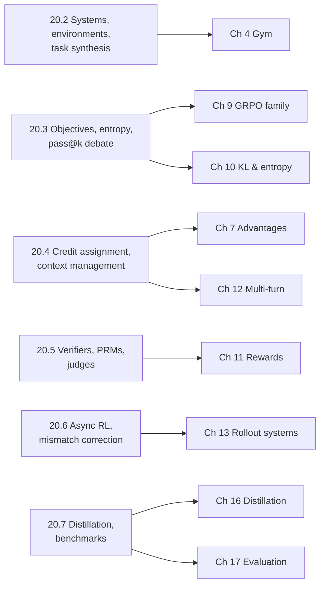

# 20. Research Frontier and Open Problems

[Chapter 19](19-capstone.md) assembled a complete training stack for TinyAgent on the BugFix gym and mapped each component to production infrastructure. The question left open is what the field is working on now: which parts of that stack are settled, which are contested, and which are being replaced. This chapter answers that question with a dated map of public research on agentic RL. It is organized by problem rather than by paper, because a reader joining a post-training team meets problems first ("our async trainer diverges", "our verifier is being gamed") and needs to know what public work bears on each one.

Research snapshot: **2026-10-13**. Every entry below gives its source, its date (arXiv v1 submission date, or the publication date of a blog or document), and what was actually inspected: the abstract only, the full text, or code or documentation at a pinned commit. Every number quoted from a paper is **author-reported**. None of these methods has been reproduced in this book at model scale; the book's own experiments are the TinyAgent runs of earlier chapters. Where we could not verify a claim against a primary source, we left it out, and the end of [Section 20.8](#208-open-problems) lists the most important exclusions. This chapter does not describe private lab recipes. A public report that one system uses a technique is evidence about that system only.

Each section ends with **What we would test**: a controlled experiment, sized for the BugFix gym and TinyAgent where possible, that would turn a reported claim into a measurement. These are proposals. None of them has been run for this chapter.

The diagram maps each section of this chapter to the chapter of the book whose mechanism it extends. Read a section after its target chapter.

## 20.1 How to read a frontier entry

A frontier entry is a claim of the form "method M, applied to model X with data D and compute C, improves metric Y on benchmark B by Δ." Each of those slots can hide a confounder, and in agentic coding work a few slots matter more than others.

The first is **which number**. Coding-agent papers report several quantities that are all called "resolve rate": single-attempt pass@1 (often averaged over several runs), Best@$k$ (sample $k$ attempts and pick one with a verifier or reranker), and pass@$k$ (any of $k$ attempts succeeds, which needs an oracle). These can differ by 15 or more points for the same model, as several entries below show. A comparison is only meaningful between identical quantities with identical harnesses.

The second is **what was trained**. Several prominent "SWE agent" results come from supervised fine-tuning on filtered trajectories rather than RL, or from single-turn RL with a non-execution reward. That does not make them less useful, but a reader who wants evidence about multi-turn RL must check.

The third is **evidence depth**. In this chapter, "abstract inspected" means we read only the abstract; "full text inspected" means we read the paper body (through an HTML rendering); "README" or "docs at SHA" means we read those files at the stated commit. A claim we only read in a search snippet does not appear.

> **Evidence.** All numbers in this chapter are reported by the cited source on the cited date. The book has not reproduced any of them. Where a source is internally inconsistent, we say so and quote the location.

## 20.2 Coding-agent systems, environments, and task synthesis

### Systems trained for repository repair

The problem these systems address is the one this book has studied in miniature: train a policy that reads, edits, and tests a repository over many turns, with a reward from executing hidden tests. The table below summarizes the public reference points. "Training" says whether the headline model was trained with multi-turn RL, single-turn RL, or supervised fine-tuning (SFT) or rejection-sampling fine-tuning (RFT).

| System (date) | Training | Reward | Author-reported SWE-bench Verified | Inspected |
| --- | --- | --- | --- | --- |
| [SWE-Gym](https://arxiv.org/abs/2412.21139) (2024-12-30) | RFT on 491 successful trajectories from stronger models | Not RL | 20.6% pass@1; 32.0% Best@16 with a trained verifier | Abstract and full text |
| [SWE-RL](https://arxiv.org/abs/2502.18449) (2025-02-25) | Single-turn GRPO on Llama-3.3-70B-Instruct | Patch similarity to the oracle patch; $-1$ for bad format | 41.0%, one patch selected from 500 samples by reranking | Abstract and full text |
| [R2E-Gym](https://arxiv.org/abs/2504.07164) (2025-04-09) | SFT on rejection-sampled trajectories | Not RL | 34.4% pass@1 (32B); 51.0% Best@26 with hybrid verifiers | Abstract and full text |
| [SkyRL-v0](https://github.com/NovaSky-AI/SkyRL/tree/a0d50c482436af7fac8caffa4533616a78431d66) (README, 2025-05-06) | Multi-turn RL (built on verl and OpenHands) | Test execution | 14B model: 18% → 21.6% | README at the v0 commit |
| [DeepSWE](https://www.together.ai/blog/deepswe) (blog, 2025-07-02) | Multi-turn RL only, from Qwen3-32B | Binary: hidden Fail2Pass and Pass2Pass tests pass within 5 minutes | 42.2% pass@1 (averaged over 16 runs); 59.0% with hybrid test-time scaling | Full blog |
| [Golubev et al.](https://arxiv.org/abs/2508.03501) (2025-08-05) | RFT, then multi-turn DAPO, Qwen2.5-72B-Instruct | Outcome only | 11% → 39% pass@1 (RFT baseline 20%) | Abstract |
| [Kimi-Dev](https://arxiv.org/abs/2509.23045) (2025-09-27) | Mid-training, SFT, then RL on the code-edit stage of a fixed workflow | 0/1 execution; separate reward for a test-writing role | 60.4% with test-time selection (48.0% at 1 patch × 1 test, from the full text); 48.6% pass@1 as a SWE-agent after further SFT | Abstract and full text |
| [SkyRL-Agent](https://arxiv.org/abs/2511.16108) (2025-11-20) | Multi-turn RL only, from Qwen3-32B | Unit tests pass | 24.4% → 39.4% pass@1 | Abstract and full text |
| [LEGO-RL](https://arxiv.org/abs/2608.17393) (2026-08-18) | Multi-turn GSPO inside existing agent harnesses | Outcome, with sandbox-side anti-hacking stages | Qwen3.5-35B-A3B: 64.0% → 70.4% in the OpenHands SDK harness | Abstract |

Three patterns stand out, and each corresponds to a mechanism from earlier chapters.

First, **public RL recipes for coding agents converged on a small set of modifications to GRPO.** The DeepSWE report describes its algorithm as GRPO plus clip-higher (from DAPO), no KL loss, no standard-deviation normalization and no length normalization (from Dr. GRPO), a leave-one-out advantage, no entropy loss, and "compact filtering", which masks trajectories that hit the maximum context, maximum steps, or timeout. SkyRL-Agent's full text describes leave-one-out advantages without standard-deviation or length normalization, fully on-policy updates, and no KL or entropy loss. These are each choices from [Chapter 7](07-advantages-and-credit.md), [Chapter 9](09-grpo-and-variants.md), and [Chapter 10](10-kl-entropy-regularization.md); the reports describe what the authors used, not controlled evidence that each choice is necessary.

Second, **truncated episodes are treated as a separate case.** DeepSWE's compact filtering masks truncated trajectories from the loss rather than assigning them reward 0, which is one answer to the timeout question in [Chapter 12](12-multi-turn-and-long-horizons.md). The alternative, scoring the final state at truncation, is discussed in [Appendix B, Problem 13](B-design-review.md#problem-13-the-agent-never-submits).

Third, **headline numbers mix single-attempt and selection results.** R2E-Gym's paper reports that execution-based and execution-free verifiers each "saturate around 42-43%" alone and reach 51% combined; DeepSWE's 59.0% likewise uses hybrid test-time scaling. The DeepSWE blog's conclusion states 59.2% while its body and table state 59.0%; we quote the body. These are verifier results, not policy results, and [Section 20.5](#205-rewards-verifiers-and-judges) returns to them.

The open-source frameworks behind these runs are cited in [Chapter 19](19-capstone.md). For this chapter we resolved: [rLLM](https://github.com/rllm-org/rllm) at `4e828c8` (the original `agentica-project/rllm` repository, archived, resolves to `7b47687`), whose README states its trainer is a modified fork of verl; [R2E-Gym](https://github.com/R2E-Gym/R2E-Gym) at `0d94c4e`; [SWE-Gym](https://github.com/SWE-Gym/SWE-Gym) at `b681068`; [SWE-RL](https://github.com/facebookresearch/swe-rl) at `5aa10d6`; and [SkyRL](https://github.com/NovaSky-AI/SkyRL) at `a1e34db`. We read READMEs only and did not audit code.

### Task synthesis and self-play

The scarce input for coding RL is not the algorithm but executable tasks: a repository snapshot, an environment that builds, a problem statement, and tests that fail before the fix and pass after it. Public work attacks this in three ways.

**Mining real history at scale.** [SWE-rebench](https://arxiv.org/abs/2505.20411) (2025-05-26, abstract) reports an automated pipeline producing "over 21,000 interactive Python-based SWE tasks" for RL, and a continuously refreshed evaluation built the same way. Its follow-up, [SWE-rebench V2](https://arxiv.org/abs/2602.23866) (2026-02-27, abstract), reports 32,079 tasks across 20 languages and 3,617 repositories. [Skywork-SWE](https://arxiv.org/abs/2506.19290) (2025-06-24, abstract) reports 10,169 validated Python task instances from 2,531 repositories and uses them for SFT. [SWE-Factory](https://arxiv.org/abs/2506.10954) (2025-06-12, abstract) uses an LLM multi-agent system to build environments and reports 337 valid instances from 671 issues at "$0.047 per instance", with exit-code-based grading at "F1 score of 0.99".

**Synthesizing bugs into working repositories.** [SWE-smith](https://arxiv.org/abs/2504.21798) (2025-04-30, abstract) inverts the mining process: build one execution environment per repository, then synthesize task instances that break existing tests. The authors report "50k instances from 128 GitHub repositories" and 40.2% pass@1 on SWE-bench Verified for their 32B model. R2E-Gym's pipeline similarly back-translates commits into problem statements and generates tests where none exist. This is the same move the BugFix gym makes with its bug families ([Chapter 4](04-environments-and-tools.md)), at repository scale.

**Self-play.** [Absolute Zero](https://arxiv.org/abs/2505.03335) (2025-05-06, abstract and full text) trains one model both to propose and to solve code-reasoning tasks, with a Python executor as verifier. Its proposer reward is a learnability signal: 0 if the solver's success rate is 0 or 1, and $1 - \text{rate}$ otherwise. This is a direct use of the observation from [Chapter 9](09-grpo-and-variants.md) that degenerate groups carry no gradient. [Self-play SWE-RL](https://arxiv.org/abs/2512.18552) (2025-12-21, abstract and full text) applies the idea to repositories: one policy acts as a bug injector, which must produce a consistent bug artifact specified by tests, and as a solver. The injector's reward is $-1$ for an inconsistent artifact, $-\alpha$ if the solve rate $s$ is 0 or 1, and $1 - (1+\alpha)s$ otherwise, with $\alpha = 0.8$; the solver's reward is $\pm 1$. The authors report gains of "+10.4 and +7.8 points" on SWE-bench Verified and SWE-Bench Pro over their starting checkpoint, above a baseline trained on human-curated data.

> **Pitfall.** A synthetic bug distribution is a training distribution. If injected bugs are systematically easier to localize than real ones (for example, because the injector edits recently touched code), the solver can learn a localization shortcut that does not transfer. The BugFix gym's held-out families exist for this reason.

**What we would test.** Build a self-play variant of the BugFix gym: TinyAgent chooses an edit op to inject a bug into a correct function (the injector), and a second rollout repairs it (the solver). Compare three task sources at a fixed number of solver episodes: the hand-authored training families, injector-generated bugs with a learnability reward, and injector-generated bugs with a uniform reward. The outcome metric is held-out family pass rate, with 5 seeds. The prediction from the learnability argument is that the learnability reward produces fewer degenerate groups per step; the open question is whether it also improves held-out transfer, or merely concentrates on bugs the solver half-knows.

## 20.3 Objectives, exploration, and the pass@k debate

### RLVR objectives as diffs against GRPO

[Chapter 9](09-grpo-and-variants.md) derives each variant in detail. Here we record what each primary source specifies, because public discussions often attribute choices to the wrong paper. GRPO as defined in [DeepSeekMath](https://arxiv.org/abs/2402.03300) (2024-02-05, full text) normalizes each sequence's per-token sum by its own length, averages over the group, puts the KL term in the loss with the $k_3$-style estimator, and uses outcome advantages $(r_i - \mathrm{mean}(r))/\mathrm{std}(r)$ shared by every token of output $i$:

$$
J_{\text{GRPO}}(\theta)=\mathbb{E}\Big[\frac{1}{G}\sum_{i=1}^{G}\frac{1}{|o_i|}\sum_{t=1}^{|o_i|}\Big(\min\big(\rho_{i,t}\hat A_{i},\ \mathrm{clip}(\rho_{i,t},1-\epsilon,1+\epsilon)\hat A_{i}\big)-\beta\,\mathbb{D}_{\text{KL}}\big[\pi_\theta\,\|\,\pi_{\text{ref}}\big]\Big)\Big]
$$

The variants, each inspected in full text unless marked:

- [Dr. GRPO](https://arxiv.org/abs/2503.20783) (2025-03-26) identifies a response-level length bias from the $1/|o_i|$ factor and a question-level difficulty bias from dividing by $\mathrm{std}(r)$, and removes both. Its authors report 43.3% on AIME 2024 with a 7B base model.
- [DAPO](https://arxiv.org/abs/2503.14476) (2025-03-18) introduces Clip-Higher ($\epsilon_{\text{low}} = 0.2$, $\epsilon_{\text{high}} = 0.28$), dynamic sampling (over-sample and drop prompts with accuracy 0 or 1), a token-level loss normalized by the total token count of the group, and overlong reward shaping (a linear penalty over a 4,096-token buffer before a 16,384-token expected maximum). It also removes the KL term. Its ablation on Qwen2.5-32B reports AIME 2024 rising from 30 (naive GRPO) to 50 as the techniques are added.
- [RLOO](https://arxiv.org/abs/2402.14740) (2024-02-22) uses the leave-one-out baseline $\frac{1}{k-1}\sum_{j \ne i} R(y_j)$ and treats the whole generation as one action.
- [GSPO](https://arxiv.org/abs/2507.18071) (2025-07-24) replaces per-token ratios with a length-normalized sequence ratio, clipped with ranges reported as $3\times10^{-4}$ and $4\times10^{-4}$:

$$
s_i(\theta)=\Big(\frac{\pi_\theta(o_i\mid x)}{\pi_{\text{old}}(o_i\mid x)}\Big)^{1/|o_i|}=\exp\Big(\frac{1}{|o_i|}\sum_{t}\log\frac{\pi_\theta(o_{i,t}\mid x,o_{i,<t})}{\pi_{\text{old}}(o_{i,t}\mid x,o_{i,<t})}\Big)
$$

  The paper reports that GRPO needed a "Routing Replay" strategy (replaying the experts selected under $\pi_{\text{old}}$) to converge on mixture-of-experts models, and that GSPO did not.
- CISPO, in the [MiniMax-M1 report](https://arxiv.org/abs/2506.13585) (2025-06-16), "clips importance sampling weights rather than token updates": the loss is $\mathrm{sg}(\hat\rho_{i,t})\hat A_{i,t}\log\pi_\theta(o_{i,t})$ with $\hat\rho$ clipped and stop-gradiented, so every token keeps a gradient. The report states a 2x speedup over DAPO in a controlled Qwen2.5-32B study.
- [VAPO](https://arxiv.org/abs/2504.05118) (2025-04-07, abstract) returns to a learned critic and reports 60.4 on AIME 2024 with a Qwen 32B base model.

Two points matter for agents specifically. The loss aggregation question ([Chapter 6](06-policy-gradient.md)) is sharper for agent trajectories than for math, because policy-token counts vary by an order of magnitude across episodes and correlate with success. And sequence-level ratios like GSPO's change what "trust region" means for a 50-turn trajectory: a geometric mean over thousands of tokens is near 1 even when a few tokens moved a great deal. Almost all of the evidence above comes from single-turn math reasoning with Qwen-family base models. DeepSWE and LEGO-RL are public reports that applied some of these choices (DAPO/Dr. GRPO modifications, GSPO) to coding agents, but neither is a controlled comparison of the objectives.

**What we would test.** On the BugFix gym, run GRPO, Dr. GRPO, DAPO's token-level loss with clip-higher, and a GSPO-style sequence ratio, holding the sample budget fixed, with 5 seeds each. Log policy-token length separately for successes and failures, clip fraction, and held-out pass rate. The mechanism-level prediction is that GRPO's $1/|o_i|$ normalization lengthens failures relative to Dr. GRPO; the open question is whether GSPO's geometric-mean ratio under-constrains long multi-turn episodes, which can be tested by injecting a large change at a few tokens and checking whether the clip activates.

### Exploration and entropy

[The Entropy Mechanism of RL for Reasoning LMs](https://arxiv.org/abs/2505.22617) (2025-05-28, full text) reports an empirical fit $R = -a e^{H} + b$ between validation performance and policy entropy, implying a performance ceiling when entropy is exhausted, and derives that for a softmax policy trained by vanilla policy gradient the entropy change per step is approximately

$$
H(\pi^{k+1}\mid s)-H(\pi^{k}\mid s)\approx-\eta\,\mathrm{Cov}_{a\sim\pi^{k}}\big(\log\pi^{k}(a\mid s),\ \pi^{k}(a\mid s)A(s,a)\big)
$$

so entropy falls whenever high-probability actions also have high advantage. The authors propose Clip-Cov and KL-Cov, which detach or penalize a small set of high-covariance tokens, and report average gains over GRPO across seven math benchmarks. [Beyond the 80/20 Rule](https://arxiv.org/abs/2506.01939) (2025-06-02, abstract) reports that restricting policy-gradient updates to the 20% highest-entropy "forking" tokens matches full updates on Qwen3-8B and exceeds them on 14B and 32B. [Reasoning with Exploration](https://arxiv.org/abs/2506.14758) (2025-06-17, abstract) adds an entropy-based term to the advantage. For agents specifically, [ARPO](https://arxiv.org/abs/2507.19849) (2025-07-26, abstract) reports that token entropy rises immediately after tool responses and branches extra rollouts at those high-uncertainty points.

The ARPO observation matters for this book's setting. Tool outputs are observations the policy did not generate ([Chapter 5](05-trajectories-and-templates.md)), so the policy's uncertainty is naturally highest just after them. That is where exploration budget is cheapest to spend and where entropy collapse is most damaging.

**What we would test.** Measure TinyAgent's per-token entropy as a function of position relative to the most recent tool observation, at initialization and after GRPO training. If the ARPO pattern holds in miniature, entropy should peak at the first policy token after an observation. Then compare a uniform entropy bonus with a bonus applied only to the first $m$ policy tokens after each observation, matching total entropy. The outcome metrics are pass@1 and pass@8 on held-out families.

### Does RL expand capability beyond the base model's pass@k?

This is the most cited open question in RLVR, and it maps directly onto the measurement in [Chapter 17](17-evaluation.md). [Yue et al.](https://arxiv.org/abs/2504.13837) (2025-04-18, full text) report that RLVR-trained models win at small $k$ but "base models achieve a higher pass@k score when k is large", that coverage at pass@256 decreases as RLVR proceeds, and that six RLVR algorithms they re-implemented "perform similarly" in this respect, while distillation "can introduce new reasoning patterns". [The Invisible Leash](https://arxiv.org/abs/2507.14843) (2025-07-20, abstract) argues that RLVR is support-constrained and that support shrinkage generally outweighs expansion.

The counter-evidence is also public. [ProRL](https://arxiv.org/abs/2505.24864) (2025-05-30, full text), with more than 2,000 steps, reference-policy resets, and DAPO components, reports RL models outperforming base models "across a wide range of pass@k evaluations, including scenarios where base models fail entirely". [RLVR Implicitly Incentivizes Correct Reasoning](https://arxiv.org/abs/2506.14245) (2025-06-17, abstract) argues that pass@$k$ on answers is the wrong metric and that a CoT-Pass@$k$ requiring correct reasoning shows boundary extension. [Pass@k Training](https://arxiv.org/abs/2508.10751) (2025-08-14, abstract) uses group pass@$k$ itself as the reward. [RL Squeezes, SFT Expands](https://arxiv.org/abs/2509.21128) (2025-09-25, abstract) characterizes RL as compressing incorrect trajectories and SFT as expanding correct ones.

Two further results complicate the interpretation of RLVR gains on particular base models. [Spurious Rewards](https://arxiv.org/abs/2506.10947) (2025-06-12, abstract) reports a 21.4-point MATH-500 gain for Qwen2.5-Math-7B with randomly assigned rewards, against 29.1 points with ground-truth rewards, and attributes it to a clipping bias that amplifies pretraining priors; the effect often fails on Llama3 and OLMo2. [One-shot RLVR](https://arxiv.org/abs/2504.20571) (2025-04-29, abstract) reports large gains from a single training example. Neither paper concerns coding agents. Both are reasons to require a non-Qwen control and a random-reward control before attributing a gain to the reward.

Our reading, labeled as interpretation: the claims are not directly contradictory. They differ in training length, regularization, base model, metric, and task family. None of the papers above measures multi-turn coding agents, where the action space includes information gathering and a small policy change can open a new region of the environment. Whether agentic RL behaves like math RLVR here is open.

**What we would test.** Train TinyAgent with GRPO for 3 lengths (short, medium, long) and with and without reference resets, then compute the unbiased pass@$k$ curve for $k \in \{1, 2, 4, \dots, 256\}$ on held-out families for the initial and trained policies ([Chapter 17](17-evaluation.md)). Add a random-reward control at the same budget. The test is whether the crossing point (if any) moves to larger $k$ with longer training, and whether the random-reward control changes pass@1 at all on a model with no pretraining prior.

## 20.4 Long horizons: credit assignment and context management

### Turn-level credit assignment

Outcome-only advantages give every policy token in a 50-turn episode the same signal ([Chapter 7](07-advantages-and-credit.md)). That is unbiased but noisy, and it rewards useless steps in successful episodes as much as the decisive edit. Public work offers four families of alternatives.

**Hierarchical value methods.** [ArCHer](https://arxiv.org/abs/2402.19446) (2024-02-29, abstract) trains an off-policy, utterance-level critic and uses it to train the token policy within each turn, and reports about 100x sample efficiency over existing methods. [SWEET-RL](https://arxiv.org/abs/2503.15478) (2025-03-19, abstract) trains a step-level critic that has access to training-time information the policy does not see, and reports a 6% absolute improvement on its collaborative coding benchmark, ColBench.

**Critic-free step groups.** [GiGPO](https://arxiv.org/abs/2505.10978) (2025-05-16, full text) keeps GRPO's episode-level groups and adds step-level groups formed retroactively from *anchor states*: identical environment states reached by different trajectories in the same group. Within an anchor-state group, actions are compared by their discounted return from that state ($\gamma = 0.95$), and the final advantage is $A = A^{E} + \omega A^{S}$ with $\omega = 1$. The authors report gains of more than 12% on ALFWorld and more than 9% on WebShop over GRPO at the same rollout cost. The method depends on states recurring exactly; the paper uses a similarity threshold for search tasks where they do not.

**Reward structure.** [Wei et al.](https://arxiv.org/abs/2505.11821) (2025-05-17, abstract; the current title is "Reinforcing Multi-Turn Reasoning in LLM Agents via Fine-Grained Reward Structure and Credit Assignment") derive GRPO and PPO variants for terminal, delayed, and per-turn reward MDPs and report that dense per-turn rewards outperform sparse terminal rewards on their search and game tasks.

**Model-derived turn rewards.** [TRACE](https://arxiv.org/abs/2607.13988) (2026-07-15, abstract) converts a frozen reference model's log-probability of the gold answer into state values at tool-call boundaries and uses their temporal differences as per-action rewards, with no critic training; the authors report large gains on BrowseComp-Plus. [SWE-MILE](https://arxiv.org/abs/2609.32631) (2026-09-26, abstract) is the most direct attempt for coding agents: potentials based on file exposure and test-state alignment, differences of which credit individual actions, with verification run asynchronously in a shadow sandbox. Its abstract gives no numbers, and it is two weeks old at the time of writing.

[RAGEN](https://arxiv.org/abs/2504.20073) (2025-04-24, full text) is a diagnostic rather than a credit method: it names an "Echo Trap" failure in multi-turn agent RL, in which reward variance collapses and gradient norms spike, and reports that keeping only high-variance prompts, removing KL, and clip-higher mitigate it. For agents, the shaping proof from [Chapter 11](11-rewards-and-verifiers.md) is the relevant theory: potential-based terms like SWE-MILE's preserve the optimal policy only if they have the form $\gamma\Phi(s') - \Phi(s)$.

**What we would test.** The BugFix gym has exact anchor states (the source string after each edit), so GiGPO's grouping applies without approximation. Compare outcome-only GRPO, GiGPO-style step groups, and a potential-based shaping term $\Phi(s) = $ fraction of public tests passing, with 5 seeds. Measure held-out pass rate and the mean number of redundant actions (repeated `read` or no-op edits) per successful episode. The prediction is that step-level credit reduces redundant actions; the risk to watch is that the shaping potential, which uses public tests, increases the rate of `hardcode_tests`.

### Context management for long episodes

A 50-turn episode with long tool outputs exceeds any fixed context budget. Truncation, summarization, and memory all change the policy's input distribution ([Chapter 12](12-multi-turn-and-long-horizons.md)), and the recent question is whether the context-management behavior itself should be learned with RL.

- [MEM1](https://arxiv.org/abs/2506.15841) (2025-06-18, abstract) trains the agent to maintain a compact internal state, rewriting it each turn and discarding the rest, and reports a 3.5x performance gain and 3.7x memory reduction against a larger model on a 16-objective multi-hop QA task.
- [SUPO](https://arxiv.org/abs/2510.06727) (2025-10-08, abstract) has the policy periodically summarize its tool-use history and derives a policy gradient that optimizes the tool-use and summarization behavior end to end with standard infrastructure.
- [Context-Folding](https://arxiv.org/abs/2510.11967) (2025-10-13, abstract) lets the agent branch into a sub-trajectory and fold it into a summary when done, trained with process rewards, and reports matching or exceeding ReAct baselines with a 10x smaller active context.
- [ReSum](https://arxiv.org/abs/2509.13313) (2025-09-16, abstract) summarizes periodically and broadcasts the final advantage to all segments.
- [FoldAct](https://arxiv.org/abs/2512.22733) (2025-12-28, abstract) states the problem precisely: summaries "fundamentally modify the agent's future observation space, creating a policy-dependent, non-stationary observation distribution".
- [CAMG-RL](https://arxiv.org/abs/2609.34422) (2026-09-28, abstract) uses ordinary files in a persistent workspace as memory for coding agents and trains with asynchronous PPO.

FoldAct's sentence identifies the training-correctness issue. When the policy writes its own summary, the summary tokens are actions, the later turns condition on them, and a sequence that a trainer reconstructs from the full history is not the sequence the policy saw. The token-in, token-out discipline of [Chapter 5](05-trajectories-and-templates.md) must be applied per segment: each segment is trained on exactly the context the sampler used.

**What we would test.** Give TinyAgent a context budget smaller than a full episode, and compare three treatments with matched budgets: drop the oldest observations, replace each tool output with a fixed-format digest produced by the environment, and let the policy emit a `note` action whose text replaces the history. Measure pass rate and, as a correctness check, the maximum per-token log-probability difference between the sampler and a trainer that reconstructs each segment; it should be zero up to numerics if segments are stored correctly.

## 20.5 Rewards, verifiers, and judges

The problem is the one [Chapter 11](11-rewards-and-verifiers.md) reproduces: any reward other than the deployment objective can be exploited, and execution-based rewards are not available for every task.

**Process reward models.** [Let's Verify Step by Step](https://arxiv.org/abs/2305.20050) (2023-05-31, abstract) compares outcome and human-labeled process supervision for reward models used in best-of-N and releases 800,000 step labels. [Math-Shepherd](https://arxiv.org/abs/2312.08935) (2023-12-14, abstract) builds process labels automatically and uses them for step-by-step PPO. [PRIME](https://arxiv.org/abs/2502.01456) (2025-02-03, abstract) updates an implicit process reward model online from policy rollouts and outcome labels only. All three were developed on math. For coding agents, a "step" is a turn with an observable effect on the repository, which makes process signals easier to define and also easier to game.

**Verifiers for coding agents.** R2E-Gym's full text distinguishes an *execution-based* verifier (a trained agent writes reproduction tests and patches are scored by passing them) from an *execution-free* verifier (a model reads the issue, trajectory, and patch and outputs a probability of correctness), and reports that "test-based verifiers suffer from low distinguishability, while execution-free verifiers are biased and often rely on stylistic features", with the hybrid at 51.0%. [SWE-RM](https://arxiv.org/abs/2512.21919) (2025-12-26, abstract) makes an observation that matters for RL: "two verifiers with nearly identical TTS performance can nevertheless yield very different results in RL", because calibration and classification accuracy matter for a training reward and not only ranking. Kimi-Dev trains a test-writing role rewarded when its test fails without the fix and passes with it, which is a verifiable reward for verifier construction. SWE-RL's similarity reward is a non-execution reward that scales to millions of pull requests but rewards resemblance to the oracle patch rather than correctness.

**LLM judges.** [Agent-as-a-Judge](https://arxiv.org/abs/2410.10934) (2024-10-14, abstract) uses an agent to judge agent work against hierarchical requirements. [Rubrics as Rewards](https://arxiv.org/abs/2507.17746) (2025-07-23, abstract) aggregates instance-specific rubric items into a reward and reports improvements over Likert-scale judge rewards. [One Token to Fool LLM-as-a-Judge](https://arxiv.org/abs/2507.08794) (2025-07-11, abstract) shows the failure mode: "master keys" such as a lone colon or "Let's solve this problem step by step." elicit false positives from judges, including in reference-based RLVR grading. LEGO-RL's abstract reports that "environmental crashes and reward hacking corrupt outcome signals" in real harnesses and describes stage-wise sandbox defenses.

Our interpretation: the frontier question is not "verifier or judge" but how to combine an exploitable dense signal with a sparse trusted one, and how to measure whether the dense signal is being exploited during training rather than after it.

**What we would test.** In the BugFix gym, build a toy execution-free verifier: a small classifier on the final source that predicts hidden-test success, trained on scripted-policy outputs. Train TinyAgent against (a) hidden tests, (b) the classifier, and (c) a hybrid that requires both. Plot the classifier reward and the hidden pass rate on shared axes, as in [Chapter 11](11-rewards-and-verifiers.md). The prediction is that (b) diverges, and the measurement of interest is how many steps pass before divergence becomes visible, and whether classifier calibration on held-out data predicts it.

## 20.6 Asynchronous RL and training–inference mismatch

[Chapter 13](13-rollout-systems.md) explains why synchronous rollout wastes accelerators when episode lengths have a long tail, and why the sampler's probabilities $\mu$ differ from the trainer's $\pi_{\text{old}}$ even with identical weights. This is the most active area of public systems work, and it is where the most detailed public engineering documentation exists.

**Asynchronous designs.** [AReaL](https://arxiv.org/abs/2505.24298) (2025-05-30, full text) decouples generation from training entirely. Rollouts are interruptible: when new weights arrive, workers discard KV caches, recompute them under the new weights, and continue, so one trajectory may span several policy versions. A staleness bound $\eta$ throttles generation: with $N_r$ trajectories generated so far, batch size $B$, and current policy version $i$, generation proceeds only while $\lfloor (N_r - 1)/B \rfloor \le i + \eta$, so $\eta = 0$ is synchronous RL (defaults reported as 4 for code and 8 for math). The objective is a *decoupled PPO* loss that separates the behavior policy from a proximal policy:

$$
J(\theta)=\mathbb{E}_{a\sim\pi_{\text{behav}}}\Big[\frac{\pi_{\text{prox}}(a)}{\pi_{\text{behav}}(a)}\min\big(u(a)\hat A,\ \mathrm{clip}(u(a),1-\epsilon,1+\epsilon)\hat A\big)\Big],\qquad u(a)=\frac{\pi_\theta(a)}{\pi_{\text{prox}}(a)}
$$

The abstract reports "up to 2.77× training speedup" over synchronous systems; the introduction says "up to 2.57×". [PipelineRL](https://arxiv.org/abs/2509.19128) (2025-09-23, full text) updates weights in flight and deliberately keeps the stale KV cache, training with importance-weighted REINFORCE truncated at 5. [Magistral](https://arxiv.org/abs/2506.10910) (2025-06-12, full text) also continues generation across weight broadcasts without refreshing the KV cache, and describes no separate importance correction. [Kimi k1.5](https://arxiv.org/abs/2501.12599) (2025-01-22, full text) caps each rollout's token budget and saves the unfinished part to a replay buffer for the next iteration ("partial rollout"). [LlamaRL](https://arxiv.org/abs/2505.24034) (2025-05-29, abstract) and [ROLL Flash](https://arxiv.org/abs/2510.11345) (2025-10-13, abstract) report asynchronous speedups at larger scale; ROLL Flash reports "2.72x on agentic tasks". [SkyRL-Agent](https://arxiv.org/abs/2511.16108) reports a 1.55x speedup from its asynchronous dispatcher for multi-turn agents.

**Mismatch corrections.** The blog post [Your Efficient RL Framework Secretly Brings You Off-Policy RL Training](https://fengyao.notion.site/off-policy-rl) (Yao, Liu, et al., first published 2025-08-05, full text) states the problem for synchronous systems: rollouts come from an inference engine, gradients from a training engine, and the two disagree. It proposes truncated importance sampling (TIS):

$$
\nabla_\theta J \approx \mathbb{E}_{a\sim\pi_{\text{sampler}}}\Big[\min\Big(\frac{\pi_{\text{learner}}(a)}{\pi_{\text{sampler}}(a)},\,C\Big)\,R(a)\,\nabla_\theta\log\pi_{\text{learner}}(a)\Big]
$$

with $C$ a hyperparameter (the companion Flash-RL README uses $C = 2$ and $C = 8$ in its example commands). The post also reports that where the probability difference is small, TIS brings no gain. [When Speed Kills Stability](https://yingru.notion.site/When-Speed-Kills-Stability-271211a558b7808d8b12d403fd15edda) (Liu, Li, et al., first published 2025-09-17, partially read) reports that the mismatch concentrates on low-probability tokens and on turns after tool responses, argues that token-level correction is biased while sequence-level correction has exponential variance, and proposes sequence-level masking variants. Its follow-up, [Trust Region Masking](https://arxiv.org/abs/2512.23075) (2025-12-28, abstract), masks whole sequences that violate a trust region, motivated by bounds that grow with horizon length. The [Ring-1T report](https://arxiv.org/abs/2510.18855) (2025-10-21, full text) proposes IcePop, which zeroes the gradient of tokens whose train/inference ratio falls outside $[0.5, 5]$, and reports that a narrower band destabilized training. The MiniMax-M1 report states that computing the LM head in FP32 raised the train/inference probability correlation "from approximately 0.9x to 0.99x".

**Removing the mismatch at the source.** [Defeating Nondeterminism in LLM Inference](https://thinkingmachines.ai/blog/defeating-nondeterminism-in-llm-inference/) (Thinking Machines, 2025-09-10, full text) attributes run-to-run variation mainly to a lack of batch invariance in kernels (RMSNorm, matmul, attention), reports 80 unique completions from 1,000 identical temperature-0 requests to a large model without batch-invariant kernels, and reports that with a bitwise-identical sampler and trainer the measured KL in an RL run was 0.

**Framework designs, at pinned commits.** verl at [`76e837e`](https://github.com/volcengine/verl/tree/76e837e0bfcb18b380a66c0ba56ef9f0ac840f09) documents a [one-step off-policy mode](https://github.com/volcengine/verl/blob/76e837e0bfcb18b380a66c0ba56ef9f0ac840f09/docs/advance/one_step_off.md) that overlaps rollout for step $n+1$ with training on step $n$, a [fully asynchronous mode](https://github.com/volcengine/verl/blob/76e837e0bfcb18b380a66c0ba56ef9f0ac840f09/docs/advance/fully_async.md) with a `staleness_threshold` and partial rollouts, and a [rollout correction](https://github.com/volcengine/verl/blob/76e837e0bfcb18b380a66c0ba56ef9f0ac840f09/docs/algo/rollout_corr.md) module whose presets include token- and sequence-level truncated IS with threshold 2.0 and an IcePop-style band of $[0.5, 5.0]$. [slime](https://github.com/THUDM/slime/tree/05e3b017fed9e02de418c2fbac9d75602a534be5) at `05e3b01` connects Megatron training to SGLang rollout through a data buffer with custom generation functions for multi-turn and tool loops. [OpenRLHF](https://github.com/OpenRLHF/OpenRLHF/tree/dc2a7ad326f619fc5a47737ea47d1920ce2c0b53) at `dc2a7ad` documents an async mode with a queue-size staleness control, partial rollouts in which "in-flight samples may contain tokens from both old and new weights", and token- or sequence-level IS correction in mask or clip modes. We read documentation and READMEs only.

> **In production.** The public designs disagree on a basic question: when weights change mid-episode, should the KV cache be recomputed (AReaL) or kept stale (PipelineRL, Magistral)? Recomputing costs prefill; keeping it means later tokens were sampled from a distribution no single policy defines, which an importance ratio computed against one policy does not describe exactly. This is unresolved in the public record.

**What we would test.** Extend the discrete-event simulator of [Chapter 13](13-rollout-systems.md) with real TinyAgent updates: a synchronous baseline, staleness bounds of 1, 2, and 4 steps, and for each, no correction, token-level TIS with $C = 2$, and sequence-level masking. Inject a controlled sampler–trainer mismatch by sampling at a slightly different temperature than the trainer assumes. Measure wall-clock-to-target pass rate, the fraction of capped ratios, and stability across 5 seeds. The prediction from [Chapter 8](08-ppo.md) is that token-level correction degrades with episode length; the BugFix gym lets us vary length by changing the turn budget.

## 20.7 Distillation and evaluation

### On-policy distillation

[Chapter 16](16-distillation.md) derives on-policy distillation: the student samples, the teacher scores each student token, and the per-token reverse KL is a dense reward. The early primary sources are [GKD](https://arxiv.org/abs/2306.13649) (2023-06-23, abstract), which trains on self-generated sequences with teacher feedback and allows alternative divergences, and [MiniLLM](https://arxiv.org/abs/2306.08543) (2023-06-14, abstract), which replaces forward KL with reverse KL optimized on-policy. The [Qwen3 Technical Report](https://arxiv.org/abs/2505.09388) (2025-05-14, full text) describes an off-policy then on-policy distillation stage for smaller models and, in its Table 21, reports for Qwen3-8B that on-policy distillation reached 74.4 on AIME'24 using 1,800 GPU hours, against 67.6 for RL using 17,920 GPU hours from the same starting checkpoint. Thinking Machines' [On-Policy Distillation](https://thinkingmachines.ai/blog/on-policy-distillation/) post (Kevin Lu et al., 2025-10-27, full text) sets the per-token advantage to the negative reverse KL and reports compute reductions relative to SFT of "9-30×" depending on accounting.

Agentic extensions are recent and abstract-checked only. [TCOD](https://arxiv.org/abs/2604.24005) (2026-04-27) names a "Trajectory-Level KL Instability" in multi-turn distillation and grows the trajectory depth the student is exposed to as a curriculum. [ReOPD](https://arxiv.org/abs/2607.04763) (2026-07-06) replays teacher-trajectory prefixes to avoid running tools during student training, and identifies a "prefix trap". The earlier version of this chapter tracked sparse-vocabulary and position-selection proposals for on-policy distillation; those entries remain in [sources.md](../sources.md).

The agent-specific question is what the teacher scores. Tool observations are not student actions, so they receive no distillation signal, but the student's prefix includes them, and a teacher conditioned on a student's unusual tool history may itself be off-distribution. That is a version of the compounding-error argument in [Chapter 16](16-distillation.md) that single-turn results cannot settle.

**What we would test.** Using the trained TinyAgent from [Chapter 9](09-grpo-and-variants.md) as the teacher, compare on-policy distillation into a fresh student with GRPO from scratch at matched student-sample budgets, and measure the teacher's own per-token entropy on student prefixes as a function of how far the student has strayed (number of turns since the student's first non-teacher action). The question is whether teacher reliability degrades with student divergence quickly enough to cap on-policy distillation's advantage in long episodes.

### Benchmarks, contamination, and validity

The evaluation problem is that a benchmark score is the product of a model, a harness, a test suite, and the history of what the model was trained on, and each factor has known defects.

**The SWE-bench family.** [SWE-bench](https://arxiv.org/abs/2310.06770) (2023-10-10, abstract) contains 2,294 issues from 12 Python repositories. [SWE-bench Verified](https://huggingface.co/datasets/princeton-nlp/SWE-bench_Verified) is, per its dataset card, "a subset of 500 samples from the SWE-bench test set, which have been human-validated for quality". [SWE-bench Multimodal](https://arxiv.org/abs/2410.03859) (2024-10-04) and [Multi-SWE-bench](https://arxiv.org/abs/2504.02605) (2025-04-03) extend to JavaScript and to seven further languages. [SWE-Bench Pro](https://arxiv.org/abs/2509.16941) (2025-09-21, full text) has 1,865 problems from 41 repositories and resists contamination by using strong-copyleft repositories and a held-out commercial set; it reports public-set pass@1 of 23.3% for GPT-5 and 22.7% for Claude Opus 4.1. [SWE-bench-Live](https://arxiv.org/abs/2505.23419) (2025-05-29) and SWE-rebench keep refreshing with tasks created after model training cutoffs.

**Agent terminals and contests.** [Terminal-Bench](https://arxiv.org/abs/2601.11868) (2026-01-17, abstract) has 89 tasks in terminal environments and reports frontier models and agents below 65%. [LiveCodeBench](https://arxiv.org/abs/2403.07974) (2024-03-12) controls contamination by problem release date.

**Documented validity problems.**

- *Solution leakage and weak tests.* [SWE-Bench+](https://arxiv.org/abs/2410.06992) (2024-10-09, abstract) reports that 32.67% of successful patches in its analysis involved the solution being present in the issue report or comments, and that 31.08% passed because of weak tests. [UTBoost](https://arxiv.org/abs/2506.09289) (ACL 2025, abstract) reports finding 36 task instances with insufficient tests and 345 erroneous patches labeled as passed.
- *Memorization.* [The SWE-Bench Illusion](https://arxiv.org/abs/2506.12286) (2025-06-14, abstract) reports models identifying buggy file paths from the issue text alone with up to 76% accuracy on SWE-bench, against up to 53% on repositories outside it.
- *Repository-state leaks.* [SWE-bench issue #465](https://github.com/SWE-bench/SWE-bench/issues/465) (opened 2025-09-03, closed 2026-03-24) documents agents finding the fixing commit through `git log --all` in task containers. The maintainers estimated the prevalence as about 5 in 10,000 trajectories and rebuilt the Verified images to remove future history. [SWE-Bench Pro Verified](https://arxiv.org/abs/2609.08149) (2026-09-08, partial full text) reports that deleting references is insufficient because later commits can be recovered from residual Git objects, and rebuilds each repository as a single fresh commit.
- *Tests versus mergeability.* A [METR research note](https://metr.org/notes/2026-03-10-many-swe-bench-passing-prs-would-not-be-merged-into-main/) (2026-03-10, full text) had four maintainers review 296 AI-generated patches from SWE-bench Verified runs and reports a grader pass rate about 24 percentage points above the maintainer merge rate, with caveats the authors list (one attempt, no feedback loop, 3 of 12 repositories).

These defects matter for RL more than for SFT, because RL optimizes against whatever the reward actually measures, and the training environments are often built from the same repositories and tooling as the benchmark. A leak that affects 5 in 10,000 evaluation trajectories can be found and amplified by a policy that is rewarded for finding it.

**What we would test.** Plant a leak in the BugFix gym: a `history` tool that, for one family only, returns the fixed source. Train TinyAgent with and without the tool and measure how many steps it takes for the leak to dominate that family's successes, then test whether the per-family learning-speed alarm from [Appendix B, Problem 11](B-design-review.md#problem-11-hidden-tests-leak-through-the-environment) catches it before the leak's success share exceeds 50%.

## 20.8 Open problems

These are problems on which, as of 2026-10-13, we found no public consensus. Each is stated as a question a reader could contribute to.

1. **Credit assignment without exact state recurrence.** Anchor-state methods need repeated states; learned critics are hard to train for language agents; model-derived potentials inherit the model's biases. Is there a critic-free turn-level estimator for repository repair, where states almost never recur exactly, that is demonstrably lower-variance than outcome advantages and not exploitable?
2. **Off-policy correction at agent horizons.** Token-level importance weights are biased, sequence-level weights explode with length, and episodes are getting longer. Which correction keeps bias and variance bounded for 50-turn, 64k-token episodes with stale KV caches, and how should it interact with PPO clipping?
3. **Learning context management.** When the policy writes its own summaries or memory, its observation distribution depends on its parameters. What is the correct gradient through that dependence, and do current segment-wise estimators converge to it?
4. **Verifiers that stay calibrated under optimization.** A verifier's accuracy on a fixed set does not predict its behavior as a training reward (the SWE-RM observation). How should verifier quality be measured for RL, and how often must it be refreshed?
5. **Task supply.** Mining and synthesis both produce tasks whose difficulty and distribution differ from deployment. Self-play gives a curriculum but may drift toward bugs that are easy to inject and verify. What task distribution maximizes transfer to real issues per GPU-hour?
6. **Whether agentic RL expands capability.** The pass@$k$ debate has been conducted on math. Does multi-turn RL with tools behave the same way, or does information-gathering behavior let it reach states the base model never visits?
7. **Benchmarks that measure what deployment needs.** Tests are a proxy for correctness, and correctness is a proxy for mergeability. Can a benchmark keep pace with RL-trained agents without becoming the training reward?

Items we excluded because we could not verify them against a primary source on 2026-10-13: the content of OpenAI's SWE-bench Verified announcement and its 2026 post about discontinuing that benchmark (the pages returned HTTP 403; we cite the dataset card instead); the contents of the SkyRL-v0 blog (the page did not render); table-level numbers for SUPO and Context-Folding (only secondary summaries were available); a claimed RL result for SWE-RM that was not in its abstract; the absolute scores of Self-play SWE-RL (shown only in a figure); several 2026 multi-turn distillation preprints seen only in search results; a reported adoption of sequence masking by a 2025 model release, seen only in a blog's update log; and an audit statistic about solution-seeking behavior on SWE-bench Multilingual for which we found no primary source.

## 20.9 Design problems in practice

> **Problem: deciding which frontier idea to adopt.** *Symptom:* a team has a working GRPO-based coding-agent recipe and a list of ten recent preprints, each reporting a gain. *Cause:* reported gains are measured on different base models, task families (mostly math), metrics, and budgets, so they cannot be ranked against each other or against the team's baseline. *Options:* adopt the method with the largest reported gain (cheap to decide, frequently wrong); reproduce each paper's headline setting (expensive, and confirms only the paper's setting); or rank ideas by whether they address a failure the team has *measured* in its own runs (entropy collapse, truncation rate, mismatch tail, verifier exploitation) and test the mechanism at small scale first. *Default:* the book recommends the third. Write down the dashboard symptom the idea should fix, reproduce that symptom in a small environment such as the BugFix gym, check that the idea changes the symptom, and only then run a matched ablation at scale with a paired evaluation ([Chapter 17](17-evaluation.md)).

> **Problem: reading an author-reported gain.** *Symptom:* a paper reports "+15 points on SWE-bench Verified". *Cause:* the number may compare Best@$k$ to pass@1, a tuned method to an untuned baseline, a different harness, or a model whose training data overlaps the benchmark repositories. *Options:* check the metric definition and sample count; check whether the baseline received equal tuning and compute; check the number of seeds and whether the gain exceeds seed spread; check whether the gain replicates on a second, more recent benchmark (SWE-bench-Live, SWE-rebench, SWE-Bench Pro); check decontamination. *Default:* treat the gain as a hypothesis until the metric is single-attempt pass@1 under the same harness, the baseline is matched, and at least one fresh benchmark agrees. The DeepSWE, R2E-Gym, and SWE-Gym rows in [Section 20.2](#202-coding-agent-systems-environments-and-task-synthesis) show differences of about 11 to 17 points between pass@1 and verifier-selected numbers for the same model.

> **Problem: a math-RLVR trick does not transfer to the agent.** *Symptom:* a change that the source paper reports as helping on AIME (for example, a narrower clip range, or updating only high-entropy tokens) has no effect or hurts on the coding agent. *Cause:* agent trajectories differ from single-turn math in ways that touch the mechanism: observation tokens interleave with policy tokens, entropy spikes after tool outputs, lengths vary by an order of magnitude, and rewards depend on environment state. *Options:* drop the change; adapt it to the agent structure (for example, compute entropy statistics only over policy tokens, separately for tokens right after observations); or test it first on a single-turn coding task to separate the "coding" effect from the "multi-turn" effect. *Default:* the book recommends the third, because it tells you which property of the agent setting broke the mechanism.

> **Problem: switching to an asynchronous framework changes results.** *Symptom:* moving from synchronous rollout to an async framework raises throughput by the expected factor, but final held-out pass rate drops by a few points. *Cause:* staleness and the sampler–trainer mismatch now enter the gradient; the default correction (or none) may not match the episode lengths; or the scheduler biases the trained batch toward short episodes. *Options:* tighten the staleness bound (costs throughput); enable truncated importance correction and log the capped fraction; compare the length distribution of trained episodes against launched episodes. *Default:* run both systems to the same number of *samples* with the same seeds, and compare pass rate against samples as well as against wall-clock. If the async run is worse per sample, measure the capped-ratio fraction and the length bias before tuning anything else ([Chapter 13](13-rollout-systems.md)).

## Summary

- Public coding-agent RL systems (DeepSWE, SkyRL-Agent, and others) report converging on a small set of GRPO modifications: leave-one-out or mean baselines without standard-deviation or length normalization, clip-higher, no KL, and special treatment of truncated episodes. Several prominent "SWE agent" results are SFT or single-turn RL rather than multi-turn RL.
- Headline coding-agent numbers mix single-attempt pass@1 with verifier-selected Best@$k$; the gap between them is often larger than the gap between methods.
- The most active open areas are turn-level credit assignment, off-policy correction for long asynchronous episodes, learned context management, verifiers that remain reliable under optimization, and task synthesis by mining, injection, or self-play.
- Most algorithmic evidence (objective variants, entropy, the pass@$k$ debate) comes from single-turn math with Qwen-family base models. Its transfer to multi-turn coding agents is largely untested in public work.
- SWE-style benchmarks have documented defects: solution leakage, weak tests, memorization, repository-history leaks, and a gap between passing tests and mergeable patches. RL amplifies whatever defect the reward shares with them.
- Every number in this chapter is author-reported as of 2026-10-13. Each section proposes a controlled experiment that would turn a claim into a measurement at BugFix-gym scale.

## Exercises

1. Pick one row of the table in [Section 20.2](#202-coding-agent-systems-environments-and-task-synthesis). From the primary source, extract the base model, training type, reward, metric definition, number of samples, and harness. Write two sentences on what the reported number does and does not establish.
2. Change an assumption: in the GSPO sequence ratio, replace the length-normalized geometric mean with the unnormalized product $\prod_t \rho_t$. For a 2,000-token trajectory in which every token ratio is $1.001$, compute both quantities, and explain which clipping range each would need.
3. Using the AReaL staleness condition, derive how many trajectories may be generated ahead of training for $\eta = 2$ and a batch size of 512, and explain what happens to throughput when $\eta = 0$.
4. Implement the GiGPO step-level advantage for the BugFix gym, using the exact source string after each edit as the anchor state. On a batch of 64 trajectories from the scripted random policy of [Chapter 4](04-environments-and-tools.md), report how many anchor-state groups contain more than one action.
5. Design review: your lead proposes adopting a learned execution-free verifier as the sole RL reward for a new task family without tests. Using [Section 20.5](#205-rewards-verifiers-and-judges), write the case against, the conditions under which you would accept it, and the metrics you would require on the dashboard.
6. Choose one "What we would test" proposal from this chapter. Write a pre-registration: hypothesis, metric, seeds, sample budget, and the result that would falsify the hypothesis. Then run it on TinyAgent if your machine allows, and report whether the outcome matched.
7. Pick one open problem from [Section 20.8](#208-open-problems) and search for work published after 2026-10-13 that addresses it. Record what you inspected, using the evidence levels of [Section 20.1](#201-how-to-read-a-frontier-entry).
