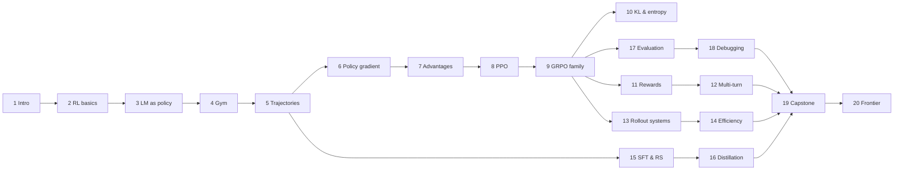

# Book outline and library contract

This file assigns scope, required design problems, figures, and the saved `agentrl` API for every chapter. Authors may add material, but they must cover everything listed here and must keep saved names and signatures stable once another chapter depends on them. [The editorial guide](editorial-guide.md) governs style.

## The running system

The book builds one system and grows it chapter by chapter.

- **BugFix gym** (Chapter 4) is a family of small Python repair tasks. Each task has an issue text, one source file containing one function with a single bug, public tests (visible through the `test` tool), and hidden tests (used only for the final reward). Bugs come from a few **families**: swapped `min`/`max` (the `clamp` task from Chapter 1), an off-by-one range, a wrong comparison operator, a missing zero guard, and a wrong initial accumulator. Each family has several surface variants with different function names and constants, which makes train/held-out splits possible.
- **Tools**: `read` returns the file. `test` runs the public tests and returns `PASS`/`FAIL` lines. `edit <op>` applies one generic source transformation from a fixed menu (for example `swap_minmax`, `fix_range_end`, `fix_comparison`, `add_zero_guard`, `fix_init`, plus the exploit `hardcode_tests`, which special-cases the public test inputs). `submit` ends the episode. Edits operate on real source strings, and tests execute real Python, with trusted authored code only. The correct op depends on the bug, which the agent can discover only by reading the file or interpreting test failures. Information gathering therefore matters, and the exploit op makes reward hacking reproducible.
- **Action format**: the policy writes `<call> tool [arg] </call>`. Malformed calls return an error observation and use up a turn. This makes format errors and parser robustness real issues.
- **TinyAgent** (Chapter 3) is a small decoder-only transformer (about 2 layers, `d_model` about 64) over a word-level vocabulary built from the gym's text. It is small enough to train with RL on CPU in about a minute, and large enough to show every real phenomenon: format learning, entropy collapse, reward hacking, length effects, and credit assignment across turns.
- **Real-model thread**: where model-specific behavior matters (chat templates, tool-call tokens, retokenization drift, the logprob mismatch between engines), chapters use the actual **Qwen3-0.6B** tokenizer or model from the check host's Hugging Face cache (`HF_HUB_OFFLINE=1`). Never download anything.

## Parts and chapters

### Front matter

**00 Notation and how to use this book** (`00-notation.md`) covers the notation table, how to read and run the book, the `#@save`/`agentrl` mechanism, the dependency graph of chapters (as a Mermaid diagram), and the meaning of measured, reported, and hypothesis labels. No saved code.

### Part I: Foundations

**01 What is agentic RL?** (`01-introduction.md`)
Cover the move from next-token prediction to acting: an LLM as a policy that emits tool calls into an environment that answers. Run the `clamp` issue end to end with a scripted agent, with no learning: reproduce the bug, edit, test, submit. Explain why post-training for agents differs from single-turn RLHF and RLVR: long horizons, environment latency, observation tokens that the policy did not generate, verifiers, and exploitation. Give a map of the whole training stack (rollout, reward, advantage, update, evaluation) as a figure. Survey what SFT, preference learning, RLVR, and distillation each contribute, and give the book's roadmap. Cite DeepSWE, SWE-bench, and R2E-Gym as public reference points. Design problems: choosing the unit of action (token, turn, or episode), choosing what counts as success, and deciding when RL is worth its cost compared with SFT. Figure: the agentic RL training loop (diagram). No saved code beyond, optionally, `CLAMP_BUGGY`/`CLAMP_FIXED` source constants.

**02 Reinforcement learning fundamentals** (`02-rl-fundamentals.md`)
Cover MDPs and POMDPs, policies, trajectories, returns, discounting, value and action-value functions, the Bellman equations, and policy evaluation done exactly on a tiny tabular repair MDP built with torch tensors. Cover bandits as the one-step special case (with the link to single-turn RLVR), exploration, and the objective $J(\theta)$. Present three ways to cast an LLM agent as an MDP: token-level (state = prefix, action = token, deterministic transitions except at tool boundaries), turn-level (action = whole message), and episode-level (bandit over complete trajectories). Explain what each casting buys and costs. Explain partial observability: the agent never sees hidden tests or the full repository. Design problems: choice of discount for finite coding episodes ($\gamma = 1$ versus $\gamma < 1$), terminal-only rewards versus step costs, and Markovness of the prefix state. Figures: a tabular MDP diagram, and a value heatmap or values as a function of $\gamma$. Save: `policy_evaluation(P, R, policy, gamma)` (exact, linear solve), `discounted_return(rewards, gamma)`.

**03 Language models as policies** (`03-language-models-as-policies.md`)
Cover the autoregressive factorization, logits → log-softmax → `gather` of the chosen token (with shapes), and the sequence log-probability as a sum. Explain sampling (temperature, top-k, top-p) and that **sampling parameters define the behavior policy**: the probability the trainer must use is the probability under the sampling distribution actually used. Cover entropy as a function of logits and the numerically stable computations (log-sum-exp, why not `softmax().log()`). Build and save **TinyAgent**: a minimal causal transformer using `nn.TransformerEncoderLayer` with a causal mask, or written out explicitly. Generate with a KV-free loop and explain why production uses KV caches. Show the memory cost of full-vocabulary log-softmax for large vocabularies (151k for Qwen3) and chunked log-prob computation. Design problems: temperature mismatch between rollout and training, top-p truncation making log-probs undefined (zero-probability tokens), the bf16 precision of log-probs, and the memory blow-up of `[B, T, V]` logits. Figures: the effect of temperature on a distribution (entropy versus temperature), and token-level log-prob strips. Save: `selected_log_probs(logits, ids)`, `entropy_from_logits(logits)`, `sample_next(logits, temperature=1.0, top_p=1.0, generator=None)` (returns ids and their log-probs under the **sampling** distribution), `TinyAgent(vocab_size, d_model=64, n_layers=2, n_heads=4, max_len=256)` (forward: ids `[B, T]` → logits `[B, T, V]`), `sequence_log_probs(model, ids)` (returns `[B, T-1]` log-probs of `ids[:, 1:]`).

**04 Environments and tools: the BugFix gym** (`04-environments-and-tools.md`)
Cover the environment contract (`reset`/`step`), tools, the action grammar, the parser, observations, termination, and budgets (turns, tokens, wall clock). Explain execution and test running, the public/hidden test split, and why sandboxing and isolation are required for real model code (containers, resource limits, network policy). Building it from scratch here is safe only because the code is trusted and authored. Cover task families and train/held-out splits. Cover scripted reference policies (an oracle, a random agent, and a hacker) and their measured success rates, which become the baselines for the rest of the book. Discuss real systems: R2E-Gym, SWE-bench harness, and the rLLM environment interface (cite pinned sources), and mention MCP-style tool schemas. Design problems: environment determinism and reproducibility, flaky tests, tool-output truncation, leaking hidden tests through tools, the latency and cost of environment steps, the trade-off between a coarse action space (edit ops) and free-form patches, and statefulness/reset cost. Figures: an environment state machine diagram, and baseline success rates by policy and family (bar chart). Save: `Task` dataclass, `make_tasks(split="train", seed=0)`, `run_tests(source, tests, fn_name)`, `EDIT_OPS` (dict name → function), `parse_call(text)`, `BugFixEnv` (with `reset(task) -> str` and `step(action_text) -> (obs: str, reward: float, done: bool, info: dict)`), and `scripted_policy(kind)`.

**05 Trajectories, templates, and masks** (`05-trajectories-and-templates.md`)
Turn a multi-turn interaction into one token sequence. Cover chat templates. Trace the real Qwen3-0.6B chat template with tools (`apply_chat_template(..., tools=...)`) and show exactly which tokens the model sees, including thinking tags and how the template treats earlier reasoning. Cover token ownership (prompt, policy, tool, template) and the action/loss mask. Cover the central multi-turn hazard: **retokenization drift**. Decode-then-reencode does not reproduce the sampled token ids, so log-probs are computed for tokens the model never sampled. Demonstrate it with the real tokenizer, and introduce the token-in/token-out discipline. Build the word-level tokenizer for TinyAgent, the `Trajectory` record, the `rollout` function that runs TinyAgent in the gym while recording sampled ids, sampling log-probs, and masks, and `collate` that pads into batch tensors. Design problems: context growth across turns, truncation policy and what it does to the training distribution, template changes between SFT and RL, stripping reasoning from history, mask bugs that silently train on tool output, and stop-token handling. Figures: a token-ownership strip for a real trajectory (diagram from actual rollout data), and a Qwen3 template annotation. Save: `Tokenizer` (with `encode`, `decode`, `vocab_size`), `build_tokenizer(tasks)`, `Trajectory` dataclass (`ids`, `action_mask`, `sample_logp`, `reward`, `info`), `rollout(model, env, task, tok, max_turns=6, temperature=1.0, generator=None)`, `collate(trajs, pad_id)` → dict with `ids [B, T]`, `action_mask [B, T-1]`, `sample_logp [B, T-1]`, `attention_mask [B, T]`, `rewards [B]`. The masks and log-probs are aligned to the *predicted* positions (`ids[:, 1:]`) to match `sequence_log_probs`.

### Part II: Policy optimization

**06 Policy gradients** (`06-policy-gradient.md`)
Cover the score-function (REINFORCE) derivation for trajectories, including why environment dynamics drop out of the gradient and why tool tokens carry no direct gradient. Cover the surrogate loss whose gradient equals the estimator (the loss value itself is meaningless), baselines and the proof that they are unbiased, and variance measured empirically. Apply the derivation to tokens: per-token terms, and causality ("reward-to-go"). Cover loss aggregation choices (sum, sequence mean, token mean, constant normalizer) and how each reweights trajectories of different lengths. Show them with numbers. Train TinyAgent with plain REINFORCE on the gym for the first time and show a learning curve. Design problems: high variance on sparse binary rewards, length bias introduced by aggregation, the gradient bias of detaching the wrong tensor, and the danger of a zero-advantage batch. Figures: estimator variance against baseline choice (data), the per-trajectory weight under each aggregation mode against length (data), and the first REINFORCE learning curve. Save: `masked_mean(x, mask, dim=None)`, `aggregate_loss(per_token, mask, mode="token_mean", norm_const=None)` with modes `"token_mean"`, `"seq_mean_token_sum"`, `"seq_mean_token_mean"`, and `"constant"`, plus `reinforce_loss(logp, advantages, mask, mode="token_mean")`.

**07 Advantages and credit assignment** (`07-advantages-and-credit.md`)
Cover returns-to-go, value functions, TD error, n-step returns, and GAE with derivation and its bias–variance trade-off. Implement GAE with masks, so that values and advantages exist only on policy tokens and tool spans are skipped. Training a value model (critic) shows why critics are hard for LLMs. Cover critic-free baselines: the group mean (GRPO), leave-one-out (RLOO), and std normalization, together with the Dr. GRPO critique of std normalization and the difficulty bias it introduces. Cover the cost of shared trajectory-level advantages for long multi-turn episodes, and turn-level advantages. Design problems: zero-variance groups (all pass or all fail), a critic initialized from a reward model versus from the policy, γ/λ for long horizons, advantage whitening across a batch versus within a group, and outcome advantages that reward useless steps. Figures: the bias and variance of GAE across λ (data), and per-token advantage strips for a multi-turn trajectory under outcome-only, GAE, and turn-level schemes (diagram from real numbers). Save: `returns_to_go(rewards, mask, gamma=1.0)`, `gae_advantages(rewards, values, mask, gamma=1.0, lam=0.95)`, `group_advantages(rewards, group_size, normalize_std=True, eps=1e-6)`, `rloo_advantages(rewards, group_size)`.

**08 PPO: reusing samples safely** (`08-ppo.md`)
Cover off-policy reuse and importance sampling: exact trajectory ratios, the products that explode, and per-token ratios as an approximation (state the approximation clearly). Cover the clipped surrogate and what it does for each sign of the advantage. Cover the trust-region view (TRPO in one section) and dual clipping. Cover the value loss with clipping, minibatches, epochs, and the full PPO update loop with a critic on the gym. Cover the diagnostics: clip fraction, approximate KL, ratio statistics, and early stopping. Design problems: too many epochs collapsing the policy, the trade-off between minibatch size and staleness, `old_logp` recomputed by the trainer versus taken from the sampler, and asymmetric clipping. Figures: the clipped objective landscape for positive and negative advantages (data), and the clip fraction and KL across PPO epochs from an actual run (data). Save: `ppo_policy_loss(logp, old_logp, advantages, mask, clip_low=0.2, clip_high=0.2, mode="token_mean")` returning `(loss, stats)` where stats includes `clip_frac` and `approx_kl`, and `value_loss(values, old_values, returns, mask, clip=0.2)`.

**09 GRPO and the critic-free family** (`09-grpo-and-variants.md`)
Cover GRPO from DeepSeekMath (group sampling, group-normalized advantages, KL in the loss) and its variants, each as a named diff against GRPO: Dr. GRPO (no std normalization, constant normalizer), DAPO (clip-higher, dynamic sampling, token-level loss, overlong shaping), RLOO, and GSPO (sequence-level ratios). Build the book's main training loop `train_rl` and train TinyAgent on the gym with GRPO. Run controlled ablations at tiny scale with a clear label, such as std-norm versus no std-norm and token-mean versus sequence-mean, using a few seeds. Design problems: group size versus number of prompts at a fixed sample budget, filtering groups with zero advantage, length growth, and choosing the loss aggregation. Figures: GRPO learning curves for a few variants with seed bands (data), and dynamic-sampling efficiency (data). Save: `RLConfig` dataclass (group_size, prompts_per_step, lr, clip_low, clip_high, kl_coef, loss_mode, adv_mode, max_turns, temperature, epochs, seed), `sample_groups(model, env_factory, tasks, tok, cfg, generator)` → list of `Trajectory`, `compute_advantages(batch, cfg)`, `train_rl(model, tasks, tok, cfg, steps, log_every=...)` → history list of dicts (reward, pass rate, entropy, clip_frac, length, and so on), `evaluate(model, tasks, tok, n_samples=1, temperature=..., generator=None)` → dict.

**10 KL, entropy, and regularization** (`10-kl-entropy-regularization.md`)
Cover the reference policy and why it exists. Cover the KL estimators k1, k2, and k3 (Schulman's note): bias and variance, which gradient each one gives as a loss, and KL in the reward versus KL in the loss. Cover forward versus reverse KL. Cover entropy collapse, entropy bonuses, the link between clip-higher and entropy, and the case that drops KL entirely (as some RLVR recipes do). Compare these with numbers on TinyAgent. Design problems: entropy collapse early in training, a KL coefficient that is too strong or too weak, reference-model memory cost, and resetting the reference. Figures: the bias and variance of estimators at different true KL values (data), and entropy curves under different regularizers (data). Save: `kl_estimate(logp, ref_logp, kind="k3")`, `entropy_bonus(logits, mask)`.

### Part III: Rewards and agents

**11 Rewards, verifiers, and reward hacking** (`11-rewards-and-verifiers.md`)
Cover verifiable rewards (test execution), partial credit, format rewards, reward models (Bradley–Terry), LLM-as-judge, process rewards, and potential-based shaping (with the proof sketch). Reproduce reward hacking: train with a public-test reward and watch the agent discover `hardcode_tests`, then fix it with hidden tests and with detection. Explain the train/eval reward split. Design problems: sparse binary rewards, partial-credit gaming, judge exploitation, reward noise from flaky tests, reward scale and normalization, and leaking tests. Figures: a hacking run with the hacked reward climbing while hidden pass rate does not, using two panels with a shared x-axis (data), and a reward-design matrix (diagram). Save: `reward_fn` variants as needed, for example `make_reward(kind)`.

**12 Multi-turn agents and long horizons** (`12-multi-turn-and-long-horizons.md`)
Cover credit assignment across turns, turn-level versus token-level advantages, step penalties and budgets, the effect of max-turn limits on learned behavior, and context management (truncation, summarization, sliding windows) and the fact that it changes the policy's input distribution. Cover handling tool errors and malformed calls, early termination, and mixing single-turn and multi-turn data. Cover the "observation tokens are inputs, not actions" invariant at long lengths. Run experiments on TinyAgent: varying the turn budget and adding a step penalty, then measuring changes in information gathering. Design problems: the agent learning to submit immediately, the agent never submitting, timeout-truncated episodes (bootstrapping versus treating them as failure), and context overflow. Figures: behavior statistics (reads, tests, edits per episode) over training (data), and a turn-level credit diagram. Save as needed.

### Part IV: Systems

**13 Rollout systems and off-policy correction** (`13-rollout-systems.md`)
Cover the architecture: inference engine (vLLM/SGLang), trainer (FSDP/Megatron), environment workers, and weight synchronization. Compare synchronous, one-step off-policy, and fully asynchronous designs, together with partial rollouts and staleness. Cover the **training–inference mismatch**: engine log-probs differ from trainer log-probs even with the same weights, because of kernels and precision. Show the mismatch with the real Qwen3-0.6B (bf16 vs fp32 or batch-size effects) on the check host when feasible, otherwise simulate it with a labeled simulation. Cover truncated importance sampling (TIS) and masked importance sampling, and simulate an async pipeline with a discrete-event model to show throughput and staleness trade-offs. Design problems: straggler episodes (long tails), staleness limits, the cost of weight sync, and environment worker failures. Figures: timelines for sync versus async rollout (a diagram from the simulation), the distribution of log-prob mismatch (data), and staleness against throughput (data). Save: `tis_weights(logp_trainer, logp_sampler, mask, cap=2.0)`, plus a simulator if reused.

**14 Scaling and efficiency** (`14-scaling-and-efficiency.md`)
Cover padding versus sequence packing (with correct masks and position ids), length-balanced batches, dynamic batch sizes by token budget, and the memory budget of logits and chunked log-probs. Cover gradient accumulation with correct normalization across microbatches, a classic bug. Cover curriculum and data filtering by pass rate (dropping always-solved and never-solved tasks) and difficulty sampling. Cover throughput accounting: tokens per second for generation versus training. Design problems: loss normalization under gradient accumulation, the packing attention leak, wasted rollouts on zero-variance prompts, and a long-tail sequence that dominates memory. Figures: padding waste versus packing (diagram from real lengths), and pass-rate filtering efficiency (data). Save: `pack_sequences(...)`, `token_budget_batches(...)`, `filter_by_pass_rate(...)` as needed.

### Part V: Beyond pure RL

**15 SFT, rejection sampling, and preferences** (`15-sft-and-rejection-sampling.md`)
Cover trajectory SFT for agents (masking tool tokens, cold start before RL), rejection-sampling fine-tuning and expert iteration (STaR), and how these relate to RL (RFT as filtered behavior cloning, and policy gradient with a 0/1 reward). Cover DPO for agent trajectories and its offline limits. Compare cold-start SFT followed by RL against RL from scratch on TinyAgent. Design problems: SFT that reduces exploration (entropy) before RL, demonstrations from a different template, off-policy degradation in DPO, and data mixture. Figures: SFT to RL curves (data). Save: `sft_loss(model, batch)`, `dpo_loss(policy_logp_chosen, policy_logp_rejected, ref_chosen, ref_rejected, beta)`.

**16 Distillation for agents** (`16-distillation.md`)
Cover off-policy distillation (teacher traces) versus on-policy distillation (the teacher scores the student's prefixes), with per-token reverse KL as a dense reward. Cover exposure bias and compounding errors in multi-turn settings. Cover the choice of top-k or full-vocabulary teacher distribution. Run the experiment on TinyAgent with a trained teacher (from Chapter 9), then distill into a fresh student, comparing sample efficiency with RL. Mention recent work with dated sources and evidence labels. Design problems: teacher/student tokenizer mismatch, teacher cost, and the case where the teacher is wrong. Figures: student learning curves for on-policy distillation, off-policy distillation, and RL (data). Save: `distill_loss(student_logits, teacher_logits, mask, kind="reverse_kl")`.

### Part VI: Practice

**17 Evaluation** (`17-evaluation.md`)
Cover pass@1 and pass@k with the unbiased estimator (derivation), confidence intervals and bootstrap, variance across seeds, comparing two runs correctly (paired tests), held-out families, contamination, and harness design (identical templates, budgets, and temperature). Cover the trade-off between greedy and sampled evaluation, and the pass@k-versus-pass@1 debate about whether RL narrows the distribution. Run the measurement on TinyAgent checkpoints. Design problems: eval noise larger than the effect size, harness drift, evaluation that reuses the training reward, and choosing a checkpoint by the test set. Figures: pass@k curves for the base model versus the RL model (data), and bootstrap CIs (data). Save: `pass_at_k(n, c, k)`, `bootstrap_ci(values, n_boot=1000, alpha=0.05, generator=None)`.

**18 Debugging RL runs** (`18-debugging-rl-runs.md`)
Cover what to log, and why. Provide a catalogue of failures, each reproduced deliberately on TinyAgent with its dashboard signature: an off-by-one mask (training on tool tokens), stale `old_logp`, entropy collapse, length explosion, a sign error in the advantage, reward hacking, an LR too high, a gradient accumulation normalization bug, and a temperature mismatch. Add a triage checklist. Figures: a small-multiples dashboard comparing a healthy run with each failure (data). Save: `log_metrics(...)`, if useful.

**19 Capstone: train a coding agent end to end** (`19-capstone.md`)
Assemble everything: SFT cold start (optional), GRPO with the chosen variant, a held-out evaluation, and ablations. Report the results with error bars. Add a "scaling up" section that maps every component to production infrastructure (verl, rLLM, OpenRLHF, SkyRL, vLLM, and R2E-Gym), with pinned sources. Add an optional real-model lab: a script under `tutorial/labs/` that trains Qwen3-0.6B on the gym's text interface for a few steps on the H200, with results saved under `tutorial/labs/results/`. Report it only if it ran.

**20 Research frontier and open problems** (`20-frontier.md`)
Cover the dated landscape (each entry with its source, date, and evidence boundary): agentic coding RL systems (DeepSWE, SWE-RL, SkyRL, and others), long-horizon credit assignment, asynchronous RL, self-play and environment generation, process rewards, test-time scaling interactions, and open problems. Mark everything as reported, not reproduced.

### Appendices

**A Mathematical tools** (`A-math.md`) covers importance sampling, the log-derivative trick, KL identities and estimators, the variance of sums, and the bias–variance of estimators, all with short derivations.

**B Design review problems** (`B-design-review.md`) gives 20–30 open-ended interview-style design problems, for example "Your SWE agent's reward climbs but SWE-bench Verified does not move," "Design the rollout system for 64k-token episodes," and "Pick a loss aggregation for variable-length tool trajectories." Each has a model answer that references chapters.

## Dependency graph

## As built: Chapters 1–5 (authoritative for downstream authors)

Read the saved blocks in the chapters themselves, or the generated `agentrl/__init__.py`, for exact code. This section summarizes their contracts.

- **Ch1** saves `CLAMP_ISSUE`, `CLAMP_BUGGY`, and `CLAMP_FIXED`.
- **Ch2** saves `REPAIR_STATES`, `REPAIR_ACTIONS`, `repair_transitions`, `make_repair_mdp(step_cost=0.0) -> (P[S,A,S], R[S,A])`, `discounted_return(rewards, gamma)`, `policy_evaluation(P, R, policy, gamma)`, and `value_iteration(...)`. Appendix A saves `mc_mean_and_stderr(samples)`.
- **Ch3** saves `selected_log_probs`, `entropy_from_logits`, `sampling_log_probs(logits, temperature, top_p)`, `sample_next(logits, temperature=1.0, top_p=1.0, generator=None) -> (ids[B], logp[B])` (greedy when temperature ≤ 0), `TinyAgent(vocab_size, d_model=64, n_layers=2, n_heads=4, max_len=256)` (about 158k parameters; has `.max_len`), `sequence_log_probs(model, ids) -> [B, T-1]`, and `chunked_log_probs(hidden, weight, ids, chunk_size=128)`.
- **Ch4** builds the gym. `make_tasks(split)` gives 20 train tasks, 10 held-out tasks, or 30 with `'all'`, across 5 families (`FAMILIES`), each `Task` with a `fix_op`. Each family has 3 public and 8 hidden tests. The gym provides:
  - `run_tests(source, tests, fn_name) -> [(passed, got)]`
  - `EDIT_OPS` and `FIX_OPS`, plus the exploit `hardcode_tests`
  - `parse_call`
  - `BugFixEnv(max_turns=6, reward='hidden' | 'public' | callable(info))`, with `reset(task) -> str` and `step(text) -> (obs, reward, done, info)`. The terminal `info` holds `task`, `family`, `submitted`, `stop`, `public_pass`, `hidden_pass`, `public_frac`, `hidden_frac`, `n_turns`, `n_invalid`, and `ops`.
  - `scripted_policy(kind in {'oracle', 'blind', 'random', 'hacker'}, seed=0)`
  - `run_episode(policy, env, task)`, `ALL_CALLS`, and `TOOL_SCHEMAS`
  - `CODING_TOOLS` (added 2026-10-14): MCP-style schemas for the production tool surface modeled on Claude Code, `Bash(command, timeout)`, `Read(file_path, offset, limit)`, `Edit(file_path, old_string, new_string, replace_all)`, `Write(file_path, content)`, `Grep(pattern, path)`, and `Glob(pattern, path)`, built with the helper `_tool`. Section 4.7 demonstrates them on an in-memory workspace, and the gym's `read`/`test`/`edit <op>`/`submit` are presented as an abstraction of this surface.

  Measured hidden-reward baselines on train tasks: oracle 1.00, blind 0.21, random 0.10, hacker 0.00 (its public pass rate is 1.00).
- **Ch5** provides:
  - `Tokenizer`, with fixed ids pad 0, bos 1, unk 2, `<obs>` 3, `</obs>` 4, `<call>` 5, `</call>` 6, `<nl>` 7. `build_tokenizer(arl.make_tasks('all'))` gives vocab 316.
  - `OWNER` (template 0, prompt 1, policy 2, tool 3).
  - `Trajectory(ids[T], action_mask[T-1], sample_logp[T-1], reward, info, owner[T], turn[T])`.
  - `scripted_rollout(policy, env, task, tok, max_turns=6, max_len=256)`. It produces SFT demonstrations; its `sample_logp` is a placeholder 0 and must never be used in ratios.
  - `rollout(model, env, task, tok, max_turns=6, temperature=1.0, generator=None)`.
  - `rollout_batch(model, envs, tasks, tok, max_turns=6, temperature=1.0, generator=None)`, which samples in lockstep. Use it for groups; it takes about 0.2 s for 64 episodes.
  - `collate(trajs, pad_id) -> {ids, attention_mask [B, T]; action_mask, sample_logp, turn_ids [B, T-1]; rewards [B]}`.

  Episodes are about 70 tokens. Truncated episodes (turn or context limit) get `stop='truncated'` and reward 0.
- **Convention:** saved code that calls earlier saved functions does `import agentrl as arl` inside the saved block and calls `arl.name`, as Chapter 5 does.
- **Warm start (Chapter 6 must provide it):** a randomly initialized TinyAgent emits only malformed calls, so its reward is 0 and every policy gradient is 0. Chapter 6 therefore builds a **base agent**: TinyAgent behavior-cloned on well-formed but unskilled scripted play, such as a mixture of `random` and `blind` episodes. It is the book's analogue of a pretrained base model, because it knows the format but not the skill. Chapter 6 saves `make_base_agent(tok, seed=0, ...) -> TinyAgent`, which is deterministic and takes at most about 10 s on CPU. Chapter 15 later treats SFT properly and may refer back to it.

## As built: Chapters 6–7 (authoritative for downstream authors)

All saved code lives in the chapters' `#@save` blocks; the generated `agentrl/__init__.py` has the exact text. Tensor arguments named `mask` are the `[B, T-1]` action masks from `collate`, aligned to `ids[:, 1:]`, and every function below returns zeros where the mask is 0.

- **Ch6** saves:
  - `masked_mean(x, mask, dim=None)`: `sum(x * mask) / sum(mask)` (scalar when `dim=None`, else reduced over `dim`; denominator clamped at 1e-8).
  - `aggregate_loss(per_token, mask, mode='token_mean', norm_const=None)` with modes `'token_mean'` (sum / total policy tokens), `'seq_mean_token_sum'` (per-row sum, mean over rows), `'seq_mean_token_mean'` (per-row mean, mean over rows), `'constant'` (sum / `norm_const`; raises if `norm_const` is None). Unknown modes raise.
  - `reinforce_loss(logp, advantages, mask, mode='token_mean', norm_const=None)`: `aggregate_loss(-advantages.detach() * logp, ...)`. `advantages` may be `[B]` (broadcast over tokens) or `[B, T-1]`. The trailing `norm_const` is an addition to the outline signature, needed for `mode='constant'`.
  - `make_base_agent(tok, seed=0, kinds=('random', 'blind'), episodes_per_task=8, steps=200, batch_size=32, lr=3e-3) -> TinyAgent`: behavior cloning (masked cross-entropy on policy tokens) on 8 `random` + 8 `blind` `scripted_rollout`s per train task. Deterministic; about 5 s on the check host (13 threads). Measured: valid calls 0.97–0.99, submit rate 0.75–0.83, pass rate 0.12–0.19 on train and held-out depending on the sample (oracle 1.00, blind 0.21, random 0.10). It almost never reads usefully.
  - `rollout_stats(trajs) -> dict(reward, pass_rate, valid_calls, submit_rate, turns, action_tokens)`; `pass_rate` = submitted and all hidden tests pass, independent of the reward function.
  - `policy_gradient_step(model, optimizer, batch, advantages, mode='token_mean', norm_const=None, max_grad_norm=1.0) -> dict(loss, grad_norm)`: recomputes `sequence_log_probs`, applies `reinforce_loss`, clips the global grad norm (returned value is pre-clip), steps.
  - Measured REINFORCE run (book's reference numbers): base agent + EMA baseline (init = base train pass rate, decay 0.9), 64 random train tasks per step, Adam lr 2e-3, `token_mean`, 80 steps, about 7 s. Train pass 0.14 -> 0.78, held-out 0.13 -> 0.46 (16 episodes per task). The policy never reads; it partly memorizes function names (first edit right 50% train vs 23% held-out) and stacks edits (2.2 per episode train, 3.5 held-out). Grad norms 0.06–0.13, so clipping at 1.0 never acts. Later chapters should expect GRPO on this gym to show the same memorization/stacking unless rewards or budgets change.
- **Ch7** saves:
  - `outcome_rewards(rewards, mask) -> [B, T-1]`: each trajectory's scalar reward on its last policy token.
  - `returns_to_go(rewards, mask, gamma=1.0) -> [B, T-1]`: discounted sum over policy positions only; time advances (and gamma applies) once per policy token; tool spans are skipped by carrying the running return.
  - `gae_advantages(rewards, values, mask, gamma=1.0, lam=0.95) -> (advantages, returns)`, both `[B, T-1]`: masked GAE; `delta_t` bootstraps from the value at the next policy position; value after the last policy token is 0 (bootstrap truncated episodes yourself); `returns = advantages + values` (critic targets). Values at off-mask positions are ignored.
  - `group_advantages(rewards, group_size, normalize_std=True, eps=1e-6) -> [B]`: rewards laid out in consecutive groups; `(r - group mean) / (group sample std + eps)` (Bessel-corrected, as `torch.std`). Zero-variance groups give exactly 0.
  - `rloo_advantages(rewards, group_size) -> [B]`: `r_i - mean of the other G-1`; group mean without std equals `(G-1)/G` times this.
  - Extras: `make_critic(model)` (deep copy of a TinyAgent with a 1-unit head), `critic_values(critic, ids) -> [B, T-1]` (value of the prefix that predicts each `ids[:, 1:]` token), `explained_variance(pred, target, mask) -> float`, `turn_advantages(rewards, values, mask, turn_ids, gamma=1.0, lam=0.95) -> [B, T-1]` (GAE with one step per call, value at each call's first token, broadcast to the call's tokens).
  - Measured: a policy-initialized critic trained 150 steps on 480 base-agent episodes reaches explained variance 0.14 on its training episodes and 0.02 on fresh ones (scratch init: 0.22 / 0.08); on one episode it gave the decisive edit the least credit. Zero-variance groups at G = 8 for the base agent: 30% of episodes. Chapter 8's PPO-with-critic should expect a weak critic on this gym; consider critic warm-up and `lam=1.0`.

## As built: Chapters 15–16

Both chapters depend only on the API of Chapters 1–5 (they build their own short REINFORCE loops and weak base) and pass the checker in about 40 seconds each.

- **Ch15** saves:
  - `sft_loss(model, batch)`: masked token-mean NLL on policy tokens of a `collate` batch.
  - `sft_train(model, trajs, tok, steps=100, lr=3e-3, batch_size=32, seed=0, hook=None, every=10) -> losses`: minibatch AdamW SFT with replacement; `hook(step)` runs every `every` steps without resetting the optimizer.
  - `pass_rate(model, tasks, tok, n_samples=4, temperature=1.0, seed=0, reward='hidden') -> (mean reward, trajs)`: lockstep sampling with `rollout_batch`.
  - `action_entropy(model, batch) -> float`: mean next-token entropy on action tokens.
  - `dpo_loss(policy_logp_chosen, policy_logp_rejected, ref_chosen, ref_rejected, beta=0.1)`: inputs are summed masked action log-probs `[B]`.

  Its **weak base** (TinyAgent SFT'd 150 steps on 160 blind+random scripted episodes) has hidden pass 0.14 on both splits, 0.06 malformed calls/episode, action entropy 0.25, and never solves the `init` family. Measured from it: oracle SFT 0.99/0.93 (train/held-out) at 60 steps; RFT plateaus at 0.74/0.15; SFT (20 steps) then 40 REINFORCE steps 0.96/0.95; REINFORCE alone 0.36/0.30 at 60 steps.
- **Ch16** saves `distill_loss(student_logits, teacher_logits, mask, kind='reverse_kl' | 'forward_kl')`: full-vocabulary per-token KL with the teacher detached, masked mean over `[B, T]`. It builds a teacher with recovery demonstrations (oracle plus masked injected mistakes) and a smaller student (`TinyAgent(d_model=32, n_layers=1, n_heads=2)`, 41.5k parameters).

## As built: Chapters 8–9 (authoritative for downstream authors)

All saved code lives in the chapters' `#@save` blocks. Masks and log-prob tensors are the `[B, T-1]` tensors of `collate`, aligned to `ids[:, 1:]`.

- **Ch8** saves:
  - `ppo_policy_loss(logp, old_logp, advantages, mask, clip_low=0.2, clip_high=0.2, mode='token_mean', dual_clip=None, norm_const=None) -> (loss, stats)`. `advantages` is `[B]` (broadcast) or `[B, T-1]`; both advantages and `old_logp` are detached inside. Per token: `min(rho*A, clip(rho, 1-clip_low, 1+clip_high)*A)`, optional dual clip `max(., dual_clip*A)` for `A < 0`, reduced by `arl.aggregate_loss(-objective, mask, mode, norm_const)`. `stats`: `clip_frac` (share of policy tokens whose clipped branch is strictly smaller, i.e. zero gradient), `approx_kl` (k3 estimate of KL(old || new), `masked_mean(rho - 1 - log rho)`), `ratio_min`, `ratio_max`. The trailing `dual_clip` and `norm_const` extend the outline signature.
  - `value_loss(values, old_values, returns, mask, clip=0.2)`: `0.5 * masked_mean(max((v - R)^2, (old + clamp(v - old, ±clip) - R)^2))`; `clip=None` is plain MSE.
  - Measured (Ch6 base agent, original gym): exact trajectory IS weights collapse fast (ESS/N 0.78 after 1 REINFORCE update, 0.34 after 3, 0.10 after 30); the per-token surrogate predicts improvement well for 1–3 updates. PPO with a warmed-up critic (100 steps), 64 episodes/iteration, 4 epochs x 4 minibatches, lr 1e-3, 30 iterations: train pass 0.90–0.93, held-out 0.31–0.33 (heavy reuse worsens memorization); critic EV vs MC returns 0.12 (lam=1) / 0.26 (lam=0.95). Per-epoch clip_frac 0.013 -> 0.089 and approx_kl 0.005 -> 0.105 over 4 epochs; early stopping at KL 0.02 uses ~2.5 of 4 epochs. Trainer-recomputed and sampler log-probs agree to 2.1e-6. Runtime ~80 s.
- **Ch9** saves:
  - `RLConfig` dataclass. Fields and defaults: `group_size=8, prompts_per_step=8, temperature=1.0, max_turns=6, rename=True, max_edits=1, reward='hidden', adv_mode='grpo' ('grpo'|'mean'|'rloo'), overlong_buffer=0, dynamic_sampling=False, max_sample_rounds=4, ratio_level='token' ('token'|'sequence'), clip_low=0.2, clip_high=0.2, loss_mode='token_mean', norm_const=None, kl_coef=0.0, kl_kind='k3' ('k1'|'k2'|'k3'), lr=1e-3, epochs=1, minibatches=2, max_grad_norm=1.0, seed=0`. `reward` is passed to `BugFixEnv(reward=...)`, so a callable `info -> float` works.
  - `make_env(cfg)` (BugFixEnv if `max_edits is None`, else `EditBudgetEnv`); `sample_groups(model, env_factory, tasks, tok, cfg, generator)` -> `len(tasks)*G` Trajectories in consecutive groups, renaming each episode's task when `cfg.rename`; `FIX_OP` (task name -> fix op); `behavior_stats(trajs)` -> dict `pass_rate, reward, reads, tests, edits, first_edit_right, turns, length` (reads/tests are calls per episode; edits are applied edits; length is policy tokens).
  - `compute_advantages(batch, cfg) -> [B]` (needs `batch['n_turns']` only when `overlong_buffer > 0`); `kl_penalty(logp, ref_logp, kind='k3') -> [B, T]` (estimate of KL(pi_theta || pi_ref) per token; Ch10 should save its own `kl_estimate` and may compare via `kl_kind`).
  - `policy_loss(logp, old_logp, advantages, mask, cfg)`; `rl_update(model, optimizer, batch, advantages, cfg, ref_model=None, generator=None) -> dict` (old_logp recomputed once by the trainer at `cfg.temperature`; KL term = `kl_coef * masked_mean(kl_penalty)`; stats averaged over minibatches: `clip_frac, approx_kl, ratio_min, ratio_max, grad_norm, entropy`, plus `kl_ref` when used).
  - `sample_step(model, env_factory, tasks, tok, cfg, generator) -> (kept, sampled)` (dynamic sampling lives here).
  - `train_rl(model, tasks, tok, cfg, steps, log_every=0, eval_tasks=None, eval_every=20, env_factory=None, ref_model=None) -> history`. Trains in place. Each history dict: `step, n_episodes, zero_adv_frac`, all `behavior_stats` keys (over everything sampled that step), the `rl_update` stats, and `eval_pass` (4 episodes/task on `eval_tasks`) every `eval_every` steps and at the last step. With `kl_coef > 0` and no `ref_model`, the reference is a frozen copy of the starting model. Deterministic given `cfg.seed`.
  - `evaluate(model, tasks, tok, n_samples=1, temperature=1.0, generator=None, cfg=None, env_factory=None) -> behavior_stats dict`. Pass `cfg=` so evaluation uses the training environment (renaming, edit limit); default generator seed 0.
  - `FN_NAMES`, `randomize_names(task, rng)` (per-episode rename to a random gym function name, all in the Ch5 vocabulary; `task.name` unchanged), `EditBudgetEnv(max_turns=6, reward='hidden', max_edits=1)` (edits beyond the budget use a turn, return `no change`, do not modify the source, are not added to `info['ops']`), `make_rl_base(tok, seed=0)` = `make_base_agent(tok, seed, kinds=('random','blind')*4 + ('oracle',))` (~7 s), `gspo_policy_loss(...)`, and `VARIANTS` (config overrides `grpo`, `dr_grpo`, `dapo`, `rloo`, `gspo`).
- **Default task setting for Chapters 10–19:** `RLConfig()` defaults (anonymized names, one edit per episode, hidden-test reward), starting from `arl.make_rl_base(tok, seed)`, training on `arl.make_tasks('train')`, evaluating with `arl.evaluate(model, arl.make_tasks('heldout'), tok, n, cfg=cfg)`. A pass rate above 0.20 (the best blind single guess) requires information from the episode. Do **not** start RL from `make_base_agent` defaults: its reads are uninformed, and GRPO then never learns to read in the default gym (stays at 0.15–0.19).
- **Measured default run** (`train_rl(copy of make_rl_base(tok), train, tok, RLConfig(), steps=80)`, ~10 s on the check host): batch reward 0.17 -> ~0.9 by step 20–40; held-out eval_pass 0.10 (step 0) -> 0.85 (step 79); final 16-episode evaluation train 0.922 / held-out 0.838; reads 1.0 per episode; first edit right 0.92 / 0.84; dominant behavior `read -> <op> -> test -> submit`; entropy 0.57 -> 0.08; clip_frac ~0.0013; zero-advantage groups rise to ~0.8 of the batch by steps 60–80 (the task saturates; later chapters that need headroom should use fewer steps, harder settings, or the zero_adv_frac to decide).
- **Shortcut results (one seed, 80 steps):** Ch6 base on original gym: train 0.98 / held-out 0.40, 0 reads (memorized names). Renamed only: 0.59 / 0.48, stacking ~2.5 edits, 0 reads (best blind 3-edit sequence passes 0.60). Renamed + one edit: 0.19 / 0.15, reads die (exploration failure). RL base, default: 0.92 / 0.84. RL base on original gym: 0.98 / 0.84 (reads too; the env fix matters for what a pass rate certifies, not for this number).
- **Ablations (3 seeds, 40 steps, default vs one field):** std-norm vs none, token_mean vs seq_mean_token_mean, clip-higher 0.28 all within seed noise (held-out 0.71–0.81); seq_mean_token_mean lengthens episodes (14.9 vs 12.9 policy tokens); dynamic sampling: held-out 0.81–0.85 but 123 episodes/step (1.9x) and worse per rollout. Presets at 40 steps: GSPO with paper ranges clips 31% of sequences on 12-token episodes. Chapter 9 runtime ~195 s.

## As built: Chapter 10

- **Ch10** saves:
  - `kl_estimate(logp, ref_logp, kind='k3') -> [B, T]`: per-token estimate of KL(pi_theta || pi_ref) from tokens sampled by pi_theta. Kinds `'k1'|'k2'|'k3'` delegate to Ch9's `arl.kl_penalty` (same values); `'k1+'|'k3+'` are straight-through: forward value of k1/k3, gradient of k2 (= the reverse-KL gradient in expectation), as verl's `+` suffix. Measured: as losses, k1 has zero expected gradient, k2 and `k3+` the exact reverse-KL gradient, k3 the forward-KL gradient (3% off the reverse direction at KL 0.002, 17% at 0.06, 34% at 0.26).
  - `entropy_bonus(logits, mask) -> scalar`: differentiable masked mean of full-vocabulary entropy (subtract `coef * entropy_bonus` from the loss).
  - `regularized_update(model, optimizer, batch, advantages, cfg, ref_model=None, generator=None, entropy_coef=0.0) -> dict`: Ch9's `rl_update` plus the entropy bonus; the KL term uses `kl_estimate(cfg.kl_kind)`, so `RLConfig(kl_kind='k3+')` works here (not in `arl.rl_update`). Logged `entropy` is the pre-step minibatch value.
  - `sequence_kl(batch, ref_model, temperature=1.0) -> [B]`: sum over policy tokens of `sample_logp - ref_logp` (k1).
  - `train_regularized(model, tasks, tok, cfg, steps, entropy_coef=0.0, kl_in_reward=False, ref_model=None) -> history`: `train_rl` without periodic eval or `zero_adv_frac`; with both regularizers off it is bit-identical to `train_rl` (checked). `kl_in_reward=True` subtracts `cfg.kl_coef * sequence_kl` from rewards before `compute_advantages` and drops the loss KL. With `kl_coef > 0` and no `ref_model`, the reference is a frozen copy of the start.
- **Measured (one seed, 40 steps from `make_rl_base`, held-out 16 attempts/task):** none: entropy 0.52 -> 0.12, pass@1 0.725, pass@8 0.80, 4.3 distinct action sequences/task. KL `k3+` 0.05: no entropy effect, pass@1 0.80, pass@8 1.00. KL `k3+` 0.3: entropy 0.28, pass@1 0.59, pass@8 0.99, 8.3 distinct. KL `k3+` 1.0: entropy stays 0.54, reads 0.53, pass@1 0.23 (near the blind 0.2). k3 loss at 0.3 ≈ k3+ at 0.3. KL in reward 0.3: much stronger (pass@1 0.34). Entropy bonus 0.03: entropy 0.31, malformed calls 0.28/episode (vs 0.04); 0.1: uniform policy (5.71 nats), pass 0. Temperature 1.3: train entropy 0.78 -> 0.47, network sharpens logits (KL from start at T=1: 0.52). Clip-higher on one batch (8 steps): the upper clip binds mostly on tokens with pi_old < 0.5, but entropy fell *more* with a looser clip (0.538 / 0.531 / 0.508 for eps_high 0.2 / 0.28 / none); no entropy benefit on TinyAgent. Reference reset after 40 steps at beta 0.3, +20 steps: keep 0.731 pass@1 / 6.0 distinct vs reset 0.787 / 4.6.
- Chapter 10 sets `torch.set_num_threads(4)` in its setup block: with the default thread count, the shared check host's contention made the chapter take over 50 minutes; with 4 threads it takes about 130 s under heavy load (load average ~50 on 26 cores).

## As built: Chapter 17

Chapter 17 depends on the API of Chapters 1–9 and 15 (`arl.pass_rate` is mentioned as a harness-drift example). It sets `torch.set_num_threads(4)` in its unsaved setup block and passes the checker in about 100 s on the loaded check host. Saved (all in `#@save` blocks of `17-evaluation.md`):

- `sample_counts(model, tasks, tok, n, cfg=None, generator=None) -> LongTensor [N]`: successes per task from `n` episodes each, sampled with `arl.sample_groups` in `cfg`'s harness (renaming, edit budget, turns, temperature; default `RLConfig()`, generator seed 0). Success is always `submitted and hidden_pass`, whatever `cfg.reward` is. Use this as the raw data of every evaluation.
- `pass_at_k(n, c, k)`: unbiased pass@k (Chen et al., 2021) in product form; `c` an int (returns float) or a tensor `[N]` (returns float64 `[N]`); raises unless `1 <= k <= n`. Average over tasks yourself.
- `wilson_interval(successes, n, z=1.96) -> (lo, hi)`: tensors (float64) of the input's shape.
- `bootstrap_ci(values, n_boot=1000, alpha=0.05, generator=None) -> (lo, hi)` floats: percentile bootstrap of the mean of `values [N]`, one value per independent unit. Pass per-task rates (`counts / n`) for the task-level (cluster) interval; passing per-episode outcomes gives the too-narrow naive interval. Default generator seed 0.
- `paired_bootstrap_diff(a, b, n_boot=1000, alpha=0.05, generator=None) -> (mean diff, lo, hi)`: paired over units (tasks).
- `required_units(sd, effect, alpha=0.05, power=0.8) -> int`: units for a two-sided z-test; for unpaired arms pass `sqrt(2) * sd` and read the result as per arm.
- **Measured (one 80-step default run in 10-step chunks via `train_rl`, 10 held-out tasks):** held-out pass@1 0.82–0.86 across evaluations of 320 episodes; task `zero/speed` is nearly unsolved by the trained agent (1–3 of 32–64; it applies `fix_comparison`), which makes the task-level interval wide ([0.60, 0.96], design effect 20) while the base agent's tasks are homogeneous (design effect 1.2). Four seeds at step 30: 0.706–0.720, training-noise sd indistinguishable from evaluation noise (one 320-episode evaluation sd 0.016). Paired step-80 vs step-60: +0.041 [+0.006, +0.087], paired se 0.023 vs unpaired 0.132. Harness drift on the trained agent: T=1.3 0.756, max_turns=3 0.722, greedy 0.894 vs 0.856 at the training harness; a scripted 3-edit stacker passes 0.20 in the training harness and 0.60 in plain `BugFixEnv`. Held-out family (`zero`, trained on the other four, 30 steps): 0.031 vs 0.930 on held-out variants. pass@k (64 episodes/task): base 0.150 → 0.998 at k=32; 80-step 0.853 → 0.988; 20-step 0.616 → 1.000; the crossing comes from `speed` alone. Test-set selection inflated the pick by ~0.03.
- For the capstone: report `sample_counts` at the training harness with n ≥ 16 per task, a task-level `bootstrap_ci`, paired comparisons with `paired_bootstrap_diff`, and choose checkpoints on `heldout_tasks[0::2]` (validation) and report `heldout_tasks[1::2]` (test), or state that no selection was done.

## As built: Chapters 11–12

Both chapters call `torch.set_num_threads(4)` in their first unsaved block (as Chapter 10 does) and depend only on the API through Chapter 10.

- **Ch11** saves:
  - `VERIFIERS`: `'hidden'`, `'public'` (binary, submitted and all tests pass), `'partial'`, `'public_partial'` (submitted × fraction passing).
  - `make_reward(kind='hidden', exploit_penalty=0.0, invalid_penalty=0.0, step_penalty=0.0, wrong_submit=0.0) -> callable(info) -> float`: verifier score minus `exploit_penalty` if `hardcode_tests` is in `info['ops']`, minus `invalid_penalty * n_invalid`, minus `step_penalty * n_turns`, plus `wrong_submit` for a submission whose verifier score is below 1. Use as `RLConfig(reward=make_reward(...))`.
  - `flaky_reward(reward, false_neg=0.0, false_pos=0.0, seed=0)`: wraps a reward; a positive reward reads 0 w.p. `false_neg`, a failed submission reads 1 w.p. `false_pos` (one shared `random.Random(seed)`).
  - `LoggedEnv(env, log)`: wrapper (attribute pass-through) that appends each finished episode's terminal info plus `reward` to `log`; use `env_factory=lambda: arl.LoggedEnv(arl.make_env(cfg), log)` with `train_rl`. `log_by_step(history, log, n_eval=0)` splits it per step (`n_eval` = eval episodes per eval step, `4 * len(eval_tasks)`). `reward_dashboard(infos) -> dict(public, hidden, exploit)`.
  - Measured (one seed, 40 steps, RL base, 4 threads): public-test reward -> exploit share 0.08 -> 0.78 (step 10) -> 1.00, training reward 1.000, hidden held-out 0.175 -> 0. Hidden reward: held-out 0.762; public + exploit penalty 1.0: 0.719. Partial hidden reward: train reward 0.901, held-out 0.588. Flaky 30% FN / FP: held-out 0.706 / 0.675, reported reward 0.544 / 0.841. Bradley–Terry RM (make_critic head at last token, 597 pairs): pairwise acc 0.993 train / 0.875 held-out; scores oracle +4.31, reading hacker +3.08, blind −2.46. Potential shaping preserves pi* on the repair MDP (V' = V − Φ to 3e-13); a +0.2 read bonus makes reading forever optimal. Runtime ~90 s under load.
- **Ch12** saves:
  - `per_call_rewards(trajs, mask, step_penalty=0.0) -> [B, T-1]` (−penalty at each call's last token, hidden verdict at the last policy token); `masked_whiten(x, mask, eps=1e-6)`.
  - `context_view(ids, owner, turn, k, keep_obs=None)` (observation masking: drop tool tokens of turns older than the last `keep_obs`); `call_sample(traj, view, call_ids, call_logp)`; `context_rollout_batch(model, envs, tasks, tok, keep_obs=None, max_turns=6, temperature=1.0, generator=None) -> (episode Trajectories, [(episode index, per-call Trajectory)])` (with `keep_obs=None` identical to `rollout_batch`; per-call log-probs match to 2e-6); `evaluate_context(model, tasks, tok, keep_obs=None, n_samples=16, seed=7, cfg=None)`.
  - `EarlyStopEnv(max_turns=6, reward='hidden', max_edits=1, max_invalid=1)` (ends unsubmitted with `stop='invalid'`); `single_turn(task)` (source appended to the issue) and `MixedTurnEnv` (grades single-turn tasks after one call as submitted; otherwise `EditBudgetEnv`).
  - Measured (one seed, 40 steps): step penalty 0.05 -> tests 0.80 -> 0.01, edits 0.78, held-out 0.656 (default 0.762); penalty 0.3 -> submits immediately (pass 0); `max_turns=3` -> reads die, pass 0.200 (in an exploratory run with another thread count it learned to read, 0.41). Critic token/turn GAE with the 0.05 cost: held-out 0.787 / 0.769, kept tests 0.97 / 0.29. Context: full-trained eval masked 0.731 -> 0.725 (tests vanish); masked-trained eval full 0.794 -> 0.500. Mixed single/multi: single-turn 0.000 -> 0.256, multi 0.762 -> 0.719; single-turn episodes get 19% of token_mean weight at 50% of episodes. `wrong_submit=-1`: submit rate 0.72 -> 0.12 (step 10) -> 0.73; masking truncated episodes instead -> submit rate 0.09, held-out 0.075. Malformed calls per turn only 1.9% -> 1.4% under the default budget. Runtime ~120 s under load (above the 90 s target; it trains 9 policies).

## As built: Chapters 13–14

Both chapters depend only on the API saved through Chapter 9 (plus Chapter 3's `chunked_log_probs`). Both call `torch.set_num_threads(4)` in their first unsaved block. Ch13 needs the check host's GPU and Qwen3-0.6B cache for Section 13.6; Ch14 needs the GPU for Section 14.3 and reads Qwen3-8B's local `config.json`.

- **Ch13** saves:
  - `agent_episode_durations(n, generator, mean_turns=8, max_turns=40, tokens_per_turn=(100, 600), decode_rate=40.0, tool_median=2.0, tool_sigma=1.0) -> [n]` simulated seconds (geometric turns, uniform tokens per turn, log-normal tool latency; assumptions, not measurements).
  - `simulate_pipeline(durations, n_slots, batch_size, train_time, sync_time, max_staleness=0, interrupt=True, steps=10) -> dict(events, time, throughput, gen_util, staleness_mean, staleness_max, trained_duration)`. Discrete-event model: `max_staleness=0` is synchronous; AReaL-style count throttle `started < (v + 1 + eta) * B`; trainer takes the oldest `B` finished episodes; `interrupt=True` = partial rollouts (in-flight episodes pause for the sync and continue), `False` = drain before sync. `events` are `(kind, slot, start, end, version)` with kind in `gen|train|sync`.
  - `tis_weights(logp_trainer, logp_sampler, mask, cap=2.0)` and `mis_weights(logp_trainer, logp_sampler, mask, low=0.5, high=5.0)` (IcePop: ratio inside the band, else 0); both detached, `[B, T-1]`.
  - `offpolicy_update(model, optimizer, batch, advantages, cfg, correction='none'|'tis'|'mis', cap=2.0, generator=None) -> stats` (decoupled: trainer-recomputed `old_logp` for PPO's clip, behavior weight `pi_old / mu` from `batch['sample_logp']` multiplied into per-token advantages; adds `mismatch` = mean |log pi_old - log mu| and `over_cap`). With `'none'` it equals `rl_update` (verified step for step).
  - `train_offpolicy(model, tasks, tok, cfg, steps, lag=0, correction='none', cap=2.0, sampler=None) -> history`: samples with the weights `lag` updates old (optionally transformed by `sampler(model)`); `lag=0, 'none'` reproduces `train_rl` exactly.
  - Measured: simulator (64 slots, B=64, 60 s train, 10 s sync): sync 451 episodes/h, slot use 0.19; async eta=1 partial 1,836 (max staleness 5); eta=2 2,077 (0.95 use, max staleness 7); drain designs 490–506. TinyAgent stale sampling, 40 steps, one seed, held-out: lag 0 0.70, lag 2 0.76, lag 4 0.44, lag 8 0.00 (reads die); TIS lag 4 0.70, lag 8 0.55; MIS lag 8 0.64. FP8-rounded sampler: mismatch 0.009 nats/token, no effect, TIS inactive. Qwen3-0.6B on the H200, 960 sampled tokens: bf16 engine-style (KV cache, left-padded batch) vs bf16 trainer mean |d| 0.031, p99 0.13, max 0.23 nats; fp32 trainer vs engine 0.025; bf16 trainer batch 1 vs batch 30 0.031; fp32 batch 1 vs 30 5.6e-6; token ratios in [0.79, 1.22]; mismatch concentrated on low-probability tokens. Deterministic across processes on the same GPU. Runtime ~146 s on the loaded host.
- **Ch14** saves:
  - `pack_sequences(trajs, max_tokens, pad_id=0) -> dict(ids, position_ids, segment_ids [R, L]; action_mask, sample_logp [R, L-1]; rows)` (first-fit decreasing; positions restart per sequence; segment -1 = padding).
  - `packed_logits(model, ids, position_ids, segment_ids) -> [R, L, V]` (TinyAgent components with a block-diagonal causal mask of shape `[R * heads, L, L]`).
  - `token_budget_batches(lengths, max_tokens) -> list of index lists` (length-sorted; padded size count x longest <= budget; an over-budget sequence gets its own microbatch).
  - `checkpointed_log_probs(hidden, weight, ids, chunk_size=1024)` (chunked + `torch.utils.checkpoint` recompute).
  - `filter_by_pass_rate(tasks, pass_rates, low=0.0, high=1.0)` (strictly inside) and `train_curriculum(model, tasks, tok, cfg, steps, low=0.0, high=1.0, revisit=1) -> history` (per-task estimate = last group mean, init 0.5; samples only tasks inside the filter plus `revisit` excluded ones, so steps shrink when tasks saturate; history adds `pool`, `n_episodes`, `zero_adv_frac`).
  - Measured: TinyAgent padding waste 74%, packing fill 96.6%; leak 6.4 nats (causal + running positions), 1.7 (causal only), 1.4e-6 (block mask). Token budget 128k on log-normal agent lengths: largest microbatch 524k -> 131k padded tokens, padding 3.0%. Qwen3-0.6B output layer peak memory at 16k tokens: full 29.9 GB, chunked 11.2 GB, chunked + recompute 2.2 GB. Per-microbatch token_mean: gradient relative error 8% (random split), 52% (length-sorted); global normalizer 1e-7. Pass-rate filter, 60 steps, 2 seeds: 2,088–2,184 vs 3,840 episodes, wasted 27% vs 43%, held-out 0.73/0.77 vs 0.76/0.82. Roofline (assumptions labeled): Qwen3-8B decode at 16k context ~1,800 tokens/s/GPU vs training ~8,000; example run 1.6 GPU-hours/step, decode 59%. Runtime ~62–75 s on the loaded host.

## As built: Chapter 18

Chapter 18 depends on the API of Chapters 1–10 and 17 (it links Chapters 11 and 14 but calls nothing from them; `arl.entropy_bonus` is Chapter 10's). It sets `torch.set_num_threads(4)` in its first unsaved block and passes the checker in about 90–100 s on the check host. Saved (all in `#@save` blocks of `18-debugging-rl-runs.md`):

- `log_metrics(sampled, cfg, update=None) -> dict`: one dashboard row from a step's sampled Trajectory list: all `behavior_stats` keys plus `n_episodes`, `zero_adv_frac` (share of groups whose rewards are all equal), `malformed` (invalid calls per episode), `hardcode` (share of episodes using `hardcode_tests`), `submitted`, `length_pass`, `length_fail` (policy tokens per passing / failing episode); merged with the `update` dict.
- `BUGS` (dict name -> description: `'mask_shift'`, `'stale_old_logp'`, `'entropy_sign'`, `'sign_flip'`, `'accum_local'`, `'sampler_temp'`, `'ref_is_policy'`), `SAMPLER_TEMP = 0.7`, `ENTROPY_COEF = 0.3`.
- `prepare_batch(model, batch, cfg, bug=None) -> (mask, old_logp, advantages)`: what the trainer feeds its loss (trainer-recomputed `old_logp` at `cfg.temperature`, `arl.compute_advantages`), with the mask/old_logp/sign faults.
- `make_ref(model, cfg, bug=None)`: frozen deep copy when `cfg.kl_coef`, else None; the live model under `'ref_is_policy'`.
- `minibatch_backward(model, batch, rows, mask, old_logp, advantages, cfg, bug=None, ref_model=None) -> stats` (no optimizer step; stats from `arl.policy_loss` plus `entropy`, `loss`, `kl_ref` when a reference is given; KL computed per minibatch from the reference's forward).
- `debug_update(model, optimizer, batch, cfg, bug=None, ref_model=None, generator=None) -> dict`: `arl.rl_update` equivalent plus `logp_gap` (mean |trainer − sampler log-prob| on the trained mask) and `loss_tokens`.
- `train_logged(model, tasks, tok, cfg, steps, bug=None, eval_tasks=None, eval_every=10, env_factory=None) -> history`: with `bug=None`, bit-identical parameters and statistics to `arl.train_rl` (checked for 5 steps); each row is `log_metrics` + `debug_update` stats + `step` (+ `eval_pass`, 4 episodes/task).
- `pad_batch(batch, extra, pad_id=0)`, `flat_grad(model, batch, mask, old_logp, advantages, cfg, bug=None) -> (grad vector, stats)`, `step_checks(model, batch, owned, trainer_logp, cfg, bug=None)`.
- `sanity_checks(model, trajs, tok, cfg, bug=None) -> {check: (value, passed)}`: nine step-0 invariants: mask = policy tokens, sampler = trainer log-prob (< 1e-4), ratio = 1 before any step, group advantage mean = 0, loss invariant to padding, accumulated = one-pass gradient, `old_logp` frozen in the update (`approx_kl > 0`), update follows the sign of A (corr > 0), KL to reference > 0 after a step. Use `RLConfig(kl_coef=0.1)` so the reference check applies. The capstone can call it on the first batch of every run.
- **Measured (RL base, default config, 24 steps, one seed):** healthy reward 0.17 -> 0.66, held-out 0.10 -> 0.70, entropy 0.57 -> 0.21, approx_kl 0.003 then ~3e-4, clip_frac 0–0.014, grad_norm 0.16–0.29, logp_gap < 6e-8. Faults: mask_shift reward still rises to 0.52 (held-out 0.47), logp_gap 3.75, grad_norm up to 1.5; stale_old_logp outcome unchanged (0.72 / 0.68), clip_frac and ratio_max exactly 0 and 1; sampler_temp (0.7) reads die, zero_adv_frac 1, held-out 0.15; sign_flip reward 0.03 in 8 steps; lr 1e-2 step-0 approx_kl 0.31 (100x), malformed 2.9/episode; accum_local no dashboard signature (0.67 / 0.65) but gradient relative error 0.54; entropy penalty 0.3 entropy 0.03, held-out 0.20; `seq_mean_token_mean` with 12 turns: failing episodes 21 -> 34 tokens vs 16 -> 13 under `token_mean`, reward unchanged; public reward: hardcode 0.97, held-out 0; ref_is_policy kl_ref exactly 0, run bit-identical to no KL. Every code fault fails a distinct subset of the nine checks; the entropy penalty passes all. A 1e-5 relative weight perturbation changed no sampled reward in 6 steps.

## As built: Chapter 19

Chapter 19 saves **no new functions**: every block calls saved `arl` functions from Chapters 4–18 (no appendix code). It sets `torch.set_num_threads(4)` in its first unsaved block and passes the checker in about 130 s on the check host (21 blocks, longest 17 lines). It defines an unsaved `train_run(model, cfg, steps, every=0, on_checkpoint=None)` from `sample_step`, `collate`, `debug_update`, and `log_metrics`, checked bit-identical to `arl.train_logged`. Validation is `heldout[0::2]` and test is `heldout[1::2]`. Section 19.7 reads `tutorial/labs/results/qwen_grpo_bugfix.json` (the checker does not run the lab).

- **Measured (TinyAgent, one seed, default `RLConfig()`, `make_rl_base`, 60 steps):** all nine `sanity_checks` pass (max sampler–trainer gap 1.3e-6). A 20-demonstration, 10-step oracle SFT cold start (renamed, `lr=1e-3`, batch 16) gives train pass@1 0.372, pass@8 0.958, informative groups 0.95, entropy 0.375, against 0.141 / 0.691 / 0.65 / 0.569 for `make_rl_base`. Validation pass@1 rises monotonically 0.125 -> 0.875, so the chosen checkpoint is step 60. Test pass@1 is 0.625 [0.294, 0.956] against 0.156 for the base, a paired gain of +0.469 [+0.131, +0.806]; `compare/under_cap` (4/32) and `zero/speed` (5/32) are unimproved. The trained agent confuses `compare` and `zero` on held-out variants (under_cap -> `add_zero_guard` 23/32; speed -> `fix_comparison` 19/32).
- **Ablations (3 seeds, 30 steps, held-out 10 tasks × 16):** default 0.719; KL k3 0.05 0.706 (paired −0.012 [−0.119, +0.129]); SFT cold start 0.798 (+0.079 [−0.025, +0.212]); public-test reward 0.004 (hardcode 0.98). The seed sd of an arm mean is 0.042, so detecting 0.05 needs 12 seeds per arm; the per-task difference sd is 0.212, so task pairing alone needs about 141 tasks. A 1-thread rerun matches the 4-thread run's batch rewards for 22 steps, then diverges (held-out 0.731 vs 0.694 at step 30).
- **Real-model lab** (`tutorial/labs/qwen_grpo_bugfix.py`, README in `tutorial/labs/`): Qwen3-0.6B, fp32, HF `generate`, real Qwen3 chat template with tool schemas (non-thinking mode), token-in/token-out with a template-equality assertion, G=8 × 8 tasks, 30 steps, AdamW lr 1e-6, at most 64 new tokens per turn. Measured on 2026-10-14: held-out pass@1 0.200 -> 0.800 (paired +0.600 [+0.325, +0.875], 8 episodes × 10 tasks); malformed calls 1.69 -> 0; entropy 0.000 by step 15; deterministic final policy that fails both `range` tasks with `fix_init`. Sampler–trainer gap 4e-8 to 3e-6. The run took 9.5 min and peaked at 32.8 GB.
- **Figures:** `ch19-dashboard`, `ch19-forest`, and `ch19-components` (module `scripts/figures/ch19_capstone.py`; it reruns the main run and the ablations, about 2 min).
