# 3. 作为策略的语言模型

第 2 章把策略写成条件分布 $\pi(a\mid s)$，并用一张表表示它。编程智能体的策略则是语言模型：模型根据 token 前缀生成动作文本，整段动作的概率由各个 token 的条件概率组成。本章先解决后续训练共同需要的问题——如何计算实际生成 token 的对数概率（log-probability），以及采样设置为什么会改变这个量。

本章实现四个后续章节会反复使用的组件：计算所选 token 的对数概率、计算下一 token 分布的熵（entropy）、记录实际采样概率的采样器，以及小型 transformer **TinyAgent**。随后我们切换到真实的 Qwen3-0.6B 模型，测量在生产级词表规模下哪些东西会改变：logits 张量的显存、分块计算对数概率，以及 bf16 对数概率的精度。

## 3.1 从下一个 token 预测到策略

参数为 $\theta$ 的语言模型在给定前缀 $c_i$（提示加上位置 $i$ 之前的所有 token）时，定义了下一个 token $y_i$ 的分布。对于回复 $y = (y_1, \dots, y_n)$，其概率按自回归方式分解：

$$
\pi_\theta(y \mid c) = \prod_{i=1}^{n} \pi_\theta(y_i \mid c_i), \qquad \log \pi_\theta(y \mid c) = \sum_{i=1}^{n} \log \pi_\theta(y_i \mid c_i).
$$

这一分解让模型同时在两种粒度上成为策略。在 **token 级**，状态是前缀 $c_i$，动作是一个 token $y_i$。在**轮（turn）级**（第 2 章的建模方式），动作 $a_t$ 是一整条消息，例如 `<call> read </call>`，它的对数概率是其中各 token 对数概率之和。两种视角使用的是同一组逐 token 数值，区别只在于后续章节如何对这些数值做回报归因（credit assignment）。

模型输出 **logits** $z \in \mathbb{R}^V$，每个词表条目一个。下一个 token 的分布是 logits 的 softmax，因此所选 token $y$ 的对数概率为

$$
\log \pi_\theta(y \mid c) = z_y - \log \sum_{v=1}^{V} \exp z_v .
$$

第二项是对数配分函数，它把所选 token 与词表中的所有其他条目耦合在一起。在代码中，这就是沿词表轴做 `log_softmax`，再用 `gather` 取出所选索引。批次轴和时间轴原样保留：形状为 `[B, T, V]` 的 logits 和形状为 `[B, T]` 的 ids 产生形状为 `[B, T]` 的对数概率。

```python
#@save
import math
import random
import re
from dataclasses import dataclass, field
import torch
from torch import nn
import torch.nn.functional as F
```

```python
#@save
def selected_log_probs(logits, ids):
    """Log-probability of each chosen id: logits [..., V], ids [...] -> [...]."""
    if logits.dtype in (torch.float16, torch.bfloat16):
        logits = logits.float()                    # normalize in fp32 (Section 3.6)
    logp = torch.log_softmax(logits, dim=-1)        # [..., V], normalized over V
    return logp.gather(-1, ids.unsqueeze(-1)).squeeze(-1)
```

`gather` 根据 `ids`，从每个位置的全词表分布中取出实际所选 token 的对数概率。例如，logits 为 `[B, T, V]`、ids 为 `[B, T]` 时，先用 `ids.unsqueeze(-1)` 得到索引 `[B, T, 1]`，取值后再用 `squeeze(-1)` 去掉最后一维，结果就是 `[B, T]`。归一化仍覆盖整个词表；只取一个值，是因为这一位置只实际采样了一个动作。该函数在归一化之前把半精度 logits 上转为 fp32，第 3.6 节会测量这样做的必要性。

我们用两种方式检验这个函数：一是与每个预训练循环都会计算的负交叉熵比较；二是检验区分对数概率与原始 logit 的性质——给每个 logit 加上同一个常数，分布不变。

```python
torch.manual_seed(0)
logits = torch.randn(2, 3, 5)                       # [B, T, V]
ids = torch.randint(0, 5, (2, 3))                   # [B, T]
logp = selected_log_probs(logits, ids)              # [B, T]
ce = F.cross_entropy(logits.reshape(-1, 5), ids.reshape(-1), reduction='none')
print('logp shape:', tuple(logp.shape))
print('equals -cross_entropy:', torch.allclose(logp, -ce.view(2, 3)))
print('sequence log-probs [B]:', logp.sum(-1).round(decimals=4))
shifted = logits + 7.0
print('logp unchanged by shift:', torch.allclose(selected_log_probs(shifted, ids), logp))
raw = lambda z: z.gather(-1, ids.unsqueeze(-1))
print('raw logit unchanged by shift:', torch.allclose(raw(shifted), raw(logits)))
```

Output:

```text
logp shape: (2, 3)
equals -cross_entropy: True
sequence log-probs [B]: tensor([-4.7175, -3.5096])
logp unchanged by shift: True
raw logit unchanged by shift: False
```

所选 token 的对数概率等于逐 token 的负交叉熵，因此策略梯度（policy gradient）损失和 SFT 损失从模型中读取的是同一个数，区别在于它们包含哪些 token、如何加权。沿时间轴求和，得到两条序列各自的序列对数概率。最后一行展示了一个常见错误：不归一化就直接 gather logits。分布没有任何变化，被 gather 的 logit 却移动了 7，所以它不可能是概率。

> **陷阱。** `logits.gather(...)` 之后接一个损失，代码能无错运行，也确实在训练某种东西。但它只提高被选中的 logit，而不会通过配分函数压低其他候选，因此优化的是另一个目标。务必先在整个词表上归一化，再做 gather。

## 3.2 数值稳定的对数概率与熵

公式 $z_y - \log\sum_v \exp z_v$ 没有问题，直接用浮点数计算却可能上溢或下溢。先算 `softmax(z)` 再取 `log` 会下溢：当某个 logit 远低于最大值时，它的概率在 fp32 中被舍入为零，对数变为 `-inf`。直接对大 logit 取指数则会上溢。**log-sum-exp** 恒等式先减去最大值 $m = \max_v z_v$，求和取对数后再加回来，同时消除这两个问题：

$$
\log \sum_v \exp z_v = m + \log \sum_v \exp(z_v - m).
$$

现在指数函数的输入都不大于零，因此函数值不超过 1，不会发生上溢；最大的一项恰好贡献 1，因此和不会下溢为零。`torch.log_softmax` 和 `torch.logsumexp` 实现的就是这一恒等式。

```python
z = torch.tensor([0.0, -50.0, -120.0])              # one far-below-max logit
print('softmax().log():', z.softmax(-1).log())
print('log_softmax():  ', z.log_softmax(-1))
big = torch.tensor([1000.0, 999.0])
naive = big.exp().sum().log()
m = big.max()
stable = m + (big - m).exp().sum().log()
print('naive logsumexp:', naive.item(), '| stable:', round(stable.item(), 4),
      '| torch:', round(torch.logsumexp(big, 0).item(), 4))
```

Output:

```text
softmax().log(): tensor([  0., -50., -inf])
log_softmax():   tensor([   0.,  -50., -120.])
naive logsumexp: inf | stable: 1000.3132 | torch: 1000.3132
```

第三个 token 的概率为 $e^{-120} \approx 10^{-52}$，低于 fp32 最小的次正规数，因此 `softmax().log()` 给出 `-inf`，而 `log_softmax` 返回精确的 $-120$。策略梯度代码会把这个值乘以优势（advantage）。后续的乘法、减法等运算可能把 `-inf` 进一步变成 `nan`，使整个批次的更新失效。`[1000, 999]` 的朴素 log-sum-exp 上溢为 `inf`，平移后的版本返回 $1000 + \log(1 + e^{-1}) = 1000.3133$。

下一个 token 分布的**熵** $H(\pi(\cdot\mid c)) = -\sum_v p_v \log p_v$ 衡量策略在某个前缀处的分散程度。RL 会持续监控它，因为熵的坍缩意味着策略已经停止探索（第 10 章）。我们同样从 `log_softmax` 计算熵。有一个细节很重要：top-p 等采样过滤器会把一些 logits 设为 $-\infty$。对这些 token，$p_v = 0$ 且 $\log p_v = -\infty$，乘积 $0 \cdot (-\infty)$ 在浮点数中是 `nan`。其极限是 0，所以我们显式写出这一点。

```python
#@save
def entropy_from_logits(logits):
    """Entropy of softmax(logits) over the last axis: [..., V] -> [...]."""
    logp = torch.log_softmax(logits.float(), dim=-1)
    p = logp.exp()
    return -(p * torch.where(p > 0, logp, 0.0)).sum(-1)   # 0 * log 0 := 0
```

```python
V = 5
print('uniform:', round(entropy_from_logits(torch.zeros(V)).item(), 4),
      '= log V =', round(math.log(V), 4))
print('peaked: ', round(entropy_from_logits(torch.tensor([8.0, 0, 0, 0, 0])).item(), 4))
masked = torch.tensor([1.0, 1.0, float('-inf'), float('-inf'), float('-inf')])
print('two live tokens:', round(entropy_from_logits(masked).item(), 4), '= log 2 =', round(math.log(2), 4))
```

Output:

```text
uniform: 1.6094 = log V = 1.6094
peaked:  0.0121
two live tokens: 0.6931 = log 2 = 0.6931
```

均匀分布达到最大熵 $\log V$，尖峰分布趋近于零，而屏蔽了三个 token 的分布恰好具有一枚公平硬币的熵，且没有 `nan`。最大值 $\log V$ 值得记住，可以作为尺度参照。对 Qwen3 的词表，它约为 11.9 nats，而训练好的模型在代码上的逐 token 熵通常只是它的一小部分。

## 3.3 采样定义了行为策略

部署中的模型很少直接从 $\mathrm{softmax}(z)$ 采样。推理栈会先变换 logits，而这些变换定义了生成数据的那个策略。标准的变换有三种：

- **温度（temperature）** $\tau$ 用来除 logits：$p \propto \exp(z/\tau)$。$\tau < 1$ 使分布更尖锐，$\tau > 1$ 使分布更平坦，$\tau \to 0$ 趋近于贪心解码。
- **Top-k** 保留最大的 $k$ 个 logits 并重新归一化。
- **Top-p**（核采样，nucleus）按概率对 token 排序，保留累计概率达到 $p$ 的最短前缀，然后重新归一化。

本书的规则直接来自策略的定义：**行为策略（behavior policy）$\mu$ 是采样器实际从中抽样的分布，包括温度与截断。** 当训练器（trainer）之后需要某个已采样 token 的概率时，例如重要性比率（importance ratio）的分母（第 8 章），它必须使用 $\mu$，而不是原始 softmax。Qwen3 模型卡建议思考模式使用温度 0.6、top-p 0.95、top-k 20，并告诫不要使用贪心解码（[Qwen3-0.6B model card](https://huggingface.co/Qwen/Qwen3-0.6B)，2026-10-13 查阅）。遵循这一建议的 rollout 在每个位置上采样的分布都不同于 $\mathrm{softmax}(z)$。

我们只实现一次这个变换，让采样器和任何想复现它的训练器共用同一个定义。`sampling_log_probs` 返回采样器的完整对数分布，被排除的 token 为 `-inf`；`sample_next` 从中抽样，并返回被抽中 token 在同一分布下的对数概率。

```python
#@save
def sampling_log_probs(logits, temperature=1.0, top_p=1.0):
    """Log-probs of the distribution actually sampled from: [..., V] -> [..., V], -inf = excluded."""
    logp = torch.log_softmax(logits.float() / temperature, dim=-1)
    if top_p >= 1.0:
        return logp
    sorted_logp, order = logp.sort(dim=-1, descending=True)
    mass_before = sorted_logp.exp().cumsum(-1) - sorted_logp.exp()   # mass of strictly larger tokens
    drop = torch.zeros_like(logp, dtype=torch.bool).scatter(-1, order, mass_before >= top_p)
    return torch.log_softmax(logp.masked_fill(drop, float('-inf')), dim=-1)


def sample_next(logits, temperature=1.0, top_p=1.0, generator=None):
    """Sample from logits [B, V] -> (ids [B], logp [B]) under the sampling distribution."""
    if temperature <= 0:                           # greedy: a deterministic policy
        ids = logits.argmax(-1)
        return ids, torch.zeros(ids.shape)          # log 1 = 0
    logp = sampling_log_probs(logits, temperature, top_p)
    ids = torch.multinomial(logp.exp(), 1, generator=generator).squeeze(-1)
    return ids, logp.gather(-1, ids.unsqueeze(-1)).squeeze(-1)
```

Top-p 规则在排在某个 token 之前的那些 token 的概率质量仍低于 $p$ 时保留该 token。因此概率最大的 token 总会被保留，保留集合是达到 $p$ 的最短前缀。`scatter` 把丢弃决定从排序后的顺序写回词表顺序。贪心解码被视为确定性策略：在它之下被选 token 的概率为 1，因此对数概率为 0。这个值是正确的，但它也说明了贪心数据为什么不能用于策略梯度估计量（estimator）：该策略给它本可能探索的每一个候选都赋予零概率。

下一段代码在三种设置下各从同一个六 token 分布中抽取 20,000 个样本，并把经验频率与 `sampling_log_probs` 报告的概率进行比较。

```python
logits6 = torch.tensor([[2.0, 1.5, 1.0, 0.0, -1.0, -2.0]])          # [1, V]
gen = torch.Generator().manual_seed(0)
for temperature, top_p in [(1.0, 1.0), (0.5, 1.0), (1.0, 0.8)]:
    probs = sampling_log_probs(logits6, temperature, top_p).exp()[0]
    draws, _ = sample_next(logits6.expand(20000, 6), temperature, top_p, generator=gen)
    freq = torch.bincount(draws, minlength=6) / 20000
    print(f'T={temperature} top_p={top_p}: p =', [round(x, 3) for x in probs.tolist()])
    print('                   freq =', [round(x, 3) for x in freq.tolist()])
```

Output:

```text
T=1.0 top_p=1.0: p = [0.459, 0.278, 0.169, 0.062, 0.023, 0.008]
                   freq = [0.457, 0.28, 0.174, 0.059, 0.022, 0.008]
T=0.5 top_p=1.0: p = [0.656, 0.241, 0.089, 0.012, 0.002, 0.0]
                   freq = [0.653, 0.24, 0.093, 0.011, 0.002, 0.0]
T=1.0 top_p=0.8: p = [0.506, 0.307, 0.186, 0.0, 0.0, 0.0]
                   freq = [0.5, 0.304, 0.196, 0.0, 0.0, 0.0]
```

每一行中，经验频率与报告概率在采样噪声范围内一致（在这个样本量下标准误约为 0.0035）。温度 0.5 时，最高 token 的概率从 0.459 增长到 0.656。在 top-p 0.8 下，最后三个 token 被完全排除：它们的采样概率恰好为 0，其余三个被重新归一化。如果训练器用原始 softmax（第一行）给这些样本打分，那么每个重要性比率的分母都是错的。


图 3.1 展示了温度的两种效应。左图中，每条曲线都从 0（贪心）单调上升，趋向上限 $\log V$。更尖锐的 logits（更大的尺度）需要更高的温度才能达到相同的熵。右图展示了机制：降低 $\tau$ 会提高高概率 token 的占比，升高 $\tau$ 则会提高尾部 token 的占比。因此 rollout 温度直接设定了 RL 的探索（exploration）水平，第 10 章讨论熵坍缩时会回到这一点。

## 3.4 TinyAgent

本书其余部分需要一个策略：它要小到能在 CPU 上用大约一分钟完成 RL 训练，又必须是真正的自回归 transformer，这样我们研究的每一种现象（格式学习、熵坍缩、奖励投机（reward hacking）、长度效应）都源自与大模型相同的机制。**TinyAgent** 是一个 pre-norm 的仅解码器 transformer，使用可学习的位置嵌入、因果掩码和不共享权重的输出头。后续章节唯一依赖的是它的接口：输入 ids `[B, T]`，输出 logits `[B, T, V]`。`rollout`（第 5 章）接受任何具有该接口的模块。

我们使用 PyTorch 的 `nn.TransformerEncoderLayer` 加上因果掩码，而不是手写注意力。读者已经熟悉 transformer 块，而本书的主题是它周围发生的事情。本书关闭 dropout，让采样器和训练器能复现同一分布下的概率；否则，还需要处理随机掩码带来的差异。第 3.7 节展示不一致的代价。

```python
#@save
class TinyAgent(nn.Module):
    """Small causal transformer policy: ids [B, T] -> logits [B, T, V]."""
    def __init__(self, vocab_size, d_model=64, n_layers=2, n_heads=4, max_len=256):
        super().__init__()
        self.max_len = max_len
        self.tok_emb = nn.Embedding(vocab_size, d_model)
        self.pos_emb = nn.Embedding(max_len, d_model)
        layer = nn.TransformerEncoderLayer(d_model, n_heads, 4 * d_model, dropout=0.0,
                                           batch_first=True, norm_first=True)
        self.blocks = nn.TransformerEncoder(layer, n_layers, enable_nested_tensor=False)
        self.norm = nn.LayerNorm(d_model)
        self.head = nn.Linear(d_model, vocab_size)

    def forward(self, ids):
        T = ids.shape[1]
        h = self.tok_emb(ids) + self.pos_emb(torch.arange(T, device=ids.device))  # [B, T, D]
        causal = nn.Transformer.generate_square_subsequent_mask(T, device=ids.device)
        h = self.blocks(h, mask=causal, is_causal=True)                            # [B, T, D]
        return self.head(self.norm(h))                                             # [B, T, V]
```

第 5 章为 BugFix gym 构建了一个三百多个词的词表，所以我们在这里实例化一个这一规模的模型。在把它当作策略之前，必须先确认两条性质。输出的形状必须正确；模型必须是因果的：位置 $t$ 的 logits 不能依赖 $t$ 之后的任何 token。否则一个 token 的概率就会依赖于它自己的未来，第 3.1 节的分解也就不再描述这个模型。

```python
torch.manual_seed(0)
model = TinyAgent(vocab_size=320)
n_params = sum(p.numel() for p in model.parameters())
ids = torch.randint(0, 320, (2, 12))                     # [B, T]
logits = model(ids)                                      # [B, T, V]
print('parameters:', n_params, '| logits shape:', tuple(logits.shape))
edited = ids.clone()
edited[:, 8:] = 0                                        # change only the future of position 7
same = torch.allclose(model(edited)[:, :8], logits[:, :8], atol=1e-6)
print('positions 0-7 unaffected by tokens 8-11:', same)
print('initial entropy (mean):', round(entropy_from_logits(logits).mean().item(), 3),
      '| log V =', round(math.log(320), 3))
```

Output:

```text
parameters: 157760 | logits shape: (2, 12, 320)
positions 0-7 unaffected by tokens 8-11: True
initial entropy (mean): 5.601 | log V = 5.768
```

TinyAgent 约有 15.8 万个参数，其中超过三分之一（57,664 个）位于 token 嵌入、位置嵌入和输出层。修改 token 8 到 11 不会改变位置 0 到 7 的 logits，说明因果掩码有效。刚初始化的模型的熵接近 $\log V$：它几乎是词表上的均匀分布。第 5 章会展示这样的策略在 gym 中做了什么：它几乎从不输出格式正确的工具调用（tool call）。

`sequence_log_probs` 把模型与训练目标连接起来。它对一条完整序列做一次前向传播，返回第一个 token 之后每个 token 的对数概率。位置 $t$ 的 logits 预测 token $t+1$，因此 logits 截去末尾，ids 截去开头。输出形状为 `[B, T-1]`，第 $j$ 列对应 token `ids[:, j+1]`，并不是 `ids[:, j]`。本书的每一个掩码和每一个存储的对数概率都使用这种对齐方式，我们称之为**被预测位置**（predicted positions）。

```python
#@save
def sequence_log_probs(model, ids):
    """Log-probs of ids[:, 1:] given their prefixes: ids [B, T] -> [B, T-1]."""
    logits = model(ids)                                   # [B, T, V]
    return selected_log_probs(logits[:, :-1], ids[:, 1:])
```

```python
logp = sequence_log_probs(model, ids)                     # [B, T-1]
by_hand = torch.log_softmax(model(ids[:, :5])[0, 3], -1)[ids[0, 4]]
print('shape:', tuple(logp.shape), '| column 3 predicts token 4:',
      torch.allclose(logp[0, 3], by_hand, atol=1e-6))
print('mean log-prob:', round(logp.mean().item(), 3), '| uniform would give', round(-math.log(320), 3))
```

Output:

```text
shape: (2, 11) | column 3 predicts token 4: True
mean log-prob: -5.923 | uniform would give -5.768
```

手工计算只输入前五个 token，取位置 3 的 logits，读出 token 4。它与完整序列结果的第 3 列一致，这既确认了对齐方式，也再次确认了因果性。平均对数概率接近 $-\log 320$，符合近似均匀模型的预期。

## 3.5 不带 KV 缓存的生成循环

要行动，策略就必须生成。最简单的正确生成器在整个前缀上调用模型，从最后一个位置的 logits 中采样下一个 token，将其追加到序列末尾，然后重复。它在每一步都重算所有之前的位置，因此不需要键值（KV）缓存。我们记录采样器给每个 token 的对数概率，因为这个数就是行为策略对该动作的概率；一旦采样设置丢失，训练器就无法重建它。

```python
def generate(model, prefix, n_new, temperature=1.0, generator=None):
    """KV-free sampling loop: returns ids [1, P+n] and sampling log-probs [1, n]."""
    ids, logps = list(prefix), []
    with torch.no_grad():
        for _ in range(n_new):
            logits = model(torch.tensor([ids]))[:, -1]           # [1, V]: whole prefix again
            next_id, logp = sample_next(logits, temperature, generator=generator)
            ids.append(int(next_id))
            logps.append(float(logp))
    return torch.tensor([ids]), torch.tensor([logps])
```

采样得到的对数概率必须与训练器在完成的序列上做一次前向传播所算出的结果一致。温度为 1 时，二者是同一个量。温度为 0.7 时则不然，除非训练器对自己的 logits 施加相同的温度。

```python
gen = torch.Generator().manual_seed(1)
prefix = [1, 7, 42, 9]
for temperature in [1.0, 0.7]:
    seq, sample_logp = generate(model, prefix, 16, temperature, generator=gen)
    with torch.no_grad():
        train_logp = sequence_log_probs(model, seq)[:, len(prefix) - 1:]           # raw softmax
        matched = selected_log_probs(model(seq)[:, :-1] / temperature, seq[:, 1:])[:, len(prefix) - 1:]
    print(f'T={temperature}: max |sample - raw trainer| = {(sample_logp - train_logp).abs().max():.2e}',
          f'| max |sample - tempered trainer| = {(sample_logp - matched).abs().max():.2e}')
```

Output:

```text
T=1.0: max |sample - raw trainer| = 9.54e-07 | max |sample - tempered trainer| = 9.54e-07
T=0.7: max |sample - raw trainer| = 4.82e-01 | max |sample - tempered trainer| = 4.77e-07
```

温度为 1 时，采样器与训练器的差异约为 $10^{-7}$，这是对短前缀做前向传播与对完整序列做前向传播之间的 fp32 舍入误差。温度为 0.7 时，未加温度的训练器在单个 token 上最多偏差 0.48 nats，因为它在一个与生成这些 token 的分布不同、且更平坦的分布下给它们打分。把训练器的 logits 除以相同的温度即可恢复一致。第 3.7 节把这一点变成一条设计规则。

不带 KV 缓存的循环是二次复杂度的。在长度为 $P$ 的提示之后生成 $n$ 个 token，要让模型处理 $\sum_{t=P}^{P+n-1} t$ 个位置；而 KV 缓存只把每个位置的键和值存储一次，每一步只处理新 token。

```python
for P, n in [(4, 16), (40, 60), (2000, 8000)]:
    kv_free = sum(range(P, P + n))
    print(f'prompt {P:>5}, new {n:>5}: KV-free positions {kv_free:>12,} | with cache {P + n:>7,}',
          f'| ratio {kv_free / (P + n):,.0f}x')
```

Output:

```text
prompt     4, new    16: KV-free positions          184 | with cache      20 | ratio 9x
prompt    40, new    60: KV-free positions        4,170 | with cache     100 | ratio 42x
prompt  2000, new  8000: KV-free positions   47,996,000 | with cache  10,000 | ratio 4,800x
```

TinyAgent 的回合（episode）不超过约 160 个 token，此时开销是带缓存成本的几十倍，而一次完整前缀的前向传播只需几百微秒。我们接受这一开销，换来一个无需缓存记账的生成器。在生产长度下，即一万个 token 的智能体上下文，这个比值会达到数千倍，所有用于 RL rollout 的推理引擎（inference engine）（vLLM、SGLang 及类似系统）都维护分页 KV 缓存。缓存不改变概率，它改变的是计算成本，同时引入了前向传播的第二套实现，其数值可能与训练器不同（第 13 章）。

## 3.6 真实词表：Qwen3-0.6B

TinyAgent 的词表足够小，`[B, T, V]` logits 张量可以忽略不计。在真实模型中，它往往是一步中最大的激活。我们从检查主机的本地缓存加载 Qwen3-0.6B 的分词器（tokenizer）和配置，不下载任何东西。

```python
from transformers import AutoConfig, AutoTokenizer
qtok = AutoTokenizer.from_pretrained('Qwen/Qwen3-0.6B')
qcfg = AutoConfig.from_pretrained('Qwen/Qwen3-0.6B')
print('tokenizer entries:', len(qtok), '| lm_head rows V:', qcfg.vocab_size,
      '| hidden D:', qcfg.hidden_size, '| tied embeddings:', qcfg.tie_word_embeddings)
for B, T in [(1, 2048), (8, 4096), (64, 16384)]:
    gb = B * T * qcfg.vocab_size * 4 / 1e9
    print(f'B={B:>2}, T={T:>5}: fp32 logits {gb:8.1f} GB')
```

Output:

```text
tokenizer entries: 151669 | lm_head rows V: 151936 | hidden D: 1024 | tied embeddings: True
B= 1, T= 2048: fp32 logits      1.2 GB
B= 8, T= 4096: fp32 logits     19.9 GB
B=64, T=16384: fp32 logits    637.3 GB
```

分词器定义了 151,669 个条目，而输出层有 151,936 行。多出的行是真实文本永远不会产生的填充（padding）。它们仍然参与 softmax，训练正确的模型会给它们可忽略的概率。一条 2,048 个 token 的序列就已需要 1.2 GB 的 fp32 logits，而一个由 8 条 4,096 token 序列组成的普通 RL 批次需要约 20 GB。这还只是前向传播。`log_softmax` 会再物化一个同样大小的张量，autograd 还要保留反向传播所需的内容。一个典型的、包含 64 条长轨迹（trajectory）的智能体强化学习（agentic RL）批次将需要 TB 级的显存。相比之下，模型权重本身（0.6 B 参数）只是零头。

在处理显存问题之前，我们先看看这些对数概率说明了什么。下一段代码在 CPU 上以 fp32 加载模型，逐 token 地给第 1 章中有缺陷的 `clamp` 及其修复版本打分。

```python
from transformers import AutoModelForCausalLM
qwen = AutoModelForCausalLM.from_pretrained('Qwen/Qwen3-0.6B', dtype=torch.float32).eval()
buggy = 'def clamp(value, lower, upper):\n    return min(lower, max(value, upper))\n'
fixed = 'def clamp(value, lower, upper):\n    return max(lower, min(value, upper))\n'
for name, text in [('buggy', buggy), ('fixed', fixed)]:
    q_ids = qtok(text, return_tensors='pt').input_ids                      # [1, T]
    with torch.no_grad():
        q_logp = selected_log_probs(qwen(q_ids).logits[:, :-1], q_ids[:, 1:])[0]  # [T-1]
    pieces = qtok.convert_ids_to_tokens(q_ids[0, 1:])
    tail = [f'{p.replace("Ġ", " ")}:{v:.2f}' for p, v in zip(pieces, q_logp.tolist())][8:14]
    print(f'{name}: T={q_ids.shape[1]}, sum log-prob {q_logp.sum():.2f} | body:', ' '.join(tail))
```

Output:

```text
buggy: T=18, sum log-prob -40.96 | body:  return:-0.86  min:-4.03 (lower:-5.17 ,:-0.02  max:-3.74 (value:-3.79
fixed: T=18, sum log-prob -30.31 | body:  return:-0.86  max:-0.90 (lower:-0.26 ,:-0.00  min:-0.06 (value:-3.22
```

两个字符串都被切分为 18 个 token，区别仅在 `return` 行的函数体。模型认为有缺陷的函数体可能性低得多：在有缺陷的版本中，`min` 和 `(lower` 分别花费 4.03 和 5.17 nats，而在修复版本中，`max` 和 `(lower` 只花费 0.90 和 0.26。两者的序列对数概率相差超过 10 nats。预训练模型已经带有关于正确代码长什么样的先验，而在编码任务上做 RL 是从这个先验出发的，而不是从未训练的 TinyAgent 那种近似均匀的策略出发。



图 3.2 把同样的数字画成两条 token 条带。从左向右读。两行中的函数签名完全相同，包括模型赋予很低概率的第一个 token ` clamp`（没有任何上下文可以预测函数名）。两行在 ` min` 和 ` max` 处出现差异；有缺陷的那行颜色更暗，表示这些 token 的概率更低。结尾的 `))\n` 在两行中都不太可能，因为模型预期函数还会继续。

现在来看显存。所选 token 的对数概率并不需要一次性得到完整的 `[B, T, V]` 张量。输出层是最终隐藏状态 `[B, T, D]` 与嵌入矩阵 `[V, D]` 的矩阵乘积，所以我们可以沿时间轴分块处理。每个块构建自己的 logits，归一化，gather 所选 token，然后丢弃 logits。logits 的峰值显存从 $B \cdot T \cdot V$ 降为 $B \cdot C \cdot V$，其中 $C$ 为块长度。

```python
#@save
def chunked_log_probs(hidden, weight, ids, chunk_size=128):
    """Selected-token log-probs without a full [B, T, V] tensor: hidden [B, T, D], weight [V, D], ids [B, T] -> [B, T]."""
    pieces = []
    for start in range(0, hidden.shape[1], chunk_size):
        logits = hidden[:, start:start + chunk_size] @ weight.T          # [B, C, V]
        pieces.append(selected_log_probs(logits, ids[:, start:start + chunk_size]))
    return torch.cat(pieces, dim=1)
```

我们在几百个 token 的 Python 源码上测试它，并与完整计算进行比较。

```python
code = '\n'.join(f'def f{i}(x, y):\n    total = 0\n    for k in range(x, y + {i}):\n'
                 f'        total += k * {i}\n    return max(total, {i})\n' for i in range(12))
c_ids = qtok(code, return_tensors='pt').input_ids                        # [1, T]
with torch.no_grad():
    hidden = qwen.model(c_ids).last_hidden_state                         # [1, T, D]
    full = selected_log_probs(qwen.lm_head(hidden)[:, :-1], c_ids[:, 1:])
    chunked = chunked_log_probs(hidden[:, :-1], qwen.lm_head.weight, c_ids[:, 1:], chunk_size=64)
T = c_ids.shape[1] - 1
print('tokens scored:', T, '| max |full - chunked|:', f'{(full - chunked).abs().max():.1e}')
print(f'peak logits: full {T * qcfg.vocab_size * 4 / 1e6:.0f} MB, chunk of 64 {64 * qcfg.vocab_size * 4 / 1e6:.0f} MB')
```

Output:

```text
tokens scored: 499 | max |full - chunked|: 4.5e-06
peak logits: full 303 MB, chunk of 64 39 MB
```

分块与完整计算的对数概率在 fp32 舍入误差内一致，而最大的 logits 缓冲区按序列长度与块长度之比缩小。这个节省只针对前向传播。在训练时，除非每个块都在反向传播中重算，否则 autograd 仍会为反向传播保留每个块的 logits。因此生产训练器使用从不存储完整 logits 张量的融合或重算内核。第 14 章为长轨迹做显存预算时会回到这一点。

最后一项测量关于精度。训练器和推理引擎通常以 bf16 运行模型，bf16 保留了 fp32 的指数范围，但只有 8 位尾数。我们分别用 fp32 权重和 bf16 权重给同一段代码打分，两种情况下都在 fp32 中做归一化。

```python
qwen_bf16 = AutoModelForCausalLM.from_pretrained('Qwen/Qwen3-0.6B', dtype=torch.bfloat16).eval()
with torch.no_grad():
    lp32 = selected_log_probs(qwen(c_ids).logits[:, :-1], c_ids[:, 1:])[0]
    lp16 = selected_log_probs(qwen_bf16(c_ids).logits[:, :-1], c_ids[:, 1:])[0]
diff = lp16 - lp32
ratio = diff.exp()                                   # pi_bf16 / pi_fp32 per token
print(f'|bf16 - fp32| log-prob: mean {diff.abs().mean():.4f}, max {diff.abs().max():.4f} nats')
print(f'per-token ratio: min {ratio.min():.3f}, max {ratio.max():.3f}',
      f'| sequence log-prob gap {diff.sum():.3f} nats over {len(diff)} tokens')
```

Output:

```text
|bf16 - fp32| log-prob: mean 0.0028, max 0.1268 nats
per-token ratio: min 0.955, max 1.135 | sequence log-prob gap 0.517 nats over 499 tokens
```

同一组权重在两种精度下平均每个 token 相差约 0.003 nats，但在单个 token 上最多相差 0.13 nats。换算成概率比（probability ratio），单个 token 的范围是 0.955 到 1.135。这些误差不会在序列上相互抵消：499 个逐 token 误差累加成 0.52 nats 的序列对数概率差，对应序列级比率 $e^{0.52} \approx 1.7$。这就是第 13 章**训推不一致**（training–inference mismatch）的根源：如果推理引擎以 bf16 采样，而训练器以不同的精度或不同的内核重算，那么在任何更新发生之前，重要性比率 $\pi_\theta / \mu$ 就已经偏离 1。


图 3.3 把每个 token 的误差相对于其 fp32 对数概率画出。这段代码重复性很强，所以 499 个 token 中的大多数都以接近确定的方式被预测，聚集在右侧，误差低于 0.05 nats。最大的误差（最高 0.13 nats）属于模型认为不太可能的少数 token，在那里 logits 的微小变化会让对数概率移动更多。这些低概率 token 正是 RL 最想强化或抑制的探索性动作，所以精度误差恰恰集中在学习信号所在之处。

## 3.7 实践中的设计问题

> **问题：rollout 与训练之间的温度不一致。**
>
> **现象：** 在一次 rollout 之后的第一个优化步，尚未有任何参数改变，PPO 比率就已不为 1，近似 KL 已经为正。在一个根本没有移动的策略上，裁剪比例（clip fraction）不为零。
>
> **原因：** 采样器从 $\mathrm{softmax}(z/\tau)$ 中抽取 token，而训练器用 $\mathrm{softmax}(z)$ 给它们打分。二者是不同的策略（第 3.5 节在一个近似均匀的模型上测得最高 0.48 nats 的差距，而差距会随 logits 的尖锐程度增大）。
>
> **可选方案：** (a) 以 $\tau = 1$ 采样 RL rollout，代价是可能失去低温采样带来的质量收益。(b) 把训练器的 logits 除以相同的 $\tau$，代价很低，但必须应用于所有计算对数概率的地方，包括参考模型和熵。(c) 把 rollout 当作 off-policy 数据，用重要性权重校正，这会增加方差。
>
> **建议做法：** 本书在训练中以 $\tau = 1$ 采样，并使用 rollout 存储的采样对数概率，这样不一致会表现为可测量的比率，而不是无声的偏差。如果部署需要 $\tau \ne 1$，就在训练器中施加相同的 $\tau$。

下一段代码复现这一症状：以 $\tau = 0.7$ 采样的 token 由未加温度的训练器打分，在没有任何更新的情况下得到远离 1 的比率。

```python
gen = torch.Generator().manual_seed(2)
seq, sample_logp = generate(model, [1, 7, 42, 9], 64, temperature=0.7, generator=gen)
with torch.no_grad():
    trainer_logp = sequence_log_probs(model, seq)[:, 3:]              # tau = 1
ratio = (trainer_logp - sample_logp).exp()
print(f'ratio pi/mu before any update: mean {ratio.mean():.3f}, min {ratio.min():.3f}, max {ratio.max():.3f}')
print(f'fraction outside [0.8, 1.2]: {((ratio < 0.8) | (ratio > 1.2)).float().mean():.2f}')
```

Output:

```text
ratio pi/mu before any update: mean 1.007, min 0.664, max 1.804
fraction outside [0.8, 1.2]: 0.36
```

即使是近似均匀的模型，也有 36% 的采样 token 落在标准 PPO 裁剪范围之外，单个比率达到 0.66 和 1.80。策略并没有改变，所以这些裁剪全部是虚假的，仅仅来自记账错误。

> **问题：top-p 截断使对数概率无定义。**
>
> **现象：** 重要性比率或 KL 估计中出现 `inf` 或 `nan`，通常只在少数 token 上。
>
> **原因：** 在 top-p 或 top-k 下，行为分布 $\mu$ 给保留集合之外的 token 恰好赋予概率 0，因此 $\log \mu = -\infty$。任何除以 $\mu$、或在另一个分布采样出的 token 上计算 $\log\mu$ 的量都会出错。更隐蔽的是，$\pi_\theta$ 在 $\mu$ 概率为零的位置仍有非零概率，所以无论抽取多少样本，基于 $\mu$ 的重要性采样（importance sampling）都根本无法估计 $\pi_\theta$ 下的期望。
>
> **可选方案：** (a) 训练 rollout 不做截断采样。(b) 存储截断（或以完全相同的方式重算），并在截断后的支撑集上评估训练器的策略，这会把目标改成截断后策略的目标。(c) 对比率极端的 token 做裁剪或掩码，这只是掩盖问题。
>
> **建议做法：** 训练 rollout 中不使用 top-p 或 top-k。只在评估和部署时截断。

> **问题：bf16 对数概率的精度。**
>
> **现象：** 在第 0 步，逐 token 比率就在 1 附近散布几个百分点；即使策略就是参考策略，与参考模型之间的 KL 也从不恰好为 0。
>
> **原因：** bf16 只有 8 位尾数。第 3.6 节在 Qwen3-0.6B 上测得平均每个 token 误差 0.003 nats，单个 token 比率在 0.955 到 1.135 之间，在 499 个 token 上序列级差距为 0.52 nats。
>
> **可选方案：** (a) 在 fp32 中计算输出层和 log-softmax（如 `selected_log_probs` 对半精度输入所做的那样），成本很低。(b) 重算对数概率时整个模型都用 fp32，这大约使显存和时间翻倍。(c) 在训练器中重算行为对数概率，而不是信任引擎给出的值，并校正剩余的不一致（第 13 章）。
>
> **建议做法：** 始终在 fp32 中归一化。当引擎和训练器使用不同内核时，在训练器中重算 `old_logp`，并把第 0 步的比率作为运行指标来监控。

> **问题：`[B, T, V]` logits 的显存爆炸。**
>
> **现象：** 只在训练中途回复长度增长时才出现的显存不足（OOM）错误。智能体强化学习会随时间拉长回复，所以在第 100 步能装下的运行到第 2,000 步就会失败。
>
> **原因：** logits 张量按 $B \cdot T \cdot V$ 增长，而 Qwen3 的 $V$ 约为 152k。第 3.6 节算出 8 条 4,096 token 的序列需要 20 GB。
>
> **可选方案：** (a) 沿时间轴分块（第 3.6 节），在反向传播中重算各块。(b) 使用从不物化 logits 的融合线性层加 log-softmax 内核。(c) 只在动作位置计算 logits，因为工具输出 token 没有损失（第 5 章），当观测（observation）占据大部分上下文时这样节省最多。(d) 减小微批次（micro-batch）大小，这会降低吞吐量。
>
> **建议做法：** 从一开始就使用分块或融合的对数概率计算，并结合按 token 预算确定的批大小（第 14 章），而不是固定的序列条数。

## 小结

- 语言模型在 token 级是一个策略，通过对 token 对数概率求和，在轮级也是一个策略。所选 token 的对数概率是 $z_y - \operatorname{logsumexp}(z)$，用 `log_softmax` 和 `gather` 计算，它等于负交叉熵。
- 用 log-sum-exp 计算对数概率和熵，绝不要用 `softmax().log()`。当过滤器把 logits 设为 $-\infty$ 时，要显式处理 $0 \cdot \log 0$。
- 温度、top-k 和 top-p 定义了行为策略。`sample_next` 返回在实际采样分布下的对数概率；给同样的 token 打分的训练器必须使用同样的变换，否则就要把数据当作 off-policy 数据处理。
- TinyAgent 是一个 15.8 万参数的因果 transformer，接口为 ids `[B, T]` → logits `[B, T, V]`。`sequence_log_probs` 把它的输出对齐到被预测位置 `ids[:, 1:]`。
- 在生产级词表规模下，logits 张量主导显存，因此必须使用分块或融合的对数概率计算。bf16 对数概率与 fp32 平均每个 token 相差约 0.003 nats，单个 token 上最多相差 0.13 nats，且误差会在序列上累积（本书在 Qwen3-0.6B 上测得）。

## 练习

1. 在 `sampling_log_probs` 的副本中加入 `top_k` 参数，并像第 3.3 节那样用 20,000 个样本验证经验频率是否一致。当剩余的 $k$ 个 logits 相等时，top-k 分布的熵是多少？
2. 改变一个假设：训练时的 dropout。给 TinyAgent 设置 `dropout=0.1`，置于训练模式，然后在温度 1 下重复第 3.5 节的采样器/训练器比较。现在第 0 步比率的散布有多大？这对 RL 期间使用 dropout 意味着什么？
3. 对 $\tau \in \{1, 0.3, 0.1, 0.01\}$ 计算 argmax token 的 `sampling_log_probs`，以此说明贪心解码是温度采样在 $\tau \to 0$ 时的极限。解释为什么贪心 rollout 给出的策略梯度为零。
4. 扩展第 3.6 节：在 bf16 中计算对数概率，并且 log-softmax 也用 bf16（跳过上转）。误差会大多少？哪些 token 受影响最大？
5. 利用 `chunked_log_probs`，编写一个只在给定掩码为 1 的位置计算对数概率的版本。对于 80% 的 token 都是工具输出的轨迹，logits 的峰值显存会下降多少？
6. 设计评审（design review）：一位同事提议只存储推理引擎采样出的 token ids，并在训练器中重算所有对数概率，“因为权重是一样的”。列出这种做法精确成立的条件、它会悄悄改变目标的条件（温度、top-p、精度、内核），以及你会在监控面板上添加什么指标来检测违反情况。
