# 12. 多轮智能体与长时程

一个 BugFix 回合（episode）大约有四次调用、七十个 token。一个 SWE 智能体（agent）的回合则有数十到数百次调用，其上下文中充满了文件内容、测试日志和堆栈跟踪，而这些都不是策略（policy）写的。两者之间变化的大部分内容并不是目标函数。GRPO 的损失不变；变化的是它周围的一切：哪一次调用应为结果获得功劳，智能体被允许调用多少次、每次调用的代价是多少，当历史再也放不下时策略实际看到的是什么，以及当一次调用格式错误、或一个回合被某个上限截断时会发生什么。

本章在 BugFix gym 上研究这些问题。在这里，每个问题都可以通过一个参数改变，并用 [第 9 章](09-grpo-and-variants.md#92-训练循环) 的行为统计量来测量。我们首先把维系多轮机制的不变量明确写出来：观测（observation）token 是输入，而不是动作（action）。然后，我们在训练中比较轮级与 token 级的信用分配（credit assignment），改变轮次预算和步惩罚并观察信息收集行为如何变化，通过上下文管理打破“一个回合就是一条序列”的视角，并处理工具错误、提前终止，以及单轮与多轮数据的混合。最后的设计问题复现了智能体 RL 中的四种经典病态：立即提交、从不提交、回合被截断，以及上下文溢出。

```python
#@save
import dataclasses
import random
import torch
import torch.nn.functional as F
import agentrl as arl
```

```python
import copy
torch.set_num_threads(4)                     # the shared check host is loaded; see Chapter 10
tok = arl.build_tokenizer(arl.make_tasks('all'))
train_tasks, heldout_tasks = arl.make_tasks('train'), arl.make_tasks('heldout')
rl_base = arl.make_rl_base(tok)

def held_out(policy, cfg, n=16):
    """Behavior statistics on held-out tasks in cfg's environment, 16 episodes per task."""
    return arl.evaluate(policy, heldout_tasks, tok, n, generator=torch.Generator().manual_seed(7), cfg=cfg)
```

## 12.1 观测是输入，不是动作

一条多轮轨迹（trajectory）交错着两种 token。**策略 token**（policy tokens）由 $\pi_\theta$ 采样得到；它们是动作，[第 6 章](06-policy-gradient.md) 的策略梯度（policy gradient）是对它们求和。**观测 token**（observation tokens）——工具输出以及包围它的模板 token——由环境（environment）产生；策略以它们为条件，但从未选择过它们。第 6.1 节的推导把这一结论表述得很精确：环境的转移概率不依赖于 $\theta$，因此它们的对数概率会从 $\nabla_\theta \log p_\theta(\tau)$ 中消去；而作用在观测 token 上的损失项将是朝向*预测环境*的梯度，那是另一个目标。[第 5 章](05-trajectories-and-templates.md) 的动作掩码（action mask）保证了这一点。我们直接检查：在一个批次上计算策略梯度损失，对 logits 求导，并按 token 的归属统计哪些位置得到了梯度。

```python
cfg = arl.RLConfig()
trajs = arl.sample_groups(rl_base, lambda: arl.make_env(cfg), train_tasks[:2], tok, cfg, torch.Generator().manual_seed(0))
batch = arl.collate(trajs, tok.pad_id)
logits = rl_base(batch['ids'])[:, :-1].detach().requires_grad_()            # [B, T-1, V]
arl.reinforce_loss(arl.selected_log_probs(logits, batch['ids'][:, 1:]), torch.ones(len(trajs)),
                   batch['action_mask']).backward()
touched = logits.grad.abs().sum(-1) > 0                                     # [B, T-1]
owner = arl.pad_rows([t.owner[1:] for t in trajs], touched.shape[1], -1)    # owner of each predicted token
for name, code in arl.OWNER.items():
    print(f'{name:<9} predicted positions {int((owner == code).sum()):4d} | with gradient {int((touched & (owner == code)).sum()):4d}')
```

Output:

```text
template  predicted positions   82 | with gradient    0
prompt    predicted positions   96 | with gradient    0
policy    predicted positions  201 | with gradient  201
tool      predicted positions  491 | with gradient    0
```

只有策略位置得到梯度；每个提示、模板和工具位置的梯度都严格为零。回合越长，这个不变量越重要，因为策略所写内容在上下文中的占比会缩小。我们以 6、12 和 24 的轮次预算运行 RL 基座智能体，测量这一占比、上下文长度，以及回合因下一次调用放不进 TinyAgent 的 256-token 上下文而结束的频率。

```python
for max_turns in [6, 12, 24]:
    cfg = arl.RLConfig(max_turns=max_turns)
    trajs = arl.sample_groups(rl_base, lambda: arl.make_env(cfg), train_tasks, tok, cfg, torch.Generator().manual_seed(1))
    policy_share = sum(float(t.action_mask.sum()) for t in trajs) / sum(len(t.ids) - 1 for t in trajs)
    overflow = sum(t.info['stop'] == 'truncated' for t in trajs) / len(trajs)
    print(f'max_turns {max_turns:2d} | tokens per episode {sum(len(t.ids) for t in trajs) / len(trajs):5.1f}'
          f' (max {max(len(t.ids) for t in trajs)}) | policy share {policy_share:.2f} | context overflow {overflow:.2f}')
```

Output:

```text
max_turns  6 | tokens per episode  38.0 (max 144) | policy share 0.30 | context overflow 0.00
max_turns 12 | tokens per episode  45.3 (max 182) | policy share 0.30 | context overflow 0.00
max_turns 24 | tokens per episode  49.3 (max 249) | policy share 0.31 | context overflow 0.01
```

RL 基座智能体很少用到大的预算，因为它提交得早：预算从 6 轮增加到 24 轮时，平均回合长度只从 38 个 token 增加到 49 个，而最长回合从 144 个 token 增加到 249 个；在 24 轮时，1% 的回合耗尽了上下文。在每种设置下，被预测的位置中只有 30% 属于策略本身；其余 70% 是提示、模板和工具 token，不携带梯度。在观测为文件内容和测试日志的 SWE 智能体中，策略的占比只有百分之几，因此一个让模型在观测上训练的掩码 bug 会把几乎全部损失都放在预测环境上。

## 12.2 跨轮次的信用分配

在结果奖励和组基线（baseline）下，一个回合的每个策略 token 都得到相同的优势（advantage）（[第 7.6 节](07-advantages-and-credit.md#76-轮级优势)）。决定性的编辑要比无用的 `test` 获得更多功劳，唯一的途径是*跨*回合比较：无用的调用在成功和失败中都会出现，因此平均而言它的概率不会改变。**逐轮奖励**（per-turn reward）让这个问题更尖锐。若每次调用的代价为 $c$，一个包含 $K$ 次调用、以判定 $v \in \{0, 1\}$ 结束的回合，其回报（return）为

$$
R(\tau) = v - cK = \sum_{k=0}^{K-1} r_k, \qquad r_k = -c + v\,[k = K-1],
$$

并且一次调用的代价在它发生的那一刻就已知。结果优势 $A(\tau) = R(\tau) - b$ 仍然把总量分摊到所有调用上。由 $r_k$ 和每次调用开始时的价值 $V(s_k)$ 构造的轮级优势 $A_k$，原则上可以让每次调用只承担它自己的代价，并因它所引起的价值变化而获得功劳。`per_call_rewards` 把 $r_k$ 铺到 token 上：每次调用的最后一个 token 上为 $-c$，回合的最后一个策略 token 上为判定结果。`masked_whiten` 在策略 token 上对优势做归一化，正如 PPO 实现对 GAE 优势所做的那样（[第 8.4 节](08-ppo.md#84-价值损失与-ppo-循环)）。

```python
#@save
def per_call_rewards(trajs, mask, step_penalty=0.0):
    """Token rewards [B, T]: -step_penalty on each call's last token, hidden-test verdict on the episode's last."""
    last_of_call = mask * (1 - F.pad(mask, (0, 1))[:, 1:])                 # 1 where a call ends
    verdict = torch.tensor([float(t.info['submitted'] and t.info['hidden_pass']) for t in trajs])
    return -step_penalty * last_of_call + arl.outcome_rewards(verdict, mask)


def masked_whiten(x, mask, eps=1e-6):
    """Normalize x to mean 0, std 1 over positions where mask is 1; zero elsewhere. [B, T] -> [B, T]."""
    mean = arl.masked_mean(x, mask)
    std = arl.masked_mean((x - mean) ** 2, mask).sqrt()
    return (x - mean) / (std + eps) * mask
```

我们用同一个奖励——隐藏测试判定减去每次调用 0.05——从同一个 RL 基座智能体出发训练三组实验：结果级 GRPO（本书的默认循环）、token 级 GAE，以及轮级 GAE，后两者都使用 $\lambda = 0.95$ 和一个评论家（critic）。评论家从策略复制而来，按照 [第 8.4 节](08-ppo.md#84-价值损失与-ppo-循环) 的建议，先在 192 个基座智能体回合上预热 60 步，此后每个训练步在批次的剩余回报（returns-to-go）上做一步回归。

```python
STEP_COST = 0.05
cost_cfg = arl.RLConfig(reward=arl.make_reward('hidden', step_penalty=STEP_COST))
torch.manual_seed(0)
warm_trajs = [t for seed in range(3) for t in arl.sample_groups(rl_base, lambda: arl.make_env(cost_cfg), train_tasks, tok,
                                                               cost_cfg, torch.Generator().manual_seed(seed))]
warm = arl.collate(warm_trajs, tok.pad_id)
warm_returns = arl.returns_to_go(per_call_rewards(warm_trajs, warm['action_mask'], STEP_COST), warm['action_mask'])
critic, gen = arl.make_critic(rl_base), torch.Generator().manual_seed(1)
critic_opt = torch.optim.Adam(critic.parameters(), lr=1e-3)
for _ in range(60):
    idx = torch.randint(len(warm_trajs), (64,), generator=gen)
    loss = arl.value_loss(arl.critic_values(critic, warm['ids'][idx]), warm_returns[idx], warm_returns[idx],
                          warm['action_mask'][idx], clip=None)
    critic_opt.zero_grad(); loss.backward(); critic_opt.step()
```

`train_credit` 就是把优势计算替换为基于评论家的版本的 `train_rl`：逐调用奖励、评论家价值、token 级或轮级的 GAE、白化、相同的裁剪更新，以及一步评论家更新。

```python
def train_credit(scheme, steps=40, lam=0.95, seed=0):
    """GRPO's loop with token- or turn-level GAE advantages from a critic -> (policy, critic, history)."""
    torch.manual_seed(seed)
    g = torch.Generator().manual_seed(seed)
    policy, value_model = copy.deepcopy(rl_base), copy.deepcopy(critic)
    popt, vopt = torch.optim.Adam(policy.parameters(), lr=cost_cfg.lr), torch.optim.Adam(value_model.parameters(), lr=1e-3)
    history = []
    for step in range(steps):
        trajs, _ = arl.sample_step(policy, lambda: arl.make_env(cost_cfg), train_tasks, tok, cost_cfg, g)
        batch = arl.collate(trajs, tok.pad_id)
        mask, rewards = batch['action_mask'], per_call_rewards(trajs, batch['action_mask'], STEP_COST)
        with torch.no_grad():
            values = arl.critic_values(value_model, batch['ids'])                          # [B, T-1]
        if scheme == 'token':
            adv = arl.gae_advantages(rewards, values, mask, 1.0, lam)[0]
        else:
            adv = arl.turn_advantages(rewards, values, mask, batch['turn_ids'], 1.0, lam)
        arl.rl_update(policy, popt, batch, masked_whiten(adv, mask), cost_cfg, generator=g)
        vloss = arl.value_loss(arl.critic_values(value_model, batch['ids']), values,
                               arl.returns_to_go(rewards, mask), mask, clip=None)
        vopt.zero_grad(); vloss.backward(); vopt.step()
        history.append(dict(step=step, **arl.behavior_stats(trajs)))
    return policy, value_model, history
```

```python
credit_runs = {}
policy = copy.deepcopy(rl_base)
credit_runs['outcome (GRPO)'] = (policy, None, arl.train_rl(policy, train_tasks, tok, cost_cfg, 40))
credit_runs['token GAE'] = train_credit('token')
credit_runs['turn GAE'] = train_credit('turn')
for name, (policy, _, history) in credit_runs.items():
    s = held_out(policy, cost_cfg)
    late = lambda key: sum(h[key] for h in history[30:]) / 10
    print(f"{name:<15} train pass, steps 30-39 {late('pass_rate'):.2f} | tests {late('tests'):.2f} | held-out: pass"
          f" {s['pass_rate']:.3f} | reads {s['reads']:.2f} | tests {s['tests']:.2f} | edits {s['edits']:.2f} | turns {s['turns']:.2f}")
```

Output:

```text
outcome (GRPO)  train pass, steps 30-39 0.67 | tests 0.01 | held-out: pass 0.656 | reads 1.01 | tests 0.01 | edits 0.78 | turns 2.81
token GAE       train pass, steps 30-39 0.72 | tests 0.92 | held-out: pass 0.787 | reads 1.03 | tests 0.97 | edits 0.98 | turns 4.01
turn GAE        train pass, steps 30-39 0.72 | tests 0.33 | held-out: pass 0.769 | reads 1.02 | tests 0.29 | edits 0.89 | turns 3.83
```

三组实验都学会了阅读。它们的区别在于如何处理代价。结果级 GRPO 几乎完全去掉了无用的 `test` 调用（每个留出回合 0.01 次），但也学到了我们不想要的东西：它只在 78% 的回合中执行编辑，在没有把握时读完就不编辑直接提交，因为调用更少的失败代价更低，其留出通过率为 0.656。两组基于评论家的实验保留了更多零成本时的习惯：token 级 GAE 几乎在每个回合都保留了测试（0.97 次测试），轮级 GAE 约在三分之一的回合中保留（0.29），而两者通过的留出回合都更多，分别为 0.787 和 0.769。与一个解释方差只有百分之几的评论家的噪声相比（[第 7.4 节](07-advantages-and-credit.md#74-学习评论家)），每轮 0.05 的代价很小，因此基于评论家的实验基本忽略了它；而结果级 GRPO 的组内比较则直接看到了它——在同一任务的、长度不同的回合之间。

> **证据。** 本书测得，每组一个随机种子，40 步。各组在 `tests` 上的差异并不稳健：在仅浮点求和顺序（线程数）不同的探索性运行中，token 级 GAE 也去掉了 `test` 调用。这一比较所支持的是机制：只有当评论家分辨出某次调用的代价时，轮级或 token 级优势才能让这次调用只承担它自己的代价；而结果优势会让更长回合中的每一次调用都为长度买单。图 12.1 展示了一个回合的轮级信用。


图 12.1 通过轮级 GAE 策略自己的评论家来解读它的一个回合（read、`fix_comparison`、test、submit）。每次调用代价 0.05，submit 带有判定结果。评论家的时序差分（TD）误差表明，阅读和决定性的编辑*降低*了价值（−0.116 和 −0.031），而无用的测试和提交提高了价值（+0.070 和 +0.305）：40 步之后，评论家分配信用的方向仍然几乎是反的，就像第 7 章的评论家一样。在 $\lambda = 0.95$ 下，轮级优势把后面的 TD 误差串联回来，于是每次调用最终都为正，从阅读的 +0.180 到测试的 +0.361。同一回合上的 token 级 GAE 还会在每次调用*内部*变化，在编辑内部最多变化 0.17，这纯粹是评论家的噪声。这是普遍情况：轮级信用的好坏完全取决于轮边界处的价值，而一个只在几百个二值结果上训练的价值模型提供不了好的价值。

## 12.3 轮次预算与步惩罚

有两个数字决定了智能体可以做多少事：**轮次预算**（turn budget，`max_turns`），这是一个硬上限，到达后回合以未提交状态结束；以及**步惩罚**（step penalty），这是以奖励为单位的每次调用的软代价。[第 2.9 节](02-rl-fundamentals.md#29-实践中的设计问题) 精确求解了修复 MDP，发现代价不超过 0.3 时最优策略保持其形态，超过 0.4 时则放弃。学习中的智能体面对的并不是最优策略的权衡，而是它*自己的*权衡：只有当策略当前对某次调用的使用能把期望判定提高得比代价更多时，这次调用才值得付费。我们用 3 轮（而不是 6 轮）的预算训练默认配置，再用 0.3 的步惩罚训练，并与默认配置以及第 12.2 节的 0.05 惩罚进行比较。每组实验都使用隐藏测试判定、RL 基座智能体和 40 步。

```python
budget_runs = {'default': arl.RLConfig(), 'penalty 0.05': cost_cfg,
               'penalty 0.3': arl.RLConfig(reward=arl.make_reward('hidden', step_penalty=0.3)),
               'max_turns 3': arl.RLConfig(max_turns=3)}
histories = {'penalty 0.05': credit_runs['outcome (GRPO)'][2]}
policies, logs = {'penalty 0.05': credit_runs['outcome (GRPO)'][0]}, {}
for name, cfg in budget_runs.items():
    if name not in histories:
        policies[name], logs[name] = copy.deepcopy(rl_base), []
        histories[name] = arl.train_rl(policies[name], train_tasks, tok, cfg, 40,
                                       env_factory=lambda cfg=cfg, log=logs[name]: arl.LoggedEnv(arl.make_env(cfg), log))
print(f'{"arm":<13} | held-out pass  reads  tests  edits  turns | batch reward, steps 30-39')
for name, cfg in budget_runs.items():
    s = held_out(policies[name], cfg)
    print(f"{name:<13} | {s['pass_rate']:13.3f} {s['reads']:6.2f} {s['tests']:6.2f} {s['edits']:6.2f} {s['turns']:6.2f} |"
          f" {sum(h['reward'] for h in histories[name][30:]) / 10:+.3f}")
```

Output:

```text
arm           | held-out pass  reads  tests  edits  turns | batch reward, steps 30-39
default       |         0.762   1.02   0.80   0.96   3.88 | +0.711
penalty 0.05  |         0.656   1.01   0.01   0.78   2.81 | +0.529
penalty 0.3   |         0.000   0.00   0.00   0.00   1.00 | -0.302
max_turns 3   |         0.200   0.00   0.00   0.99   2.03 | +0.181
```

预算和惩罚各自从同一个起点产生了不同的智能体。默认配置在 80% 的回合中保留了一次不必要的 `test`，因为它没有代价。每次调用 0.05 的惩罚去掉了测试，连带去掉了一部分编辑（第 12.2 节）。0.3 的惩罚产生了第 2.9 节中的退化智能体：它在每个留出回合的第一次调用就提交，通过率为 0，奖励为 −0.30，即一次调用的代价。而 3 轮的预算产生了一个盲猜者：不阅读，一次编辑，一次提交，通过率为 0.200，恰好等于 [第 9.4 节](09-grpo-and-variants.md#94-环境设计中的捷径特征) 中最好的单一盲猜操作。阅读、编辑、提交正好放得进 3 轮，但没有任何余量：初始策略中少见的阅读回合几乎总是在提交前耗尽轮次，因此阅读的收益低于盲猜，最终被消除。（在一次仅线程数不同的探索性运行中，3 轮实验确实学会了阅读，并达到 0.41；没有余量的预算会让结果取决于早期的运气。）


图 12.2 展示了动态过程。在 0.3 的惩罚下，轮次在大约 10 步内塌缩到 1，通过率根本来不及上升。在 3 轮预算下，阅读在最初 10 步内降到 0，而通过率停留在盲猜上限 0.2 附近。默认配置在第 12 步左右冲高到每回合约 1.4 次阅读，然后稳定在 1。0.05 的惩罚学会阅读更慢，直到第 25 步左右才达到每回合一次阅读，因为每次阅读在其收益被学会之前就被收费了；它的 `tests` 起初与默认配置一起上升，然后在第 27 步之后塌缩——此时阅读已经确立，测试成了唯一一个花了代价却买不到任何东西的调用。代价在技能已经存在时塑造技能*如何*被执行；代价较小时会减慢技能的发现，相对于初始策略的成功率而言代价较大时则会阻止技能的发现。

## 12.4 上下文管理改变策略的输入

长回合最终会放不进上下文窗口。生产环境中的智能体主要用三种方式管理上下文：**截断**（truncation，丢弃最早的轮次）、**观测掩蔽**（observation masking，保留每次调用，但用占位符替换旧的工具输出），以及**摘要**（summarization，用模型写的摘要替换一段历史）。Lindenbauer et al.（2025）报告，对于 SWE-bench Verified 上的 SWE-agent，简单的观测掩蔽相对于原始智能体把成本减半，且解决率与 LLM 摘要持平。无论用哪种方法，它都改变了策略所依赖的条件，因此也改变了 [第 5 章](05-trajectories-and-templates.md) 的单序列视角视为理所当然的两件事。

第一，**输入分布**变了。用完整历史训练的策略从未见过源代码处被占位符替换的历史。第二，**一个回合不再是一条序列**。在完整上下文下，第 $k$ 次调用的前缀就是第 $k+1$ 次调用前缀的一部分，所以在整个回合上做一次前向传播就能为每次调用打分。在掩蔽下，第 $k+1$ 次调用是从一个与第 $k$ 次调用所见不同的前缀生成的，因此每次调用都是一个单独的（提示，补全）样本，训练器（trainer）必须在采样器所用的完全相同的前缀下为每次调用打分；否则，它计算的就是 token 在从未产生过它们的上下文下的概率——这是第 5.4 节重分词漂移（retokenization drift）故障的另一种形式。

`context_view` 在 `Episode` 的 token 日志上实现观测掩蔽：在第 $k$ 次调用之前，它丢弃比最后 `keep_obs` 轮更早的每一轮的工具 token，保留 `<obs> </obs>` 模板 token 作为占位符。`keep_obs=None` 表示完整上下文。

```python
#@save
def context_view(ids, owner, turn, k, keep_obs=None):
    """Token ids the policy sees before call k: tool tokens of turns older than the last keep_obs are dropped."""
    if keep_obs is None:
        return list(ids)
    tool = arl.OWNER['tool']
    return [i for i, o, t in zip(ids, owner, turn) if not (o == tool and t < k - keep_obs)]


def call_sample(traj, view, call_ids, call_logp):
    """One call as its own Trajectory: ids = view + call; mask and sampling log-probs on the call tokens only."""
    ids, n = torch.tensor(view + call_ids), len(call_ids)
    mask, logp = torch.zeros(len(ids) - 1), torch.zeros(len(ids) - 1)
    mask[-n:], logp[-n:] = 1.0, torch.tensor(call_logp)
    return arl.Trajectory(ids, mask, logp, traj.reward, traj.info, turn=torch.zeros(len(ids), dtype=torch.long))
```

`context_rollout_batch` 就是第 5 章的同步（lockstep）采样器，只有一处改动：每次调用都从截至当前的回合的 `context_view` 生成，并记录（视图，调用）对。它返回完整的回合（用于统计），以及逐调用样本（用于训练），每个样本都标注了其所属回合的索引。

```python
#@save
def context_rollout_batch(model, envs, tasks, tok, keep_obs=None, max_turns=6, temperature=1.0, generator=None):
    """Lockstep episodes whose calls see context_view -> (episode Trajectories, [(episode index, call Trajectory)])."""
    episodes = [arl.Episode(env, task, tok, max_turns, getattr(model, 'max_len', 256)) for env, task in zip(envs, tasks)]
    calls, views, samples = [([], []) for _ in episodes], [None] * len(episodes), []
    active = list(range(len(episodes)))
    while active:
        for b in active:
            if not calls[b][0]:                                      # a new call starts: fix its view
                e = episodes[b]
                views[b] = context_view(e.ids, e.owner, e.turn, len(e.actions), keep_obs)
        rows = [torch.tensor(views[b] + calls[b][0]) for b in active]
        last = torch.tensor([len(r) - 1 for r in rows])
        with torch.no_grad():
            logits = model(arl.pad_rows(rows, int(last.max()) + 1, tok.pad_id))     # [A, T, V]
        next_ids, logps = arl.sample_next(logits[torch.arange(len(rows)), last], temperature, generator=generator)
        for b, i, lp in zip(active, next_ids.tolist(), logps.tolist()):
            calls[b][0].append(i)
            calls[b][1].append(lp)
            if i == tok.call_end_id or len(calls[b][0]) == arl.MAX_CALL_TOKENS:
                samples.append((b, views[b], *calls[b]))
                episodes[b].act(*calls[b])
                calls[b] = ([], [])
        active = [b for b in active if not episodes[b].done]
    trajs = [arl.make_trajectory(e) for e in episodes]
    return trajs, [(b, call_sample(trajs[b], view, ids, logp)) for b, view, ids, logp in samples]
```

两项检查确定了正确性。在 `keep_obs=None` 且使用相同生成器时，采样器必须精确复现 `rollout_batch`；而逐调用样本分别打分时，必须给出与把回合作为单条序列打分相同的对数概率。

```python
cfg = arl.RLConfig()
tasks = [t for t in train_tasks[:4] for _ in range(4)]
reference = arl.rollout_batch(rl_base, [arl.make_env(cfg) for _ in tasks], tasks, tok, 6, 1.0, torch.Generator().manual_seed(0))
episodes, samples = context_rollout_batch(rl_base, [arl.make_env(cfg) for _ in tasks], tasks, tok, None, 6, 1.0,
                                          torch.Generator().manual_seed(0))
print('identical episodes:', all(torch.equal(a.ids, b.ids) for a, b in zip(reference, episodes)), '| calls:', len(samples))
with torch.no_grad():
    per_episode = [float((arl.sequence_log_probs(rl_base, t.ids[None])[0] * t.action_mask).sum()) for t in episodes]
    per_call = [0.0] * len(episodes)
    for b, s in samples:
        per_call[b] += float((arl.sequence_log_probs(rl_base, s.ids[None])[0] * s.action_mask).sum())
print(f'max |log p(episode) - sum of per-call log p| = {max(abs(a - b) for a, b in zip(per_episode, per_call)):.1e}')
```

Output:

```text
identical episodes: True | calls: 61
max |log p(episode) - sum of per-call log p| = 2.1e-06
```

在完整上下文下，逐调用采样器逐 token 复现了单序列采样器；16 个回合的 61 次调用作为单独样本打分，给出的对数概率与整个回合打分的结果相同，误差在 $2.1 \times 10^{-6}$ 以内，来自 float32 求和顺序。在掩蔽下，只有第一项检查会变化：样本与任何单条序列都不同，只有逐调用打分是正确的。

在逐调用样本上训练还需要再做一个决定：优势。判定属于回合，因此我们像以前一样在回合之上计算组优势，并让一个回合的每次调用都使用该回合的优势。在 `token_mean` 聚合下，这与单序列更新的目标相同：相同的 token、相同的优势、相同的归一化因子。只有上下文不同。

```python
def train_context(steps=40, keep_obs=1, seed=0):
    """GRPO on per-call samples whose contexts are masked to the last keep_obs observations -> policy."""
    cfg, policy = arl.RLConfig(seed=seed), copy.deepcopy(rl_base)
    torch.manual_seed(seed)
    g, opt = torch.Generator().manual_seed(seed), torch.optim.Adam(policy.parameters(), lr=cfg.lr)
    for _ in range(steps):
        order = torch.randperm(len(train_tasks), generator=g)[:cfg.prompts_per_step].tolist()
        names = random.Random(int(torch.randint(2 ** 31, (1,), generator=g)))
        tasks = [arl.randomize_names(train_tasks[i], names) for i in order for _ in range(cfg.group_size)]
        trajs, samples = context_rollout_batch(policy, [arl.make_env(cfg) for _ in tasks], tasks, tok, keep_obs,
                                               cfg.max_turns, cfg.temperature, g)
        episode_adv = arl.compute_advantages({'rewards': torch.tensor([t.reward for t in trajs])}, cfg)   # [E]
        batch = arl.collate([s for _, s in samples], tok.pad_id)
        arl.rl_update(policy, opt, batch, episode_adv[torch.tensor([b for b, _ in samples])], cfg, generator=g)
    return policy
```

`evaluate_context` 在给定的上下文策略下采样留出回合。我们把两种训练条件——完整上下文（第 12.3 节的默认运行）和 `keep_obs=1` 的观测掩蔽——与三种评估条件交叉：完整、`keep_obs=1`，以及移除所有工具输出的 `keep_obs=0`。

```python
#@save
def evaluate_context(model, tasks, tok, keep_obs=None, n_samples=16, seed=7, cfg=None):
    """Behavior statistics of n_samples episodes per task, sampled with context_view(keep_obs) and renamed tasks."""
    cfg, names = cfg or arl.RLConfig(), random.Random(seed)
    batch_tasks = [arl.randomize_names(t, names) for t in tasks for _ in range(n_samples)]
    trajs, _ = context_rollout_batch(model, [arl.make_env(cfg) for _ in batch_tasks], batch_tasks, tok, keep_obs,
                                     cfg.max_turns, cfg.temperature, torch.Generator().manual_seed(seed))
    return arl.behavior_stats(trajs)
```

```python
context_policies = {'full': policies['default'], 'keep_obs=1': train_context(keep_obs=1)}
context_table = {}
for train_name, policy in context_policies.items():
    for eval_keep in [None, 1, 0]:
        s = evaluate_context(policy, heldout_tasks, tok, eval_keep)
        context_table[train_name, eval_keep] = s
        print(f"trained {train_name:<10} evaluated keep_obs={str(eval_keep):<4} | pass {s['pass_rate']:.3f} |"
              f" reads {s['reads']:.2f} | tests {s['tests']:.2f} | turns {s['turns']:.2f}")
```

Output:

```text
trained full       evaluated keep_obs=None | pass 0.731 | reads 1.01 | tests 0.82 | turns 3.87
trained full       evaluated keep_obs=1    | pass 0.725 | reads 1.27 | tests 0.05 | turns 3.39
trained full       evaluated keep_obs=0    | pass 0.006 | reads 1.27 | tests 0.02 | turns 2.33
trained keep_obs=1 evaluated keep_obs=None | pass 0.500 | reads 1.04 | tests 0.07 | turns 5.29
trained keep_obs=1 evaluated keep_obs=1    | pass 0.794 | reads 1.04 | tests 0.02 | turns 3.38
trained keep_obs=1 evaluated keep_obs=0    | pass 0.006 | reads 1.02 | tests 0.01 | turns 2.29
```

沿着行阅读这张表。用完整上下文训练、用掩蔽评估的策略保持了通过率（从 0.731 到 0.725），但改变了行为：测试从每回合 0.82 次降到 0.05 次，阅读从 1.01 次升到 1.27 次，因为在编辑之后，它看到的历史中源代码已被占位符替换，这是它在训练中从未见过的输入。用掩蔽训练、用完整上下文评估的策略则失去了大部分优势：通过率从 0.794 降到 0.500，回合延长到 5.29 轮，因为它在编辑之后发现源代码仍然可见，不知道该如何继续。每个策略在其训练时的上下文下表现最好，而且这种不匹配是不对称的。当所有工具输出都被移除（`keep_obs=0`）时，两者都完全失败，这证实了信息来自观测。`context_rollout_batch` 的默认设置是完整上下文，第 5 章的采样器仍是本书的默认做法；任何上下文策略都必须在训练和评估中以完全相同的方式应用，图 12.3 对此做了总结。



## 12.5 工具错误、格式错误的调用与提前终止

一次调用可能以三种方式失败：无法解析（缺少参数的 `<call> edit </call>`），指定了不存在的工具或参数，或者调用有效但工具失败（测试运行崩溃、超时）。对前两种情况，gym 返回一个错误观测并消耗一轮，这也是大多数智能体评测框架（harness）的设计；例如，Model Context Protocol 把工具失败作为标记了 `isError` 的结果返回，使模型能看到并从中恢复（[第 4.7 节](04-environments-and-tools.md#47-真实的编码环境与隔离)）。另一种做法是**提前终止**（early termination）：一出错就结束回合，并判为失败。它节省了一个已经出错的回合的计算量，对格式错误的输出给出更尖锐的信号，但也消除了学习恢复的任何机会。`EarlyStopEnv` 在出现 `max_invalid` 次错误后以未提交状态结束回合。

```python
#@save
class EarlyStopEnv(arl.EditBudgetEnv):
    """EditBudgetEnv that ends the episode, unsubmitted, after max_invalid malformed or unknown calls."""
    def __init__(self, max_turns=6, reward='hidden', max_edits=1, max_invalid=1):
        super().__init__(max_turns, reward, max_edits)
        self.max_invalid = max_invalid

    def step(self, action_text):
        obs, reward, done, info = super().step(action_text)
        if done or self.n_invalid < self.max_invalid:
            return obs, reward, done, info
        self.done = True
        info = dict(self.final_info(submitted=False), stop='invalid')
        return obs, self.reward_fn(info), True, info
```

利害有多大，取决于策略出错的频率以及它能否恢复。我们在训练任务上用两种环境评估 RL 基座智能体，并从默认运行的环境日志中读出训练开始和结束时格式错误调用的比率。

```python
cfg = arl.RLConfig()
for name, factory in [('error observation', lambda: arl.make_env(cfg)), ('early stop', lambda: EarlyStopEnv())]:
    trajs = arl.sample_groups(rl_base, factory, train_tasks, tok, cfg, torch.Generator().manual_seed(2))
    erred = [t for t in trajs if t.info['n_invalid'] > 0]
    print(f"{name:<18} episodes with an error {len(erred) / len(trajs):.3f} | their pass rate"
          f" {sum(t.reward for t in erred) / max(len(erred), 1):.3f} | overall pass {sum(t.reward for t in trajs) / len(trajs):.3f}"
          f" | policy tokens per episode {sum(float(t.action_mask.sum()) for t in trajs) / len(trajs):.1f}")
steps = arl.log_by_step(histories['default'], logs['default'])
for window in [range(0, 5), range(35, 40)]:
    infos = [i for k in window for i in steps[k]]
    print(f'default run, steps {window.start}-{window.stop - 1}: malformed calls per turn'
          f' {sum(i["n_invalid"] for i in infos) / sum(i["n_turns"] for i in infos):.4f}')
```

Output:

```text
error observation  episodes with an error 0.044 | their pass rate 0.143 | overall pass 0.131 | policy tokens per episode 12.3
early stop         episodes with an error 0.050 | their pass rate 0.000 | overall pass 0.144 | policy tokens per episode 11.6
default run, steps 0-4: malformed calls per turn 0.0189
default run, steps 35-39: malformed calls per turn 0.0138
```

基座智能体在约 5% 的回合中出错。在错误观测下，这些回合能够恢复，通过率为 0.143，约等于基座智能体的整体通过率；在提前终止下，它们的通过率按构造为 0。两者的整体通过率（0.131 和 0.144）只相差采样噪声，因为两种环境在第一次出错之后产生的回合不同；提前终止节省了约 6% 的策略 token。训练日志揭示了一个不那么显然的事实：GRPO 几乎没有减少格式错误的调用，40 步内只从 1.9% 的轮次降到 1.4%。一次格式错误的调用消耗一轮，而默认的 6 轮预算比策略所需的 4 轮多出两轮余量，因此一次错误对奖励几乎没有影响，也几乎没有针对它的梯度。只有当格式错误要付出奖励代价时——紧张的预算、提前终止，或者 `make_reward(invalid_penalty=...)`——它们才会在 RL 下消失。

## 12.6 混合单轮与多轮数据

智能体后训练很少只使用智能体回合。单轮数据（一个包含全部信息的提示和一个答案，如数学 RLVR 或根据规格说明生成代码）采样更便宜，没有环境延迟，并且教授的是同一种底层技能。BugFix 版本的单轮任务在提示中给出源代码，并对第一次调用评分：`single_turn` 把源代码的阅读投影追加到问题描述之后，`MixedTurnEnv` 在一次调用之后就对这类任务评分（视为已提交），同时把其他所有任务作为正常回合运行。环境通过检查任务来做出判断，因此一个工厂即可服务于混合批次。

```python
#@save
def single_turn(task):
    """Copy of task whose prompt includes the source, graded after one call by MixedTurnEnv."""
    return dataclasses.replace(task, issue=task.issue + '\n' + arl.compact_source(task.source))


class MixedTurnEnv(arl.EditBudgetEnv):
    """EditBudgetEnv that ends single_turn tasks after the first call and grades them as submitted."""
    def reset(self, task):
        self.single = '\n' in task.issue
        return super().reset(task)

    def step(self, action_text):
        obs, reward, done, info = super().step(action_text)
        if done or not self.single:
            return obs, reward, done, info
        self.done = True
        info = self.final_info(submitted=True)
        return obs, self.reward_fn(info), True, info
```

只在多轮回合上训练的策略会把单轮任务视为陌生的输入。我们在留出任务上用两种格式评估默认运行的策略，然后在训练任务上用两种格式 50/50 的混合训练一个策略，并以同样方式评估它。

```python
mixed_cfg = arl.RLConfig()
mixed_factory = lambda: MixedTurnEnv(mixed_cfg.max_turns, mixed_cfg.reward, mixed_cfg.max_edits)
mixed_policy = copy.deepcopy(rl_base)
mixed_history = arl.train_rl(mixed_policy, train_tasks + [single_turn(t) for t in train_tasks], tok, mixed_cfg, 40,
                             env_factory=mixed_factory)
for name, policy in [('multi-turn only', policies['default']), ('50/50 mixture', mixed_policy)]:
    cells = []
    for fmt, tasks in [('multi-turn', heldout_tasks), ('single-turn', [single_turn(t) for t in heldout_tasks])]:
        s = arl.evaluate(policy, tasks, tok, 16, generator=torch.Generator().manual_seed(7), cfg=mixed_cfg,
                         env_factory=mixed_factory)
        cells.append(f"{fmt} pass {s['pass_rate']:.3f} (reads {s['reads']:.2f})")
    print(f'{name:<16}', ' | '.join(cells))
```

Output:

```text
multi-turn only  multi-turn pass 0.762 (reads 1.02) | single-turn pass 0.000 (reads 0.00)
50/50 mixture    multi-turn pass 0.719 (reads 1.03) | single-turn pass 0.256 (reads 0.03)
```

只在多轮回合上训练的策略一个单轮任务也通过不了：在已经包含源代码的提示上，它从不阅读（0.00 次阅读），而它的第一次调用——也就是结束回合的那次调用——从来不是正确的编辑，因为“单次调用立即评分”是它的训练中从未出现过的情形。混合训练的策略通过了 25.6% 的单轮留出任务，高于盲猜的 0.20，代价是多轮通过率更低：在同样 40 步、多轮回合数量减半之后，为 0.719 对 0.762。对于大型预训练模型，从提示中的源代码读出操作和从观测中读出操作是同一种技能；对于 TinyAgent，由于两者的位置不同，它们只能部分迁移。

混合还改变了每个回合在损失中的权重。在 `token_mean` 下，一个回合的权重与其策略 token 数成正比（[第 6.6 节](06-policy-gradient.md#66-损失聚合)），而单轮回合只有一次调用，多轮回合约有四次。下面的代码从混合策略采样一个包含每种格式各 4 个任务的批次，并测量单轮回合在 `token_mean` 和逐序列平均下所获得的损失权重占比。

```python
half = train_tasks[::5] + [single_turn(t) for t in train_tasks[1::5]]                 # 4 + 4 tasks
kept = arl.sample_groups(mixed_policy, mixed_factory, half, tok, mixed_cfg, torch.Generator().manual_seed(3))
tokens = torch.tensor([float(t.action_mask.sum()) for t in kept])
single = torch.tensor([bool((t.ids[t.owner == arl.OWNER['prompt']] == tok.stoi['<nl>']).any()) for t in kept])
print(f'single-turn share of episodes {single.float().mean():.2f} | of loss weight: token_mean'
      f' {tokens[single].sum() / tokens.sum():.2f}, seq_mean {single.float().mean():.2f}')
```

Output:

```text
single-turn share of episodes 0.50 | of loss weight: token_mean 0.19, seq_mean 0.50
```

一半的回合是单轮的，它们获得了 `token_mean` 损失权重的 19%，因为每个单轮回合只有一次调用，而多轮回合约有四次。逐序列平均会给它们 50%。因此，对梯度而言重要的混合比例是策略 token 的比例，而不是回合的比例，并且随着训练中多轮回合变短或变长，这个比例也会移动。

## 12.7 实践中的设计问题

> **问题：智能体学会立即提交。** *症状：*每回合轮次降到 1，通过率降到 0，奖励稳定在负的单步代价。*原因：*在步代价为 $c$ 时，一次需要 $K$ 次调用、以概率 $p$ 通过的尝试价值为 $p - cK$，而立即提交的价值为 $-c$。策略是在它*当前的* $p$ 和 $K$ 下比较两者，而不是在最优值下比较，因此训练好的智能体负担得起的代价（在第 2.9 节的 MDP 中，最优策略只有在代价超过 0.4 时才放弃），对于 $p \approx 0.17$ 的初始策略却是毁灭性的。*可选方案：*（a）小得多的代价，或在通过率变高之前不设代价。（b）在训练过程中逐步引入的代价。（c）只对超出免费额度的调用收取代价。（d）把代价作为单独的指标报告，并据此选择检查点，而不是在它上面训练。*默认做法：*先（a）后（b），并用下面的算术针对初始策略进行核验。第 12.3 节中 0.3 惩罚的运行就是这个问题的复现。

```python
start = histories['penalty 0.3'][0]
p, K = start['pass_rate'], start['turns']
print(f'starting policy: pass {p:.2f}, turns {K:.2f} -> attempt worth {p - 0.3 * K:+.2f}; submit at once worth {-0.3:+.2f}')
print('penalty 0.3 run, turns per episode by 10-step window:',
      [round(sum(h['turns'] for h in histories['penalty 0.3'][i:i + 10]) / 10, 2) for i in range(0, 40, 10)])
```

Output:

```text
starting policy: pass 0.17, turns 3.64 -> attempt worth -0.92; submit at once worth -0.30
penalty 0.3 run, turns per episode by 10-step window: [1.82, 1.02, 1.01, 1.01]
```

对于初始策略，一次尝试的价值为 $0.17 - 0.3 \times 3.64 = -0.92$，立即提交的价值为 $-0.30$，因此几乎在每个组中，组内比较都偏向立即提交。每回合轮次从前十步的 1.82 降到第二个十步的 1.02，并保持不变；一旦没有回合尝试修复，就没有组包含成功，策略也就永远无法发现修复是有回报的。

> **问题：智能体从不提交。** *症状：*提交率下降，回合跑满轮次上限，奖励朝 0 上升而通过率不升。*原因：*被轮次上限终止的回合会被奖励函数判为未提交，在隐藏测试判定下其值为 0。如果错误的提交受到惩罚（这里为 $-1$），那么在当前通过率下，不提交比提交更安全，策略就会学会耗尽预算。无论是否有人刻意设计，截断的结果都是奖励的一部分。*可选方案：*（a）让未提交的回合至少和失败的提交一样差。（b）把被截断的回合排除在更新之外（见下一个问题）。（c）永远不要把失败惩罚到低于截断的值。*默认做法：*（a）：耗尽轮次的结果应当是所有可能结果中最差的。我们用 `wrong_submit=-1` 训练并记录提交率。

```python
never_cfg, never_log = arl.RLConfig(reward=arl.make_reward('hidden', wrong_submit=-1.0)), []
never_policy = copy.deepcopy(rl_base)
never_history = arl.train_rl(never_policy, train_tasks, tok, never_cfg, 40,
                             env_factory=lambda: arl.LoggedEnv(arl.make_env(never_cfg), never_log))
for k, infos in enumerate(arl.log_by_step(never_history, never_log)):
    if k % 5 == 0 or k == 39:
        print(f"step {k:2d} | submit rate {sum(i['submitted'] for i in infos) / len(infos):.2f} |"
              f" pass {never_history[k]['pass_rate']:.2f} | reward {never_history[k]['reward']:+.2f} |"
              f" turns {never_history[k]['turns']:.2f}")
```

Output:

```text
step  0 | submit rate 0.72 | pass 0.17 | reward -0.38 | turns 3.64
step  5 | submit rate 0.23 | pass 0.17 | reward +0.11 | turns 5.44
step 10 | submit rate 0.12 | pass 0.11 | reward +0.09 | turns 5.78
step 15 | submit rate 0.20 | pass 0.20 | reward +0.20 | turns 5.59
step 20 | submit rate 0.41 | pass 0.41 | reward +0.41 | turns 5.19
step 25 | submit rate 0.58 | pass 0.56 | reward +0.55 | turns 4.86
step 30 | submit rate 0.59 | pass 0.59 | reward +0.59 | turns 4.83
step 35 | submit rate 0.70 | pass 0.69 | reward +0.67 | turns 4.59
step 39 | submit rate 0.73 | pass 0.73 | reward +0.73 | turns 4.53
```

10 步之内，提交率从 0.72 降到 0.12，回合跑到允许的 6 轮中的 5.78 轮，通过率降到 0.11，而奖励却从 −0.38 *升*到 +0.09：通过不提交，策略避开了 −1。这次运行在这里恢复了过来，因为策略的阅读技能在底层不断提升（一次通过的提交价值 +1，高于等待的 0），到第 39 步，它在 73% 的回合中提交，并通过了 73%。在通过率一直很低的更难的任务上，没有任何东西能把它拉回来。

> **问题：因超时而被截断的回合。** *症状：*轮次或 token 上限紧张的运行学得慢、学会仓促行事，或者（如上所示）学会拖延；改变上限会改变学到的行为。*原因：*被截断的回合没有判定。把它记为失败（gym 的默认做法）会让智能体学习这个上限；用其他方式记分则是对上限含义的一种选择。Pardo et al.（2018）区分了两种情况：如果上限是任务的一部分，剩余时间就应当放进智能体的输入，截断是真正的终止结果；如果上限只是为了让训练可行而存在，智能体就应从回合被截断处状态的价值进行自举（bootstrap），$\hat R = \sum_{k<K} r_k + V(s_K)$，这需要一个评论家。*可选方案：*（a）把截断视为失败，并在观测中展示剩余预算。（b）把被截断的回合从损失中掩蔽掉，正如 DAPO 的超长过滤和 DeepSWE 的紧凑过滤所做的那样（[第 20 章](20-frontier.md)）。（c）用评论家自举。*默认做法：*当上限属于任务本身时（一个有真实截止时间的编程智能体）用（a）；只有当上限是策略无法用来规避惩罚的工程上限时才用（b）；只有当评论家的解释方差经过测量时才用（c）。下面的代码在从不提交的设置下重新训练，并掩蔽被截断的回合：它们的优势设为 0，组基线只使用提交了的回合。

```python
def masked_truncation_advantages(trajs, G=8):
    """Group mean/std over submitted episodes only; unsubmitted (truncated) episodes get advantage 0 -> [B]."""
    r = torch.tensor([t.reward for t in trajs]).view(-1, G)
    keep = torch.tensor([float(t.info['submitted']) for t in trajs]).view(-1, G)
    n = keep.sum(-1, keepdim=True).clamp(min=1)
    mean = (r * keep).sum(-1, keepdim=True) / n
    std = (((r - mean) ** 2 * keep).sum(-1, keepdim=True) / (n - 1).clamp(min=1)).sqrt()
    return ((r - mean) / (std + 1e-6) * keep).flatten()

torch.manual_seed(0)
g, masked_policy = torch.Generator().manual_seed(0), copy.deepcopy(rl_base)
opt, masked_hist = torch.optim.Adam(masked_policy.parameters(), lr=never_cfg.lr), []
for step in range(40):
    trajs, _ = arl.sample_step(masked_policy, lambda: arl.make_env(never_cfg), train_tasks, tok, never_cfg, g)
    arl.rl_update(masked_policy, opt, arl.collate(trajs, tok.pad_id), masked_truncation_advantages(trajs), never_cfg, generator=g)
    masked_hist.append(dict(submit=sum(t.info['submitted'] for t in trajs) / len(trajs), **arl.behavior_stats(trajs)))
print('masked truncation, submit rate by 10-step window:', [round(sum(h['submit'] for h in masked_hist[i:i + 10]) / 10, 2) for i in range(0, 40, 10)])
for name, policy in [('truncation = 0', never_policy), ('truncation masked', masked_policy)]:
    s = held_out(policy, never_cfg)
    print(f"{name:<18} held-out pass {s['pass_rate']:.3f} | turns {s['turns']:.2f}")
```

Output:

```text
masked truncation, submit rate by 10-step window: [0.37, 0.13, 0.1, 0.09]
truncation = 0     held-out pass 0.706 | turns 4.51
truncation masked  held-out pass 0.075 | turns 5.84
```

掩蔽让情况变得更糟。提交率降到 0.09 并停留在那里，留出通过率为 0.075，而把截断记为 0 时为 0.706。被截断的回合被掩蔽后，不提交就*没有*任何后果：这些回合的优势为零，而每一次失败的提交都会压低 `submit` 的概率，没有任何东西把它推回去。拖延变得免费了。掩蔽被截断的回合消除了*反对*截断的信号——对于那些在仍有进展时被截断的回复，这正是 DAPO 超长过滤的本意；而当截断是策略可以主动做出的选择时，策略就会利用这一点。只有当策略无法以比认真工作更低的代价故意触发截断时，或者另外对截断设置代价时，才使用（b）。

> **问题：上下文溢出。** *症状：*少数长回合在任何判定之前就以 `stop='truncated'` 结束，最长的序列上出现内存峰值，长时程任务的失败率高于其难度所预示的水平。*原因：*上下文随每个观测增长；在真实环境中工具输出没有上界（[第 4.8 节](04-environments-and-tools.md#48-实践中的设计问题)），而窗口——这里是 256 个 token——是固定的。第 12.1 节测量了风险如何随轮次预算增长。*可选方案：*（a）为每个观测设上限（保留头部和尾部，并加入标记）。（b）观测掩蔽或摘要（第 12.4 节），这会把一个回合变成逐调用样本，并改变输入分布；要用与部署时相同的上下文策略进行训练。（c）更大的窗口，代价是内存和注意力计算开销。（d）把溢出视为截断，并应用上一个问题的规则。*默认做法：*始终使用（a）；一旦回合经常超出窗口就使用（b）；并且严格在训练所用的上下文策略下进行评估，第 12.4 节已表明这一点不是可选的。

## 小结

- 观测 token 是输入：在一个真实批次上的策略梯度损失给全部 201 个策略位置都带来了非零梯度，而 669 个提示、模板和工具位置一个也没有。BugFix 回合中只有 30% 的 token 属于策略；在长的 SWE 回合中只有百分之几。
- 在逐调用代价下，结果级 GRPO 通过比较不同长度的回合去掉了无用的 `test` 调用，同时也学会了在没有把握时跳过编辑（留出 0.656）；基于评论家的 token 级和轮级 GAE 保留了更多无用调用，通过得也更多（0.787、0.769）。只有当评论家分辨出某次调用的代价时，轮级优势才能让这次调用只承担它自己的代价。
- 代价和预算会从同一个初始策略中选出不同的智能体：0.3 的步惩罚让智能体立即提交（通过率 0），而没有余量的 3 轮预算消除了阅读（通过率 0.200，即盲猜上限）。要把代价与*初始*策略的成功率比较，而不是与最优策略的比较。
- 上下文管理让每次调用都成为单独的样本，必须在采样器所用的完全相同的上下文下打分（验证到 $2 \times 10^{-6}$）；它还改变了输入分布：用掩蔽上下文训练的策略在完整上下文下评估，从 0.794 降到 0.500。训练和评估要使用相同的上下文策略。
- 当预算有余量时，格式错误的调用不付出奖励代价，因此 RL 几乎没有消除它们（从 1.9% 到 1.4% 的轮次）。混合单轮与多轮任务教会了单轮格式（0.256 对 0.000），代价是多轮表现略有下降；在 `token_mean` 下，占 50% 回合的单轮回合只得到 19% 的权重。
- 截断是奖励的一部分：在失败提交记 −1 时，智能体有一段时间停止了提交；而把被截断的回合从损失中掩蔽掉让拖延变得免费（留出 0.075）。所有结果都是在 158k 参数模型上的单随机种子机制演示（mechanism demonstration）。

## 练习

1. 证明在逐调用代价且 $\gamma = \lambda = 1$ 时，轮级 GAE 给第 $k$ 次调用的优势为 $\sum_{j \ge k} r_j - V(s_k)$。评论家满足什么条件时，它恰好让一次无用的 `test` 调用只承担它自己的代价？
2. 改变一个假设：从一个先以 `max_turns=6` 训练了 20 步的策略出发，重新运行第 12.3 节的 `max_turns 3` 实验。一个已经会阅读的策略在紧张的预算下还会继续阅读吗？这对关于预算的课程设计说明了什么？
3. 为第 12.4 节的上下文策略实现摘要：把源代码观测替换为 `arl.infer_op` 会选择的操作名。用它训练，并在完整上下文下评估。掩蔽和摘要，哪种上下文策略迁移得更好？为什么？
4. 按照 Pardo 等人在上限属于任务时的建议，在 `EditBudgetEnv` 的一个副本中把剩余预算加入观测（"turns left 2"），并重复 `wrong_submit=-1` 的运行。策略还会拖延吗？
5. 在第 12.6 节的混合运行中，比较 `loss_mode='token_mean'` 与 `'seq_mean_token_mean'`。在每种设置下哪种格式提升得更快？这如何从上面测得的权重占比推出？
6. 自举：使用第 12.2 节的评论家，为从不提交运行中因预算而被截断的回合计算 $V(s_K)$，并对被截断的回合用 $\hat R = \sum_k r_k + V(s_K)$ 训练。与第 12.7 节的两种处理方式进行比较。
7. 设计评审（design review）：一个用 50 轮预算和完整上下文训练的 SWE 智能体，在部署时使用 100 轮预算并在 30 轮之后进行观测掩蔽，其解决率下降了。列出其中涉及的分布偏移、能够区分它们的测量，以及你会提议的训练改动。
