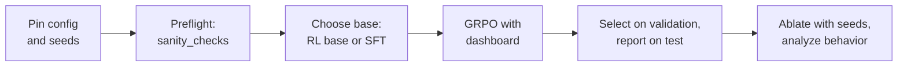

# 19. 综合实战：端到端训练一个编程智能体

前十八章已经实现了环境与隐藏测试、token-in/token-out rollout、advantage、策略更新、正则化、SFT、评测和训练器检查。本章把这些 `#@save` 组件接成一次完整训练：先固定配置和数据划分，检查训练器并选择起点，再训练、选检查点、做消融，最后报告带区间的测试结果。重点是用证据说明智能体学到了什么，以及哪些结论还不能下。

前面保存的组件现在可以直接组装起来。下面每个代码块都只调用已保存的 `arl` 函数，而整个训练器展开写出、让每个阶段都清晰可见，也只需要十二行。后面有两节会离开 TinyAgent。19.7 节报告同一配方在 Qwen3-0.6B 这个真实预训练模型上、在一块 H200 上的实测运行。19.8 节把本书的每个函数对应到在大规模系统中实现它的公开基础设施，并说明哪些东西会改变。TinyAgent 的每个数字都是一个参数量 158k、有 20 个训练任务和 10 个留出（held-out）任务的模型上的机制演示（mechanism demonstration），而不是基准证据。本章不再保存新函数，重点是检查已有组件能否接成完整、可信的训练流程。

```python
import copy
import dataclasses
import json
import random
from collections import Counter
from pathlib import Path
import torch
import agentrl as arl

torch.set_num_threads(4)                     # the check host is shared (Chapter 10); Section 19.9 returns to this
tok = arl.build_tokenizer(arl.make_tasks('all'))
train_tasks, heldout_tasks = arl.make_tasks('train'), arl.make_tasks('heldout')
val_tasks, test_tasks = heldout_tasks[0::2], heldout_tasks[1::2]          # one variant per family in each
print('validation:', [t.name for t in val_tasks])
print('test:      ', [t.name for t in test_tasks])
```

Output:

```text
validation: ['minmax/pin', 'range/series', 'compare/qualifies', 'zero/share', 'init/product_upto']
test:       ['minmax/saturate', 'range/step_total', 'compare/under_cap', 'zero/speed', 'init/add_threes']
```

划分在训练任何东西之前就已固定。验证任务决定本章的每一个决策（保留哪个检查点、相信哪个消融结果）。测试任务对每个要报告的模型只评估一次（[17.8 节](17-evaluation.md#178-不碰测试集地选择检查点)）。每个划分有五个任务，每个 bug 类型的留出变体两边各分到一个。

## 19.1 配方及其预检

这次运行分为六个阶段，本章按顺序展开。



**固定配置。** 结果的可复现程度取决于产生它的配置，所以第一个代码块打印出每个字段。目标函数是本书在 [9.1 节](09-grpo-and-variants.md#91-deepseekmath-中的-grpo)中的 GRPO 默认设置，其中每个选择都基于前面某一章的测量：

| 选择 | 默认值 | 本书中的证据 |
| --- | --- | --- |
| 优势 | 组均值与标准差（`adv_mode='grpo'`） | 去掉标准差的效果在随机种子噪声范围内（留出 0.71–0.80 对 0.76–0.81，[9.6 节](09-grpo-and-variants.md#96-小规模下的受控消融)） |
| 聚合 | `token_mean` | `seq_mean_token_mean` 使回合变长（14.9 对 12.9 个策略 token），而通过率没有提升 |
| 裁剪 | 对称，0.2 | 这里裁剪只作用于约 0.15% 的 token，所以 clip-higher 没有可作用的对象（第 9 章和第 10 章） |
| 动态采样 | 关闭 | 它每步采样的 rollout 是 1.9 倍，按每条 rollout 计效果更差，而 rollout 正是智能体最昂贵的维度 |
| 到参考策略的 KL | 无 | [第 10 章](10-kl-entropy-regularization.md)中的单个随机种子倾向于小 KL（pass@1 0.80 对 0.725）；19.5 节用三个随机种子重新检验 |
| 样本复用 | 1 个轮次（epoch），2 个小批次 | 更多复用加剧了记忆（[第 8 章](08-ppo.md)） |

环境字段与目标函数同样重要。在函数被重命名、每个回合只允许一次编辑的条件下，任何高于 0.2 的通过率都需要在回合中收集信息（[9.4 节](09-grpo-and-variants.md#94-环境设计中的捷径特征)）。奖励来自隐藏测试。

```python
CFG = arl.RLConfig()                         # the book's GRPO (Chapter 9): anonymized gym, one edit, hidden tests
STEPS, CKPT_EVERY, N_VAL, N_TEST = 60, 10, 16, 32
fields = dataclasses.asdict(CFG)
for i in range(0, len(fields), 8):
    print(' | '.join(f'{k}={v}' for k, v in list(fields.items())[i:i + 8]))
print(f'run: {STEPS} steps, checkpoint every {CKPT_EVERY}, torch {torch.__version__}, {torch.get_num_threads()} threads')
```

Output:

```text
group_size=8 | prompts_per_step=8 | temperature=1.0 | max_turns=6 | rename=True | max_edits=1 | reward=hidden | adv_mode=grpo
overlong_buffer=0 | dynamic_sampling=False | max_sample_rounds=4 | ratio_level=token | clip_low=0.2 | clip_high=0.2 | loss_mode=token_mean | norm_const=None
kl_coef=0.0 | kl_kind=k3 | lr=0.001 | epochs=1 | minibatches=2 | max_grad_norm=1.0 | seed=0
run: 60 steps, checkpoint every 10, torch 2.9.1+cu126, 4 threads
```

最后一行记录了两个不在 `RLConfig` 中却仍会改变数字的事实：库版本和 CPU 线程数。19.9 节表明，仅改变线程数就会改变运行结果。

**预检。** 在花费算力之前，先在第一个批次上运行 [18.6 节](18-debugging-rl-runs.md#186-每个强化学习代码库都应断言的不变量)中的九个不变量。它们只需几次前向和反向传播，合起来能抓出第 18 章目录中的每一种代码故障。检查时把 KL 系数设为 0.1，这只是为了让参考模型的不变量有东西可测。

```python
base = arl.make_rl_base(tok)                 # Chapter 9's starting policy
first = arl.sample_groups(base, lambda: arl.make_env(CFG), train_tasks[:8], tok, CFG,
                          torch.Generator().manual_seed(0))                # the first batch: 64 episodes
checks = arl.sanity_checks(base, first, tok, dataclasses.replace(CFG, kl_coef=0.1))
for name, (value, ok) in checks.items():
    print(f'{"pass" if ok else "FAIL"} | {name:<34} | {value:.3g}')
```

Output:

```text
pass | mask = policy tokens               | 0
pass | sampler = trainer log-prob         | 1.31e-06
pass | ratio = 1 before any step          | 0
pass | group advantage mean = 0           | 7.45e-09
pass | loss invariant to padding          | 0
pass | accumulated = one-pass gradient    | 0
pass | old_logp frozen in the update      | 0.00126
pass | update raises log pi where A > 0   | 0.547
pass | KL to reference > 0 after a step   | 0.0197
```

九项检查全部通过。除了结论，也要读数值。掩码恰好覆盖策略 token（0 处不匹配）。这个批次上采样器与训练器对数概率之间的最大差距为 $1.3 \times 10^{-6}$，这是浮点噪声。第一步之前比率严格为 1，组优势的平均值在 $10^{-8}$ 以内为零。经过一次真实更新后，具有正优势的回合的对数概率上升了：$\log\pi$ 的变化与优势的相关系数为 0.55。一个团队会把这个代码块设为一道关卡，使预检失败的运行永远不会启动。

## 19.2 选择初始策略

强化学习只是对初始策略已经会做的事情重新加权（[9.4 节](09-grpo-and-variants.md#更根本的探索问题)），所以基座的选择是第一个能决定运行成败的决策。我们比较两个候选。第一个是 `make_rl_base`，它是本书中预训练模型的类比：它知道调用格式，偶尔会先读代码再做出正确的编辑。第二个在此基础上加了一个简短的 **SFT 冷启动**（cold start），使用少量专家数据，就像[第 15 章](15-sft-and-rejection-sampling.md)那样。它为每个训练任务使用一条经过重命名、在训练评测框架中录制的 oracle 演示，并训练十个 SFT 步。

```python
rng = random.Random(0)
demos = [arl.scripted_rollout(arl.scripted_policy('oracle'), arl.make_env(CFG), arl.randomize_names(t, rng), tok)
         for t in train_tasks]               # one renamed oracle demonstration per training task
sft_base = copy.deepcopy(base)
losses = arl.sft_train(sft_base, demos, tok, steps=10, lr=1e-3, batch_size=16)
print(f'{len(demos)} demonstrations, {sum(int(d.action_mask.sum()) for d in demos)} policy tokens;'
      f' SFT loss {losses[0]:.3f} -> {losses[-1]:.3f} in {len(losses)} steps')
```

Output:

```text
20 demonstrations, 260 policy tokens; SFT loss 0.218 -> 0.105 in 10 steps
```

冷启动被刻意设计得很小，只有 260 个监督 token，使它能改变策略而不至于直接解决任务。在第 15 章中，60 步的 oracle SFT 不需要任何强化学习就达到了 0.89 的留出通过率，那样本章就没有东西可研究了。

在强化学习之前比较基座，应该测量什么？仅有 pass@1 是不够的。GRPO 从奖励各不相同的组中学习，所以有用的统计量是：成功是否会出现在策略的样本中（训练任务上的 pass@8）；大小为 8 的组中携带梯度的比例；以及维持探索的熵（[第 10 章](10-kl-entropy-regularization.md)）。`describe` 用第 17 章保存的评估函数报告这三者。

```python
def describe(name, model, n=16):
    """What RL can start from: pass@1 and pass@8 on training tasks, informative groups, entropy, behavior."""
    counts = arl.sample_counts(model, train_tasks, tok, n, CFG, torch.Generator().manual_seed(1))   # [20]
    trajs = arl.sample_groups(model, lambda: arl.make_env(CFG), train_tasks, tok, CFG,
                              torch.Generator().manual_seed(2))                                   # 20 groups of 8
    rewards = torch.tensor([t.reward for t in trajs]).view(-1, CFG.group_size)                    # [20, 8]
    stats = arl.behavior_stats(trajs)
    print(f'{name:<16} pass@1 {counts.sum().item() / (n * len(counts)):.3f} | pass@8'
          f' {arl.pass_at_k(n, counts, 8).mean().item():.3f} | informative groups'
          f' {(rewards.std(-1) > 0).float().mean().item():.2f} | entropy'
          f' {arl.action_entropy(model, arl.collate(trajs, tok.pad_id)):.3f} | reads {stats["reads"]:.2f}'
          f' | first edit right {stats["first_edit_right"]:.2f}')

describe('RL base', base)
describe('SFT cold start', sft_base)
```

Output:

```text
RL base          pass@1 0.141 | pass@8 0.691 | informative groups 0.65 | entropy 0.569 | reads 0.23 | first edit right 0.18
SFT cold start   pass@1 0.372 | pass@8 0.958 | informative groups 0.95 | entropy 0.375 | reads 1.61 | first edit right 0.43
```

十个 SFT 步改变了每一项统计。冷启动通过了 0.37 的训练回合，而不是 0.14，pass@8 达到 0.96，并且 95% 的组携带梯度，RL 基座则为 65%。它几乎每个回合都会读代码，而且经常不止一次（每回合 1.61 次读取，部分学会了模仿 oracle 的单次读取）。代价也看得见：它的动作熵从 0.57 降到 0.38 nats，朝第 15 章中完整 SFT 产生的近乎确定性的策略走了三分之一。

这些数字预测冷启动会学得更快，但并不表明它最终会更好；而且这里它的 oracle 数据完美且免费，真实的演示数据从来不是这样。因此主运行从本书的参考起点 `make_rl_base` 出发，而 19.5 节把冷启动作为一个单字段消融，用三个随机种子来检验。配方就应该这样改变：一次一个决策，每个决策都有自己的证据。

## 19.3 训练与监控

第 18 章的 `train_logged` 已经包含诊断记录。本章展开它的循环，逐步展示采样、组批、计算优势、裁剪更新和记录指标，并加入保存与评估检查点的钩子；这是选择检查点所需、而原函数尚未提供的功能。

```python
def train_run(model, cfg, steps, every=0, on_checkpoint=None):
    """The trainer from saved parts: sample, collate, update, log -> history (same RNG stream as arl.train_logged)."""
    torch.manual_seed(cfg.seed)
    gen = torch.Generator().manual_seed(cfg.seed)
    env_factory = lambda: arl.make_env(cfg)
    ref_model = arl.make_ref(model, cfg)                                     # frozen copy if cfg.kl_coef > 0
    optimizer = torch.optim.Adam(model.parameters(), lr=cfg.lr)
    history = []
    for step in range(steps):
        kept, sampled = arl.sample_step(model, env_factory, train_tasks, tok, cfg, gen)   # G episodes per task
        batch = arl.collate(kept, tok.pad_id)                                # ids [B, T], masks [B, T-1]
        batch['n_turns'] = torch.tensor([float(t.info['n_turns']) for t in kept])
        update = arl.debug_update(model, optimizer, batch, cfg, None, ref_model, gen)     # advantages + PPO step
        history.append(dict(arl.log_metrics(sampled, cfg, update), step=step))            # one dashboard row
        if every and (step + 1) % every == 0:
            on_checkpoint(step + 1, model)
    return history
```

重写的循环是一个新的实现，因此第 18 章的规则同样适用：在信任它之前，先对照参考实现检查它。

```python
a, b = copy.deepcopy(base), copy.deepcopy(base)
arl.train_logged(a, train_tasks, tok, CFG, 3)
train_run(b, CFG, 3)
print('train_run == arl.train_logged after 3 steps:',
      all(torch.equal(p, q) for p, q in zip(a.parameters(), b.parameters())))
```

Output:

```text
train_run == arl.train_logged after 3 steps: True
```

参数逐位一致。第 18 章已经对照 `train_rl` 检查过 `train_logged`，所以这个循环就是本书的训练器。检查点钩子用它自己的随机数生成器在验证任务上评估，不触动训练的随机数流。19.5 节确认了这一点。

主运行训练 60 步，每步 64 个回合。每 10 步它保留一份策略的冻结副本，并在五个验证任务上评估该副本，每个任务 16 个回合。

```python
def val_counts_of(model):
    return arl.sample_counts(model, val_tasks, tok, N_VAL, CFG, torch.Generator().manual_seed(3))   # [5]

checkpoints, val_counts = {0: copy.deepcopy(base)}, {0: val_counts_of(base)}
def keep(step, model):
    checkpoints[step], val_counts[step] = copy.deepcopy(model), val_counts_of(model)

policy = copy.deepcopy(base)
history = train_run(policy, CFG, STEPS, every=CKPT_EVERY, on_checkpoint=keep)
keys = ['reward', 'reads', 'tests', 'entropy', 'zero_adv_frac', 'approx_kl', 'clip_frac', 'grad_norm', 'logp_gap']
for h in history[::10] + history[-1:]:
    print(f"step {h['step']:2d} | " + ' | '.join(f'{k} {h[k]:.3g}' for k in keys))
```

Output:

```text
step  0 | reward 0.172 | reads 0.312 | tests 0.328 | entropy 0.565 | zero_adv_frac 0.375 | approx_kl 0.00322 | clip_frac 0.0139 | grad_norm 0.204 | logp_gap 3.05e-08
step 10 | reward 0.406 | reads 1.61 | tests 0.531 | entropy 0.368 | zero_adv_frac 0.125 | approx_kl 0.000174 | clip_frac 0 | grad_norm 0.217 | logp_gap 3.76e-08
step 20 | reward 0.719 | reads 1.11 | tests 1.06 | entropy 0.182 | zero_adv_frac 0.25 | approx_kl 0.000295 | clip_frac 0 | grad_norm 0.287 | logp_gap 8.5e-09
step 30 | reward 0.703 | reads 0.969 | tests 0.734 | entropy 0.135 | zero_adv_frac 0.625 | approx_kl 5.59e-05 | clip_frac 0 | grad_norm 0.178 | logp_gap 1.02e-08
step 40 | reward 0.844 | reads 1.02 | tests 0.812 | entropy 0.106 | zero_adv_frac 0.75 | approx_kl 3.43e-05 | clip_frac 0 | grad_norm 0.17 | logp_gap 1.13e-08
step 50 | reward 0.859 | reads 1.03 | tests 0.906 | entropy 0.0878 | zero_adv_frac 0.625 | approx_kl 9.38e-06 | clip_frac 0 | grad_norm 0.151 | logp_gap 3.55e-09
step 59 | reward 0.875 | reads 1 | tests 0.859 | entropy 0.0667 | zero_adv_frac 0.625 | approx_kl 1.89e-05 | clip_frac 0 | grad_norm 0.168 | logp_gap 2.31e-09
```


图 19.1 是这次运行的监控面板，第 18 章的每组指标各占一个面板。每个面板看起来都是正常的。

- **结果。** 批次奖励从 0.17 升到 0.88，验证通过率随之从 0.13 升到 0.88。
- **行为。** 读取最先上升。到第 10 步，策略每回合读取 1.6 次，超出了需要，到第 30 步稳定在一次。测试上升得更晚，并稳定在每回合约 0.85 次，尽管在只允许一次编辑的情况下，测试结果什么也改变不了。结果优势也会给无用的步骤记功（[第 7 章](07-advantages-and-credit.md)）。编辑始终是一次。
- **优化器状态。** 熵从 0.57 平稳地降到 0.07 nats，没有突然坍缩。随着策略稳定下来，每步 KL 从 $3 \times 10^{-3}$ 缩小到约 $10^{-5}$。第 0 步之后打印的每一行中裁剪比例都是 0，打印出的梯度范数保持在 0.15 到 0.29 之间，远低于 1 的裁剪阈值。
- **一致性。** 采样器–训练器差距保持在 $10^{-7}$ 以下，比预检阈值低三个数量级。这在整个运行期间（而不只是在第 0 步）排除了第 18 章中的掩码、温度和陈旧比率故障。

对下一个决策最重要的面板是零优势比例。在策略学习期间它降到 0.1–0.2，然后从第 30 步起升到 0.6–0.8。此时大多数组都是全部通过，因此每一步的梯度只来自少数几个组。19.9 节用这一点来决定何时停止。

## 19.4 评估与检查点选择

现在我们有七个检查点。我们只用验证任务来选择一个：通过率最高者，平局时选更早的检查点。每个检查点都附上其任务级自助法区间（[17.3 节](17-evaluation.md#173-置信区间)）。

```python
print('step | validation pass@1 | task-bootstrap 95% CI')
for step, counts in val_counts.items():
    lo, hi = arl.bootstrap_ci(counts / N_VAL)
    print(f'{step:4d} | {counts.sum().item() / (N_VAL * len(counts)):17.3f} | [{lo:.3f}, {hi:.3f}]')
chosen = max(val_counts, key=lambda s: (val_counts[s].sum().item(), -s))   # best validation; ties -> earliest
print('chosen checkpoint: step', chosen)
```

Output:

```text
step | validation pass@1 | task-bootstrap 95% CI
   0 |             0.125 | [0.037, 0.225]
  10 |             0.375 | [0.225, 0.550]
  20 |             0.662 | [0.362, 0.887]
  30 |             0.725 | [0.375, 0.938]
  40 |             0.762 | [0.387, 0.988]
  50 |             0.787 | [0.462, 0.988]
  60 |             0.875 | [0.775, 0.975]
chosen checkpoint: step 60
```

验证通过率在每个检查点都上升，所以规则选中最后一个，即第 60 步。第 20 步到第 50 步的区间很宽，约为 $\pm 0.3$，因为五个验证任务中有一两个落后于其他任务。到第 60 步时，这些任务已经赶上，区间收窄到 [0.78, 0.98]。由于验证曲线单调，这次选择没有需要权衡的接近情形。无论如何，下面的测试数字都不受这一选择影响，因为测试任务没有参与选择。

测试评估对每个要报告的模型只运行一次：初始策略和选中的检查点。它对每个测试任务使用 32 个回合，并用 [17.2 节](17-evaluation.md#172-passk-及其无偏估计量)的无偏估计量计算 pass@$k$。

```python
models = {'RL base': base, f'step {chosen} (chosen)': checkpoints[chosen]}
test = {name: arl.sample_counts(m, test_tasks, tok, N_TEST, CFG, torch.Generator().manual_seed(4))
        for name, m in models.items()}                                       # successes per test task, [5]
for name, counts in test.items():
    lo, hi = arl.bootstrap_ci(counts / N_TEST)
    passk = [arl.pass_at_k(N_TEST, counts, k).mean().item() for k in (1, 4, 8)]
    print(f'{name:<20} pass@1 {passk[0]:.3f} [{lo:.3f}, {hi:.3f}] | pass@4 {passk[1]:.3f} | pass@8 {passk[2]:.3f}'
          f' | per task {counts.tolist()}')
```

Output:

```text
RL base              pass@1 0.156 [0.131, 0.181] | pass@4 0.508 | pass@8 0.780 | per task [6, 5, 4, 6, 4]
step 60 (chosen)     pass@1 0.625 [0.294, 0.956] | pass@4 0.789 | pass@8 0.899 | per task [29, 31, 4, 5, 31]
```

测试通过率 0.625 远低于同一检查点 0.875 的验证通过率，逐任务计数说明了原因。三个测试任务几乎被解决（32 次中分别通过 29、31 和 31 次）。另外两个没有。`compare/under_cap` 32 次中通过 4 次，`zero/speed` 通过 5 次，与未训练的基座（4 次和 6 次）大致相同。在这两个任务上，强化学习没有带来任何可测量的效果。这也是区间 [0.29, 0.96] 如此之宽的原因：它是在五个任务上做的自助法，其中两个与另外三个结论截然相反。pass@$k$ 各列显示了 [17.7 节](17-evaluation.md#177-强化学习是否让分布变窄tinyagent-上的-passk)中的模式。强化学习在 $k = 1$ 时优势很大（0.63 对 0.16），并随 $k$ 增大而缩小（$k = 8$ 时为 0.90 对 0.78），因为基座的随机猜测最终会碰中正确的操作。

区间这么宽，提升是真的吗？比较应当按任务配对：两个模型面对相同的任务，而任务效应是最大的方差来源（[17.4 节](17-evaluation.md#174-比较两次训练)）。

```python
diff, lo, hi = arl.paired_bootstrap_diff(test[f'step {chosen} (chosen)'] / N_TEST, test['RL base'] / N_TEST)
print(f'chosen - base, paired over 5 test tasks: {diff:+.3f} [{lo:+.3f}, {hi:+.3f}]')
unpaired = [arl.bootstrap_ci(c / N_TEST) for c in test.values()]
print('unpaired intervals overlap:', unpaired[1][0] < unpaired[0][1])
```

Output:

```text
chosen - base, paired over 5 test tasks: +0.469 [+0.131, +0.806]
unpaired intervals overlap: False
```

配对差值为 +0.47，95% 区间为 [+0.13, +0.81]，不包含零。区间仍然很宽，它也理应如此。这是一个关于任务总体的陈述，却只用五个任务来估计，而五个中有两个没有提升。这次运行的诚实报告是：留出测试 pass@1 为 0.63 [0.29, 0.96]，初始策略为 0.16；配对提升 +0.47 [+0.13, +0.81]；一个训练随机种子、五个测试任务，其中两个没有提升。19.6 节探究其原因。

## 19.5 多随机种子消融实验

配方有很多旋钮。哪些值得花算力？我们检验三个。每一个之所以被选中，要么是因为前面某章留下了悬而未决的问题，要么是因为选错的代价很高：

1. **到参考策略的 KL**（$\beta = 0.05$，$k_3$ 放在损失中）。第 10 章的单个随机种子倾向于它，而已发表的编程智能体配方都去掉了它（[第 20 章](20-frontier.md)）。
2. **SFT 冷启动。** 19.2 节预测它会学得更快。
3. **用公开测试奖励代替隐藏测试。** 这不是候选方案，而是一个对照，让[第 11 章](11-rewards-and-verifiers.md)的奖励投机（reward hacking）结果保持在视野中；任何削弱验证器（verifier）的配方改动都应对照它检查。

每个实验组相对默认设置只改变一处，运行 30 步（第 17 章发现此时仍有提升空间），使用随机种子 0、1 和 2。每次运行在全部十个留出任务上评估，每个任务 16 个回合。评估所用的生成器只依赖于随机种子，因此相同随机种子的各组在相同的评估随机数流上进行比较。这十二次运行总共约需 80 秒。

```python
ARMS = {'default': (base, {}), 'KL k3 0.05': (base, dict(kl_coef=0.05)),
        'SFT cold start': (sft_base, {}), 'public-test reward': (base, dict(reward='public'))}
SEEDS, ABL_STEPS = [0, 1, 2], 30
runs = {}
for arm, (start, fields) in ARMS.items():
    for seed in SEEDS:
        model = copy.deepcopy(start)
        hist = train_run(model, arl.RLConfig(seed=seed, **fields), ABL_STEPS)
        counts = arl.sample_counts(model, heldout_tasks, tok, 16, CFG, torch.Generator().manual_seed(100 + seed))
        runs[arm, seed] = dict(history=hist, counts=counts, model=model)
print('default, seed 0 == main run at step 30:',
      all(torch.equal(p, q) for p, q in zip(runs['default', 0]['model'].parameters(), checkpoints[30].parameters())))
```

Output:

```text
default, seed 0 == main run at step 30: True
```

随机种子为 0 的默认组就是主运行的前 30 步，其参数与主运行第 30 步的检查点完全一致，因此检查点评估没有扰动训练。每个实验组都按任务与默认组比较。对每个组，我们把每个任务的通过率在三个随机种子上取平均，然后对十个逐任务差值做自助法。这个区间捕捉的是任务之间的变化。随机种子之间的离散程度打印在旁边，19.9 节会用到它。

```python
def arm_rates(arm):
    return torch.stack([runs[arm, s]['counts'] / 16 for s in SEEDS])         # [seeds, 10 tasks]

print(f'{"arm":<19}| held-out pass@1 by seed | mean  | vs default, paired [95% CI] | reward 25-29 | hardcode | entropy')
for arm in ARMS:
    rates, hists = arm_rates(arm), [runs[arm, s]['history'] for s in SEEDS]
    diff, lo, hi = arl.paired_bootstrap_diff(rates.mean(0), arm_rates('default').mean(0))
    late = sum(h[i]['reward'] for h in hists for i in range(25, 30)) / 15
    hack = sum(h[-1]['hardcode'] for h in hists) / 3
    ent = sum(h[-1]['entropy'] for h in hists) / 3
    paired = 'reference' if arm == 'default' else f'{diff:+.3f} [{lo:+.3f}, {hi:+.3f}]'
    print(f'{arm:<19}| {" ".join(f"{r:.3f}" for r in rates.mean(-1).tolist()):<24}| {rates.mean():.3f} |'
          f' {paired:<28}| {late:12.3f} | {hack:8.2f} | {ent:.3f}')
```

Output:

```text
arm                | held-out pass@1 by seed | mean  | vs default, paired [95% CI] | reward 25-29 | hardcode | entropy
default            | 0.694 0.756 0.706       | 0.719 | reference                   |        0.709 |     0.00 | 0.181
KL k3 0.05         | 0.675 0.725 0.719       | 0.706 | -0.012 [-0.119, +0.129]     |        0.754 |     0.01 | 0.169
SFT cold start     | 0.731 0.863 0.800       | 0.798 | +0.079 [-0.025, +0.212]     |        0.872 |     0.01 | 0.115
public-test reward | 0.006 0.006 0.000       | 0.004 | -0.715 [-0.873, -0.531]     |        0.986 |     0.98 | 0.055
```


图 19.2 把这张表画成了森林图。对照每个组的区间来解读：

- **KL $k_3$ 0.05。** 均值为 0.706 对 0.719，配对差值为 $-0.01$ [$-0.12$, $+0.13$]。检测不到任何效应。熵几乎没变（0.17 对 0.18），第 10 章单个随机种子下的优势没能在三个随机种子下保持。默认设置仍为无 KL，这也省下了参考模型的显存和前向传播。
- **SFT 冷启动。** 均值为 0.798，在每个随机种子下都是四个组中最好的。配对差值为 +0.08 [$-0.03$, $+0.21$]，区间包含零，因此在三个随机种子和十个任务下，这只是值得继续验证的线索，还不能定论。它后期的训练奖励高得多（0.87 对 0.71），正如 19.2 节所预测，熵也更低（0.12 对 0.18）。是否采用它是一个不确定条件下的决策，19.9 节计算了要定论需要多少代价。
- **公开测试奖励。** 它的训练奖励为 0.99，是所有组中最好的曲线。在最后一步，98% 的回合使用了 `hardcode_tests`，而它在隐藏测试上的留出通过率为 0.004。$-0.72$ 的效应不需要任何统计。这个组放在表中，是为了让任何读结果的人都不会忘记：训练奖励只衡量验证器所奖励的东西。

> **证据。** 本书测得：每组三个随机种子，30 步，每个随机种子 160 个留出回合，一个参数量 158k 的模型。配对区间重采样的是任务而不是随机种子，因此在一定程度上低估了总不确定性。SFT 结果依赖于免费且完美的演示数据，真实团队没有这种条件。这些数字都不能预测同样的改动在大模型上的效果。

## 19.6 智能体学到了什么

通过率说明智能体成功的频率。行为统计说明它如何成功，逐任务分解说明它在哪里失败。我们从选中的检查点为每个留出任务采样 32 个回合。

```python
agent = checkpoints[chosen]
trajs = arl.sample_groups(agent, lambda: arl.make_env(CFG), heldout_tasks, tok, dataclasses.replace(CFG, group_size=32),
                          torch.Generator().manual_seed(5))                  # 32 episodes per held-out task
stats = arl.behavior_stats(trajs)
print(' | '.join(f'{k} {v:.2f}' for k, v in stats.items()))
def step_name(action):
    call = arl.parse_call(action)                                            # (tool, arg) or None
    return 'malformed' if call is None else call[1] or call[0]
calls = Counter(' -> '.join(step_name(a) for a in t.info['actions']) for t in trajs)
for sequence, count in calls.most_common(5):
    print(f'{count:3d} x {sequence}')
```

Output:

```text
pass_rate 0.74 | reward 0.74 | reads 1.02 | tests 0.82 | edits 0.93 | first_edit_right 0.74 | turns 3.84 | length 12.44
 60 x read -> swap_minmax -> test -> submit
 59 x read -> fix_range_end -> test -> submit
 59 x read -> fix_init -> test -> submit
 45 x read -> add_zero_guard -> test -> submit
 27 x read -> fix_comparison -> test -> submit
```

智能体学会了一套流程：读取，应用一个操作，测试，提交。它基本上每个回合都会读取（每回合 1.02 次），并在 93% 的回合中执行编辑。它的通过率等于首次编辑的准确率（0.74）：只要选对操作就会成功，所以每次失败都是选错或者没有编辑。最常见的五个序列就是这套流程分别配上五种操作，而它们的计数并不均匀。`swap_minmax` 出现在 60 个回合中，而 `fix_comparison` 只有 27 个，尽管每种操作都恰好在十个任务中的两个上正确（各 64 个回合）。逐任务表格显示了这些回合去了哪里。

```python
by_task = {}
for t in trajs:
    by_task.setdefault(t.info['task'], []).append(t)
for name, group in by_task.items():
    passed = sum(bool(t.info['submitted'] and t.info['hidden_pass']) for t in group) / len(group)
    first_ops = Counter(t.info['ops'][0] if t.info['ops'] else 'none' for t in group)
    print(f'{name:<18} pass {passed:.2f} | correct op {arl.FIX_OP[name]:<15} | first edits {dict(first_ops.most_common(2))}')
```

Output:

```text
minmax/pin         pass 1.00 | correct op swap_minmax     | first edits {'swap_minmax': 32}
minmax/saturate    pass 0.94 | correct op swap_minmax     | first edits {'swap_minmax': 30, 'none': 2}
range/series       pass 0.91 | correct op fix_range_end   | first edits {'fix_range_end': 29, 'none': 3}
range/step_total   pass 0.97 | correct op fix_range_end   | first edits {'fix_range_end': 31, 'none': 1}
compare/qualifies  pass 0.69 | correct op fix_comparison  | first edits {'fix_comparison': 22, 'add_zero_guard': 4}
compare/under_cap  pass 0.19 | correct op fix_comparison  | first edits {'add_zero_guard': 23, 'fix_comparison': 6}
zero/share         pass 0.72 | correct op add_zero_guard  | first edits {'add_zero_guard': 23, 'fix_comparison': 7}
zero/speed         pass 0.06 | correct op add_zero_guard  | first edits {'fix_comparison': 19, 'none': 10}
init/product_upto  pass 0.97 | correct op fix_init        | first edits {'fix_init': 31, 'none': 1}
init/add_threes    pass 0.97 | correct op fix_init        | first edits {'fix_init': 31, 'fix_comparison': 1}
```

有三种缺陷类型被解决了：`minmax`、`range` 和 `init` 在两个留出变体上的通过率都在 0.91 到 1.00 之间。弱点在于智能体相互混淆的两种缺陷类型。`compare` 和 `zero` 的通过率在 0.06 到 0.72 之间，而且错误是交叉的。在 `under_cap` 上，智能体在 32 个回合中有 23 个应用了 `zero` 类型的修复 `add_zero_guard`。在 `speed` 上，它在 19 个回合中应用了 `compare` 类型的修复 `fix_comparison`，另有 10 个回合没有编辑就提交了。把读取到的观测与 oracle 的关键词规则对比，并各看一个失败案例。

```python
for name in ['compare/qualifies', 'compare/under_cap', 'zero/share', 'zero/speed']:
    source = arl.compact_source(next(t for t in heldout_tasks if t.name == name).source)
    print(f"{name:<18} {source.split(chr(10))[-1]:<40} oracle rule -> {arl.infer_op(source)}")
wrong = {'compare/under_cap': 'add_zero_guard', 'zero/speed': 'fix_comparison'}
for name, op in wrong.items():
    failure = next(t for t in by_task[name] if t.info['ops'] == [op])
    print(tok.decode(failure.ids.tolist()).replace('\n', ' / '))
```

Output:

```text
compare/qualifies  return score > cutoff + 1                oracle rule -> fix_comparison
compare/under_cap  return load < cap                        oracle rule -> fix_comparison
zero/share         return amount // people                  oracle rule -> add_zero_guard
zero/speed         return miles * 2 // hours                oracle rule -> add_zero_guard
<bos> issue : share returns wrong results <call> read </call> <obs> def share ( load , cap ) : / return load < cap </obs> <call> edit add_zero_guard </call> <obs> ok </obs> <call> test </call> <obs> fail ( 2 , 2 ) -> False want True / pass ( 9 , 7 ) / pass ( 9 , 8 ) </obs> <call> submit </call>
<bos> issue : is_early returns wrong results <call> read </call> <obs> def is_early ( miles , hours ) : / return miles * 2 // hours </obs> <call> edit fix_comparison </call> <obs> no change </obs> <call> submit </call>
```

在 oracle 的规则下，两份源代码都毫无歧义：比较运算符意味着 `fix_comparison`，`//` 意味着 `add_zero_guard`。智能体学到的是另一条规则。在第一个失败案例中，它读到 `return load < cap`，应用了除零保护，然后运行测试，测试报告了失败（`fail ( 2 , 2 ) -> False want True`）。随后它照样提交，因为一次编辑的预算让它别无他法。在第二个案例中，它读到 `miles * 2 // hours`，应用 `fix_comparison`，得到 `no change`，然后提交。它的观测中包含正确的证据，而在这些留出变体上，它依据的是证据中错误的那部分。这两种缺陷类型的源代码也是最短的，只有一行、几个 token，而且它们的留出变体使用了训练中从未见过的操作数名称和常数。我们无法从权重中读出策略的特征。我们能说的是，对这两种缺陷类型，它学到的特征不能迁移到每一个变体上，而训练奖励无法揭示这一点，因为同样的特征在训练变体上是有效的。19.4 节的测试结果是透过两个任务看到的同一事实：`under_cap` 和 `speed` 正是这两种缺陷类型在测试集一侧的成员。

这是整个运行最有用的产出，因为它指明了下一个实验：在对目标函数做任何改动之前，先为 `compare` 和 `zero` 增加更多代码变体，使用不同的操作数名称，或者像 [17.6 节](17-evaluation.md#176-留出划分与泄漏)那样做留出类型评估。练习 4 直接探测这些特征。

## 19.7 在真实模型上运行同一循环

TinyAgent 的设计目的，是以 CPU 级的成本让每个机制都可见。换成真实预训练模型后，这些组件能否继续工作？下面用两个可选实验作初步检验（见[它们的 README](../labs/README.md)）。两者都训练 **Qwen3-0.6B**，使用来自 `agentrl` 的相同任务、隐藏测试奖励、组优势和裁剪损失。第一个实验 `tutorial/labs/qwen_grpo_bugfix.py` 保留 gym 的动作菜单。第二个实验 `tutorial/labs/qwen_grpo_tools.py` 用通用编程工具取代菜单，就像生产中的智能体那样。我们先看第一个。只有真实模型所需的部分是新的：

- **带工具的真实对话模板（chat template）。** [4.7 节](04-environments-and-tools.md)的四个工具模式由 Qwen3 自己的模板在非思考模式下渲染。模型写出 `<tool_call>{"name": "edit", "arguments": {"op": ...}}</tool_call>`，一个解析器把 JSON 映射为 gym 的 `<call> edit op </call>`。其他任何内容，包括普通文字，都是一次格式错误的调用，会耗掉一轮。
- **token-in/token-out（[5.4 节](05-trajectories-and-templates.md#54-重分词漂移)）。** 采样得到的 id 按采样原样保留。每个工具结果以模板中工具响应块的确切 token id 追加。启动时，脚本断言这些 id 与模板对同一对话的渲染结果相等。
- **用 Hugging Face `generate` 做批量生成**，温度为 1，禁用 top-k 和 top-p，使采样分布就是训练器求导的那个分布（[3.3 节](03-language-models-as-policies.md#33-采样定义了行为策略)）。不使用 vLLM；生成和训练都在一块 GPU 上以 fp32 运行。
- **只在损失需要的位置计算 logits。** 语言模型头只在策略位置上运行。完整的 `[B, T, 151936]` logits 每 1,000 token 的一行约需 0.6 GB（[14.3 节](14-scaling-and-efficiency.md#143-logits-的内存)）。更新在微批次上累积，整个小批次使用同一个归一化因子（[14.4 节](14-scaling-and-efficiency.md#144-梯度累积与损失归一化)）。

rollout 的核心很短。下面的节选来自该脚本，本书的检查器不会执行它：

```py
for e, (new, logp) in zip(active, generate(model, qtok, [e['ids'] for e in active], ...)):
    e['ids'] += new                                   # sampled ids, never re-encoded
    e['mask'] += [1] * len(new)                       # policy-owned, through <|im_end|>
    action = to_gym_action(qtok.decode(new))          # text exists only at the env boundary
    obs, reward, done, info = e['env'].step(action)
    if not done:
        obs_ids = observation_ids(qtok, obs)          # template tokens + tool output, verified at startup
        e['ids'] += obs_ids
        e['mask'] += [0] * len(obs_ids)
```

这次运行使用 30 个 GRPO 步，每步 8 个训练任务 × 8 个回合，AdamW 学习率为 $10^{-6}$，每轮最多 64 个新 token，并在训练前后各做一次留出评估，每个任务 8 个回合。下面的代码块读取保存的结果文件并打印。这些是 2026-10-14 一次运行的**实测**数字。

```python
lab = json.loads(Path('tutorial/labs/results/qwen_grpo_bugfix.json').read_text())
print(lab['config']['model'], '|', lab['config']['gpu'], '|', {k: lab['config']['lab'][k] for k in
      ['steps', 'group_size', 'prompts', 'lr', 'max_new_tokens', 'eval_n']})
for when in ['before', 'after']:
    r = lab[when]
    print(f"{when:<6} held-out pass@1 {r['pass_at_1']:.3f} [{r['ci'][0]:.3f}, {r['ci'][1]:.3f}] | per task"
          f" {[int(c) for c in r['per_task']]} | reads {r['reads']:.2f} | malformed {r['malformed']:.2f}"
          f" | submitted {r['submitted']:.2f}")
d = lab['paired_diff']
print(f"after - before, paired over 10 tasks: {d['diff']:+.3f} [{d['ci'][0]:+.3f}, {d['ci'][1]:+.3f}]")
```

Output:

```text
Qwen/Qwen3-0.6B | NVIDIA H200 | {'steps': 30, 'group_size': 8, 'prompts': 8, 'lr': 1e-06, 'max_new_tokens': 64, 'eval_n': 8}
before held-out pass@1 0.200 [0.062, 0.388] | per task [2, 1, 2, 1, 7, 3, 0, 0, 0, 0] | reads 0.61 | malformed 1.69 | submitted 0.61
after  held-out pass@1 0.800 [0.500, 1.000] | per task [8, 8, 0, 0, 8, 8, 8, 8, 8, 8] | reads 1.02 | malformed 0.00 | submitted 1.00
after - before, paired over 10 tasks: +0.600 [+0.325, +0.875]
```

预训练模型起始的留出通过率为 0.20 [0.06, 0.39]，相当于盲目单次猜测的水平。它的主要问题是格式，而不是能力：每回合 1.69 次格式错误的调用，只有 61% 的回合最终提交。它评估中的第一个回合说明了原因。在一次格式正确的编辑之后，它用文字作答（“The function `issue` was fixed by adjusting the range ...”），然后反复向用户询问函数名，gym 将这些记为格式错误的调用。30 步之后，通过率为 0.80 [0.50, 1.00]，在十个留出任务上的配对提升为 +0.60 [+0.33, +0.88]。不再有格式错误的调用，每个回合都提交，每个回合都先读取。

```python
for row in lab['steps'][::5] + lab['steps'][-1:]:
    print(f"step {row['step']:2d} | reward {row['reward']:.3f} | malformed {row['malformed']:.2f} | reads"
          f" {row['reads']:.2f} | tokens {row['policy_tokens']:5.1f} | entropy {row['entropy']:.3f} | zero-adv"
          f" {row['zero_adv_frac']:.2f} | gap {row['logp_gap_mean']:.1e}")
print(f"wall clock {lab['wall_clock_s'] / 60:.1f} min | peak GPU memory {lab['peak_gpu_gb']:.1f} GB")
```

Output:

```text
step  0 | reward 0.078 | malformed 1.73 | reads 0.66 | tokens 113.0 | entropy 0.545 | zero-adv 0.62 | gap 3.2e-06
step  5 | reward 0.516 | malformed 0.16 | reads 1.48 | tokens  77.4 | entropy 0.079 | zero-adv 0.38 | gap 6.9e-07
step 10 | reward 0.578 | malformed 0.00 | reads 1.00 | tokens  55.9 | entropy 0.027 | zero-adv 0.38 | gap 3.8e-07
step 15 | reward 0.625 | malformed 0.02 | reads 0.98 | tokens  64.9 | entropy 0.000 | zero-adv 1.00 | gap 9.0e-08
step 20 | reward 0.844 | malformed 0.00 | reads 1.00 | tokens  65.3 | entropy 0.005 | zero-adv 0.88 | gap 1.1e-07
step 25 | reward 0.750 | malformed 0.00 | reads 1.00 | tokens  65.8 | entropy 0.000 | zero-adv 1.00 | gap 9.8e-08
step 29 | reward 0.750 | malformed 0.00 | reads 1.00 | tokens  66.2 | entropy 0.000 | zero-adv 1.00 | gap 4.0e-08
wall clock 9.5 min | peak GPU memory 32.8 GB
```

格式最先被学会，而且几乎是立刻学会的。格式错误的调用从每回合 1.73 次降到第 5 步的 0.16 次，到第 10 步降为零；随着文字回答消失，每回合策略 token 数从 113 降到约 56。奖励随之上升。然后策略停止了探索。其动作 token 的熵从 0.55 nats 降到第 10 步的 0.03，到第 15 步降为 0.000。从第 15 步起，大多数步的零优势比例为 1.00：对某个任务的每组 8 次尝试都产生了完全相同的回合，所以梯度恰好为零，批次奖励只随恰好抽到的任务而变动。最终评估显示，哪些行为随着探索停止而固定了下来。训练后的逐任务计数全是 8 中 8 或 8 中 0，在这次评测中，策略表现得近乎确定。它每次都解决十个留出任务中的八个，每次都在两个 `range` 任务上失败，因为它对这两个任务应用了 `fix_init`（结果文件中保存的示例显示了这一点）。`range` 类型从未被稳定地解决，而一旦熵降到零，`range` 任务上的组内很难再采样到成功，因此这次训练未能纠正这些错误。

采样器–训练器差距保持在每 token $4 \times 10^{-8}$ 到 $3 \times 10^{-6}$ nats 之间。两边都以 fp32 运行，所以这是带 KV cache、左填充的生成路径与一次完整前向传播之间的差距，比 13.6 节用同一模型测得的 bf16 差距低约四个数量级。这次运行在一块共享的 H200 上耗时 9.5 分钟，GPU 显存峰值为 32.8 GB。

> **证据。** 本书于 2026-10-14 测得，仅一次：一个随机种子，30 步，在 10 个任务上做留出评估，每个任务 8 个回合。0.20 → 0.80 的提升对这次运行是真实的（配对区间不包含零），但其中大部分是模型学会了 gym 的工具调用格式和“读取—编辑—测试—提交”流程，这是预训练模型所缺少的，而不是其修复代码能力的普遍提升。在 $10^{-6}$ 的学习率下 15 步内发生的熵坍缩是最具可迁移性的观察：在真实模型上，就像第 10 章中的 TinyAgent 一样，熵是一种资源，一次小规模的强化学习运行就可能把它完全耗尽，而到那时仍未解决的问题就会一直无法解决。我们没有调学习率，也没有运行其他随机种子；练习 5 会去做。

### 用通用工具取代编辑菜单

上面的运行有一个不真实之处：模型从一份菜单中选择修复（`edit swap_minmax`），由 gym 中预先编写的代码完成修改。生产中的编程智能体拿到的是通用工具，修改要由它们自己写出。第二个实验 `tutorial/labs/qwen_grpo_tools.py` 以 Claude Code 的工具集为参照：工具名和参数遵循 Claude Code 的[工具参考文档](https://code.claude.com/docs/en/tools-reference)（2026-10-14 查阅），工具描述是我们自己写的简短版本。任务、奖励、优势、损失、更新以及 token-in/token-out 路径都与第一个实验相同。接口的变化如下：

- **每个回合一个仓库。** 每个任务按本书默认的强化学习设置（[9.4 节](09-grpo-and-variants.md#94-环境设计中的捷径特征)）用 `arl.randomize_names` 换成一个无关的 gym 函数名，然后变成两个内存中的文件：有缺陷的源文件 `<fn>.py`，以及以 pytest 函数形式保存公开测试的 `test_<fn>.py`。隐藏测试从不进入仓库。
- **四个工具。** `Read(file_path, offset, limit)` 返回带行号的文件内容。`Edit(file_path, old_string, new_string, replace_all)` 做精确字符串替换；如果 `old_string` 不存在，或者在未设置 `replace_all` 时出现多次，或者本回合还没有读过该文件，它就会失败。要求先 Read 是我们的选择；参考文档只对部分模型这样要求。`Write(file_path, content)` 覆盖或创建文件。`Bash(command, timeout)` 是一个白名单模拟，支持 `pytest`、`python <file>.py`、`ls`、`cat` 和 `grep`；其他任何命令都返回一条错误观测。Grep 和 Glob 没有包含在内，因为参考文档说它们在 Linux 上默认不存在，Claude Code 在那里通过 Bash 搜索。
- **回合像真实智能体那样结束。** 不含工具调用的助手轮次就是最终回答。否则回合在 6 轮预算用完时结束。如果最终的 `<fn>.py` 通过全部隐藏测试，奖励为 1。格式错误的调用和失败的调用都返回一条错误观测，并耗掉这一轮。
- **模型写的代码在子进程中运行。** 每次运行测试、每次 `python <file>.py`，都会把仓库复制到一个新的临时目录，然后以空环境和 10 秒超时启动 `python -I -S`。在导入任何仓库代码之前，子进程先用 `resource` 设定限制：5 个 CPU 秒、1 GiB 地址空间、每个写出的文件 1 MiB，并且不能创建子进程。隐藏测试的评分以同样方式运行。训练器进程从不对模型输出调用 `exec`。这是在受控主机上带资源限制的进程隔离，**不是安全沙箱**：子进程仍然可以读取该用户的文件并建立网络连接。生产中模型写的代码应当放在没有网络访问的容器或虚拟机中运行（[4.7 节](04-environments-and-tools.md#47-真实编程环境与隔离)）。

`Edit` 工具是模型必须学会满足的部分。下面的节选来自该脚本，本书的检查器不会执行它：

```py
if name not in repo.read:
    raise ToolError('not_read', 'File has not been read yet. Read it first before writing to it.')
count = repo.files[name].count(old_string) if old_string else 0
if count == 0:
    raise ToolError('not_found', f'String to replace not found in file.\nString: {old_string}')
if count > 1 and not replace_all:
    raise ToolError('not_unique', f'Found {count} matches of the string to replace, but replace_all is false. ...')
repo.files[name] = repo.files[name].replace(old_string, new_string, -1 if replace_all else 1)
```

这次运行使用 18 个 GRPO 步，每步 8 个训练任务 × 8 个回合，学习率 $10^{-6}$，每轮最多 256 个新 token，训练前后在每个留出任务上各评估 8 个回合。由于 GPU 是共享的，生成按每批 16 个回合分块进行。以下是 2026-10-14 一次运行中**测得**的数字：

```python
tools = json.loads(Path('tutorial/labs/results/qwen_grpo_tools.json').read_text())
print({k: tools['config']['lab'][k] for k in ['steps', 'group_size', 'prompts', 'lr', 'max_turns', 'max_new_tokens',
                                              'eval_n']})
for when in ['before', 'after']:
    r = tools[when]
    print(f"{when:<6} held-out pass@1 {r['pass_at_1']:.3f} [{r['ci'][0]:.3f}, {r['ci'][1]:.3f}] | per task"
          f" {[int(c) for c in r['per_task']]}")
    print(f"       per episode: Read {r['calls_Read']:.2f} | Edit {r['calls_Edit']:.2f} | Write {r['calls_Write']:.2f}"
          f" | Bash {r['calls_Bash']:.2f} | malformed {r['malformed']:.2f} | failed {r['failed']:.2f} (not found"
          f" {r['failed_not_found']:.2f}, not read {r['failed_not_read']:.2f}, no change {r['failed_no_change']:.2f})")
d = tools['paired_diff']
print(f"after - before, paired over 10 tasks: {d['diff']:+.3f} [{d['ci'][0]:+.3f}, {d['ci'][1]:+.3f}]")
```

Output:

```text
{'steps': 18, 'group_size': 8, 'prompts': 8, 'lr': 1e-06, 'max_turns': 6, 'max_new_tokens': 256, 'eval_n': 8}
before held-out pass@1 0.100 [0.025, 0.212] | per task [1, 0, 0, 0, 2, 1, 0, 0, 4, 0]
       per episode: Read 1.31 | Edit 0.93 | Write 0.46 | Bash 0.07 | malformed 0.09 | failed 0.85 (not found 0.30, not read 0.20, no change 0.25)
after  held-out pass@1 0.488 [0.237, 0.750] | per task [8, 8, 1, 2, 8, 8, 0, 0, 4, 0]
       per episode: Read 1.18 | Edit 1.00 | Write 0.03 | Bash 0.00 | malformed 0.00 | failed 0.21 (not found 0.00, not read 0.00, no change 0.21)
after - before, paired over 10 tasks: +0.388 [+0.150, +0.650]
```

```python
for row in tools['steps'][::4] + tools['steps'][-1:]:
    print(f"step {row['step']:2d} | reward {row['reward']:.3f} | Write {row['calls_Write']:.2f} | Bash"
          f" {row['calls_Bash']:.2f} | failed {row['failed']:.2f} | tokens {row['policy_tokens']:5.1f} | entropy"
          f" {row['entropy']:.3f} | zero-adv {row['zero_adv_frac']:.2f}")
print(f"wall clock {tools['wall_clock_s'] / 60:.1f} min | peak GPU memory {tools['peak_gpu_gb']:.1f} GB")
```

Output:

```text
step  0 | reward 0.000 | Write 0.52 | Bash 0.02 | failed 0.81 | tokens 129.4 | entropy 0.000 | zero-adv 1.00
step  4 | reward 0.188 | Write 0.11 | Bash 0.06 | failed 0.30 | tokens 123.2 | entropy 0.185 | zero-adv 0.62
step  8 | reward 0.484 | Write 0.05 | Bash 0.08 | failed 0.08 | tokens 102.6 | entropy 0.164 | zero-adv 0.50
step 12 | reward 0.594 | Write 0.03 | Bash 0.03 | failed 0.11 | tokens  93.9 | entropy 0.177 | zero-adv 0.50
step 16 | reward 0.719 | Write 0.00 | Bash 0.00 | failed 0.00 | tokens  84.5 | entropy 0.131 | zero-adv 0.88
step 17 | reward 0.781 | Write 0.02 | Bash 0.00 | failed 0.03 | tokens  85.5 | entropy 0.121 | zero-adv 0.38
wall clock 20.0 min | peak GPU memory 14.2 GB
```

预训练模型的起点是 0.10 [0.02, 0.21]，是它在编辑菜单下起点的一半。格式不再是主要问题：每个回合只有 0.09 次格式错误的调用，99% 的回合以最终回答结束。它的问题是通过通用工具正确地行动。每个回合有 0.85 次失败的调用，主要是 `old_string` 不在文件中的 Edit（0.30）、在任何 Read 之前的 Edit（0.20），以及两个字符串完全相同的 Edit（0.25）。在第一次评估和第一个训练步保存的 20 个示例回合中，每个找不到的 `old_string` 都是编造的文本，例如 `'saturate_result'` 或 `'print(5)'`，而不是空白字符上的细微偏差。模型每个回合还调用 0.46 次 Write，在保存的示例中，这些调用覆盖了源文件或某个测试文件，或者创建了新文件。它很少运行测试（每个回合 0.07 次 Bash 调用），而且无论编辑做了什么，通常都以一句成功声明结束，例如“The bug was fixed, and the tests now pass”。

18 步之后，留出通过率为 0.49 [0.24, 0.75]，配对提升为 +0.39 [+0.15, +0.65]。模型学会了满足工具的要求：没有格式错误的调用，没有找不到的 `old_string`，没有先于 Read 的 Edit，每个回合调用 Edit 1.00 次。学到的流程是：Read 源文件，用一个 Edit 把 Read 输出中的一整行原样复制为 `old_string`（保留缩进，去掉行号前缀），然后作答。Write 从第 0 步的每回合 0.52 次降到第 17 步的 0.02 次。minmax 和 compare 两种缺陷类型 8 次全部解决。在 `compare/qualifies` 上，模型把 `score > cutoff + 1` 改成了 `score > cutoff`。这个修复不是 gym 的 `fix_comparison`（`>=`），但在整数上与之等价，并通过了隐藏测试，而编辑菜单无法表达它。

有两件事没有学到。第一，模型不再测试。Bash 调用降到零，而当编辑是错的时候，最终回答仍然说“The public tests are now passing correctly.”。奖励不依赖于是否运行测试，一次测试要耗掉一轮和若干 token，而奖励对这个习惯没有直接的回报，所以没有任何力量让它保留下来。第二，剩下的失败是语义上的，而不是机械上的。在 range 任务上，它修改循环体（`out += i * limit`、`t += 5`），而不是 range 的终点。在 zero 任务上，它把 `//` 换成 `/`，或者做一个两个字符串完全相同的 Edit，这是唯一剩下的失败类型（每回合 0.21 次）。在 init 任务上，它把初始值设成一个错误的常数。与此同时，策略的熵从第 4 步的 0.185 nats 降到第 17 步的 0.121（第 0 步没有任何组的优势非零，因此没有更新，也没有熵）。它在 18 步内没有像菜单策略那样在第 15 步坍缩，但两次运行的长度不同，动作 token 的含义也不同，所以这不是同条件的比较。这次运行耗时 20.0 分钟，GPU 显存峰值为 14.2 GB。

| Qwen3-0.6B，各一个随机种子 | 编辑菜单（30 步） | 通用工具（18 步） |
| --- | --- | --- |
| 训练前留出 pass@1 | 0.20 [0.06, 0.39] | 0.10 [0.02, 0.21] |
| 训练后留出 pass@1 | 0.80 [0.50, 1.00] | 0.49 [0.24, 0.75] |
| 配对提升 | +0.60 [+0.33, +0.88] | +0.39 [+0.15, +0.65] |
| 强化学习最先修好的 | 调用格式 | 格式正确、精确匹配的 Edit |
| 仍然存在的问题 | `range` 上被冻结的错误操作 | 三种缺陷类型上的错误编辑；不再测试 |

> **证据。** 本书于 2026-10-14 测得，仅一次：一个随机种子，18 步，在 10 个任务上做留出评估，每个任务 8 个回合。对这次运行而言提升是真实的（配对区间不包含零）。两个实验的差别不只在接口（步数、每轮 token 数也不同），所以这张表是把两个机制演示并排放在一起，而不是受控比较。起点估计带有噪声：更早的一次尝试使用 32 个回合的生成分块和 8 轮预算，在共享 GPU 上于第 2 步因显存不足而停止，它在训练前对同样的留出任务测得 0.05。最具可迁移性的观察是测试行为的消失。一个不关心智能体如何得到答案的结果奖励不会保留验证行为；一个不经检查就声称成功的策略是预期中的结果，而不是异常。

## 19.8 扩展规模

本书的系统在一个进程、一个 CPU 上几分钟就能跑完。生产中的智能体强化学习在数百块 GPU 上把同样的阶段运行数天；DeepSWE 报告在 64 块 H100 GPU 上用 4.5K 个 R2E-Gym 问题训练 Qwen3-32B 六天（[DeepSWE](https://www.together.ai/blog/deepswe)，2025-07-02，作者报告）。图 19.3 把每个阶段对应到实现它的公开基础设施，下表为本书的每个函数列出其生产系统中的对应组件，以及扩大规模后哪些部分需要调整。生产一栏只引用记录在 [sources.md](../../sources.md) 和[第 20 章](20-frontier.md)中的来源；除非给出来源，第三栏陈述的是一般性的工程观察。我们读过这些系统的文档和部分源文件，但没有运行它们。


| 本书函数（`arl.`） | 生产系统中的对应组件 | 规模上会改变什么 |
| --- | --- | --- |
| `make_tasks`、`Task` | [R2E-Gym](https://arxiv.org/abs/2504.07164)（从提交中程序化整理的环境，其 README 中为 8.1K+ 个问题）、[SWE-Gym](https://arxiv.org/abs/2412.21139)（2,438 个任务）、[SWE-smith](https://arxiv.org/abs/2504.21798) 和 [SWE-rebench](https://arxiv.org/abs/2505.20411)（任务挖掘） | 任务是挖掘出来的而不是编写的，因此需要按可解性、不稳定测试以及与评估基准的重叠进行过滤（DeepSWE 过滤掉了 SWE-bench Verified 的仓库） |
| `BugFixEnv`、`EditBudgetEnv`、`run_tests` | Docker 容器中的仓库（[R2E-Gym README](https://github.com/agentica-project/R2E-Gym/blob/353348a0ff690f2592025eff41b3fef4201a4d8b/README.md)：每个实例约 300–500 MB 镜像；[SWE-bench harness](https://www.swebench.com/SWE-bench/guides/evaluation/)：base/env/instance 三层镜像）；rLLM 带 `reset`/`step` 的 `BaseEnv`（[固定提交](https://github.com/agentica-project/rllm/blob/7b47687f6a9ef1bf5cbd56dd1af61fff08c4b0e4/rllm/environments/base/base_env.py)） | 模型编写的代码是不可信的：它需要隔离、资源限制、网络策略和超时（DeepSWE：测试必须在 5 分钟内通过）。环境步需要数秒，因此环境工作进程变成一个与 GPU 同等规模的资源池 |
| `TOOL_SCHEMAS`、`parse_call`、`Tokenizer` | 模型的对话模板配合函数调用模式（5.2 节、19.7 节）；文件编辑器、shell 等自由形式的工具 | 自由形式补丁取代编辑菜单，因此解析、格式错误的调用和重分词漂移（retokenization drift）成为持续的工程问题 |
| `rollout_batch`、`sample_groups` | 带分页 KV cache 和连续批处理的推理引擎（inference engine）：[vLLM](https://arxiv.org/abs/2309.06180)、[SGLang](https://arxiv.org/abs/2312.07104)；[rLLM](https://github.com/rllm-org/rllm) 的智能体循环，其 README 称其训练器是 verl 的修改分支 | 回合从 70 个 token 增长到数万个，时长呈长尾分布（第 13 章）。采样器的对数概率与训练器的不同（13.6 节），因此要记录它们并检查差距 |
| `make_reward`、`VERIFIERS` | 在容器中运行的隐藏测试（DeepSWE：Fail2Pass 和 Pass2Pass 测试）；基于执行与不基于执行的混合验证器（[R2E-Gym](https://arxiv.org/abs/2504.07164)） | 验证器在规模上被利用的方式与第 11 章完全相同，因此漏洞利用检测和留出验证成为常设流程 |
| `compute_advantages`、`group_advantages`、`rloo_advantages` | verl `core_algos` 中的优势估计量（[固定提交](https://github.com/verl-project/verl/blob/00094bd9cd3fef9cf8903daf60ea4a2bcf832efc/verl/trainer/ppo/core_algos.py)）；DeepSWE 的 GRPO++（留一法，无标准差归一化） | 数学不变；组分散在各个工作进程上，因此组 id 必须随回合一起传递 |
| `rl_update`、`ppo_policy_loss`、`aggregate_loss` | 基于 FSDP、DeepSpeed 或 Megatron 的训练器：[verl](https://github.com/verl-project/verl/tree/00094bd9cd3fef9cf8903daf60ea4a2bcf832efc)（[HybridFlow](https://arxiv.org/abs/2409.19256)）、[OpenRLHF](https://arxiv.org/abs/2405.11143)（基于 Ray、vLLM、DeepSpeed 和 Transformers 构建）、[slime](https://github.com/THUDM/slime/tree/05e3b017fed9e02de418c2fbac9d75602a534be5)（Megatron 配合 SGLang rollout） | 分片模型、按 token 预算划分的微批次、序列打包，以及跨累积步的单一全局归一化因子（第 14 章）；在大词表上分块计算对数概率 |
| `kl_estimate`、`entropy_bonus` | verl 的 `kl_loss_type` 选项（`low_var_kl` = $k_3$，`+` 后缀表示直通梯度） | 公开的编程配方（DeepSWE、SkyRL-Agent）去掉了这两项，这也省掉了参考模型的显存 |
| `train_offpolicy`、`tis_weights`、`simulate_pipeline` | verl 的一步 off-policy 模式和完全异步模式，配合 rollout 校正（[`76e837e` 下的文档](https://github.com/volcengine/verl/tree/76e837e0bfcb18b380a66c0ba56ef9f0ac840f09)）；[AReaL](https://arxiv.org/abs/2505.24298)；OpenRLHF 带部分 rollout 的异步模式 | 在长尾回合上，同步强化学习会让大多数生成器空闲，因此异步成为必需，而陈旧度与重要性校正成为目标函数的一部分（第 13 章） |
| `log_metrics`、`sanity_checks`、`train_logged` | verl 的 `metric_utils`（score、response length、clip ratio、entropy、`pg_clipfrac`、`ppo_kl`）和 `rollout_probs_diff` 指标（18.7 节） | 工具调用和漏洞利用占比之类的行为统计仍需用户自己添加，而它们最重要 |
| `sample_counts`、`pass_at_k`、`bootstrap_ci`、`paired_bootstrap_diff` | Docker 中的 SWE-bench 评测框架；DeepSWE 报告 16 次运行平均的 pass@1 | 每次评估都很昂贵，因此方差预算、验证集与测试集的使用约定和污染检查变得更重要，而不是更不重要（第 17 章） |
| `make_rl_base`、`sft_train` | 预训练基座模型（DeepSWE 和 SkyRL-Agent 使用 Qwen3）；在拒绝采样得到的轨迹上做 SFT（R2E-Gym、SWE-Gym） | 初始策略来自预训练和中期训练。强化学习仍然只是放大基座已经偶尔会做的事（9.4 节） |

本书的两处简化掩盖了最大的变化。第一，本书的环境**只执行编写好的可信代码**。它的智能体只是在固定的编辑操作中做选择。真实的智能体会编写代码，就像 19.7 节的工具实验那样，而安全地执行这些代码本身就是一个系统问题。该实验中带资源限制的子进程只是朝这个方向迈出的最小一步，而不是沙箱（[第 4 章](04-environments-and-tools.md)）。第二，本书的采样器和训练器是同一个进程中的同一个模块，所以它们的对数概率一致到 $10^{-8}$。在生产中它们是不同的引擎，往往精度也不同，13.6 节对 bf16 的 Qwen3-0.6B 测得平均差距为 0.03 nats。右侧一栏中的每个组件之所以存在，都是因为这两个事实中的某一个不再成立。

## 19.9 实践中的设计问题

> **问题：在算力预算下选择消融什么。**
>
> **现象：** 一个团队在十几个旋钮上每种配置只跑一个随机种子，按留出得分排序，而排序无法复现。
>
> **原因：** 单次运行的得分把改动的效应与随机种子噪声和评估噪声混在一起，而合理配置之间的差异往往比这两种噪声都小。
>
> **可选方案：** (a) 更少的实验组、更多的随机种子，依据先验证据和决策出错的代价来选择；(b) 配对设计，让各组共享任务、评估随机数流和随机种子，从而把任务方差从比较中去除；(c) 先廉价地筛选许多组（短运行、一个随机种子），再用许多随机种子确认少数幸存者。
>
> **建议做法：** 始终采用 (b)，并根据运行前所做的功效计算选择 (a) 或 (c)。19.5 节的消融实验给出了这一计算的输入。

```python
seed_means = torch.stack([arm_rates(arm).mean(-1) for arm in ARMS if arm != 'public-test reward'])   # [3 arms, 3 seeds]
seed_sd = seed_means.std(-1).mean().item()
task_diffs = arm_rates('KL k3 0.05').mean(0) - arm_rates('default').mean(0)                         # [10]
print(f'seed sd of an arm mean {seed_sd:.3f} | sd of per-task differences {task_diffs.std().item():.3f}')
for effect in [0.10, 0.05, 0.02]:
    print(f'effect {effect:.2f}: seeds per arm {arl.required_units(2 ** 0.5 * seed_sd, effect)} |'
          f' paired tasks {arl.required_units(task_diffs.std().item(), effect)}')
```

Output:

```text
seed sd of an arm mean 0.042 | sd of per-task differences 0.212
effect 0.10: seeds per arm 3 | paired tasks 36
effect 0.05: seeds per arm 12 | paired tasks 141
effect 0.02: seeds per arm 70 | paired tasks 881
```

一个组的留出均值在不同随机种子间的波动约为 0.04。每组三个随机种子能以 80% 的功效检测出 0.10 的差异，但 0.05 的差异需要每组 12 个随机种子，0.02 则需要 70 个。SFT 组的 +0.08 落在三个随机种子无法定论的区域，这就是 19.5 节中“提示性”一词的定量版本。任务一栏说明了另一重样本量限制：两个几乎相当的组之间，逐任务差值的标准差为 0.21，因此仅靠任务级配对来检测 0.05 的效应需要约 140 个任务。无论随机种子有多少，十个留出任务都限定了这个 gym 所能分辨的精度。后训练团队在面对只有几百个任务的基准时，面临的是同样的算术。

> **问题：决定何时停止训练。**
>
> **现象：** 训练奖励仍在缓慢上升，留出检查点持平或有噪声，而运行仍在消耗算力。
>
> **原因：** 随着策略使训练分布饱和，越来越多的组变为全部通过，因此每一步的梯度来自更少的任务，剩下的学习大多是锐化（熵持续下降）。验证衡量的是这种锐化是否仍能迁移。
>
> **可选方案：** (a) 当验证在设定数量的检查点内没有改善（对照其区间判断）时停止；(b) 当零优势比例持续偏高时停止或改变任务分布，因为训练信号已经耗尽（[14.5 节](14-scaling-and-efficiency.md#145-按通过率过滤任务)）；(c) 事先选定的固定预算，可复现但盲目。
>
> **建议做法：** (a) 和 (b) 结合使用，并在运行前写下决策规则。主运行的两个信号：

```python
zero = [h['zero_adv_frac'] for h in history]
print('zero-advantage groups by 10-step window:', [round(sum(zero[i:i + 10]) / 10, 2) for i in range(0, STEPS, 10)])
print('validation pass@1 by checkpoint:', {s: round(c.sum().item() / (N_VAL * len(c)), 3) for s, c in val_counts.items()})
```

Output:

```text
zero-advantage groups by 10-step window: [0.21, 0.19, 0.4, 0.71, 0.78, 0.59]
validation pass@1 by checkpoint: {0: 0.125, 10: 0.375, 20: 0.662, 30: 0.725, 40: 0.762, 50: 0.787, 60: 0.875}
```

从第 30 步起，60–80% 的组不携带梯度，而验证通过率从 0.73 缓慢升到 0.88，各区间直到第 60 步之前都相互重叠（19.4 节）。在规则 (a)“连续两个检查点没有超出前一个区间的改善”下，这次运行会在第 40 步停止，并失去最后的提升。在规则 (b) 下，高零优势比例说明后续步骤只从少数几个组中学习，而 19.6 节指出了是哪些组：仍未解决的 `compare` 和 `zero` 变体。在第 30 步时，更好的算力用法是一个更频繁采样这些任务的课程（`arl.train_curriculum`），或者为两种薄弱的缺陷类型增加新变体，而不是在已饱和的分布上继续训练更多步。

> **问题：跨主机的可复现性。**
>
> **现象：** 相同的代码、配置和随机种子在两台机器上，或在同一台机器的不同负载或线程设置下，产生不同的学习曲线。
>
> **原因：** 浮点加法不满足结合律。CPU 和 GPU 的 kernel 会根据线程数、批次形状和硬件来划分归约，因此梯度在最后几位上不同。参数逐渐分离，一旦某个采样 token 落到概率边界的另一侧，轨迹就会分叉，两次运行就成了不同的随机抽样（[Defeating Nondeterminism in LLM Inference](https://thinkingmachines.ai/blog/defeating-nondeterminism-in-llm-inference/) 对推理 kernel 提出了同样的观点）。第 10 章和第 12 章在线程数改变导致运行结果改变时遇到过这一点。
>
> **可选方案：** (a) 固定并记录所有进入数值计算的因素（线程数、库版本、硬件、批次形状）；(b) 在可用时使用确定性或批次不变的 kernel，代价是速度；(c) 把运行视为随机抽样，在随机种子之间比较分布，永远不要跨主机比较单条曲线。
>
> **建议做法：** 调试和重放时用 (a)，每个结论都用 (c)；只有当逐位重放很重要时（例如采样器–训练器这一对）才用 (b)。下面用 1 个线程而不是 4 个线程重跑主运行的前 30 步，复现这一症状：

```python
torch.set_num_threads(1)
single = copy.deepcopy(base)
hist_1 = train_run(single, CFG, 30)
torch.set_num_threads(4)
diverge = next((i for i in range(30) if hist_1[i]['reward'] != history[i]['reward']), None)
gap = max((p - q).abs().max().item() for p, q in zip(single.parameters(), checkpoints[30].parameters()))
held_1 = arl.sample_counts(single, heldout_tasks, tok, 16, CFG, torch.Generator().manual_seed(100))
print(f'1 thread vs 4 threads: first step whose batch reward differs {diverge} | max parameter difference at step 30 {gap:.2e}')
print(f"held-out pass@1 at step 30: 1 thread {held_1.sum().item() / 160:.3f} | 4 threads {runs['default', 0]['counts'].sum().item() / 160:.3f}")
```

Output:

```text
1 thread vs 4 threads: first step whose batch reward differs 22 | max parameter difference at step 30 1.70e-02
held-out pass@1 at step 30: 1 thread 0.731 | 4 threads 0.694
```

在前 22 步中，两次运行采样了完全相同的批次，因为微小的参数差异很少能让一个采样 token 越过概率边界。在第 22 步，有一个 token 越过了，从那以后两次运行就是不同的抽样。到第 30 步，部分参数相差 0.017，留出通过率分别为 0.731 和 0.694，差值在上面测得的 0.04 的随机种子波动范围之内。两个数字都没有错。如果方法优劣的判断会随这点差异翻转，现有实验就不足以支持该判断。

## 接下来做什么

你现在已经构建、运行并测量了智能体强化学习系统的每个阶段。还剩两个方向：阅读在规模上运行这些阶段的工作，以及在公开记录还很薄弱的地方做研究。

**阅读路线。** 按以下顺序阅读这些一手来源，每一篇都对照为它做铺垫的那一章：

1. 读 [DeepSeekMath](https://arxiv.org/abs/2402.03300) 了解 GRPO，然后把 [DAPO](https://arxiv.org/abs/2503.14476) 和 [Dr. GRPO](https://arxiv.org/abs/2503.20783) 当作相对它的差异来读（第 9 章）。
2. [DeepSWE 报告](https://www.together.ai/blog/deepswe)和 [SkyRL-Agent](https://arxiv.org/abs/2511.16108)，这是最详细的公开多轮编程配方。把它们的每个选择对应到 `RLConfig` 的一个字段（第 20 章）。
3. [R2E-Gym](https://arxiv.org/abs/2504.07164) 和 [SWE-Gym](https://arxiv.org/abs/2412.21139)，了解任务和验证器是如何构建的（第 4 章和第 11 章）。
4. [HybridFlow](https://arxiv.org/abs/2409.19256)（verl）和 [AReaL](https://arxiv.org/abs/2505.24298)，了解围绕损失函数的系统，以及第 20 章中关于训推不一致（training–inference mismatch）的笔记（第 13 章）。
5. 然后在固定提交下阅读 verl 的 `core_algos.py`，并把本书的函数放在旁边对照。其中的每个函数现在都应该有一个你写过的对应物。

**研究项目。** 下面每一个都可以从本书的 gym 开始，并扩展到 Qwen 实验：

1. **在易混淆的缺陷类型之间实现迁移。** 19.6 节中训练好的智能体在留出变体上把 `compare` 与 `zero` 混淆了。找出它使用了哪些输入特征（对读取观测中的 token 做消融，观察所选择的操作），并检验更多的代码变体或一个辅助损失能否修复迁移。
2. **真实模型中的熵坍缩。** Qwen3-0.6B 在 15 步内变成确定性的，并冻结了一个错误的映射（19.7 节）。在那次运行上比较更低的学习率、clip-higher、熵目标和 KL 锚点，以留出通过率和仍未解决的缺陷类型数量来衡量。
3. **节省 rollout 的课程。** 在第 30 步之后零优势组占 60–80% 的情况下，测量 `train_curriculum`、动态采样和自适应组大小在每条 rollout 上带来的留出通过率。
4. **长时程下的轮级回报归因。** 提高 `max_turns`，加入步成本，并在足够长、使差异显现的回合上比较结果优势、基于 critic 的优势和轮级优势（第 7 章和第 12 章）。
5. **验证器的鲁棒性。** 在 `hardcode_tests` 之外添加更多漏洞，测量在公开奖励下每个漏洞被发现的速度，以及哪种检测信号最先抓到它（第 11 章）。
6. **在真实模型上做异步训练。** 用一步 off-policy 采样和 `tis_weights` 校正扩展该实验，并测量 bf16 下的采样器–训练器差距和稳定性（第 13 章）。

## 小结

- 每个阶段都已保存之后，完整的流水线很短：一个固定的 `RLConfig`，在第一个批次上运行 `sanity_checks`，一个由 `sample_step`、`collate`、`debug_update` 和 `log_metrics` 构建的十二行训练器（与 `train_logged` 逐位一致），在验证任务上选择检查点，以及用 `sample_counts`、`bootstrap_ci` 和 `paired_bootstrap_diff` 做的测试报告。
- 综合项目运行（从 `make_rl_base` 出发的默认 GRPO，60 步，一个随机种子）通过了全部九个预检不变量，使采样器–训练器差距保持在 $10^{-7}$ 以下，并把留出测试 pass@1 从 0.16 提高到 0.63 [0.29, 0.96]，在五个测试任务上的配对提升为 +0.47 [+0.13, +0.81]。验证选中了最后一个检查点。
- 三个随机种子的消融实验发现：小 KL 项没有效应（$-0.01$）；10 步 SFT 冷启动带来提示性但未确立的提升（+0.08 [$-0.03$, $+0.21$]）；公开测试奖励下出现了预期中的崩溃（训练奖励 0.99，留出 0.004）。要分辨 0.05 的效应，需要每组约 12 个随机种子，仅靠任务级配对则需要约 140 个任务。
- 行为统计揭示了学到的东西：一套“读取、编辑、测试、提交”的流程，它解决了三种缺陷类型，却在留出变体上把 `compare` 与 `zero` 混淆。指明下一个实验的是这个失败，而不是主打数字。
- 在 Qwen3-0.6B 上，使用相同的奖励、优势和损失，30 个 GRPO 步在一块 H200 上用 9.5 分钟把留出 pass@1 从 0.20 提高到 0.80，主要是通过学会格式和流程；同时在第 15 步时把策略的熵降到零，使一种缺陷类型的错误映射固定下来。
- 用 Claude Code 风格的工具（Read、精确字符串 Edit、Write 和白名单 Bash）取代编辑菜单后，18 步把 Qwen3-0.6B 从 0.10 提高到 0.49。强化学习消除了编造的 `old_string` 和其他工具失败，但策略也不再运行测试，并且无论结果如何都声称成功，因为结果奖励不依赖于验证。
- 本书的每个函数都有生产系统中的对应组件（rollout 用 vLLM 和 SGLang；训练用 verl、OpenRLHF 和 slime；容器中的 R2E-Gym 和 SWE-Gym 环境；带重要性校正的异步流水线）。规模改变的是回合长度、环境的信任模型以及采样器与训练器之间的一致性，而不是数学。

## 练习

1. 改变一个假设：从 `sft_base` 而不是 `base` 重跑 19.3 节的主运行。验证会选择不同的检查点吗？报告测试通过率及其区间，以及相对本章运行的配对差值，并说明这是否会改变 19.5 节中的决策。
2. 19.4 节的验证曲线在每个检查点都上升。把运行延长到 120 步，每 10 步一个检查点。事先利用 19.9 节的两个信号写出一条停止规则，应用它，并报告它节省了多少步、在测试通过率上付出了多少代价。
3. 利用 19.9 节的功效计算，设计一个能够定论 SFT 冷启动是否能把留出 pass@1 提高至少 0.05 的最小实验。通过在各组之间配对随机种子，你能节省多少所需预算？如果预算允许，运行它。
4. 探测 19.6 节中的混淆。对 `zero/speed`，编辑读取到的观测（去掉 `* 2`、重命名操作数、换成某个训练变体的名称），并记录每次改动后训练好的策略选择了哪个操作。是哪些 token 驱动了它的选择？
5. 在 Qwen 实验中，熵降到 0 之后，range 类型在 16 个留出回合中始终是 0 次成功。预测把学习率降到 $5 \times 10^{-7}$，或加入 `clip_high=0.28`，会对熵坍缩发生的步数和 range 类型产生什么影响。然后设计一次能在 40 GPU 分钟内检验该预测的运行。
6. 为图 19.1 的监控面板添加一个基于 `info` 的漏洞利用计数器，使它能在不知道名称的情况下抓到一种新的漏洞利用操作（不是 `hardcode_tests`）。它依赖于被投机利用的回合的什么性质？什么时候会产生误报？
7. 设计评审：你们团队的 SWE 智能体在一次强化学习运行后，在一个 500 任务的留出集上 pass@1 从 38% 提高到 44%，这是用一个随机种子、一次评估测得的。你的经理想要发布并宣布提升了 6 个百分点。利用本章内容，列出你在同意之前会要求的证据，以及每一项所需的计算和大致代价。
8. 在工具实验中改变一个假设：训练后的策略不再调用 Bash。预测下列每一项对测试频率和留出 pass@1 的影响：(a) 只有在运行测试之后才允许第二次 Edit；(b) 对通过公开测试给予部分奖励；(c) 从一个在少量“先测试再作答”的示范上微调过的策略开始（第 15 章）。其中哪一项（如果有的话）能阻止策略声称它并未检查过的成功？设计一次在 40 GPU 分钟内检验其中一项的运行。
