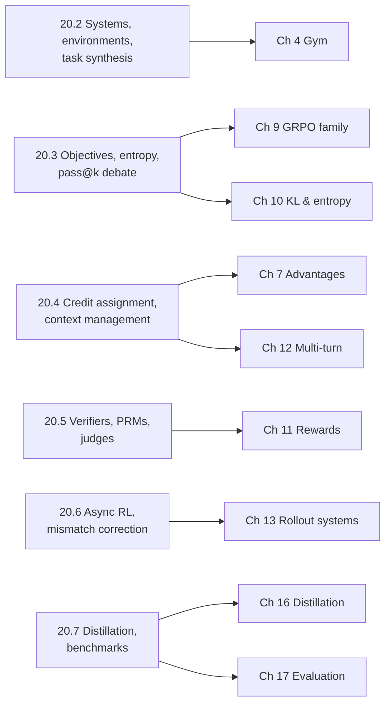

# 20. 研究前沿与开放问题

[第 19 章](19-capstone.md)在 BugFix gym 上为 TinyAgent 组装了一套完整的训练栈，并把每个组件对应到生产基础设施。留下的问题是：这个领域现在在做什么？这套栈中哪些部分已有定论，哪些仍有争议，哪些正在被替换？本章用一张标注日期的智能体强化学习（agentic RL）公开研究地图来回答这个问题。本章按问题而不是按论文组织，因为加入后训练团队的读者首先遇到的是问题（“我们的异步训练器发散了”“我们的验证器被投机利用了”），需要知道哪些公开工作与每个问题相关。

研究快照日期：**2026-10-13**。下面每一条都给出其来源、日期（arXiv v1 提交日期，或博客、文档的发布日期），以及实际查阅了什么：仅摘要、全文，或固定提交下的代码或文档。本章引用的论文中的每个数字都是**作者报告**的。这些方法没有一个在本书中以模型规模复现过；本书自己的实验是前面各章中的 TinyAgent 运行。凡是我们无法对照一手来源核实的说法，都已略去，[20.8 节](#208-开放问题)末尾列出了最重要的排除项。本章不描述私有实验室的配方。一份公开报告说某个系统使用了某种技术，只是关于该系统的证据。

每一节都以**我们会测试什么**结尾：一个受控实验，尽可能按 BugFix gym 和 TinyAgent 的规模设计，能把一个报告的主张变成一次测量。这些都是提议，没有一个是为本章实际运行过的。

上图把本章每一节对应到本书中其机制被扩展的那一章。请在读完目标章之后再读相应的一节。

## 20.1 如何阅读一条前沿条目

一条前沿条目是这样一种形式的主张：“方法 M 应用于模型 X、使用数据 D 和计算量 C，使基准 B 上的指标 Y 提高了 Δ。”每个槽位都可能藏着混杂因素，而在智能体编程工作中，有几个槽位比其他的更重要。

第一个是**哪个数字**。编程智能体论文报告的好几个量都被叫作“解决率”：单次尝试的 pass@1（常在多次运行上取平均）、Best@$k$（采样 $k$ 次尝试，用验证器（verifier）或重排序器挑一个），以及 pass@$k$（$k$ 次尝试中任一次成功即可，这需要一个预言机）。如下面若干条目所示，同一个模型的这些量可能相差 15 个百分点或更多。只有在相同的量、相同的评测框架（harness）之间做比较才有意义。

第二个是**训练的是什么**。好几个知名的“SWE 智能体”结果来自在过滤后的轨迹上做监督微调（SFT），而不是强化学习，或者来自使用非执行奖励的单轮强化学习。这并不会让它们的用处变小，但想要获得多轮强化学习证据的读者必须核查。

第三个是**证据深度**。在本章中，“查阅摘要”指我们只读了摘要；“查阅全文”指我们读了论文正文（通过 HTML 渲染）；“README”或“某 SHA 下的文档”指我们在所述提交下读了这些文件。我们只在搜索摘要片段中读到的主张不会出现。

> **证据。** 本章所有数字都由所引来源在所引日期报告。本书没有复现其中任何一个。若某个来源内部不一致，我们会指出并给出位置。

## 20.2 编程智能体系统、环境与任务合成

### 为仓库修复而训练的系统

这些系统要解决的问题，正是本书以缩微形式研究过的问题：训练一个策略（policy），在多轮中读取、编辑和测试一个代码仓库，奖励来自执行隐藏测试。下表汇总了公开的参考点。“训练”一栏说明主打模型是用多轮强化学习、单轮强化学习，还是监督微调（SFT）或拒绝采样微调（RFT）训练的。

| 系统（日期） | 训练 | 奖励 | 作者报告的 SWE-bench Verified | 查阅范围 |
| --- | --- | --- | --- | --- |
| [SWE-Gym](https://arxiv.org/abs/2412.21139)（2024-12-30） | 在来自更强模型的 491 条成功轨迹上做 RFT | 非强化学习 | 20.6% pass@1；使用训练好的验证器时 32.0% Best@16 | 摘要与全文 |
| [SWE-RL](https://arxiv.org/abs/2502.18449)（2025-02-25） | 在 Llama-3.3-70B-Instruct 上做单轮 GRPO | 与预言机补丁的相似度；格式错误为 $-1$ | 41.0%，通过重排序从 500 个样本中选出一个补丁 | 摘要与全文 |
| [R2E-Gym](https://arxiv.org/abs/2504.07164)（2025-04-09） | 在拒绝采样得到的轨迹上做 SFT | 非强化学习 | 34.4% pass@1（32B）；使用混合验证器时 51.0% Best@26 | 摘要与全文 |
| [SkyRL-v0](https://github.com/NovaSky-AI/SkyRL/tree/a0d50c482436af7fac8caffa4533616a78431d66)（README，2025-05-06） | 多轮强化学习（基于 verl 和 OpenHands 构建） | 测试执行 | 14B 模型：18% → 21.6% | v0 提交下的 README |
| [DeepSWE](https://www.together.ai/blog/deepswe)（博客，2025-07-02） | 仅多轮强化学习，从 Qwen3-32B 出发 | 二值：隐藏的 Fail2Pass 和 Pass2Pass 测试在 5 分钟内通过 | 42.2% pass@1（16 次运行平均）；使用混合测试时扩展时 59.0% | 博客全文 |
| [Golubev et al.](https://arxiv.org/abs/2508.03501)（2025-08-05） | 先 RFT，再多轮 DAPO，Qwen2.5-72B-Instruct | 仅结果 | 11% → 39% pass@1（RFT 基线 20%） | 摘要 |
| [Kimi-Dev](https://arxiv.org/abs/2509.23045)（2025-09-27） | 中期训练、SFT，然后在固定工作流的代码编辑阶段做强化学习 | 0/1 执行结果；为编写测试的角色单独设奖励 | 使用测试时选择时 60.4%（全文中 1 个补丁 × 1 个测试时为 48.0%）；进一步 SFT 后作为 SWE-agent 的 pass@1 为 48.6% | 摘要与全文 |
| [SkyRL-Agent](https://arxiv.org/abs/2511.16108)（2025-11-20） | 仅多轮强化学习，从 Qwen3-32B 出发 | 单元测试通过 | 24.4% → 39.4% pass@1 | 摘要与全文 |
| [LEGO-RL](https://arxiv.org/abs/2608.17393)（2026-08-18） | 在现有智能体评测框架内做多轮 GSPO | 结果奖励，配合沙箱侧的反投机阶段 | Qwen3.5-35B-A3B：在 OpenHands SDK 评测框架中 64.0% → 70.4% | 摘要 |

有三个模式很突出，每一个都对应前面各章中的一个机制。

第一，**编程智能体的公开强化学习配方收敛到对 GRPO 的一小组修改上。** DeepSWE 报告把其算法描述为 GRPO 加上 clip-higher（来自 DAPO）、无 KL 损失、无标准差归一化且无长度归一化（来自 Dr. GRPO）、留一法优势（advantage）、无熵损失，以及“compact filtering”，即对触及最大上下文、最大步数或超时的轨迹做掩码。SkyRL-Agent 的全文描述了不带标准差或长度归一化的留一法优势、完全同策略（on-policy）的更新，以及无 KL 和熵损失。这些分别是[第 7 章](07-advantages-and-credit.md)、[第 9 章](09-grpo-and-variants.md)和[第 10 章](10-kl-entropy-regularization.md)中的选择；这些报告描述的是作者用了什么，而不是每个选择都必要的受控证据。

第二，**截断的回合被作为单独情形处理。** DeepSWE 的 compact filtering 把截断轨迹从损失中掩码掉，而不是给它们 0 奖励，这是对[第 12 章](12-multi-turn-and-long-horizons.md)中超时问题的一种回答。另一种做法是在截断时对最终状态打分，见[附录 B 问题 13](B-design-review.md#问题-13智能体从不提交)。

第三，**主打数字混合了单次尝试结果与选择结果。** R2E-Gym 的论文报告，基于执行和不基于执行的验证器各自单独使用时都“在 42-43% 左右饱和”，组合后达到 51%；DeepSWE 的 59.0% 同样使用了混合测试时扩展。DeepSWE 博客的结论部分写的是 59.2%，而正文和表格写的是 59.0%；我们引用正文。这些是验证器的结果，而不是策略的结果，[20.5 节](#205-奖励验证器与评判模型)会回到这一点。

这些运行背后的开源框架在[第 19 章](19-capstone.md)中引用。为本章我们解析了：[rLLM](https://github.com/rllm-org/rllm) 在 `4e828c8`（原 `agentica-project/rllm` 仓库已归档，解析到 `7b47687`），其 README 说明它的训练器是 verl 的修改分支；[R2E-Gym](https://github.com/R2E-Gym/R2E-Gym) 在 `0d94c4e`；[SWE-Gym](https://github.com/SWE-Gym/SWE-Gym) 在 `b681068`；[SWE-RL](https://github.com/facebookresearch/swe-rl) 在 `5aa10d6`；以及 [SkyRL](https://github.com/NovaSky-AI/SkyRL) 在 `a1e34db`。我们只读了 README，没有审计代码。

### 任务合成与自博弈

编程强化学习中稀缺的输入不是算法，而是可执行的任务：一个仓库快照、一个能构建的环境、一个问题描述，以及在修复前失败、修复后通过的测试。公开工作从三个方向着手。

**大规模挖掘真实历史。** [SWE-rebench](https://arxiv.org/abs/2505.20411)（2025-05-26，摘要）报告了一条自动化流水线，为强化学习产出“over 21,000 interactive Python-based SWE tasks”，并以同样方式构建了一个持续更新的评估集。其后续工作 [SWE-rebench V2](https://arxiv.org/abs/2602.23866)（2026-02-27，摘要）报告了覆盖 20 种语言、3,617 个仓库的 32,079 个任务。[Skywork-SWE](https://arxiv.org/abs/2506.19290)（2025-06-24，摘要）报告了来自 2,531 个仓库的 10,169 个经过验证的 Python 任务实例，并将其用于 SFT。[SWE-Factory](https://arxiv.org/abs/2506.10954)（2025-06-12，摘要）用一个 LLM 多智能体系统构建环境，报告从 671 个问题中得到 337 个有效实例，成本为“$0.047 per instance”，基于退出码的判分达到“F1 score of 0.99”。

**向可运行的仓库中合成 bug。** [SWE-smith](https://arxiv.org/abs/2504.21798)（2025-04-30，摘要）把挖掘过程反过来：为每个仓库构建一个执行环境，然后合成会让现有测试失败的任务实例。作者报告了“50k instances from 128 GitHub repositories”，以及其 32B 模型在 SWE-bench Verified 上 40.2% 的 pass@1。R2E-Gym 的流水线类似地把提交反向翻译成问题描述，并在没有测试的地方生成测试。这与 BugFix gym 用其 bug 族所做的事情相同（[第 4 章](04-environments-and-tools.md)），只是在仓库规模上。

**自博弈。** [Absolute Zero](https://arxiv.org/abs/2505.03335)（2025-05-06，摘要与全文）训练同一个模型既提出又求解代码推理任务，以 Python 执行器作为验证器。其提出者的奖励是一个可学习性信号：若求解者成功率为 0 或 1 则为 0，否则为 $1 - \text{rate}$。这直接利用了[第 9 章](09-grpo-and-variants.md)中退化组不携带梯度的观察。[Self-play SWE-RL](https://arxiv.org/abs/2512.18552)（2025-12-21，摘要与全文）把这个想法应用到代码仓库上：同一个策略既充当 bug 注入者（必须产出一个由测试界定的、自洽的 bug 产物），又充当求解者。注入者的奖励在产物不自洽时为 $-1$，在求解率 $s$ 为 0 或 1 时为 $-\alpha$，否则为 $1 - (1+\alpha)s$，其中 $\alpha = 0.8$；求解者的奖励为 $\pm 1$。作者报告在 SWE-bench Verified 和 SWE-Bench Pro 上相对其起始检查点分别提升了“+10.4 and +7.8 points”，并超过了一个在人工整理数据上训练的基线。

> **陷阱。** 合成的 bug 分布就是一种训练分布。如果注入的 bug 系统性地比真实 bug 更容易定位（例如因为注入者编辑的是最近改动过的代码），求解者就可能学到一条无法迁移的定位捷径（shortcut）。BugFix gym 设置留出（held-out）族正是出于这个原因。

**我们会测试什么。** 构建 BugFix gym 的自博弈变体：TinyAgent 选择一个编辑操作向正确的函数中注入 bug（注入者），另一次 rollout 修复它（求解者）。在固定的求解者回合数下比较三种任务来源：人工编写的训练族、使用可学习性奖励的注入者生成 bug，以及使用均匀奖励的注入者生成 bug。结果指标是留出族的通过率，使用 5 个随机种子。可学习性论证给出的预测是：可学习性奖励每步产生的退化组更少；开放问题是它是否也能改善留出迁移，还是只是集中在求解者半懂的 bug 上。

## 20.3 目标函数、探索与 pass@k 之争

### 把 RLVR 目标写成相对 GRPO 的差异

[第 9 章](09-grpo-and-variants.md)详细推导了每个变体。这里我们记录每个一手来源具体规定了什么，因为公开讨论常把某些选择归到错误的论文上。[DeepSeekMath](https://arxiv.org/abs/2402.03300)（2024-02-05，全文）中定义的 GRPO，把每条序列的逐 token 和除以其自身长度，在组内取平均，把 KL 项放在损失中并使用 $k_3$ 式估计量，并使用由输出 $i$ 的每个 token 共享的结果优势 $(r_i - \mathrm{mean}(r))/\mathrm{std}(r)$：

$$
J_{\text{GRPO}}(\theta)=\mathbb{E}\Big[\frac{1}{G}\sum_{i=1}^{G}\frac{1}{|o_i|}\sum_{t=1}^{|o_i|}\Big(\min\big(\rho_{i,t}\hat A_{i},\ \mathrm{clip}(\rho_{i,t},1-\epsilon,1+\epsilon)\hat A_{i}\big)-\beta\,\mathbb{D}_{\text{KL}}\big[\pi_\theta\,\|\,\pi_{\text{ref}}\big]\Big)\Big]
$$

各变体如下，除特别标注外均查阅了全文：

- [Dr. GRPO](https://arxiv.org/abs/2503.20783)（2025-03-26）指出了来自 $1/|o_i|$ 因子的回答级长度偏差，以及来自除以 $\mathrm{std}(r)$ 的问题级难度偏差，并把两者都去掉。其作者报告用一个 7B 基座模型在 AIME 2024 上达到 43.3%。
- [DAPO](https://arxiv.org/abs/2503.14476)（2025-03-18）引入了 Clip-Higher（$\epsilon_{\text{low}} = 0.2$，$\epsilon_{\text{high}} = 0.28$）、动态采样（过采样并丢弃准确率为 0 或 1 的提示）、按组内 token 总数归一化的 token 级损失，以及超长奖励塑形（在 16,384 token 的期望最大长度之前，于 4,096 token 的缓冲区内施加线性惩罚）。它还去掉了 KL 项。其在 Qwen2.5-32B 上的消融实验报告，随着这些技术逐项加入，AIME 2024 从 30（朴素 GRPO）升到 50。
- [RLOO](https://arxiv.org/abs/2402.14740)（2024-02-22）使用留一法基线 $\frac{1}{k-1}\sum_{j \ne i} R(y_j)$，并把整个生成视为一个动作。
- [GSPO](https://arxiv.org/abs/2507.18071)（2025-07-24）用一个长度归一化的序列比率取代逐 token 比率，其裁剪范围报告为 $3\times10^{-4}$ 和 $4\times10^{-4}$：

$$
s_i(\theta)=\Big(\frac{\pi_\theta(o_i\mid x)}{\pi_{\text{old}}(o_i\mid x)}\Big)^{1/|o_i|}=\exp\Big(\frac{1}{|o_i|}\sum_{t}\log\frac{\pi_\theta(o_{i,t}\mid x,o_{i,<t})}{\pi_{\text{old}}(o_{i,t}\mid x,o_{i,<t})}\Big)
$$

  论文报告，GRPO 在混合专家模型上需要一种“Routing Replay”策略（重放 $\pi_{\text{old}}$ 下选中的专家）才能收敛，而 GSPO 不需要。
- CISPO 出自 [MiniMax-M1 报告](https://arxiv.org/abs/2506.13585)（2025-06-16），它“clips importance sampling weights rather than token updates”：损失为 $\mathrm{sg}(\hat\rho_{i,t})\hat A_{i,t}\log\pi_\theta(o_{i,t})$，其中 $\hat\rho$ 经过裁剪并停止梯度，因此每个 token 都保留梯度。该报告称，在一项受控的 Qwen2.5-32B 研究中，它比 DAPO 快 2 倍。
- [VAPO](https://arxiv.org/abs/2504.05118)（2025-04-07，摘要）回到学习型评论家（critic），并报告用 Qwen 32B 基座模型在 AIME 2024 上达到 60.4。

对智能体而言，有两点格外重要。损失聚合问题（[第 6 章](06-policy-gradient.md)）在智能体轨迹上比在数学任务上更尖锐，因为策略 token 数在回合之间相差一个数量级，并且与成功相关。而像 GSPO 那样的序列级比率，改变了“信赖域”对一条 50 轮轨迹的含义：即使少数 token 变化很大，数千个 token 上的几何平均仍接近 1。上述证据几乎全部来自使用 Qwen 系列基座模型的单轮数学推理。DeepSWE 和 LEGO-RL 是把其中一些选择（DAPO/Dr. GRPO 修改、GSPO）用于编程智能体的公开报告，但两者都不是对这些目标函数的受控比较。

**我们会测试什么。** 在 BugFix gym 上运行 GRPO、Dr. GRPO、带 clip-higher 的 DAPO token 级损失，以及 GSPO 式序列比率，固定样本预算，每种 5 个随机种子。分别记录成功与失败回合的策略 token 长度、裁剪比例（clip fraction）和留出通过率。机制层面的预测是：与 Dr. GRPO 相比，GRPO 的 $1/|o_i|$ 归一化会让失败轨迹变长；开放问题是 GSPO 的几何平均比率是否对长的多轮回合约束不足，这可以通过在少数 token 上注入一个大的变化并检查裁剪是否被触发来测试。

### 探索与熵

[The Entropy Mechanism of RL for Reasoning LMs](https://arxiv.org/abs/2505.22617)（2025-05-28，全文）报告了验证集性能与策略熵（entropy）之间的经验拟合 $R = -a e^{H} + b$，这意味着熵耗尽时存在性能上限；并推导出，对用朴素策略梯度训练的 softmax 策略，每步熵的变化近似为

$$
H(\pi^{k+1}\mid s)-H(\pi^{k}\mid s)\approx-\eta\,\mathrm{Cov}_{a\sim\pi^{k}}\big(\log\pi^{k}(a\mid s),\ \pi^{k}(a\mid s)A(s,a)\big)
$$

因此只要高概率动作同时具有高优势，熵就会下降。作者提出了 Clip-Cov 和 KL-Cov，对一小部分高协方差 token 断开梯度或施加惩罚，并报告在七个数学基准上相对 GRPO 的平均提升。[Beyond the 80/20 Rule](https://arxiv.org/abs/2506.01939)（2025-06-02，摘要）报告，把策略梯度更新限制在熵最高的 20%“分叉”token 上，在 Qwen3-8B 上与完整更新持平，在 14B 和 32B 上超过完整更新。[Reasoning with Exploration](https://arxiv.org/abs/2506.14758)（2025-06-17，摘要）在优势中加入一个基于熵的项。专门针对智能体，[ARPO](https://arxiv.org/abs/2507.19849)（2025-07-26，摘要）报告 token 熵在工具响应之后立即上升，并在这些高不确定性点上分叉出额外的 rollout。

ARPO 的观察对本书的设置很重要。工具输出是策略没有生成的观测（[第 5 章](05-trajectories-and-templates.md)），因此策略的不确定性自然在它们之后最高。那里是花费探索（exploration）预算最便宜的地方，也是熵坍缩危害最大的地方。

**我们会测试什么。** 在初始化时和 GRPO 训练后，测量 TinyAgent 的逐 token 熵随相对最近一次工具观测的位置的变化。如果 ARPO 的模式在缩微尺度上成立，熵应在观测之后的第一个策略 token 处达到峰值。然后在总熵匹配的条件下，比较均匀的熵奖励项与只施加于每次观测之后前 $m$ 个策略 token 的熵奖励项。结果指标是留出族上的 pass@1 和 pass@8。

### 强化学习能把能力扩展到基座模型的 pass@k 之外吗？

这是 RLVR 中被引用最多的开放问题，并且直接对应[第 17 章](17-evaluation.md)中的测量。[Yue et al.](https://arxiv.org/abs/2504.13837)（2025-04-18，全文）报告，RLVR 训练的模型在小 $k$ 时胜出，但“base models achieve a higher pass@k score when k is large”；随着 RLVR 进行，pass@256 的覆盖率下降；他们重新实现的六种 RLVR 算法在这方面“perform similarly”；而蒸馏“can introduce new reasoning patterns”。[The Invisible Leash](https://arxiv.org/abs/2507.14843)（2025-07-20，摘要）认为 RLVR 受支撑集约束，并且支撑集的收缩通常超过扩张。

反面证据同样是公开的。[ProRL](https://arxiv.org/abs/2505.24864)（2025-05-30，全文）训练超过 2,000 步，使用参考策略重置和 DAPO 组件，报告强化学习模型“across a wide range of pass@k evaluations, including scenarios where base models fail entirely”都优于基座模型。[RLVR Implicitly Incentivizes Correct Reasoning](https://arxiv.org/abs/2506.14245)（2025-06-17，摘要）认为基于答案的 pass@$k$ 是错误的指标，而要求推理正确的 CoT-Pass@$k$ 显示了边界的扩展。[Pass@k Training](https://arxiv.org/abs/2508.10751)（2025-08-14，摘要）直接把组内 pass@$k$ 用作奖励。[RL Squeezes, SFT Expands](https://arxiv.org/abs/2509.21128)（2025-09-25，摘要）把强化学习刻画为压缩错误轨迹，把 SFT 刻画为扩展正确轨迹。

另外两个结果让对特定基座模型上 RLVR 收益的解释更加复杂。[Spurious Rewards](https://arxiv.org/abs/2506.10947)（2025-06-12，摘要）报告，Qwen2.5-Math-7B 在随机分配奖励时 MATH-500 提升了 21.4 个百分点，而使用真实奖励时为 29.1 个百分点，并将其归因于一种放大预训练先验的裁剪偏差；这一效应在 Llama3 和 OLMo2 上常常不出现。[One-shot RLVR](https://arxiv.org/abs/2504.20571)（2025-04-29，摘要）报告仅用一个训练样本就获得了很大提升。两篇论文都不涉及编程智能体。它们都是理由：在把一项收益归功于奖励之前，要求做一个非 Qwen 对照和一个随机奖励对照。

我们的解读（标注为解读）：这些主张并不直接矛盾。它们在训练长度、正则化、基座模型、指标和任务族上都不同。上述论文没有一篇测量多轮编程智能体，而在这类智能体中，动作空间包括信息收集，策略的微小变化就可能打开环境的一片新区域。智能体强化学习在这一点上是否表现得像数学 RLVR，仍是开放问题。

**我们会测试什么。** 用 GRPO 训练 TinyAgent 三种长度（短、中、长），分别带和不带参考策略重置，然后在留出族上为初始策略和训练后策略计算 $k \in \{1, 2, 4, \dots, 256\}$ 的无偏 pass@$k$ 曲线（[第 17 章](17-evaluation.md)）。在相同预算下加入一个随机奖励对照。要检验的是：交叉点（如果存在）是否随训练变长而移向更大的 $k$；以及在一个没有预训练先验的模型上，随机奖励对照是否会改变 pass@1。

## 20.4 长时程：信用分配与上下文管理

### 轮级信用分配

仅基于结果的优势，给一个 50 轮回合中的每个策略 token 相同的信号（[第 7 章](07-advantages-and-credit.md)）。这是无偏的但噪声很大，并且在成功的回合中，它对无用步骤的奖励与对决定性编辑的奖励一样多。公开工作提供了四类替代方案。

**分层价值方法。** [ArCHer](https://arxiv.org/abs/2402.19446)（2024-02-29，摘要）训练一个异策略（off-policy）的话语级评论家，并用它在每一轮内训练 token 级策略，报告相对现有方法约 100 倍的样本效率。[SWEET-RL](https://arxiv.org/abs/2503.15478)（2025-03-19，摘要）训练一个步级评论家，它能访问策略看不到的训练期信息，并报告在其协作编程基准 ColBench 上 6% 的绝对提升。

**无评论家的步级分组。** [GiGPO](https://arxiv.org/abs/2505.10978)（2025-05-16，全文）保留 GRPO 的回合级分组，并加入从*锚点状态*（anchor states）事后构造的步级分组：锚点状态是同一组中不同轨迹到达的相同环境状态。在一个锚点状态组内，各动作按从该状态出发的折扣回报（$\gamma = 0.95$）进行比较，最终优势为 $A = A^{E} + \omega A^{S}$，其中 $\omega = 1$。作者报告在相同 rollout 成本下，相对 GRPO 在 ALFWorld 上提升超过 12%，在 WebShop 上超过 9%。该方法依赖于状态精确重现；对于状态不会精确重现的搜索任务，论文使用一个相似度阈值。

**奖励结构。** [Wei et al.](https://arxiv.org/abs/2505.11821)（2025-05-17，摘要；当前标题为“Reinforcing Multi-Turn Reasoning in LLM Agents via Fine-Grained Reward Structure and Credit Assignment”）为终止奖励、延迟奖励和逐轮奖励的 MDP 推导了 GRPO 和 PPO 变体，并报告在其搜索和游戏任务上，稠密的逐轮奖励优于稀疏的终止奖励。

**由模型导出的轮级奖励。** [TRACE](https://arxiv.org/abs/2607.13988)（2026-07-15，摘要）把一个冻结参考模型对标准答案的对数概率，转换为工具调用边界处的状态价值，并把它们的时序差分用作逐动作奖励，无需训练评论家；作者报告在 BrowseComp-Plus 上有很大提升。[SWE-MILE](https://arxiv.org/abs/2609.32631)（2026-09-26，摘要）是针对编程智能体最直接的尝试：基于文件暴露程度和测试状态对齐度的势函数，其差值为单个动作分配信用，验证在一个影子沙箱中异步运行。其摘要没有给出数字，并且在撰写本文时它才发布两周。

[RAGEN](https://arxiv.org/abs/2504.20073)（2025-04-24，全文）是一种诊断而不是信用分配方法：它命名了多轮智能体强化学习中的一种“Echo Trap”故障，表现为奖励方差坍缩、梯度范数尖峰，并报告只保留高方差提示、去掉 KL 以及 clip-higher 可以缓解它。对智能体而言，相关的理论是[第 11 章](11-rewards-and-verifiers.md)中的塑形证明：像 SWE-MILE 那样基于势函数的项，只有在具有 $\gamma\Phi(s') - \Phi(s)$ 形式时才能保持最优策略不变。

**我们会测试什么。** BugFix gym 有精确的锚点状态（每次编辑后的源代码字符串），因此 GiGPO 的分组无需近似即可应用。比较仅结果的 GRPO、GiGPO 式步级分组，以及势函数 $\Phi(s) = $ 通过的公开测试比例的基于势函数的塑形项，使用 5 个随机种子。测量留出通过率，以及每个成功回合中冗余动作（重复的 `read` 或无效编辑）的平均数。预测是步级信用会减少冗余动作；需要注意的风险是，使用公开测试的塑形势函数会提高 `hardcode_tests` 的发生率。

### 长回合的上下文管理

一个带有长工具输出的 50 轮回合会超出任何固定的上下文预算。截断、摘要和记忆都会改变策略的输入分布（[第 12 章](12-multi-turn-and-long-horizons.md)），而最近的问题是：上下文管理行为本身是否应该用强化学习来学习。

- [MEM1](https://arxiv.org/abs/2506.15841)（2025-06-18，摘要）训练智能体维护一个紧凑的内部状态，每轮重写它并丢弃其余内容，报告在一个 16 目标的多跳问答任务上，相对一个更大的模型取得 3.5 倍的性能提升和 3.7 倍的内存降低。
- [SUPO](https://arxiv.org/abs/2510.06727)（2025-10-08，摘要）让策略周期性地总结其工具使用历史，并推导出一个策略梯度，用标准基础设施端到端地优化工具使用与摘要行为。
- [Context-Folding](https://arxiv.org/abs/2510.11967)（2025-10-13，摘要）让智能体分支进入一条子轨迹，完成后将其折叠成摘要，用过程奖励训练，报告以小 10 倍的活跃上下文达到或超过 ReAct 基线。
- [ReSum](https://arxiv.org/abs/2509.13313)（2025-09-16，摘要）周期性地做摘要，并把最终优势广播到所有片段。
- [FoldAct](https://arxiv.org/abs/2512.22733)（2025-12-28，摘要）准确地陈述了问题：摘要“fundamentally modify the agent's future observation space, creating a policy-dependent, non-stationary observation distribution”。
- [CAMG-RL](https://arxiv.org/abs/2609.34422)（2026-09-28，摘要）把持久工作区中的普通文件用作编程智能体的记忆，并用异步 PPO 训练。

FoldAct 的这句话指出了训练正确性的问题。当策略编写自己的摘要时，摘要 token 是动作，之后的轮次以它们为条件，而训练器从完整历史重建出的序列并不是策略看到的序列。[第 5 章](05-trajectories-and-templates.md)的“token 进、token 出”纪律必须逐片段应用：每个片段都要在采样器所用的确切上下文上训练。

**我们会测试什么。** 给 TinyAgent 一个小于完整回合的上下文预算，在预算匹配的条件下比较三种处理：丢弃最早的观测；用环境产生的固定格式摘要替换每个工具输出；让策略发出一个 `note` 动作，其文本替换历史。测量通过率，并作为正确性检查，测量采样器与逐片段重建的训练器之间每个 token 对数概率差的最大值；如果片段存储正确，它在数值误差范围内应为零。

## 20.5 奖励、验证器与评判模型

问题正是[第 11 章](11-rewards-and-verifiers.md)所复现的：除部署目标之外的任何奖励都可能被利用，而基于执行的奖励并非对每个任务都可用。

**过程奖励模型。** [Let's Verify Step by Step](https://arxiv.org/abs/2305.20050)（2023-05-31，摘要）比较了用于 best-of-N 的奖励模型的结果监督与人工标注的过程监督，并发布了 800,000 个步骤标签。[Math-Shepherd](https://arxiv.org/abs/2312.08935)（2023-12-14，摘要）自动构建过程标签，并将其用于逐步 PPO。[PRIME](https://arxiv.org/abs/2502.01456)（2025-02-03，摘要）仅利用策略 rollout 和结果标签在线更新一个隐式过程奖励模型。三者都是在数学上开发的。对编程智能体而言，“一步”就是对仓库有可观测影响的一轮，这让过程信号更容易定义，也更容易被投机利用。

**编程智能体的验证器。** R2E-Gym 的全文区分了*基于执行*的验证器（一个训练好的智能体编写复现测试，补丁按是否通过这些测试打分）与*不基于执行*的验证器（一个模型读取问题描述、轨迹和补丁，输出正确的概率），并报告“test-based verifiers suffer from low distinguishability, while execution-free verifiers are biased and often rely on stylistic features”，混合方案达到 51.0%。[SWE-RM](https://arxiv.org/abs/2512.21919)（2025-12-26，摘要）给出了一个对强化学习很重要的观察：“two verifiers with nearly identical TTS performance can nevertheless yield very different results in RL”，因为对训练奖励而言，校准度和分类准确率都很重要，而不只是排序。Kimi-Dev 训练一个编写测试的角色，当它的测试在没有修复时失败、有修复时通过就给奖励，这是一种用于构建验证器的可验证奖励。SWE-RL 的相似度奖励是一种不基于执行的奖励，可以扩展到数百万个拉取请求，但它奖励的是与预言机补丁的相似，而不是正确性。

**LLM 评判模型。** [Agent-as-a-Judge](https://arxiv.org/abs/2410.10934)（2024-10-14，摘要）用一个智能体对照分层的需求来评判智能体的工作。[Rubrics as Rewards](https://arxiv.org/abs/2507.17746)（2025-07-23，摘要）把针对具体实例的评分细则条目聚合成奖励，并报告相对 Likert 量表评判奖励的提升。[One Token to Fool LLM-as-a-Judge](https://arxiv.org/abs/2507.08794)（2025-07-11，摘要）展示了失败模式：诸如单独一个冒号或“Let's solve this problem step by step.”之类的“master keys”会让评判模型给出假阳性，包括在基于参考答案的 RLVR 判分中。LEGO-RL 的摘要报告，在真实评测框架中“environmental crashes and reward hacking corrupt outcome signals”，并描述了分阶段的沙箱防御。

我们的解读：前沿问题不是“验证器还是评判模型”，而是如何把一个可被利用的稠密信号与一个稀疏的可信信号结合起来，以及如何在训练过程中而不是训练之后测量稠密信号是否正被利用。

**我们会测试什么。** 在 BugFix gym 中构建一个玩具级的不基于执行的验证器：一个基于最终源代码预测隐藏测试是否成功的小分类器，在脚本策略的输出上训练。让 TinyAgent 分别针对 (a) 隐藏测试、(b) 该分类器、(c) 要求两者都满足的混合方案进行训练。像[第 11 章](11-rewards-and-verifiers.md)那样，把分类器奖励和隐藏测试通过率画在同一坐标轴上。预测是 (b) 会发生背离；值得关注的测量是背离变得可见之前经过了多少步，以及分类器在留出数据上的校准度能否预测这一点。

## 20.6 异步强化学习与训推不一致

[第 13 章](13-rollout-systems.md)解释了为什么当回合长度有长尾时同步 rollout 会浪费加速器，以及为什么即使权重相同，采样器的概率 $\mu$ 也与训练器的 $\pi_{\text{old}}$ 不同。这是公开系统工作中最活跃的领域，也是公开工程文档最详尽的领域。

**异步设计。** [AReaL](https://arxiv.org/abs/2505.24298)（2025-05-30，全文）把生成与训练完全解耦。rollout 是可中断的：新权重到达时，工作进程丢弃 KV cache，在新权重下重新计算后继续，因此一条轨迹可能跨越多个策略版本。陈旧度（staleness）上限 $\eta$ 对生成进行节流：记已生成的轨迹数为 $N_r$、批大小为 $B$、当前策略版本为 $i$，只有当 $\lfloor (N_r - 1)/B \rfloor \le i + \eta$ 时生成才继续，因此 $\eta = 0$ 就是同步强化学习（报告的默认值：代码为 4，数学为 8）。目标函数是一种*解耦 PPO* 损失，它把行为策略（behavior policy）与一个近端策略分开：

$$
J(\theta)=\mathbb{E}_{a\sim\pi_{\text{behav}}}\Big[\frac{\pi_{\text{prox}}(a)}{\pi_{\text{behav}}(a)}\min\big(u(a)\hat A,\ \mathrm{clip}(u(a),1-\epsilon,1+\epsilon)\hat A\big)\Big],\qquad u(a)=\frac{\pi_\theta(a)}{\pi_{\text{prox}}(a)}
$$

摘要报告相对同步系统“up to 2.77× training speedup”；引言则写“up to 2.57×”。[PipelineRL](https://arxiv.org/abs/2509.19128)（2025-09-23，全文）在生成过程中更新权重，并有意保留陈旧的 KV cache，用截断在 5 的重要性加权 REINFORCE 进行训练。[Magistral](https://arxiv.org/abs/2506.10910)（2025-06-12，全文）同样在权重广播之间继续生成而不刷新 KV cache，并且没有描述单独的重要性校正。[Kimi k1.5](https://arxiv.org/abs/2501.12599)（2025-01-22，全文）限制每次 rollout 的 token 预算，并把未完成的部分存入回放缓冲区供下一次迭代使用（“partial rollout”）。[LlamaRL](https://arxiv.org/abs/2505.24034)（2025-05-29，摘要）和 [ROLL Flash](https://arxiv.org/abs/2510.11345)（2025-10-13，摘要）报告了更大规模上的异步加速；ROLL Flash 报告“2.72x on agentic tasks”。[SkyRL-Agent](https://arxiv.org/abs/2511.16108) 报告其面向多轮智能体的异步调度器带来 1.55 倍加速。

**不一致校正。** 博客文章 [Your Efficient RL Framework Secretly Brings You Off-Policy RL Training](https://fengyao.notion.site/off-policy-rl)（Yao, Liu, et al.，首次发布于 2025-08-05，全文）陈述了同步系统中的问题：rollout 来自推理引擎，梯度来自训练引擎，两者并不一致。它提出了截断重要性采样（TIS）：

$$
\nabla_\theta J \approx \mathbb{E}_{a\sim\pi_{\text{sampler}}}\Big[\min\Big(\frac{\pi_{\text{learner}}(a)}{\pi_{\text{sampler}}(a)},\,C\Big)\,R(a)\,\nabla_\theta\log\pi_{\text{learner}}(a)\Big]
$$

其中 $C$ 是超参数（配套的 Flash-RL README 在示例命令中使用 $C = 2$ 和 $C = 8$）。该文章还报告，在概率差异很小的地方，TIS 不带来收益。[When Speed Kills Stability](https://yingru.notion.site/When-Speed-Kills-Stability-271211a558b7808d8b12d403fd15edda)（Liu, Li, et al.，首次发布于 2025-09-17，部分阅读）报告不一致集中在低概率 token 和工具响应之后的轮次上，认为 token 级校正有偏，而序列级校正方差呈指数级，并提出了序列级掩码变体。其后续工作 [Trust Region Masking](https://arxiv.org/abs/2512.23075)（2025-12-28，摘要）对违反信赖域的整条序列做掩码，其动机是随时间跨度增长的界。[Ring-1T 报告](https://arxiv.org/abs/2510.18855)（2025-10-21，全文）提出了 IcePop，把训练/推理比率落在 $[0.5, 5]$ 之外的 token 的梯度置零，并报告更窄的区间会使训练不稳定。MiniMax-M1 报告称，用 FP32 计算 LM head 使训练/推理概率的相关性“from approximately 0.9x to 0.99x”。

**从源头消除不一致。** [Defeating Nondeterminism in LLM Inference](https://thinkingmachines.ai/blog/defeating-nondeterminism-in-llm-inference/)（Thinking Machines，2025-09-10，全文）把运行间的差异主要归因于 kernel（RMSNorm、matmul、attention）缺乏批次不变性，报告在没有批次不变 kernel 时，向一个大模型发送 1,000 个相同的温度为 0 的请求得到了 80 种不同的补全，并报告在采样器与训练器逐位一致时，一次强化学习运行中测得的 KL 为 0。

**框架设计（固定提交）。** verl 在 [`76e837e`](https://github.com/volcengine/verl/tree/76e837e0bfcb18b380a66c0ba56ef9f0ac840f09) 下记录了：一种[一步异策略模式](https://github.com/volcengine/verl/blob/76e837e0bfcb18b380a66c0ba56ef9f0ac840f09/docs/advance/one_step_off.md)，把第 $n+1$ 步的 rollout 与第 $n$ 步的训练重叠；一种[完全异步模式](https://github.com/volcengine/verl/blob/76e837e0bfcb18b380a66c0ba56ef9f0ac840f09/docs/advance/fully_async.md)，带有 `staleness_threshold` 和部分 rollout；以及一个 [rollout 校正](https://github.com/volcengine/verl/blob/76e837e0bfcb18b380a66c0ba56ef9f0ac840f09/docs/algo/rollout_corr.md)模块，其预设包括阈值为 2.0 的 token 级和序列级截断 IS，以及 $[0.5, 5.0]$ 的 IcePop 式区间。[slime](https://github.com/THUDM/slime/tree/05e3b017fed9e02de418c2fbac9d75602a534be5) 在 `05e3b01` 下通过一个数据缓冲区把 Megatron 训练与 SGLang rollout 连接起来，并为多轮与工具循环提供自定义生成函数。[OpenRLHF](https://github.com/OpenRLHF/OpenRLHF/tree/dc2a7ad326f619fc5a47737ea47d1920ce2c0b53) 在 `dc2a7ad` 下记录了一种以队列大小控制陈旧度的异步模式、部分 rollout（其中“in-flight samples may contain tokens from both old and new weights”），以及 mask 或 clip 模式下的 token 级或序列级 IS 校正。我们只读了文档和 README。

> **生产实践。** 公开的设计在一个基本问题上存在分歧：当权重在回合中途改变时，KV cache 应该重新计算（AReaL）还是保持陈旧（PipelineRL、Magistral）？重新计算要付出预填充的代价；保持陈旧则意味着后面的 token 采样自一个没有任何单一策略定义的分布，而针对单一策略计算的重要性比率并不能精确描述它。这在公开记录中尚无定论。

**我们会测试什么。** 用真实的 TinyAgent 更新扩展[第 13 章](13-rollout-systems.md)的离散事件模拟器：一个同步基线，陈旧度上限分别为 1、2、4 步，并对每种情况分别使用无校正、$C = 2$ 的 token 级 TIS 和序列级掩码。通过以与训练器假设略有不同的温度采样，注入受控的采样器–训练器不一致。测量达到目标通过率的挂钟时间、被截断比率的比例，以及 5 个随机种子之间的稳定性。[第 8 章](08-ppo.md)给出的预测是 token 级校正随回合长度而退化；BugFix gym 让我们可以通过改变轮数预算来改变长度。

## 20.7 蒸馏与评估

### 同策略蒸馏

[第 16 章](16-distillation.md)推导了同策略蒸馏（on-policy distillation）：学生（student）采样，教师（teacher）为学生的每个 token 打分，逐 token 的反向 KL 就是稠密奖励。早期的一手来源是 [GKD](https://arxiv.org/abs/2306.13649)（2023-06-23，摘要），它在自生成的序列上借助教师反馈训练，并允许使用其他散度；以及 [MiniLLM](https://arxiv.org/abs/2306.08543)（2023-06-14，摘要），它用同策略优化的反向 KL 取代前向 KL。[Qwen3 Technical Report](https://arxiv.org/abs/2505.09388)（2025-05-14，全文）描述了用于较小模型的先异策略、后同策略的蒸馏阶段，并在其 Table 21 中报告：对 Qwen3-8B，从同一起始检查点出发，同策略蒸馏用 1,800 GPU 小时在 AIME'24 上达到 74.4，而强化学习用 17,920 GPU 小时达到 67.6。Thinking Machines 的 [On-Policy Distillation](https://thinkingmachines.ai/blog/on-policy-distillation/) 一文（Kevin Lu et al.，2025-10-27，全文）把逐 token 优势设为负的反向 KL，并报告相对 SFT 的计算量降低为“9-30×”，具体取决于计算口径。

面向智能体的扩展都很新，且只核查了摘要。[TCOD](https://arxiv.org/abs/2604.24005)（2026-04-27）命名了多轮蒸馏中的一种“Trajectory-Level KL Instability”，并以课程方式逐步增加学生所接触的轨迹深度。[ReOPD](https://arxiv.org/abs/2607.04763)（2026-07-06）重放教师轨迹前缀，以避免在学生训练期间运行工具，并指出了一种“prefix trap”。本章的早期版本跟踪过同策略蒸馏中稀疏词表和位置选择方面的提议；这些条目仍保留在 [sources.md](../../sources.md) 中。

智能体特有的问题是教师给什么打分。工具观测不是学生的动作，所以它们不接受蒸馏信号；但学生的前缀包含它们，而一个以学生不寻常的工具历史为条件的教师，本身可能就处于分布之外。这是[第 16 章](16-distillation.md)中累积误差论证的一个版本，单轮结果无法回答它。

**我们会测试什么。** 用[第 9 章](09-grpo-and-variants.md)中训练好的 TinyAgent 作为教师，在匹配的学生样本预算下，比较向一个全新学生做同策略蒸馏与从头做 GRPO；并测量教师自身在学生前缀上的逐 token 熵，作为学生偏离程度（自学生第一次做出非教师动作以来的轮数）的函数。要回答的问题是：教师的可靠性是否随学生的偏离而足够快地下降，以至于限制了同策略蒸馏在长回合中的优势。

### 基准、污染与有效性

评估的问题在于，一个基准得分是模型、评测框架、测试套件以及模型训练数据历史的乘积，而每个因素都有已知的缺陷。

**SWE-bench 系列。** [SWE-bench](https://arxiv.org/abs/2310.06770)（2023-10-10，摘要）包含来自 12 个 Python 仓库的 2,294 个问题。根据其数据集卡片，[SWE-bench Verified](https://huggingface.co/datasets/princeton-nlp/SWE-bench_Verified) 是“a subset of 500 samples from the SWE-bench test set, which have been human-validated for quality”。[SWE-bench Multimodal](https://arxiv.org/abs/2410.03859)（2024-10-04）和 [Multi-SWE-bench](https://arxiv.org/abs/2504.02605)（2025-04-03）分别扩展到 JavaScript 和另外七种语言。[SWE-Bench Pro](https://arxiv.org/abs/2509.16941)（2025-09-21，全文）包含来自 41 个仓库的 1,865 个问题，通过使用强 copyleft 仓库和一个留出的商业集来抵御污染；它报告公开集上 GPT-5 的 pass@1 为 23.3%，Claude Opus 4.1 为 22.7%。[SWE-bench-Live](https://arxiv.org/abs/2505.23419)（2025-05-29）和 SWE-rebench 持续用模型训练截止日期之后创建的任务进行更新。

**智能体终端与竞赛。** [Terminal-Bench](https://arxiv.org/abs/2601.11868)（2026-01-17，摘要）包含 89 个终端环境任务，报告前沿模型和智能体的成绩低于 65%。[LiveCodeBench](https://arxiv.org/abs/2403.07974)（2024-03-12）按题目发布日期控制污染。

**有文献记录的有效性问题。**

- *解答泄漏与弱测试。* [SWE-Bench+](https://arxiv.org/abs/2410.06992)（2024-10-09，摘要）报告，在其分析中，32.67% 的成功补丁涉及解答出现在问题报告或评论中，31.08% 是因为测试太弱而通过。[UTBoost](https://arxiv.org/abs/2506.09289)（ACL 2025，摘要）报告发现了 36 个测试不充分的任务实例，以及 345 个被标为通过的错误补丁。
- *记忆。* [The SWE-Bench Illusion](https://arxiv.org/abs/2506.12286)（2025-06-14，摘要）报告，模型仅凭问题描述文本就能在 SWE-bench 上以最高 76% 的准确率识别出有 bug 的文件路径，而在 SWE-bench 之外的仓库上最高为 53%。
- *仓库状态泄漏。* [SWE-bench issue #465](https://github.com/SWE-bench/SWE-bench/issues/465)（2025-09-03 开启，2026-03-24 关闭）记录了智能体在任务容器中通过 `git log --all` 找到修复提交的情况。维护者估计其发生率约为每 10,000 条轨迹中 5 条，并重建了 Verified 镜像以删除“未来”的历史。[SWE-Bench Pro Verified](https://arxiv.org/abs/2609.08149)（2026-09-08，部分全文）报告，删除引用并不够，因为后来的提交可以从残留的 Git 对象中恢复，因此它把每个仓库重建为单个全新的提交。
- *测试与可合并性。* 一篇 [METR 研究笔记](https://metr.org/notes/2026-03-10-many-swe-bench-passing-prs-would-not-be-merged-into-main/)（2026-03-10，全文）请四位维护者评审了 SWE-bench Verified 运行中的 296 个 AI 生成补丁，报告判分器通过率比维护者合并率高约 24 个百分点，作者列出了若干注意事项（一次尝试、无反馈循环、12 个仓库中的 3 个）。

这些缺陷对强化学习比对 SFT 更重要，因为强化学习会针对奖励实际测量的任何东西进行优化，而训练环境往往与基准由相同的仓库和工具构建。一个只影响每 10,000 条评估轨迹中 5 条的泄漏，可以被一个因发现它而得到奖励的策略找到并放大。

**我们会测试什么。** 在 BugFix gym 中植入一个泄漏：一个 `history` 工具，只对某一个族返回修复后的源代码。分别在有和没有该工具的情况下训练 TinyAgent，测量泄漏需要多少步才能主导该族的成功，然后检验[附录 B 问题 11](B-design-review.md#问题-11隐藏测试通过环境泄漏)中的逐族学习速度告警，能否在泄漏的成功占比超过 50% 之前发现它。

## 20.8 开放问题

截至 2026-10-13，我们在以下问题上没有找到公开共识。每个问题都表述为读者可以作出贡献的问题。

1. **没有精确状态重现时的信用分配。** 锚点状态方法需要重复出现的状态；学习型评论家很难为语言智能体训练；由模型导出的势函数会继承模型的偏差。对于状态几乎从不精确重现的仓库修复，是否存在一个无评论家的轮级估计量，能被证明比结果优势方差更低，并且不可被利用？
2. **智能体时间跨度下的异策略校正。** token 级重要性权重有偏，序列级权重随长度爆炸，而回合正变得越来越长。对于带有陈旧 KV cache 的 50 轮、64k token 回合，哪种校正能让偏差和方差都保持有界？它应如何与 PPO 裁剪相互作用？
3. **学习上下文管理。** 当策略编写自己的摘要或记忆时，它的观测分布依赖于自身参数。经过这种依赖的正确梯度是什么？当前的逐片段估计量是否收敛到它？
4. **在优化下保持校准的验证器。** 验证器在固定集合上的准确率并不能预测它作为训练奖励时的表现（SWE-RM 的观察）。应如何为强化学习衡量验证器质量？它必须多久刷新一次？
5. **任务供给。** 挖掘和合成产出的任务，其难度和分布都与部署不同。自博弈提供了课程，但可能漂向易于注入和验证的 bug。哪种任务分布能使每 GPU 小时向真实问题的迁移最大化？
6. **智能体强化学习是否扩展能力。** pass@$k$ 之争是在数学上进行的。带工具的多轮强化学习是否表现相同？还是说，信息收集行为能让它到达基座模型从未访问过的状态？
7. **衡量部署所需之物的基准。** 测试是正确性的代理，而正确性又是可合并性的代理。一个基准能否跟上强化学习训练的智能体，而又不沦为训练奖励？

以下内容因我们在 2026-10-13 无法对照一手来源核实而被排除：OpenAI 的 SWE-bench Verified 发布公告及其 2026 年关于停用该基准的文章的内容（页面返回 HTTP 403；我们改为引用数据集卡片）；SkyRL-v0 博客的内容（页面无法渲染）；SUPO 和 Context-Folding 的表格级数字（只能找到二手总结）；SWE-RM 一个不在其摘要中的强化学习结果的说法；Self-play SWE-RL 的绝对分数（只在一张图中给出）；只在搜索结果中见到的几篇 2026 年多轮蒸馏预印本；只在某篇博客更新日志中见到的、某个 2025 年模型发布采用序列掩码的报道；以及一个关于 SWE-bench Multilingual 上寻找解答行为的审计统计，我们没有找到其一手来源。

## 20.9 实践中的设计问题

> **问题：决定采用哪个前沿想法。** *症状：* 一个团队有一套可用的基于 GRPO 的编程智能体配方，以及一份十篇近期预印本的清单，每篇都报告了提升。*原因：* 报告的提升是在不同的基座模型、任务族（大多是数学）、指标和预算上测得的，因此既无法相互排序，也无法与团队的基线排序。*可选方案：* 采用报告提升最大的方法（决定起来便宜，但经常是错的）；复现每篇论文的主打设置（昂贵，而且只能确认论文自己的设置）；或者按想法是否针对团队在自己的运行中*测得*的故障（熵坍缩、截断率、不一致尾部、验证器被利用）来排序，并先在小规模上测试机制。*默认做法：* 本书推荐第三种。写下这个想法应当修复的监控面板症状，在 BugFix gym 这样的小环境中复现该症状，检查这个想法是否改变了该症状，然后才在规模上用配对评估运行匹配的消融实验（[第 17 章](17-evaluation.md)）。

> **问题：解读作者报告的提升。** *症状：* 一篇论文报告“+15 points on SWE-bench Verified”。*原因：* 这个数字可能是在拿 Best@$k$ 与 pass@1 比较、拿调过参的方法与没调参的基线比较、使用了不同的评测框架，或者模型的训练数据与基准仓库有重叠。*可选方案：* 检查指标定义和样本数；检查基线是否得到同等的调参和算力；检查随机种子数以及提升是否超过种子间波动；检查提升能否在第二个更新的基准上复现（SWE-bench-Live、SWE-rebench、SWE-Bench Pro）；检查去污染。*默认做法：* 在指标是相同评测框架下的单次尝试 pass@1、基线匹配、并且至少一个新基准结论一致之前，把这一提升视为假设。[20.2 节](#202-编程智能体系统环境与任务合成)中 DeepSWE、R2E-Gym 和 SWE-Gym 这几行显示，同一模型的 pass@1 与验证器选择后的数字之间相差约 11 到 17 个百分点。

> **问题：一个数学 RLVR 技巧无法迁移到智能体上。** *症状：* 一个来源论文报告在 AIME 上有帮助的改动（例如更窄的裁剪范围，或只更新高熵 token），在编程智能体上没有效果或有害。*原因：* 智能体轨迹在触及机制的方面与单轮数学不同：观测 token 与策略 token 交错，熵在工具输出之后飙升，长度相差一个数量级，奖励依赖于环境状态。*可选方案：* 放弃这个改动；使其适应智能体结构（例如只在策略 token 上计算熵统计，并对紧跟观测之后的 token 单独统计）；或者先在单轮编程任务上测试，以区分“编程”效应与“多轮”效应。*默认做法：* 本书推荐第三种，因为它能告诉你是智能体设置的哪种性质破坏了该机制。

> **问题：切换到异步框架改变了结果。** *症状：* 从同步 rollout 迁移到异步框架后，吞吐量按预期倍数提高，但最终的留出通过率下降了几个百分点。*原因：* 陈旧度和采样器–训练器不一致现在进入了梯度；默认的校正（或没有校正）可能与回合长度不匹配；或者调度器使被训练批次偏向短回合。*可选方案：* 收紧陈旧度上限（损失吞吐量）；启用截断重要性校正并记录被截断比例；比较被训练回合与被启动回合的长度分布。*默认做法：* 用相同随机种子把两个系统运行到相同的*样本*数，既按样本数也按挂钟时间比较通过率。如果异步运行按每样本计更差，在调任何其他东西之前，先测量被截断比率的比例和长度偏差（[第 13 章](13-rollout-systems.md)）。

## 小结

- 公开的编程智能体强化学习系统（DeepSWE、SkyRL-Agent 等）报告收敛到一小组 GRPO 修改上：不带标准差或长度归一化的留一法或均值基线、clip-higher、无 KL，以及对截断回合的特殊处理。好几个知名的“SWE 智能体”结果是 SFT 或单轮强化学习，而不是多轮强化学习。
- 编程智能体的主打数字把单次尝试的 pass@1 与验证器选择后的 Best@$k$ 混在一起；两者之间的差距往往比方法之间的差距还大。
- 最活跃的开放领域是轮级信用分配、面向长异步回合的异策略校正、学习型上下文管理、在优化下仍然可靠的验证器，以及通过挖掘、注入或自博弈进行的任务合成。
- 大多数算法证据（目标函数变体、熵、pass@$k$ 之争）来自使用 Qwen 系列基座模型的单轮数学任务。它们向多轮编程智能体的迁移，在公开工作中基本未经检验。
- SWE 类基准有文献记录的缺陷：解答泄漏、弱测试、记忆、仓库历史泄漏，以及通过测试与可合并补丁之间的差距。奖励与这些基准共有的任何缺陷，都会被强化学习放大。
- 本章的每个数字都是截至 2026-10-13 的作者报告值。每一节都提出了一个受控实验，可以在 BugFix gym 规模上把一个主张变成一次测量。

## 练习

1. 从 [20.2 节](#202-编程智能体系统环境与任务合成)的表格中挑一行。从一手来源中提取基座模型、训练类型、奖励、指标定义、样本数和评测框架。用两句话写出报告的数字能说明什么、不能说明什么。
2. 改变一个假设：在 GSPO 序列比率中，用未归一化的乘积 $\prod_t \rho_t$ 替换长度归一化的几何平均。对一条每个 token 比率都为 $1.001$ 的 2,000 token 轨迹，计算这两个量，并说明各自需要怎样的裁剪范围。
3. 利用 AReaL 的陈旧度条件，推导在 $\eta = 2$、批大小为 512 时，最多可以领先训练生成多少条轨迹；并说明当 $\eta = 0$ 时吞吐量会怎样。
4. 为 BugFix gym 实现 GiGPO 的步级优势，用每次编辑后的确切源代码字符串作为锚点状态。在[第 4 章](04-environments-and-tools.md)脚本化随机策略产生的 64 条轨迹组成的批次上，报告有多少个锚点状态组包含不止一个动作。
5. 设计评审：你的负责人提议，对一个没有测试的新任务族，采用一个学习得到的不基于执行的验证器作为唯一的强化学习奖励。利用 [20.5 节](#205-奖励验证器与评判模型)，写出反对理由、你会接受它的条件，以及你会要求放在监控面板上的指标。
6. 从本章中选一个“我们会测试什么”的提议。写一份预注册：假设、指标、随机种子、样本预算，以及会证伪该假设的结果。然后如果你的机器允许，在 TinyAgent 上运行它，并报告结果是否与预期一致。
7. 从 [20.8 节](#208-开放问题)中挑一个开放问题，搜索 2026-10-13 之后发表的、针对它的工作。用 [20.1 节](#201-如何阅读一条前沿条目)的证据级别记录你查阅了什么。
