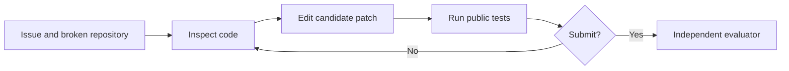

A coding agent receives an issue and a repository, inspects files, edits code, runs commands, and submits a patch. Before choosing a training objective, we need to understand what changes during that interaction and what counts as success. We begin with a concrete repair rather than an optimizer formula.

## DeepSWE supplies the system-level question

The [DeepSWE release report](https://www.together.ai/blog/deepswe) describes a Qwen3-32B-based coding agent trained with RL using rLLM and R2E-Gym. Its interaction includes code inspection, edits, and testing. We use that public project as a reference for questions about environment contracts, long trajectories, and verifiable feedback. Our examples are newly authored small coding tasks, not its training dataset or a reproduction of its benchmark results.

The pinned [rLLM SWE example](https://github.com/agentica-project/rllm/blob/7b47687f6a9ef1bf5cbd56dd1af61fff08c4b0e4/examples/swe/README.md) is an integration reference. “From scratch” below means exposing every teaching function. A production coding environment requires repository/container infrastructure beyond this trusted-function laboratory.

## The issue we will carry through the book

**Issue:** Fix `clamp(value, lower, upper)`. It must return lower below the interval, upper above the interval, and value inside the interval. Equal bounds are valid. Reversed bounds must raise `ValueError`. Negative bounds must work.

The repository currently mixes up `min` and `max`. First load that exact source and run an issue reproduction. This is ordinary execution; no model is sampled or updated.

```python
buggy_source = "def clamp(value, lower, upper):\n    return min(lower, max(value, upper))\n"
namespace = {}
exec(buggy_source, namespace)  # Execute only our trusted, authored example.
clamp = namespace["clamp"]
print("repository file:")
print(buggy_source.rstrip())
print("issue reproduction:", clamp(3, 0, 5))
print("expected:", 3)
```

Output:

```text
repository file:
def clamp(value, lower, upper):
    return min(lower, max(value, upper))
issue reproduction: 0
expected: 3
```

`namespace` is a dictionary of names defined by the executed source. Selecting its `clamp` entry gives the function object. This is not the model's policy: it is the code being repaired. In real SWE tasks, imports, dependencies, build steps, and repository revisions also affect execution.

## Turn the specification into an independent check

Each test is a tuple containing a name, arguments, and an expected value or exception class. `check_case` returns a Boolean. It treats unexpected exceptions as failures and checks the required exception explicitly. `grade_source` builds a fresh namespace, evaluates the tests, and returns named results. These are our first verifier functions, constructed here rather than imported.

```python
cases = [
    ("inside", (3, 0, 5), 3),
    ("below", (-2, 0, 5), 0),
    ("above", (8, 0, 5), 5),
    ("negative bounds", (-3, -5, -1), -3),
    ("equal bounds", (8, 2, 2), 2),
    ("reversed bounds", (3, 5, 0), ValueError),
]

def check_case(function, arguments, expected):
    try:
        actual = function(*arguments)
    except Exception as error:
        return isinstance(expected, type) and isinstance(error, expected)
    return not isinstance(expected, type) and actual == expected

def grade_source(source, test_cases):
    namespace = {}  # A fresh function definition for this candidate patch.
    try:
        exec(source, namespace)
        function = namespace["clamp"]
    except Exception:
        return {name: False for name, _, _ in test_cases}
    return {
        name: check_case(function, arguments, expected)
        for name, arguments, expected in test_cases
    }

report = grade_source(buggy_source, cases)
print("baseline checks:", report)
print("baseline pass count:", sum(report.values()), "/", len(report))
```

Output:

```text
baseline checks: {'inside': False, 'below': True, 'above': False, 'negative bounds': False, 'equal bounds': True, 'reversed bounds': False}
baseline pass count: 2 / 6
```

Test execution verifies the stated cases, not all possible programs or inputs. The runner here is not a security sandbox: every candidate is a trusted string authored in this chapter. Real model-generated code must execute in an isolated environment with resource limits. Tests used by the agent and tests reserved for evaluation must have separate access paths.

## A reference repair makes the target concrete

Check bounds first. Then `min(value, upper)` clips from above, and `max(lower, ...)` clips from below. That composition explains the implementation rather than treating its passing score as magic.

```python
reference_source = (
    "def clamp(value, lower, upper):\n"
    "    if lower > upper:\n"
    "        raise ValueError('reversed bounds')\n"
    "    return max(lower, min(value, upper))\n"
)
report = grade_source(reference_source, cases)
print("reference checks:", report)
print("reference pass count:", sum(report.values()), "/", len(report))
```

Output:

```text
reference checks: {'inside': True, 'below': True, 'above': True, 'negative bounds': True, 'equal bounds': True, 'reversed bounds': True}
reference pass count: 6 / 6
```

The reference patch is supplied for teaching. We have not trained an agent to find it. An agent rollout must instead choose its own inspection, edit, test, and submission actions. That distinction leads naturally to the next chapter.

## What post-training could change

SFT could teach demonstrated repair traces. Preference training could compare plausible patches. Outcome RL could sample repairs and use an evaluator score. On-policy distillation could ask a teacher for guidance at the student's own repair prefixes. We will derive those mechanisms only after defining the coding interaction and how the model generated it.



**Exercise.** Propose a patch that passes only the `inside` case. Explain why exposing every evaluator test during training changes the task.

**Next question.** Who executes a tool request, and what changes after an edit? Build [the coding environment](/tutorial/chapters/02-coding-environment) next.
