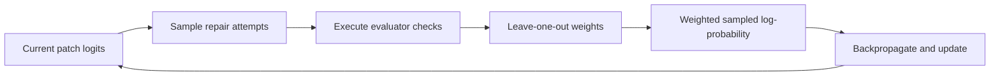

The previous chapters built all components: a coding task, tool interaction, generated-action ownership, token scores, evaluator feedback, learning weights, and an update rule. We now combine an executable verifier with an actual sampled policy update. To make every operation inspectable, the policy chooses among four authored clamp patches in a one-step repair environment. It does not generate arbitrary text or implement full DeepSWE.

## Define candidates and verifier together

Candidate 0 keeps the original bug. Candidate 1 fixes min/max but omits reversed-bound validation. Candidate 2 satisfies the stated specification. Candidate 3 returns the input unchanged. We derive rewards by executing evaluator tests on each source, rather than assigning a reward table by preference.

`passes_case` distinguishes expected values from expected exception classes. `evaluate_patch` compiles a fresh candidate and requires all checks to pass. These functions are constructed here again so this chapter runs in an independent session. All source strings are trusted teaching code; this evaluator is not a production sandbox.

```python
import torch
patches = [
    "def clamp(value, lower, upper):\n    return min(lower, max(value, upper))\n",
    "def clamp(value, lower, upper):\n    return max(lower, min(value, upper))\n",
    "def clamp(value, lower, upper):\n    if lower > upper:\n        raise ValueError('reversed bounds')\n    return max(lower, min(value, upper))\n",
    "def clamp(value, lower, upper):\n    return value\n",
]
cases = [
    ((3, 0, 5), 3), ((-2, 0, 5), 0), ((8, 0, 5), 5),
    ((-3, -5, -1), -3), ((8, 2, 2), 2), ((3, 5, 0), ValueError),
]

def passes_case(function, arguments, expected):
    try:
        actual = function(*arguments)
    except Exception as error:
        return isinstance(expected, type) and isinstance(error, expected)
    return not isinstance(expected, type) and actual == expected

def evaluate_patch(source):
    namespace = {}
    try:
        exec(source, namespace)
        function = namespace["clamp"]
    except Exception:
        return 0.0
    return float(all(passes_case(function, args, expected) for args, expected in cases))

reward_table = torch.tensor([evaluate_patch(source) for source in patches], dtype=torch.float64)
print("executable patch rewards:", reward_table.tolist())
```

Output:

```text
executable patch rewards: [0.0, 0.0, 1.0, 0.0]
```

The reward table is binary and only candidate 2 passes every evaluator case. Precomputing these four deterministic results avoids repeatedly executing the same authored functions in the tiny training loop. In real code-generating rollouts, candidates are newly generated and must be evaluated separately.

## Construct the estimator and perform fresh-sample updates

`leave_one_out_advantages` receives one group of patch rewards. Subtract each reward from the group total and divide by the other-sample count to form an independent reference under iid group sampling. Subtract that baseline and detach. The helper checks the group has at least two members.

Four trainable logits define probabilities over patches. `multinomial` samples 32 independent repair attempts with replacement using a local seeded generator. The verifier-derived table supplies each sampled patch's reward. Gather the sampled patch log-probabilities, multiply by detached advantages, negate, and average. Clear gradients, backpropagate, and update. Each iteration draws fresh data under the current policy; no old-policy ratio is needed for this one-step on-policy demonstration.

```python
def leave_one_out_advantages(rewards):
    if rewards.ndim != 1 or rewards.numel() < 2:
        raise ValueError("Need at least two independent repair samples")
    other_sample_mean = (rewards.sum() - rewards) / (rewards.numel() - 1)
    return (rewards - other_sample_mean).detach()

generator = torch.Generator().manual_seed(7)
logits = torch.nn.Parameter(torch.zeros(4, dtype=torch.float64))
optimizer = torch.optim.SGD([logits], lr=0.2)
before = logits.softmax(-1).detach().clone()
for step in range(80):
    actions = torch.multinomial(logits.detach().softmax(-1), 32, replacement=True, generator=generator)
    rewards = reward_table[actions]
    advantage = leave_one_out_advantages(rewards)
    sampled_logp = logits.log_softmax(-1).gather(0, actions)
    loss = -(advantage * sampled_logp).mean()
    optimizer.zero_grad()
    loss.backward()
    optimizer.step()
after = logits.softmax(-1).detach()
print("initial patch policy:", [round(v, 4) for v in before.tolist()])
print("trained patch policy:", [round(v, 4) for v in after.tolist()])
print("correct patch probability increased:", bool(after[2] > before[2]))
print("expected evaluator reward improved:", bool((after*reward_table).sum() > (before*reward_table).sum()))
```

Output:

```text
initial patch policy: [0.25, 0.25, 0.25, 0.25]
trained patch policy: [0.0267, 0.0261, 0.9215, 0.0257]
correct patch probability increased: True
expected evaluator reward improved: True
```

## Read the result carefully

The policy learned a greater preference for the fully passing authored patch. It did not learn to write a novel patch or to navigate a repository. The action here is a whole patch choice; in the earlier language-model chapters, actions were generated tokens. Both use categorical likelihoods, but their action spaces and horizons differ.



## Scale the same contract toward DeepSWE

Replace the finite candidate set with a tokenizer-backed language policy and the one-step environment with repository read/edit/test/submit interactions. Preserve original sampled tokens and policy versions, separate public observations from evaluator checks, align loss positions, choose an explicit reduction and sample-reuse rule, and independently measure patch success at matched budgets. Use the pinned rLLM SWE example as a production integration reference; this tutorial does not reproduce its training run.

**Exercises.** Remove reversed-bound checks and observe which patches now earn reward. Explain how that changes the task rather than merely training efficiency. Add a fifth overfit patch. Compare self-inclusive versus leave-one-out weights over many independently sampled groups before choosing a GPU experiment.
