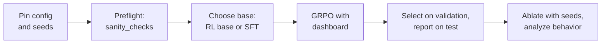

Eighteen chapters built the parts of an agentic RL system one at a time: an environment with tools and hidden tests ([Chapter 4](/tutorial/chapters/04-environments-and-tools)), a token-in/token-out rollout ([Chapter 5](/tutorial/chapters/05-trajectories-and-templates)), advantages and clipped updates ([Chapters 6 to 9](/tutorial/chapters/09-grpo-and-variants)), regularization ([Chapter 10](/tutorial/chapters/10-kl-entropy-regularization)), rewards that can be hacked ([Chapter 11](/tutorial/chapters/11-rewards-and-verifiers)), supervised warm starts ([Chapter 15](/tutorial/chapters/15-sft-and-rejection-sampling)), evaluation with error bars ([Chapter 17](/tutorial/chapters/17-evaluation)), and invariants that catch broken trainers ([Chapter 18](/tutorial/chapters/18-debugging-rl-runs)). Each chapter saved its pieces with `#@save`. This chapter assembles them into one run and does it the way a post-training team does: pin the configuration, check the trainer before step 1, choose a starting policy on evidence, train with a dashboard, choose a checkpoint on validation tasks, report a test number with an interval and a paired comparison, ablate with seeds, and say what the agent actually learned.

This is where the `#@save` design pays off. Every block below calls only saved `arl` functions, and the whole trainer, written out so that each stage is visible, takes twelve lines. Two later sections leave TinyAgent behind. Section 19.7 reports a measured run of the same recipe on Qwen3-0.6B, a real pretrained model, on an H200. Section 19.8 maps each book function to the public infrastructure that implements it at scale and says what changes. Every TinyAgent number is a mechanism demonstration on a 158k-parameter model with 20 training and 10 held-out tasks, not benchmark evidence. The chapter saves no new functions: the point is that it does not need any.

```python
import copy
import dataclasses
import json
import random
from collections import Counter
from pathlib import Path
import torch
import agentrl as arl

torch.set_num_threads(4)                     # the check host is shared (Chapter 10); Section 19.9 returns to this
tok = arl.build_tokenizer(arl.make_tasks('all'))
train_tasks, heldout_tasks = arl.make_tasks('train'), arl.make_tasks('heldout')
val_tasks, test_tasks = heldout_tasks[0::2], heldout_tasks[1::2]          # one variant per family in each
print('validation:', [t.name for t in val_tasks])
print('test:      ', [t.name for t in test_tasks])
```

Output:

```text
validation: ['minmax/pin', 'range/series', 'compare/qualifies', 'zero/share', 'init/product_upto']
test:       ['minmax/saturate', 'range/step_total', 'compare/under_cap', 'zero/speed', 'init/add_threes']
```

The split is fixed before anything is trained. The validation tasks make every decision in this chapter (which checkpoint to keep, which ablation to believe). The test tasks are evaluated once per reported model ([Section 17.8](/tutorial/chapters/17-evaluation#17-8-choosing-a-checkpoint-without-touching-the-test-set)). With five tasks per split, one held-out variant of each bug family lands on each side.

## 19.1 The recipe and its preflight

The run has six stages, and the chapter follows them in order.



**Pinning the configuration.** A result is only as reproducible as the configuration that produced it, so the first block prints every field. The objective is the book's GRPO default from [Section 9.1](/tutorial/chapters/09-grpo-and-variants#9-1-grpo-as-in-deepseekmath), and each of its choices rests on a measurement from an earlier chapter:

| Choice | Default | Evidence in the book |
| --- | --- | --- |
| Advantage | group mean and std (`adv_mode='grpo'`) | Removing the std was within seed noise (held-out 0.71–0.80 against 0.76–0.81, [Section 9.6](/tutorial/chapters/09-grpo-and-variants#9-6-controlled-ablations-at-tiny-scale)) |
| Aggregation | `token_mean` | `seq_mean_token_mean` lengthened episodes (14.9 against 12.9 policy tokens) with no gain in pass rate |
| Clip | symmetric, 0.2 | The clip binds on about 0.15% of tokens here, so clip-higher had nothing to act on (Chapters 9 and 10) |
| Dynamic sampling | off | It sampled 1.9 times as many rollouts per step and did worse per rollout, and rollouts are the expensive axis for agents |
| KL to a reference | none | One seed in [Chapter 10](/tutorial/chapters/10-kl-entropy-regularization) favored a small KL (pass@1 0.80 against 0.725); Section 19.5 retests it with three seeds |
| Sample reuse | 1 epoch, 2 minibatches | More reuse worsened memorization ([Chapter 8](/tutorial/chapters/08-ppo)) |

The environment fields matter as much as the objective. With renamed functions and one edit per episode, any pass rate above 0.2 requires information gathered in the episode ([Section 9.4](/tutorial/chapters/09-grpo-and-variants#9-4-shortcut-features-in-environment-design)). The reward comes from the hidden tests.

```python
CFG = arl.RLConfig()                         # the book's GRPO (Chapter 9): anonymized gym, one edit, hidden tests
STEPS, CKPT_EVERY, N_VAL, N_TEST = 60, 10, 16, 32
fields = dataclasses.asdict(CFG)
for i in range(0, len(fields), 8):
    print(' | '.join(f'{k}={v}' for k, v in list(fields.items())[i:i + 8]))
print(f'run: {STEPS} steps, checkpoint every {CKPT_EVERY}, torch {torch.__version__}, {torch.get_num_threads()} threads')
```

Output:

```text
group_size=8 | prompts_per_step=8 | temperature=1.0 | max_turns=6 | rename=True | max_edits=1 | reward=hidden | adv_mode=grpo
overlong_buffer=0 | dynamic_sampling=False | max_sample_rounds=4 | ratio_level=token | clip_low=0.2 | clip_high=0.2 | loss_mode=token_mean | norm_const=None
kl_coef=0.0 | kl_kind=k3 | lr=0.001 | epochs=1 | minibatches=2 | max_grad_norm=1.0 | seed=0
run: 60 steps, checkpoint every 10, torch 2.9.1+cu126, 4 threads
```

The last line records two facts that are not in `RLConfig` and still change the numbers: the library version and the CPU thread count. Section 19.9 shows that changing the thread count alone changes the run.

**Preflight.** Before spending compute, run the nine invariants of [Section 18.6](/tutorial/chapters/18-debugging-rl-runs#18-6-invariants-every-rl-codebase-should-assert) on the first batch. They cost a few forward and backward passes, and together they catch every code fault in Chapter 18's catalogue. The check sets a KL coefficient of 0.1, only so that the reference-model invariant has something to test.

```python
base = arl.make_rl_base(tok)                 # Chapter 9's starting policy
first = arl.sample_groups(base, lambda: arl.make_env(CFG), train_tasks[:8], tok, CFG,
                          torch.Generator().manual_seed(0))                # the first batch: 64 episodes
checks = arl.sanity_checks(base, first, tok, dataclasses.replace(CFG, kl_coef=0.1))
for name, (value, ok) in checks.items():
    print(f'{"pass" if ok else "FAIL"} | {name:<34} | {value:.3g}')
```

Output:

```text
pass | mask = policy tokens               | 0
pass | sampler = trainer log-prob         | 1.31e-06
pass | ratio = 1 before any step          | 0
pass | group advantage mean = 0           | 7.45e-09
pass | loss invariant to padding          | 0
pass | accumulated = one-pass gradient    | 0
pass | old_logp frozen in the update      | 0.00126
pass | update raises log pi where A > 0   | 0.547
pass | KL to reference > 0 after a step   | 0.0197
```

All nine checks pass. Read the values as well as the verdicts. The mask covers exactly the policy tokens (0 mismatches). The largest gap between sampler and trainer log-probabilities on this batch is $1.3 \times 10^{-6}$, which is float noise. Ratios are exactly 1 before the first step, and the group advantages average to zero within $10^{-8}$. After one real update, episodes with positive advantage gained log-probability: the change in $\log\pi$ correlates with the advantage at 0.55. A team would make this block a gate, so that a run whose preflight fails never starts.

## 19.2 Choosing a starting policy

RL reweights what the starting policy already does ([Section 9.4](/tutorial/chapters/09-grpo-and-variants#the-exploration-problem-underneath)), so the choice of base is the first decision that can make or break a run. We compare two candidates. The first is `make_rl_base`, the book's analogue of a pretrained model: it knows the call format and occasionally reads the code and then makes the right edit. The second adds a short **SFT cold start** on a small amount of expert data, as in [Chapter 15](/tutorial/chapters/15-sft-and-rejection-sampling). It uses one oracle demonstration per training task, renamed and recorded in the training harness, and trains for ten SFT steps.

```python
rng = random.Random(0)
demos = [arl.scripted_rollout(arl.scripted_policy('oracle'), arl.make_env(CFG), arl.randomize_names(t, rng), tok)
         for t in train_tasks]               # one renamed oracle demonstration per training task
sft_base = copy.deepcopy(base)
losses = arl.sft_train(sft_base, demos, tok, steps=10, lr=1e-3, batch_size=16)
print(f'{len(demos)} demonstrations, {sum(int(d.action_mask.sum()) for d in demos)} policy tokens;'
      f' SFT loss {losses[0]:.3f} -> {losses[-1]:.3f} in {len(losses)} steps')
```

Output:

```text
20 demonstrations, 260 policy tokens; SFT loss 0.218 -> 0.105 in 10 steps
```

The cold start is deliberately small, 260 supervised tokens, so that it shifts the policy without solving the task. In Chapter 15, 60 steps of oracle SFT reached 0.89 held-out without any RL, which would leave this chapter nothing to study.

What should we measure to compare bases before RL? Pass@1 alone is not enough. GRPO learns from groups whose rewards differ, so the useful statistics are whether success appears in the policy's samples at all (pass@8 on training tasks), the share of groups of 8 that carry a gradient, and the entropy that keeps exploration alive ([Chapter 10](/tutorial/chapters/10-kl-entropy-regularization)). `describe` reports all three with Chapter 17's saved evaluation functions.

```python
def describe(name, model, n=16):
    """What RL can start from: pass@1 and pass@8 on training tasks, informative groups, entropy, behavior."""
    counts = arl.sample_counts(model, train_tasks, tok, n, CFG, torch.Generator().manual_seed(1))   # [20]
    trajs = arl.sample_groups(model, lambda: arl.make_env(CFG), train_tasks, tok, CFG,
                              torch.Generator().manual_seed(2))                                   # 20 groups of 8
    rewards = torch.tensor([t.reward for t in trajs]).view(-1, CFG.group_size)                    # [20, 8]
    stats = arl.behavior_stats(trajs)
    print(f'{name:<16} pass@1 {counts.sum().item() / (n * len(counts)):.3f} | pass@8'
          f' {arl.pass_at_k(n, counts, 8).mean().item():.3f} | informative groups'
          f' {(rewards.std(-1) > 0).float().mean().item():.2f} | entropy'
          f' {arl.action_entropy(model, arl.collate(trajs, tok.pad_id)):.3f} | reads {stats["reads"]:.2f}'
          f' | first edit right {stats["first_edit_right"]:.2f}')

describe('RL base', base)
describe('SFT cold start', sft_base)
```

Output:

```text
RL base          pass@1 0.141 | pass@8 0.691 | informative groups 0.65 | entropy 0.569 | reads 0.23 | first edit right 0.18
SFT cold start   pass@1 0.372 | pass@8 0.958 | informative groups 0.95 | entropy 0.375 | reads 1.61 | first edit right 0.43
```

Ten SFT steps changed every statistic. The cold start passes 0.37 of training episodes instead of 0.14 and reaches a pass@8 of 0.96, and 95% of its groups carry a gradient, against 65% for the RL base. It reads in nearly every episode, often more than once (1.61 reads per episode, a partly learned imitation of the oracle's single read). The price is visible too: its action entropy fell from 0.57 to 0.38 nats, a third of the way toward the near-deterministic policy that full SFT produced in Chapter 15.

These numbers predict that the cold start will learn faster. They do not show that it will end better, and its oracle data is perfect and free here, which real demonstrations never are. The main run therefore starts from `make_rl_base`, the book's reference starting point, and Section 19.5 tests the cold start as a one-field ablation with three seeds. That is how a recipe should change: one decision at a time, each on its own evidence.

## 19.3 Training with a dashboard

Chapter 18's `train_logged` is the instrumented trainer. We write its loop out here for two reasons. It is the clearest statement of what an RL step is, and a capstone run needs one thing `train_logged` does not provide: a hook that saves and evaluates checkpoints. Each line in the loop body is one stage of the system: sample groups, collate them into tensors, compute advantages and apply the clipped update, then log a dashboard row.

```python
def train_run(model, cfg, steps, every=0, on_checkpoint=None):
    """The trainer from saved parts: sample, collate, update, log -> history (same RNG stream as arl.train_logged)."""
    torch.manual_seed(cfg.seed)
    gen = torch.Generator().manual_seed(cfg.seed)
    env_factory = lambda: arl.make_env(cfg)
    ref_model = arl.make_ref(model, cfg)                                     # frozen copy if cfg.kl_coef > 0
    optimizer = torch.optim.Adam(model.parameters(), lr=cfg.lr)
    history = []
    for step in range(steps):
        kept, sampled = arl.sample_step(model, env_factory, train_tasks, tok, cfg, gen)   # G episodes per task
        batch = arl.collate(kept, tok.pad_id)                                # ids [B, T], masks [B, T-1]
        batch['n_turns'] = torch.tensor([float(t.info['n_turns']) for t in kept])
        update = arl.debug_update(model, optimizer, batch, cfg, None, ref_model, gen)     # advantages + PPO step
        history.append(dict(arl.log_metrics(sampled, cfg, update), step=step))            # one dashboard row
        if every and (step + 1) % every == 0:
            on_checkpoint(step + 1, model)
    return history
```

A rewritten loop is a new implementation, so Chapter 18's rule applies to it: check it against the reference before trusting it.

```python
a, b = copy.deepcopy(base), copy.deepcopy(base)
arl.train_logged(a, train_tasks, tok, CFG, 3)
train_run(b, CFG, 3)
print('train_run == arl.train_logged after 3 steps:',
      all(torch.equal(p, q) for p, q in zip(a.parameters(), b.parameters())))
```

Output:

```text
train_run == arl.train_logged after 3 steps: True
```

The parameters agree bit for bit. Chapter 18 already checked `train_logged` against `train_rl`, so this loop is the book's trainer. The checkpoint hook evaluates on the validation tasks with its own random generator and leaves the training stream untouched. Section 19.5 confirms this.

The main run trains for 60 steps of 64 episodes. Every 10 steps it keeps a frozen copy of the policy and evaluates that copy on the five validation tasks, with 16 episodes per task.

```python
def val_counts_of(model):
    return arl.sample_counts(model, val_tasks, tok, N_VAL, CFG, torch.Generator().manual_seed(3))   # [5]

checkpoints, val_counts = {0: copy.deepcopy(base)}, {0: val_counts_of(base)}
def keep(step, model):
    checkpoints[step], val_counts[step] = copy.deepcopy(model), val_counts_of(model)

policy = copy.deepcopy(base)
history = train_run(policy, CFG, STEPS, every=CKPT_EVERY, on_checkpoint=keep)
keys = ['reward', 'reads', 'tests', 'entropy', 'zero_adv_frac', 'approx_kl', 'clip_frac', 'grad_norm', 'logp_gap']
for h in history[::10] + history[-1:]:
    print(f"step {h['step']:2d} | " + ' | '.join(f'{k} {h[k]:.3g}' for k in keys))
```

Output:

```text
step  0 | reward 0.172 | reads 0.312 | tests 0.328 | entropy 0.565 | zero_adv_frac 0.375 | approx_kl 0.00322 | clip_frac 0.0139 | grad_norm 0.204 | logp_gap 3.05e-08
step 10 | reward 0.406 | reads 1.61 | tests 0.531 | entropy 0.368 | zero_adv_frac 0.125 | approx_kl 0.000174 | clip_frac 0 | grad_norm 0.217 | logp_gap 3.76e-08
step 20 | reward 0.719 | reads 1.11 | tests 1.06 | entropy 0.182 | zero_adv_frac 0.25 | approx_kl 0.000295 | clip_frac 0 | grad_norm 0.287 | logp_gap 8.5e-09
step 30 | reward 0.703 | reads 0.969 | tests 0.734 | entropy 0.135 | zero_adv_frac 0.625 | approx_kl 5.59e-05 | clip_frac 0 | grad_norm 0.178 | logp_gap 1.02e-08
step 40 | reward 0.844 | reads 1.02 | tests 0.812 | entropy 0.106 | zero_adv_frac 0.75 | approx_kl 3.43e-05 | clip_frac 0 | grad_norm 0.17 | logp_gap 1.13e-08
step 50 | reward 0.859 | reads 1.03 | tests 0.906 | entropy 0.0878 | zero_adv_frac 0.625 | approx_kl 9.38e-06 | clip_frac 0 | grad_norm 0.151 | logp_gap 3.55e-09
step 59 | reward 0.875 | reads 1 | tests 0.859 | entropy 0.0667 | zero_adv_frac 0.625 | approx_kl 1.89e-05 | clip_frac 0 | grad_norm 0.168 | logp_gap 2.31e-09
```


Figure 19.1 is the dashboard of this run, with one panel for each group of Chapter 18's metrics. Every panel reads as healthy.

- **Outcome.** The batch reward rises from 0.17 to 0.88, and the validation pass rate follows it from 0.13 to 0.88.
- **Behavior.** Reads rise first. By step 10 the policy reads 1.6 times per episode, more than it needs, and it settles to one read by step 30. Tests rise later and stay near 0.85 per episode, although with one edit allowed a test result cannot change anything. Outcome advantages also credit useless steps ([Chapter 7](/tutorial/chapters/07-advantages-and-credit)). Edits stay at one.
- **Optimizer health.** Entropy falls smoothly from 0.57 to 0.07 nats, with no sudden collapse. The per-step KL shrinks from $3 \times 10^{-3}$ to about $10^{-5}$ as the policy settles. The clip fraction is 0 in every printed row after step 0, and the printed gradient norms stay between 0.15 and 0.29, far below the clipping threshold of 1.
- **Consistency.** The sampler–trainer gap stays below $10^{-7}$, three orders of magnitude under the preflight threshold. This rules out Chapter 18's mask, temperature, and stale-ratio faults for the whole run, not only at step 0.

The panel that matters most for the next decision is the zero-advantage share. It falls to 0.1–0.2 while the policy is learning, then rises to 0.6–0.8 from step 30 on. Most groups are then all-pass, so each step's gradient comes from only a few groups. Section 19.9 uses this to decide when to stop.

## 19.4 Evaluation and checkpoint selection

We now have seven checkpoints. We choose one using only the validation tasks: highest pass rate, with ties broken toward the earlier checkpoint. Each is printed with its task-level bootstrap interval ([Section 17.3](/tutorial/chapters/17-evaluation#17-3-confidence-intervals)).

```python
print('step | validation pass@1 | task-bootstrap 95% CI')
for step, counts in val_counts.items():
    lo, hi = arl.bootstrap_ci(counts / N_VAL)
    print(f'{step:4d} | {counts.sum().item() / (N_VAL * len(counts)):17.3f} | [{lo:.3f}, {hi:.3f}]')
chosen = max(val_counts, key=lambda s: (val_counts[s].sum().item(), -s))   # best validation; ties -> earliest
print('chosen checkpoint: step', chosen)
```

Output:

```text
step | validation pass@1 | task-bootstrap 95% CI
   0 |             0.125 | [0.037, 0.225]
  10 |             0.375 | [0.225, 0.550]
  20 |             0.662 | [0.362, 0.887]
  30 |             0.725 | [0.375, 0.938]
  40 |             0.762 | [0.387, 0.988]
  50 |             0.787 | [0.462, 0.988]
  60 |             0.875 | [0.775, 0.975]
chosen checkpoint: step 60
```

The validation pass rate rises at every checkpoint, so the rule picks the last one, step 60. The intervals from step 20 to step 50 are wide, about $\pm 0.3$, because one or two of the five validation tasks lag behind the others. At step 60 those tasks have caught up and the interval narrows to [0.78, 0.98]. With a monotone validation curve, the selection had no close call to resolve. Either way the test number below is unaffected by the choice, because the test tasks took no part in it.

The test evaluation runs once for each reported model: the starting policy and the chosen checkpoint. It uses 32 episodes per test task and computes pass@$k$ with the unbiased estimator of [Section 17.2](/tutorial/chapters/17-evaluation#17-2-pass@-and-its-unbiased-estimator).

```python
models = {'RL base': base, f'step {chosen} (chosen)': checkpoints[chosen]}
test = {name: arl.sample_counts(m, test_tasks, tok, N_TEST, CFG, torch.Generator().manual_seed(4))
        for name, m in models.items()}                                       # successes per test task, [5]
for name, counts in test.items():
    lo, hi = arl.bootstrap_ci(counts / N_TEST)
    passk = [arl.pass_at_k(N_TEST, counts, k).mean().item() for k in (1, 4, 8)]
    print(f'{name:<20} pass@1 {passk[0]:.3f} [{lo:.3f}, {hi:.3f}] | pass@4 {passk[1]:.3f} | pass@8 {passk[2]:.3f}'
          f' | per task {counts.tolist()}')
```

Output:

```text
RL base              pass@1 0.156 [0.131, 0.181] | pass@4 0.508 | pass@8 0.780 | per task [6, 5, 4, 6, 4]
step 60 (chosen)     pass@1 0.625 [0.294, 0.956] | pass@4 0.789 | pass@8 0.899 | per task [29, 31, 4, 5, 31]
```

The test pass rate, 0.625, is well below the same checkpoint's validation pass rate of 0.875, and the per-task counts show why. Three test tasks are nearly solved (29, 31, and 31 of 32). Two are not. `compare/under_cap` passes 4 of 32 and `zero/speed` passes 5 of 32, about the same as the untrained base (4 and 6). On those two tasks RL did nothing measurable. That is also why the interval [0.29, 0.96] is so wide: it is a bootstrap over five tasks, two of which disagree sharply with the other three. The pass@$k$ columns show the pattern from [Section 17.7](/tutorial/chapters/17-evaluation#17-7-does-rl-narrow-the-distribution?-pass@-on-tinyagent). RL's advantage is large at $k = 1$ (0.63 against 0.16) and shrinks as $k$ grows (0.90 against 0.78 at $k = 8$), because the base's random guesses eventually hit the right op.

Is the improvement real, given intervals that wide? The comparison should be paired by task: both models face the same tasks, and the task effect is the largest source of variance ([Section 17.4](/tutorial/chapters/17-evaluation#17-4-comparing-two-runs)).

```python
diff, lo, hi = arl.paired_bootstrap_diff(test[f'step {chosen} (chosen)'] / N_TEST, test['RL base'] / N_TEST)
print(f'chosen - base, paired over 5 test tasks: {diff:+.3f} [{lo:+.3f}, {hi:+.3f}]')
unpaired = [arl.bootstrap_ci(c / N_TEST) for c in test.values()]
print('unpaired intervals overlap:', unpaired[1][0] < unpaired[0][1])
```

Output:

```text
chosen - base, paired over 5 test tasks: +0.469 [+0.131, +0.806]
unpaired intervals overlap: False
```

The paired difference is +0.47 with a 95% interval of [+0.13, +0.81], which excludes zero. The interval is still wide, and it should be. It is a statement about a population of tasks estimated from five, and two of the five show no gain. The honest report of this run is: held-out test pass@1 of 0.63 [0.29, 0.96], against 0.16 for the starting policy; paired gain +0.47 [+0.13, +0.81]; one training seed, five test tasks, and no gain on two of them. Section 19.6 asks why.

## 19.5 Ablations with seeds

The recipe has many knobs. Which ones are worth the compute? We test three. Each was chosen because an earlier chapter left it open or because getting it wrong is costly:

1. **KL to the reference** ($\beta = 0.05$, $k_3$ in the loss). Chapter 10's single seed favored it, while the published coding-agent recipes drop it ([Chapter 20](/tutorial/chapters/20-frontier)).
2. **SFT cold start.** Section 19.2 predicted that it would learn faster.
3. **Public-test reward instead of hidden tests.** This is not a candidate. It is a control that keeps the hacking result of [Chapter 11](/tutorial/chapters/11-rewards-and-verifiers) in view; any recipe change that weakens the verifier should be checked against it.

Each arm changes one thing relative to the default and runs 30 steps (Chapter 17 found headroom left at that point) with seeds 0, 1, and 2. Each run is evaluated on all ten held-out tasks with 16 episodes per task. The evaluation generator depends only on the seed, so arms with the same seed are compared on the same evaluation stream. The twelve runs take about 80 seconds.

```python
ARMS = {'default': (base, {}), 'KL k3 0.05': (base, dict(kl_coef=0.05)),
        'SFT cold start': (sft_base, {}), 'public-test reward': (base, dict(reward='public'))}
SEEDS, ABL_STEPS = [0, 1, 2], 30
runs = {}
for arm, (start, fields) in ARMS.items():
    for seed in SEEDS:
        model = copy.deepcopy(start)
        hist = train_run(model, arl.RLConfig(seed=seed, **fields), ABL_STEPS)
        counts = arl.sample_counts(model, heldout_tasks, tok, 16, CFG, torch.Generator().manual_seed(100 + seed))
        runs[arm, seed] = dict(history=hist, counts=counts, model=model)
print('default, seed 0 == main run at step 30:',
      all(torch.equal(p, q) for p, q in zip(runs['default', 0]['model'].parameters(), checkpoints[30].parameters())))
```

Output:

```text
default, seed 0 == main run at step 30: True
```

The default arm with seed 0 is the first 30 steps of the main run, and its parameters match the main run's step-30 checkpoint exactly, so the checkpoint evaluations did not perturb training. Each arm is compared with the default by task. For each arm, we average each task's pass rate over the three seeds, then bootstrap the ten per-task differences. This interval captures variation from task to task. The spread across seeds is printed beside it, and Section 19.9 uses it.

```python
def arm_rates(arm):
    return torch.stack([runs[arm, s]['counts'] / 16 for s in SEEDS])         # [seeds, 10 tasks]

print(f'{"arm":<19}| held-out pass@1 by seed | mean  | vs default, paired [95% CI] | reward 25-29 | hardcode | entropy')
for arm in ARMS:
    rates, hists = arm_rates(arm), [runs[arm, s]['history'] for s in SEEDS]
    diff, lo, hi = arl.paired_bootstrap_diff(rates.mean(0), arm_rates('default').mean(0))
    late = sum(h[i]['reward'] for h in hists for i in range(25, 30)) / 15
    hack = sum(h[-1]['hardcode'] for h in hists) / 3
    ent = sum(h[-1]['entropy'] for h in hists) / 3
    paired = 'reference' if arm == 'default' else f'{diff:+.3f} [{lo:+.3f}, {hi:+.3f}]'
    print(f'{arm:<19}| {" ".join(f"{r:.3f}" for r in rates.mean(-1).tolist()):<24}| {rates.mean():.3f} |'
          f' {paired:<28}| {late:12.3f} | {hack:8.2f} | {ent:.3f}')
```

Output:

```text
arm                | held-out pass@1 by seed | mean  | vs default, paired [95% CI] | reward 25-29 | hardcode | entropy
default            | 0.694 0.756 0.706       | 0.719 | reference                   |        0.709 |     0.00 | 0.181
KL k3 0.05         | 0.675 0.725 0.719       | 0.706 | -0.012 [-0.119, +0.129]     |        0.754 |     0.01 | 0.169
SFT cold start     | 0.731 0.863 0.800       | 0.798 | +0.079 [-0.025, +0.212]     |        0.872 |     0.01 | 0.115
public-test reward | 0.006 0.006 0.000       | 0.004 | -0.715 [-0.873, -0.531]     |        0.986 |     0.98 | 0.055
```


Figure 19.2 shows the table as a forest plot. Read each arm against its interval:

- **KL $k_3$ 0.05.** The mean is 0.706 against 0.719, a paired difference of $-0.01$ [$-0.12$, $+0.13$]. No effect is detectable. Entropy barely moved (0.17 against 0.18), and Chapter 10's one-seed advantage did not survive three seeds. The default stays at no KL, which also saves the memory and forward pass of a reference model.
- **SFT cold start.** The mean is 0.798, and it is the best of the four arms in every seed. The paired difference is +0.08 [$-0.03$, $+0.21$], an interval that includes zero, so with three seeds and ten tasks this result is suggestive, not established. Its late training reward is much higher (0.87 against 0.71), as Section 19.2 predicted, and its entropy is lower (0.12 against 0.18). Whether to adopt it is a decision under uncertainty, and Section 19.9 computes what it would cost to settle.
- **Public-test reward.** Its training reward is 0.99, the best curve of any arm. In the final step, 98% of its episodes use `hardcode_tests`, and its held-out pass rate on the hidden tests is 0.004. An effect of $-0.72$ needs no statistics. The arm is in the table so that no reader of the results forgets that the training reward measures only what the verifier rewards.

> **Evidence.** Measured here: three seeds per arm, 30 steps, 160 held-out episodes per seed, one 158k-parameter model. The paired intervals resample tasks, not seeds, so they somewhat understate the total uncertainty. The SFT result depends on free, perfect demonstrations, which real teams do not have. None of these numbers predicts the effect of the same change on a large model.

## 19.6 What the agent learned

A pass rate says how often the agent succeeds. Behavior statistics say how it succeeds, and the per-task breakdown says where it fails. We sample 32 episodes per held-out task from the chosen checkpoint.

```python
agent = checkpoints[chosen]
trajs = arl.sample_groups(agent, lambda: arl.make_env(CFG), heldout_tasks, tok, dataclasses.replace(CFG, group_size=32),
                          torch.Generator().manual_seed(5))                  # 32 episodes per held-out task
stats = arl.behavior_stats(trajs)
print(' | '.join(f'{k} {v:.2f}' for k, v in stats.items()))
def step_name(action):
    call = arl.parse_call(action)                                            # (tool, arg) or None
    return 'malformed' if call is None else call[1] or call[0]
calls = Counter(' -> '.join(step_name(a) for a in t.info['actions']) for t in trajs)
for sequence, count in calls.most_common(5):
    print(f'{count:3d} x {sequence}')
```

Output:

```text
pass_rate 0.74 | reward 0.74 | reads 1.02 | tests 0.82 | edits 0.93 | first_edit_right 0.74 | turns 3.84 | length 12.44
 60 x read -> swap_minmax -> test -> submit
 59 x read -> fix_range_end -> test -> submit
 59 x read -> fix_init -> test -> submit
 45 x read -> add_zero_guard -> test -> submit
 27 x read -> fix_comparison -> test -> submit
```

The agent learned a procedure: read, apply one op, test, submit. It reads in essentially every episode (1.02 reads per episode) and applies an edit in 93% of episodes. Its pass rate equals its first-edit accuracy (0.74): whenever it picks the right op it succeeds, so every failure is a wrong choice or a missing edit. The five most frequent sequences are this procedure with each of the five ops, and their counts are uneven. `swap_minmax` appears in 60 episodes and `fix_comparison` in only 27, although each op is correct on exactly two of the ten tasks (64 episodes each). The per-task table shows where those episodes went.

```python
by_task = {}
for t in trajs:
    by_task.setdefault(t.info['task'], []).append(t)
for name, group in by_task.items():
    passed = sum(bool(t.info['submitted'] and t.info['hidden_pass']) for t in group) / len(group)
    first_ops = Counter(t.info['ops'][0] if t.info['ops'] else 'none' for t in group)
    print(f'{name:<18} pass {passed:.2f} | correct op {arl.FIX_OP[name]:<15} | first edits {dict(first_ops.most_common(2))}')
```

Output:

```text
minmax/pin         pass 1.00 | correct op swap_minmax     | first edits {'swap_minmax': 32}
minmax/saturate    pass 0.94 | correct op swap_minmax     | first edits {'swap_minmax': 30, 'none': 2}
range/series       pass 0.91 | correct op fix_range_end   | first edits {'fix_range_end': 29, 'none': 3}
range/step_total   pass 0.97 | correct op fix_range_end   | first edits {'fix_range_end': 31, 'none': 1}
compare/qualifies  pass 0.69 | correct op fix_comparison  | first edits {'fix_comparison': 22, 'add_zero_guard': 4}
compare/under_cap  pass 0.19 | correct op fix_comparison  | first edits {'add_zero_guard': 23, 'fix_comparison': 6}
zero/share         pass 0.72 | correct op add_zero_guard  | first edits {'add_zero_guard': 23, 'fix_comparison': 7}
zero/speed         pass 0.06 | correct op add_zero_guard  | first edits {'fix_comparison': 19, 'none': 10}
init/product_upto  pass 0.97 | correct op fix_init        | first edits {'fix_init': 31, 'none': 1}
init/add_threes    pass 0.97 | correct op fix_init        | first edits {'fix_init': 31, 'fix_comparison': 1}
```

Three families are solved: `minmax`, `range`, and `init` pass at 0.91 to 1.00 on both held-out variants. The weakness is two families that the agent confuses with each other. `compare` and `zero` pass at 0.06 to 0.72, and the errors cross over. On `under_cap` the agent applies `add_zero_guard`, the `zero` fix, in 23 of 32 episodes. On `speed` it applies `fix_comparison`, the `compare` fix, in 19 episodes and submits without editing in 10. Compare the read observations with the oracle's keyword rule, and look at one failure of each kind.

```python
for name in ['compare/qualifies', 'compare/under_cap', 'zero/share', 'zero/speed']:
    source = arl.compact_source(next(t for t in heldout_tasks if t.name == name).source)
    print(f"{name:<18} {source.split(chr(10))[-1]:<40} oracle rule -> {arl.infer_op(source)}")
wrong = {'compare/under_cap': 'add_zero_guard', 'zero/speed': 'fix_comparison'}
for name, op in wrong.items():
    failure = next(t for t in by_task[name] if t.info['ops'] == [op])
    print(tok.decode(failure.ids.tolist()).replace('\n', ' / '))
```

Output:

```text
compare/qualifies  return score > cutoff + 1                oracle rule -> fix_comparison
compare/under_cap  return load < cap                        oracle rule -> fix_comparison
zero/share         return amount // people                  oracle rule -> add_zero_guard
zero/speed         return miles * 2 // hours                oracle rule -> add_zero_guard
<bos> issue : share returns wrong results <call> read </call> <obs> def share ( load , cap ) : / return load < cap </obs> <call> edit add_zero_guard </call> <obs> ok </obs> <call> test </call> <obs> fail ( 2 , 2 ) -> False want True / pass ( 9 , 7 ) / pass ( 9 , 8 ) </obs> <call> submit </call>
<bos> issue : is_early returns wrong results <call> read </call> <obs> def is_early ( miles , hours ) : / return miles * 2 // hours </obs> <call> edit fix_comparison </call> <obs> no change </obs> <call> submit </call>
```


Both sources are unambiguous under the oracle's rule: a comparison operator means `fix_comparison`, and `//` means `add_zero_guard`. The agent learned a different rule. In the first failure it reads `return load < cap`, applies the division guard, and runs the tests, which report the failure (`fail ( 2 , 2 ) -> False want True`). It then submits anyway, because the one-edit budget leaves it nothing else to do. In the second it reads `miles * 2 // hours`, applies `fix_comparison`, gets `no change`, and submits. Its observations contain the right evidence, and on these held-out variants it acts on the wrong part of it. The two families also have the shortest sources, one line of a few tokens, and their held-out variants use operand names and constants never seen in training. We cannot read the policy's features off its weights. What we can say is that for these two families it learned features that do not transfer to every variant, and the training reward could not reveal this, because the same features worked on the training variants. The test result of Section 19.4 is the same fact seen through two tasks: `under_cap` and `speed` are the test-side members of these families.

This is the most useful output of the whole run, because it names the next experiment: more surface variants of `compare` and `zero` with varied operand names, or a held-out-family evaluation as in [Section 17.6](/tutorial/chapters/17-evaluation#17-6-held-out-splits-and-leakage), before any change to the objective. Exercise 4 probes the features directly.

## 19.7 The same loop on a real model

TinyAgent was designed to make every mechanism visible at CPU cost. Does the recipe survive contact with a real model? Two optional labs answer this (see [their README](/tutorial/labs/README)). Both train **Qwen3-0.6B** with the same tasks, hidden-test reward, group advantages, and clipped loss from `agentrl`. The first, `tutorial/labs/qwen_grpo_bugfix.py`, keeps the gym's action menu. The second, `tutorial/labs/qwen_grpo_tools.py`, replaces the menu with generic coding tools, as a production agent would use. We start with the first. Only the parts a real model needs are new:

- **The real chat template with tools.** The four tool schemas of [Section 4.7](/tutorial/chapters/04-environments-and-tools) are rendered by Qwen3's own template in non-thinking mode. The model writes `<tool_call>{"name": "edit", "arguments": {"op": ...}}</tool_call>`, and a parser maps the JSON to the gym's `<call> edit op </call>`. Anything else, including plain prose, is a malformed call that uses up a turn.
- **Token-in/token-out ([Section 5.4](/tutorial/chapters/05-trajectories-and-templates#5-4-retokenization-drift)).** The sampled ids are kept as sampled. Each tool result is appended as the exact token ids of the template's tool-response block. At startup the script asserts that these ids equal the template's own rendering of the same conversation.
- **Batched generation with Hugging Face `generate`** at temperature 1 with top-k and top-p disabled, so that the sampling distribution is the one the trainer differentiates ([Section 3.3](/tutorial/chapters/03-language-models-as-policies#3-3-sampling-defines-the-behavior-policy)). There is no vLLM; generation and training run in fp32 on one GPU.
- **Logits only where the loss needs them.** The language-model head runs only on policy positions. Full `[B, T, 151936]` logits would cost about 0.6 GB per 1,000-token row ([Section 14.3](/tutorial/chapters/14-scaling-and-efficiency#14-3-the-memory-of-logits)). Updates accumulate over microbatches with one normalizer for the whole minibatch ([Section 14.4](/tutorial/chapters/14-scaling-and-efficiency#14-4-gradient-accumulation-and-loss-normalization)).

The core of the rollout is short. The excerpt below is from the script and is not executed by the book's checker:

```py
for e, (new, logp) in zip(active, generate(model, qtok, [e['ids'] for e in active], ...)):
    e['ids'] += new                                   # sampled ids, never re-encoded
    e['mask'] += [1] * len(new)                       # policy-owned, through <|im_end|>
    action = to_gym_action(qtok.decode(new))          # text exists only at the env boundary
    obs, reward, done, info = e['env'].step(action)
    if not done:
        obs_ids = observation_ids(qtok, obs)          # template tokens + tool output, verified at startup
        e['ids'] += obs_ids
        e['mask'] += [0] * len(obs_ids)
```

The run used 30 GRPO steps of 8 training tasks × 8 episodes, a learning rate of $10^{-6}$ with AdamW, 64 new tokens at most per turn, and a held-out evaluation with 8 episodes per task before and after training. The block below reads the saved results file and prints them. These are **measured** numbers from one run on 2026-10-14.

```python
lab = json.loads(Path('tutorial/labs/results/qwen_grpo_bugfix.json').read_text())
print(lab['config']['model'], '|', lab['config']['gpu'], '|', {k: lab['config']['lab'][k] for k in
      ['steps', 'group_size', 'prompts', 'lr', 'max_new_tokens', 'eval_n']})
for when in ['before', 'after']:
    r = lab[when]
    print(f"{when:<6} held-out pass@1 {r['pass_at_1']:.3f} [{r['ci'][0]:.3f}, {r['ci'][1]:.3f}] | per task"
          f" {[int(c) for c in r['per_task']]} | reads {r['reads']:.2f} | malformed {r['malformed']:.2f}"
          f" | submitted {r['submitted']:.2f}")
d = lab['paired_diff']
print(f"after - before, paired over 10 tasks: {d['diff']:+.3f} [{d['ci'][0]:+.3f}, {d['ci'][1]:+.3f}]")
```

Output:

```text
Qwen/Qwen3-0.6B | NVIDIA H200 | {'steps': 30, 'group_size': 8, 'prompts': 8, 'lr': 1e-06, 'max_new_tokens': 64, 'eval_n': 8}
before held-out pass@1 0.200 [0.062, 0.388] | per task [2, 1, 2, 1, 7, 3, 0, 0, 0, 0] | reads 0.61 | malformed 1.69 | submitted 0.61
after  held-out pass@1 0.800 [0.500, 1.000] | per task [8, 8, 0, 0, 8, 8, 8, 8, 8, 8] | reads 1.02 | malformed 0.00 | submitted 1.00
after - before, paired over 10 tasks: +0.600 [+0.325, +0.875]
```

The pretrained model starts at a held-out pass rate of 0.20 [0.06, 0.39], the level of a blind single guess. Its main problem is format, not skill: 1.69 malformed calls per episode, and only 61% of episodes ever submit. The first episode of its evaluation shows why. After one well-formed edit, it answers in prose ("The function `issue` was fixed by adjusting the range ...") and then repeatedly asks the user for the function name, which the gym scores as malformed calls. After 30 steps the pass rate is 0.80 [0.50, 1.00], with a paired gain of +0.60 [+0.33, +0.88] over the ten held-out tasks. There are no malformed calls, every episode submits, and every episode reads first.

```python
for row in lab['steps'][::5] + lab['steps'][-1:]:
    print(f"step {row['step']:2d} | reward {row['reward']:.3f} | malformed {row['malformed']:.2f} | reads"
          f" {row['reads']:.2f} | tokens {row['policy_tokens']:5.1f} | entropy {row['entropy']:.3f} | zero-adv"
          f" {row['zero_adv_frac']:.2f} | gap {row['logp_gap_mean']:.1e}")
print(f"wall clock {lab['wall_clock_s'] / 60:.1f} min | peak GPU memory {lab['peak_gpu_gb']:.1f} GB")
```

Output:

```text
step  0 | reward 0.078 | malformed 1.73 | reads 0.66 | tokens 113.0 | entropy 0.545 | zero-adv 0.62 | gap 3.2e-06
step  5 | reward 0.516 | malformed 0.16 | reads 1.48 | tokens  77.4 | entropy 0.079 | zero-adv 0.38 | gap 6.9e-07
step 10 | reward 0.578 | malformed 0.00 | reads 1.00 | tokens  55.9 | entropy 0.027 | zero-adv 0.38 | gap 3.8e-07
step 15 | reward 0.625 | malformed 0.02 | reads 0.98 | tokens  64.9 | entropy 0.000 | zero-adv 1.00 | gap 9.0e-08
step 20 | reward 0.844 | malformed 0.00 | reads 1.00 | tokens  65.3 | entropy 0.005 | zero-adv 0.88 | gap 1.1e-07
step 25 | reward 0.750 | malformed 0.00 | reads 1.00 | tokens  65.8 | entropy 0.000 | zero-adv 1.00 | gap 9.8e-08
step 29 | reward 0.750 | malformed 0.00 | reads 1.00 | tokens  66.2 | entropy 0.000 | zero-adv 1.00 | gap 4.0e-08
wall clock 9.5 min | peak GPU memory 32.8 GB
```

Format was learned first, and almost at once. Malformed calls fell from 1.73 per episode to 0.16 by step 5 and to zero by step 10, and the policy-token count per episode fell from 113 to about 56 as the prose answers disappeared. The reward climbed with them. Then the policy stopped exploring. The entropy of its action tokens fell from 0.55 nats to 0.03 by step 10 and to 0.000 by step 15. From step 15 on, most steps have a zero-advantage share of 1.00: every group of 8 attempts at a task produced identical episodes, so the gradient was exactly zero, and the batch reward only moves with the tasks that happen to be drawn. The final evaluation shows what was frozen. The after-training per-task counts are all 8 of 8 or 0 of 8, a deterministic policy. It solves eight of the ten held-out tasks every time and fails both `range` tasks every time, by applying `fix_init` to them (the saved examples in the results file show it). The `range` family was never solved reliably, and once the entropy reached zero, no group on a `range` task could ever contain a success again, so RL could not repair it.

The sampler–trainer gap stays between $4 \times 10^{-8}$ and $3 \times 10^{-6}$ nats per token. Both sides run in fp32, so this is the gap between a KV-cached, left-padded generation path and a full forward pass, about four orders of magnitude below the bf16 gap that Section 13.6 measured with the same model. The run took 9.5 minutes on a shared H200 with a peak of 32.8 GB of GPU memory.

> **Evidence.** Measured here, once, on 2026-10-14: one seed, 30 steps, held-out evaluation with 8 episodes per task on 10 tasks. The 0.20 → 0.80 improvement is real for this run (the paired interval excludes zero), but most of it is the model learning the gym's tool-call format and the read-edit-test-submit procedure, which a pretrained model lacks, not a general improvement in its ability to repair code. The entropy collapse within 15 steps at a learning rate of $10^{-6}$ is the most transferable observation: on a real model, as on TinyAgent in Chapter 10, entropy is a resource that a small RL run can spend completely, and what remains unsolved at that point stays unsolved. We did not tune the learning rate or run other seeds; Exercise 5 does.

### Generic tools instead of an edit menu

The run above has one unrealistic feature: the model chooses a repair from a menu (`edit swap_minmax`), and the gym's authored code writes the change. Production coding agents get generic tools and write the change themselves. The second lab, `tutorial/labs/qwen_grpo_tools.py`, uses the tool set of Claude Code as its reference: the names and parameters follow Claude Code's [tools reference](https://code.claude.com/docs/en/tools-reference) (checked 2026-10-14), and the descriptions are our own short versions. The tasks, reward, advantages, loss, update, and token-in/token-out path are those of the first lab. The interface changes as follows:

- **A repository per episode.** Each task gets an unrelated gym function name from `arl.randomize_names`, as in the book's default RL setting ([Section 9.4](/tutorial/chapters/09-grpo-and-variants#9-4-shortcut-features-in-environment-design)), and becomes two in-memory files: the buggy source `<fn>.py` and `test_<fn>.py`, which holds the public tests as pytest functions. The hidden tests never enter the repository.
- **Four tools.** `Read(file_path, offset, limit)` returns the file with line numbers. `Edit(file_path, old_string, new_string, replace_all)` is an exact string replacement that fails if `old_string` is absent, or appears more than once without `replace_all`, or if the file has not been read in this episode. Requiring the Read is our choice; the reference applies it to some models only. `Write(file_path, content)` overwrites or creates a file. `Bash(command, timeout)` is an allowlisted emulation that supports `pytest`, `python <file>.py`, `ls`, `cat`, and `grep`; any other command returns an error observation. Grep and Glob are left out because the reference says they are absent by default on Linux, where Claude Code searches through Bash.
- **The episode ends as a real agent's does.** An assistant turn without a tool call is the final answer. Otherwise the episode ends when the budget of 6 turns runs out. The reward is 1 if the final `<fn>.py` passes every hidden test. Malformed calls and failed calls return an error observation and use up the turn.
- **Model-written code runs in a child process.** Every test run and every `python <file>.py` copies the repository into a fresh temporary directory and starts `python -I -S` with an empty environment and a 10-second timeout. Before importing any repository code, the child sets `resource` limits: 5 CPU-seconds, 1 GiB of address space, 1 MiB per written file, and no child processes. The hidden-test grader runs the same way. The trainer process never `exec`s model output. This is process isolation with resource limits on a controlled host, **not a security sandbox**: the child can still read the user's files and open network connections. Model-written code in production belongs in containers or VMs without network access ([Chapter 4](/tutorial/chapters/04-environments-and-tools)).

The `Edit` tool is the part a model must learn to satisfy. This excerpt from the script is not executed by the book's checker:

```py
if name not in repo.read:
    raise ToolError('not_read', 'File has not been read yet. Read it first before writing to it.')
count = repo.files[name].count(old_string) if old_string else 0
if count == 0:
    raise ToolError('not_found', f'String to replace not found in file.\nString: {old_string}')
if count > 1 and not replace_all:
    raise ToolError('not_unique', f'Found {count} matches of the string to replace, but replace_all is false. ...')
repo.files[name] = repo.files[name].replace(old_string, new_string, -1 if replace_all else 1)
```

The run used 18 GRPO steps of 8 training tasks × 8 episodes, a learning rate of $10^{-6}$, 256 new tokens at most per turn, and 8 held-out episodes per task before and after training. Generation ran in chunks of 16 episodes because the GPU was shared. These are **measured** numbers from one run on 2026-10-14:

```python
tools = json.loads(Path('tutorial/labs/results/qwen_grpo_tools.json').read_text())
print({k: tools['config']['lab'][k] for k in ['steps', 'group_size', 'prompts', 'lr', 'max_turns', 'max_new_tokens',
                                              'eval_n']})
for when in ['before', 'after']:
    r = tools[when]
    print(f"{when:<6} held-out pass@1 {r['pass_at_1']:.3f} [{r['ci'][0]:.3f}, {r['ci'][1]:.3f}] | per task"
          f" {[int(c) for c in r['per_task']]}")
    print(f"       per episode: Read {r['calls_Read']:.2f} | Edit {r['calls_Edit']:.2f} | Write {r['calls_Write']:.2f}"
          f" | Bash {r['calls_Bash']:.2f} | malformed {r['malformed']:.2f} | failed {r['failed']:.2f} (not found"
          f" {r['failed_not_found']:.2f}, not read {r['failed_not_read']:.2f}, no change {r['failed_no_change']:.2f})")
d = tools['paired_diff']
print(f"after - before, paired over 10 tasks: {d['diff']:+.3f} [{d['ci'][0]:+.3f}, {d['ci'][1]:+.3f}]")
```

Output:

```text
{'steps': 18, 'group_size': 8, 'prompts': 8, 'lr': 1e-06, 'max_turns': 6, 'max_new_tokens': 256, 'eval_n': 8}
before held-out pass@1 0.100 [0.025, 0.212] | per task [1, 0, 0, 0, 2, 1, 0, 0, 4, 0]
       per episode: Read 1.31 | Edit 0.93 | Write 0.46 | Bash 0.07 | malformed 0.09 | failed 0.85 (not found 0.30, not read 0.20, no change 0.25)
after  held-out pass@1 0.488 [0.237, 0.750] | per task [8, 8, 1, 2, 8, 8, 0, 0, 4, 0]
       per episode: Read 1.18 | Edit 1.00 | Write 0.03 | Bash 0.00 | malformed 0.00 | failed 0.21 (not found 0.00, not read 0.00, no change 0.21)
after - before, paired over 10 tasks: +0.388 [+0.150, +0.650]
```

```python
for row in tools['steps'][::4] + tools['steps'][-1:]:
    print(f"step {row['step']:2d} | reward {row['reward']:.3f} | Write {row['calls_Write']:.2f} | Bash"
          f" {row['calls_Bash']:.2f} | failed {row['failed']:.2f} | tokens {row['policy_tokens']:5.1f} | entropy"
          f" {row['entropy']:.3f} | zero-adv {row['zero_adv_frac']:.2f}")
print(f"wall clock {tools['wall_clock_s'] / 60:.1f} min | peak GPU memory {tools['peak_gpu_gb']:.1f} GB")
```

Output:

```text
step  0 | reward 0.000 | Write 0.52 | Bash 0.02 | failed 0.81 | tokens 129.4 | entropy 0.000 | zero-adv 1.00
step  4 | reward 0.188 | Write 0.11 | Bash 0.06 | failed 0.30 | tokens 123.2 | entropy 0.185 | zero-adv 0.62
step  8 | reward 0.484 | Write 0.05 | Bash 0.08 | failed 0.08 | tokens 102.6 | entropy 0.164 | zero-adv 0.50
step 12 | reward 0.594 | Write 0.03 | Bash 0.03 | failed 0.11 | tokens  93.9 | entropy 0.177 | zero-adv 0.50
step 16 | reward 0.719 | Write 0.00 | Bash 0.00 | failed 0.00 | tokens  84.5 | entropy 0.131 | zero-adv 0.88
step 17 | reward 0.781 | Write 0.02 | Bash 0.00 | failed 0.03 | tokens  85.5 | entropy 0.121 | zero-adv 0.38
wall clock 20.0 min | peak GPU memory 14.2 GB
```

The pretrained model starts at 0.10 [0.02, 0.21], half its starting point with the edit menu. Format is no longer its main problem: it makes 0.09 malformed calls per episode, and 99% of episodes end with a final answer. Its problem is acting correctly through generic tools. It makes 0.85 failed calls per episode, mostly Edits whose `old_string` is not in the file (0.30), Edits before any Read (0.20), and Edits whose two strings are identical (0.25). In the 20 saved example episodes from the first evaluation and the first training step, every `old_string` that was not found was invented text, such as `'saturate_result'` or `'print(5)'`, not a near miss in whitespace. The model also calls Write 0.46 times per episode, and in the saved examples those calls overwrite the source or a test file, or create a new file. It rarely runs the tests (0.07 Bash calls per episode), and it usually ends with a claim of success, such as "The bug was fixed, and the tests now pass", whatever the edit did.

After 18 steps the held-out pass rate is 0.49 [0.24, 0.75], a paired gain of +0.39 [+0.15, +0.65]. The model learned to satisfy the tools. There are no malformed calls, no missing `old_string`s, and no Edits before a Read, and Edit is called 1.00 times per episode. The learned procedure is Read the source, Edit with an `old_string` copied as a whole line from the Read output, with its indentation and without the line-number prefix, and then answer. Write fell from 0.52 calls per episode at step 0 to 0.02 at step 17. The minmax and compare families are solved 8 of 8 times. On `compare/qualifies` the model replaced `score > cutoff + 1` with `score > cutoff`. That fix is not the gym's `fix_comparison` (`>=`), but it is equivalent on integers and passes the hidden tests, and the edit menu could not have expressed it.

Two things were not learned. First, the model stopped testing. Bash calls fell to zero, and the final answers still say "The public tests are now passing correctly." when the edit is wrong. The reward does not depend on running the tests, a test run costs a turn and tokens, and the reward gives no direct credit for the habit, so nothing kept it alive. Second, the remaining failures are semantic, not mechanical. On the range tasks it edits the loop body (`out += i * limit`, `t += 5`) instead of the range end. On the zero tasks it replaces `//` with `/` or makes an Edit whose two strings are identical, the only failure type left (0.21 per episode). On the init tasks it sets the initial value to a wrong constant. Meanwhile, the policy's entropy fell from 0.185 nats at step 4 to 0.121 at step 17 (step 0 had no group with a nonzero advantage, so no update and no entropy). It did not collapse within 18 steps as the menu policy did by step 15, but the runs differ in length and in the meaning of an action token, so this is not a like-for-like comparison. The run took 20.0 minutes, with a peak of 14.2 GB of GPU memory.

| Qwen3-0.6B, one seed each | Edit menu (30 steps) | Generic tools (18 steps) |
| --- | --- | --- |
| Held-out pass@1 before | 0.20 [0.06, 0.39] | 0.10 [0.02, 0.21] |
| Held-out pass@1 after | 0.80 [0.50, 1.00] | 0.49 [0.24, 0.75] |
| Paired gain | +0.60 [+0.33, +0.88] | +0.39 [+0.15, +0.65] |
| What RL fixed first | the call format | well-formed, exact-match Edits |
| What remained | a frozen wrong op for `range` | wrong edits in three families; no testing |

> **Evidence.** Measured here, once, on 2026-10-14: one seed, 18 steps, 8 held-out episodes per task on 10 tasks. The gain is real for this run (the paired interval excludes zero). The two labs differ in more than the interface (number of steps, tokens per turn), so the table shows two mechanism demonstrations side by side, not a controlled comparison. The starting estimate is noisy: an earlier attempt with generation chunks of 32 and an 8-turn budget, stopped by an out-of-memory error at step 2 on the shared GPU, measured 0.05 before training on the same held-out tasks. The most transferable observation is the loss of testing. An outcome reward that ignores how the agent reached its answer does not preserve verification behavior, and a policy that claims success without checking is the expected result, not an anomaly.

## 19.8 Scaling up

The book's system runs in one process on a CPU in minutes. Production agent RL runs the same stages on hundreds of GPUs for days; DeepSWE reports Qwen3-32B trained on 4.5K R2E-Gym problems on 64 H100 GPUs for six days ([DeepSWE](https://www.together.ai/blog/deepswe), 2025-07-02, author-reported). Figure 19.3 maps each stage to the public infrastructure that implements it, and the table below lists, for each book function, its production equivalent and what changes at scale. The production column cites only sources recorded in [sources.md](/tutorial/sources) and [Chapter 20](/tutorial/chapters/20-frontier); the third column states general engineering observations unless a source is given. We have read these systems' documentation and selected source files, not run them.


| Book function (`arl.`) | Production equivalent | What changes at scale |
| --- | --- | --- |
| `make_tasks`, `Task` | [R2E-Gym](https://arxiv.org/abs/2504.07164) (procedurally curated environments from commits, 8.1K+ problems in its README), [SWE-Gym](https://arxiv.org/abs/2412.21139) (2,438 tasks), [SWE-smith](https://arxiv.org/abs/2504.21798) and [SWE-rebench](https://arxiv.org/abs/2505.20411) (task mining) | Tasks are mined, not authored, so they need filtering for solvability, flaky tests, and overlap with evaluation benchmarks (DeepSWE filtered out SWE-bench Verified repositories) |
| `BugFixEnv`, `EditBudgetEnv`, `run_tests` | Repositories in Docker containers ([R2E-Gym README](https://github.com/agentica-project/R2E-Gym/blob/353348a0ff690f2592025eff41b3fef4201a4d8b/README.md): ~300–500 MB image per instance; [SWE-bench harness](https://www.swebench.com/SWE-bench/guides/evaluation/): base/env/instance image layers); rLLM's `BaseEnv` with `reset`/`step` ([pinned](https://github.com/agentica-project/rllm/blob/7b47687f6a9ef1bf5cbd56dd1af61fff08c4b0e4/rllm/environments/base/base_env.py)) | Model-written code is untrusted: it needs isolation, resource limits, network policy, and timeouts (DeepSWE: tests must pass within 5 minutes). Environment steps take seconds, so environment workers become a pool sized like the GPUs |
| `TOOL_SCHEMAS`, `parse_call`, `Tokenizer` | The model's chat template with function-calling schemas (Section 5.2, Section 19.7); free-form tools such as a file editor and a shell | Free-form patches replace an edit menu, so parsing, malformed calls, and retokenization drift become constant engineering concerns |
| `rollout_batch`, `sample_groups` | Inference engines with paged KV caches and continuous batching: [vLLM](https://arxiv.org/abs/2309.06180), [SGLang](https://arxiv.org/abs/2312.07104); the agent loop of [rLLM](https://github.com/rllm-org/rllm), whose README describes its trainer as a modified fork of verl | Episodes grow from 70 tokens to tens of thousands, with long-tailed durations (Chapter 13). Sampler log-probabilities differ from the trainer's (Section 13.6), so record them and check the gap |
| `make_reward`, `VERIFIERS` | Hidden tests run in the container (DeepSWE: Fail2Pass and Pass2Pass tests); hybrid execution-based and execution-free verifiers ([R2E-Gym](https://arxiv.org/abs/2504.07164)) | Verifiers are exploited at scale exactly as in Chapter 11, so exploit detection and held-out verification become standing processes |
| `compute_advantages`, `group_advantages`, `rloo_advantages` | verl's `core_algos` advantage estimators ([pinned](https://github.com/verl-project/verl/blob/00094bd9cd3fef9cf8903daf60ea4a2bcf832efc/verl/trainer/ppo/core_algos.py)); DeepSWE's GRPO++ (leave-one-out, no std normalization) | The math is unchanged; groups are spread across workers, so group ids must travel with episodes |
| `rl_update`, `ppo_policy_loss`, `aggregate_loss` | Trainers built on FSDP, DeepSpeed, or Megatron: [verl](https://github.com/verl-project/verl/tree/00094bd9cd3fef9cf8903daf60ea4a2bcf832efc) ([HybridFlow](https://arxiv.org/abs/2409.19256)), [OpenRLHF](https://arxiv.org/abs/2405.11143) (built on Ray, vLLM, DeepSpeed, and Transformers), [slime](https://github.com/THUDM/slime/tree/05e3b017fed9e02de418c2fbac9d75602a534be5) (Megatron with SGLang rollout) | Sharded models, token-budget microbatches, sequence packing, and one global normalizer across accumulation steps (Chapter 14); chunked log-probs over large vocabularies |
| `kl_estimate`, `entropy_bonus` | verl's `kl_loss_type` options (`low_var_kl` = $k_3$, `+` suffix for straight-through gradients) | Public coding recipes (DeepSWE, SkyRL-Agent) drop both terms, which also removes the reference model's memory |
| `train_offpolicy`, `tis_weights`, `simulate_pipeline` | verl one-step off-policy and fully async modes with rollout correction ([docs at `76e837e`](https://github.com/volcengine/verl/tree/76e837e0bfcb18b380a66c0ba56ef9f0ac840f09)); [AReaL](https://arxiv.org/abs/2505.24298); OpenRLHF's async mode with partial rollouts | Synchronous RL leaves most generators idle on long-tailed episodes, so asynchrony becomes necessary, and staleness and importance correction become part of the objective (Chapter 13) |
| `log_metrics`, `sanity_checks`, `train_logged` | verl's `metric_utils` (score, response length, clip ratio, entropy, `pg_clipfrac`, `ppo_kl`) and `rollout_probs_diff` metrics (Section 18.7) | Behavior statistics such as tool calls and exploit shares remain the user's to add, and they matter most |
| `sample_counts`, `pass_at_k`, `bootstrap_ci`, `paired_bootstrap_diff` | The SWE-bench evaluation harness in Docker; DeepSWE reports pass@1 averaged over 16 runs | Each evaluation is expensive, so variance budgets, validation/test discipline, and contamination checks matter more, not less (Chapter 17) |
| `make_rl_base`, `sft_train` | Pretrained base models (Qwen3 for DeepSWE and SkyRL-Agent); SFT on rejection-sampled trajectories (R2E-Gym, SWE-Gym) | The starting policy comes from pretraining and mid-training. RL still only amplifies what the base already does sometimes (Section 9.4) |

Two of the book's simplifications hide the largest changes. First, the book's environment executes **only authored code**. Its agent selects among fixed edit operations. A real agent writes code, as in the tools lab of Section 19.7, and executing that code safely is a systems problem of its own. The lab's child processes with resource limits are the smallest step in that direction, not a sandbox ([Chapter 4](/tutorial/chapters/04-environments-and-tools)). Second, the book's sampler and trainer are one module in one process, so their log-probabilities agree to $10^{-8}$. In production they are different engines, often in different precisions, and Section 13.6 measured a mean gap of 0.03 nats for bf16 Qwen3-0.6B. Every component in the right-hand column exists because one of these two facts stops being true.

## 19.9 Design problems in practice

> **Problem: choosing what to ablate under a compute budget.** *Symptom:* a team runs one seed per configuration across a dozen knobs, ranks them by held-out score, and the ranking does not reproduce. *Cause:* a single run's score mixes the effect of the change with seed noise and evaluation noise, and differences between plausible configurations are often smaller than either. *Options:* (a) fewer arms with more seeds, chosen by prior evidence and by the cost of a wrong decision; (b) paired designs that share tasks, evaluation streams, and seeds across arms, which remove the task variance from the comparison; (c) screening many arms cheaply (short runs, one seed), then confirming the few that survive with many seeds. *Default:* (b) always, with (a) or (c) chosen from a power calculation done before the runs. The ablation of Section 19.5 gives the inputs to that calculation.

```python
seed_means = torch.stack([arm_rates(arm).mean(-1) for arm in ARMS if arm != 'public-test reward'])   # [3 arms, 3 seeds]
seed_sd = seed_means.std(-1).mean().item()
task_diffs = arm_rates('KL k3 0.05').mean(0) - arm_rates('default').mean(0)                         # [10]
print(f'seed sd of an arm mean {seed_sd:.3f} | sd of per-task differences {task_diffs.std().item():.3f}')
for effect in [0.10, 0.05, 0.02]:
    print(f'effect {effect:.2f}: seeds per arm {arl.required_units(2 ** 0.5 * seed_sd, effect)} |'
          f' paired tasks {arl.required_units(task_diffs.std().item(), effect)}')
```

Output:

```text
seed sd of an arm mean 0.042 | sd of per-task differences 0.212
effect 0.10: seeds per arm 3 | paired tasks 36
effect 0.05: seeds per arm 12 | paired tasks 141
effect 0.02: seeds per arm 70 | paired tasks 881
```

An arm's held-out mean varies by about 0.04 between seeds. Three seeds per arm detect a difference of 0.10 at 80% power, but a difference of 0.05 needs 12 seeds per arm and 0.02 needs 70. The SFT arm's +0.08 sits in the region three seeds cannot settle, which is the quantitative version of "suggestive" in Section 19.5. The task column is sobering in a different way: per-task differences between two near-equal arms have a standard deviation of 0.21, so detecting a 0.05 effect from task-level pairing alone would take about 140 tasks. Ten held-out tasks bound what this gym can resolve, whatever the number of seeds. A post-training team faces the same arithmetic with benchmarks of a few hundred tasks.

> **Problem: deciding when to stop training.** *Symptom:* the training reward is still creeping up, held-out checkpoints are flat or noisy, and the run keeps consuming compute. *Cause:* as the policy saturates the training distribution, more groups become all-pass, so each step's gradient comes from fewer tasks, and the remaining learning is mostly sharpening (entropy keeps falling). Validation measures whether that sharpening still transfers. *Options:* (a) stop when validation has not improved for a set number of checkpoints, judged against its interval; (b) stop or change the task distribution when the zero-advantage share stays high, because the training signal is spent ([Section 14.5](/tutorial/chapters/14-scaling-and-efficiency#14-5-filtering-tasks-by-pass-rate)); (c) a fixed budget chosen in advance, which is reproducible but blind. *Default:* (a) and (b) together, with the decision rule written down before the run. The main run's two signals:

```python
zero = [h['zero_adv_frac'] for h in history]
print('zero-advantage groups by 10-step window:', [round(sum(zero[i:i + 10]) / 10, 2) for i in range(0, STEPS, 10)])
print('validation pass@1 by checkpoint:', {s: round(c.sum().item() / (N_VAL * len(c)), 3) for s, c in val_counts.items()})
```

Output:

```text
zero-advantage groups by 10-step window: [0.21, 0.19, 0.4, 0.71, 0.78, 0.59]
validation pass@1 by checkpoint: {0: 0.125, 10: 0.375, 20: 0.662, 30: 0.725, 40: 0.762, 50: 0.787, 60: 0.875}
```

From step 30 on, 60–80% of groups carried no gradient, while validation rose slowly from 0.73 to 0.88 with intervals that overlap until step 60 (Section 19.4). Under rule (a) with "no improvement beyond the previous interval for two checkpoints", this run would have stopped at step 40 and lost the final gain. Under rule (b), the high zero-advantage share says that further steps learn from only a few groups, and Section 19.6 identifies which: the `compare` and `zero` variants that are still unsolved. The better use of compute at step 30 is a curriculum that samples those tasks more often (`arl.train_curriculum`), or new variants of the two weak families, rather than more steps on a saturated distribution.

> **Problem: reproducibility across hosts.** *Symptom:* the same code, configuration, and seed produce different learning curves on two machines, or on one machine under a different load or thread setting. *Cause:* floating-point addition is not associative. CPU and GPU kernels split reductions according to the thread count, batch shape, and hardware, so gradients differ in the last bits. The parameters drift apart, and as soon as a sampled token falls on the other side of a probability boundary, the trajectories diverge and the runs are different random draws ([Defeating Nondeterminism in LLM Inference](https://thinkingmachines.ai/blog/defeating-nondeterminism-in-llm-inference/) makes the same point for inference kernels). Chapters 10 and 12 met this when a thread-count change altered a run's outcome. *Options:* (a) pin and record everything that enters the numerics (thread count, library versions, hardware, batch shapes); (b) deterministic or batch-invariant kernels where available, at a cost in speed; (c) treat runs as random draws and compare distributions across seeds, never single curves across hosts. *Default:* (a) for debugging and replay, and (c) for every claim; (b) only when bitwise replay matters, as for the sampler–trainer pair. The symptom, reproduced by rerunning the first 30 steps of the main run with 1 thread instead of 4:

```python
torch.set_num_threads(1)
single = copy.deepcopy(base)
hist_1 = train_run(single, CFG, 30)
torch.set_num_threads(4)
diverge = next((i for i in range(30) if hist_1[i]['reward'] != history[i]['reward']), None)
gap = max((p - q).abs().max().item() for p, q in zip(single.parameters(), checkpoints[30].parameters()))
held_1 = arl.sample_counts(single, heldout_tasks, tok, 16, CFG, torch.Generator().manual_seed(100))
print(f'1 thread vs 4 threads: first step whose batch reward differs {diverge} | max parameter difference at step 30 {gap:.2e}')
print(f"held-out pass@1 at step 30: 1 thread {held_1.sum().item() / 160:.3f} | 4 threads {runs['default', 0]['counts'].sum().item() / 160:.3f}")
```

Output:

```text
1 thread vs 4 threads: first step whose batch reward differs 22 | max parameter difference at step 30 1.70e-02
held-out pass@1 at step 30: 1 thread 0.731 | 4 threads 0.694
```

For 22 steps the two runs sampled identical batches, because tiny parameter differences rarely move a sampled token across a probability boundary. At step 22 one did, and from there the runs are different draws. By step 30 some parameters differ by 0.017, and the held-out pass rates are 0.731 and 0.694, a difference within the seed spread of 0.04 measured above. Neither number is wrong. A claim that depends on which of them you got is not a claim about the method.

## What to do next

You have now built, run, and measured every stage of an agentic RL system. Two directions remain: reading the work that runs these stages at scale, and doing research where the public record is thin.

**A reading path.** Read these primary sources in this order, each against the chapter that prepares it:

1. [DeepSeekMath](https://arxiv.org/abs/2402.03300) for GRPO, then [DAPO](https://arxiv.org/abs/2503.14476) and [Dr. GRPO](https://arxiv.org/abs/2503.20783) as diffs against it (Chapter 9).
2. The [DeepSWE report](https://www.together.ai/blog/deepswe) and [SkyRL-Agent](https://arxiv.org/abs/2511.16108), the most detailed public multi-turn coding recipes. Map each of their choices to a field of `RLConfig` (Chapter 20).
3. [R2E-Gym](https://arxiv.org/abs/2504.07164) and [SWE-Gym](https://arxiv.org/abs/2412.21139) for how tasks and verifiers are built (Chapters 4 and 11).
4. [HybridFlow](https://arxiv.org/abs/2409.19256) (verl) and [AReaL](https://arxiv.org/abs/2505.24298) for the system around the loss, and the training–inference mismatch notes of Chapter 20 (Chapter 13).
5. Then read verl's `core_algos.py` at the pinned commit with this book's functions beside it. Every function in it should now have a counterpart you have written.

**Research projects.** Each of the following can start on this book's gym and scale to the Qwen lab:

1. **Transfer within confused families.** The trained agent in Section 19.6 confuses `compare` with `zero` on held-out variants. Find out which input features it uses (ablate tokens of the read observation and watch the chosen op), and test whether more surface variants, or an auxiliary loss, fix the transfer.
2. **Entropy collapse in real models.** Qwen3-0.6B became deterministic within 15 steps and froze a wrong mapping (Section 19.7). Compare a lower learning rate, clip-higher, an entropy target, and a KL anchor on that run, measured by held-out pass rate and by the number of families that remain unsolved.
3. **Rollout-efficient curricula.** With 60–80% zero-advantage groups after step 30, measure the held-out pass rate per rollout for `train_curriculum`, dynamic sampling, and adaptive group sizes.
4. **Turn-level credit at long horizons.** Raise `max_turns`, add a step cost, and compare outcome, critic-based, and turn-level advantages (Chapters 7 and 12) on episodes long enough for the difference to matter.
5. **Verifier robustness.** Add exploits beyond `hardcode_tests` and measure how quickly each is found under a public reward, and which detection signal catches it first (Chapter 11).
6. **Asynchronous training on the real model.** Extend the lab with one-step-off-policy sampling and the `tis_weights` correction, and measure the sampler–trainer gap and stability in bf16 (Chapter 13).

## Summary

- With every stage saved, the full pipeline is short: a pinned `RLConfig`, `sanity_checks` on the first batch, a twelve-line trainer built from `sample_step`, `collate`, `debug_update`, and `log_metrics` (bit-identical to `train_logged`), checkpoint selection on validation tasks, and a test report from `sample_counts`, `bootstrap_ci`, and `paired_bootstrap_diff`.
- The capstone run (default GRPO from `make_rl_base`, 60 steps, one seed) passed all nine preflight invariants, kept the sampler–trainer gap below $10^{-7}$, and raised held-out test pass@1 from 0.16 to 0.63 [0.29, 0.96], a paired gain of +0.47 [+0.13, +0.81] over five test tasks. Validation chose the last checkpoint.
- Ablations with three seeds found no effect of a small KL term ($-0.01$), a suggestive but unestablished gain from a 10-step SFT cold start (+0.08 [$-0.03$, $+0.21$]), and the expected collapse under a public-test reward (training reward 0.99, held-out 0.004). Resolving a 0.05 effect would take about 12 seeds per arm, and task-level pairing alone about 140 tasks.
- Behavior statistics showed what was learned: a read, edit, test, submit procedure that solves three families and confuses `compare` with `zero` on held-out variants. That failure, not the headline number, names the next experiment.
- On Qwen3-0.6B, with the same reward, advantages, and loss, 30 GRPO steps took held-out pass@1 from 0.20 to 0.80 in 9.5 minutes on one H200, mostly by learning the format and procedure, and drove the policy's entropy to zero by step 15, freezing a wrong mapping for one family.
- With Claude Code-style tools (Read, exact-string Edit, Write, and an allowlisted Bash) instead of the edit menu, 18 steps took Qwen3-0.6B from 0.10 to 0.49. RL removed invented `old_string`s and other tool failures, but the policy also stopped running the tests and claimed success regardless, because the outcome reward did not depend on verification.
- Every book function has a production counterpart (vLLM and SGLang for rollout; verl, OpenRLHF, and slime for training; R2E-Gym and SWE-Gym environments in containers; async pipelines with importance correction). Scale changes the episode length, the trust model of the environment, and the agreement between sampler and trainer, not the mathematics.

## Exercises

1. Change an assumption: rerun the main run of Section 19.3 from `sft_base` instead of `base`. Does validation choose a different checkpoint? Report the test pass rate with its interval and the paired difference against the run in this chapter, and say whether this changes the decision in Section 19.5.
2. The validation curve of Section 19.4 rose at every checkpoint. Extend the run to 120 steps with checkpoints every 10. Write a stopping rule in advance using both signals of Section 19.9, apply it, and report how many steps it saved and what it cost in test pass rate.
3. Use the power calculation of Section 19.9 to design the smallest experiment that would settle whether the SFT cold start improves held-out pass@1 by at least 0.05. How much of the required budget can you save by pairing seeds across arms? Run it if the budget allows.
4. Probe the confusion of Section 19.6. For `zero/speed`, edit the read observation (remove `* 2`, rename the operands, swap in a training variant's names) and record which op the trained policy chooses after each change. Which tokens drive its choice?
5. In the Qwen lab, the range family stayed at 0 of 16 held-out episodes after entropy reached 0. Predict what lowering the learning rate to $5 \times 10^{-7}$, or adding `clip_high=0.28`, does to the step at which entropy collapses and to the range family. Then design a run that tests the prediction within 40 GPU-minutes.
6. Add an `info`-based exploit counter to the dashboard of Figure 19.1 that would catch a new exploit op (not `hardcode_tests`) without knowing its name. What property of hacked episodes does it rely on, and when would it raise false alarms?
7. Design review: your team's SWE agent improves from 38% to 44% pass@1 on a 500-task held-out set after an RL run, measured with one seed and one evaluation. Your manager wants to ship and announce a 6-point gain. Using this chapter, list the evidence you would ask for before agreeing, with the computation each item needs and roughly what it costs.
8. Change an assumption in the tools lab: the trained policy stopped calling Bash. Predict what each of these does to the testing rate and to held-out pass@1: (a) allow a second Edit only after a test run; (b) give partial reward for passing public tests; (c) start from a policy fine-tuned on a few demonstrations that test before answering (Chapter 15). Which of them, if any, would stop the policy from claiming success it has not checked? Design a run that tests one of them within 40 GPU-minutes.
