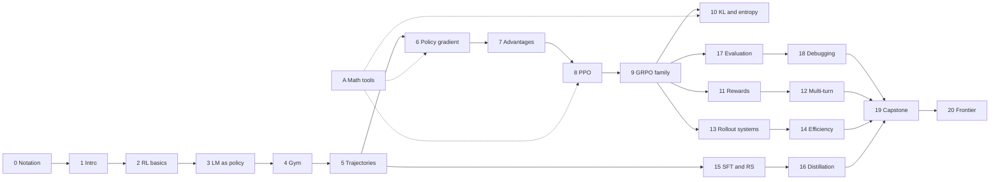

本书通过搭建一套完整的小型训练系统来讲授面向语言模型智能体的强化学习。每章推导一个机制，用几行 PyTorch 实现它，运行它，并解读输出。这部分前言说明本书面向哪些读者、如何运行、全书使用的符号、如何标注各类论断，以及各章之间的依赖关系。

## 0.1 预备知识

本书假定你训练或微调过大模型。你应当熟悉 transformer、交叉熵、优化器、混合精度以及分布式训练的基础；这些内容本书都不再解释。你还应当熟悉期望、条件分布和方差这一层次的概率知识。[附录 A](/tutorial/zh/chapters/A-math) 汇集了强化学习各章用到的具体工具（重要性采样（importance sampling）、对数导数技巧、KL 恒等式以及蒙特卡洛误差棒），并附有简短推导和数值验证。

本书*不*假定读者有任何强化学习背景。[第 2 章](/tutorial/zh/chapters/02-rl-fundamentals)从定义出发构建 MDP、价值函数（value function）和强化学习目标，[第 6 章](/tutorial/zh/chapters/06-policy-gradient)从零推导策略梯度（policy gradient）。行文节奏面向学得快、但希望每一步都有依据的读者。

## 0.2 每章如何展开

每章都遵循同样的循环。一节以上一节留下的问题开头，陈述一个机制，用一个短代码块实现它，运行它，并解读打印出的输出。每章以**实践中的设计问题**一节、**小结**和**练习**收尾。设计问题的写法就像一位资深工程师在设计评审中陈述问题那样：你会在监控面板上看到的症状，用本章数学表述的原因，各个可选方案及其代价，以及一个标注为本书建议的默认做法。

代码块都很短，每块只做一件事。张量形状写在注释中，使用固定的轴名：

| 轴 | 含义 |
| --- | --- |
| `B` | 轨迹批次 |
| `G` | 组大小：每个提示或任务的样本数 |
| `T` | 以 token 计的序列长度 |
| `V` | 词表大小 |
| `D` | 模型宽度 |
| `S`, `A` | 表格型 MDP 中的状态数和动作数 |

例如，一个批次的逐 token 对数概率为 `logp: [B, T]`，而标记策略自身 token 的掩码具有相同的形状。

```python
import torch

B, T = 2, 6
logp = torch.full((B, T), -0.5)                     # logp: [B, T]
action_mask = torch.tensor([[0, 1, 1, 0, 0, 1],     # action_mask: [B, T], 1 = policy token
                            [0, 1, 1, 1, 0, 0]])
masked_sum = (logp * action_mask).sum(-1)           # [B]
print('logp shape:', tuple(logp.shape), ' mask shape:', tuple(action_mask.shape))
print('sum of policy-token log-probs per trajectory:', masked_sum.tolist())
```

Output:

```text
logp shape: (2, 6)  mask shape: (2, 6)
sum of policy-token log-probs per trajectory: [-1.5, -1.5]
```

输出都是运行代码块打印出来的，从不手写。检查器会重新执行每一章，只要任何打印输出与正文不一致就会报错。

## 0.3 运行代码

每章是一个 Markdown 文件，其中的 Python 代码块在一个全新的命名空间中按顺序运行。所有内容都在 CPU 上运行，一章大约一分钟内完成。

**`agentrl` 库。** 第一行为 `#@save` 的代码块会成为生成的 Python 包 `agentrl` 的一部分。被保存的代码块只包含导入、函数和类的定义以及常量，不打印任何内容。在定义某个函数的那一章里，直接用函数名调用它。后续章节以如下内容开头

```text
import torch
import agentrl as arl
```

然后调用 `arl.policy_evaluation(...)`、`arl.TinyAgent(...)` 等。这正是本书成为一次完整构建的方式：到综合实战（capstone）一章时，训练栈的每个组件都已经推导、实现并保存过一次，综合实战章节直接导入它们。一章只能使用 Python、PyTorch、标准库、本章前面的代码块，以及*更早*章节保存的函数。检查器只用前面的章节构建 `agentrl`，以此强制执行这条规则。要在本地构建这个包，运行

```text
python3 scripts/build_library.py          # writes agentrl/__init__.py from all #@save blocks
```

不要手工编辑 `agentrl/__init__.py`；应当修改章节并重新构建。

**检查一章。** `scripts/check_tutorial_snippets.py` 执行各章，并将每个代码块的标准输出与其后的 `Output:` 块进行比较。作者在本书的检查主机（已安装 PyTorch）上运行它，通过一个包装脚本把仓库复制到一个私有目录中：

```text
scripts/remote_check.sh <workdir> --refresh 02    # run chapter 02 and rewrite its Output blocks
scripts/remote_check.sh <workdir> 02              # verify that recorded outputs match
```

读者可以用任何较新的 PyTorch 在本地运行检查器：`python3 scripts/check_tutorial_snippets.py --chapters 02`。使用真实 Qwen3-0.6B 分词器或模型的章节，会在设置 `HF_HUB_OFFLINE=1` 的情况下从本地 Hugging Face 缓存读取，从不下载。

**图。** 数据图由 `scripts/figures/` 中的模块根据本书代码计算并渲染为 SVG；它们是重新生成的，而不是手绘的。

## 0.4 符号

同一个符号在每一章中含义相同。当文献对某个符号的用法不同时，相应章节会加以说明。

| 符号 | 含义 |
| --- | --- |
| $\pi_\theta$ | 参数为 $\theta$ 的策略（即语言模型） |
| $\pi_{\text{old}}$ | 在当前更新之前、生成一批数据的那个策略 |
| $\mu$ | 与陈旧的 $\pi_\theta$ 不同时的行为策略，例如推理引擎的采样分布 |
| $\pi_{\text{ref}}$ | 用于 KL 正则化的冻结参考策略 |
| $s_t, a_t, o_t$ | 第 $t$ 步的状态、动作和观测（轮级） |
| $y_i$, $c_i$ | 第 $i$ 个生成的 token 及其前缀（token 级） |
| $r_t$ | 第 $t$ 步的奖励；当 $r$ 可能有歧义时，比率用 $\rho$ 表示 |
| $\tau$ | 一条轨迹 $(s_0, a_0, r_0, s_1, \dots)$；$R(\tau)$ 为其总奖励 |
| $G_t$ | 从第 $t$ 步起的回报：$\sum_{k \ge 0} \gamma^k r_{t+k}$ |
| $J(\theta)$ | 强化学习目标，$\mathbb{E}_{\tau \sim \pi_\theta}[R(\tau)]$ |
| $P(s' \mid s, a)$, $R(s,a)$ | MDP 的转移概率和期望奖励 |
| $V^\pi, Q^\pi$ | 策略 $\pi$ 的状态价值函数和动作价值函数 |
| $A_t$, $\hat A_t$ | 优势 $Q^\pi - V^\pi$ 及其估计 |
| $\rho_t$ | 概率比 $\pi_\theta(a_t \mid s_t) / \pi_{\text{old}}(a_t \mid s_t)$；有些论文写作 $r_t$ |
| $G$ | 组大小：每个提示的样本数（通过下标与回报 $G_t$ 区分） |
| $\gamma, \lambda$ | 折扣因子和 GAE 参数 |
| $\epsilon$ | 裁剪半宽；非对称时为 $\epsilon_{\text{low}}, \epsilon_{\text{high}}$ |
| $\beta$ | KL 系数 |
| $\mathrm{KL}(p \,\Vert\, q)$ | $\mathbb{E}_{x \sim p}[\log p(x) - \log q(x)]$ |
| $\mathcal{H}(\pi)$ | 分布的熵，$-\mathbb{E}_{a \sim \pi}[\log \pi(a)]$ |
| $\mathbb{E}$, $\mathrm{Var}$, $\hat{\ }$ | 期望、方差以及某个量的估计 |

有两条约定会反复出现。对数概率使用自然对数。掩码和逐 token 对数概率都对齐到*被预测的*位置，因此 `logp[:, i]` 是 token `ids[:, i + 1]` 的对数概率（[第 5 章](/tutorial/zh/chapters/05-trajectories-and-templates)）。

## 0.5 证据标签

一本讲训练系统的书会做出三类论断，而混淆它们正是讹传扩散的方式。本书中的每一个定量论断都属于下列类别之一，提示框会注明属于哪一类。

- **本书测得。** 由书中代码块打印的数字，或由实验保存在 `tutorial/labs/results/` 下的数字。对于产生它们的代码而言，这些数字是精确的。几乎所有这类数字都来自演示机制的小型 CPU 实验。它们不是基准测试结果，凡是读者可能混淆二者的地方，正文都会加以说明。
- **文献报告。** 由论文、技术报告或官方仓库提出、附有链接的论断。每个来源都记录在 [sources.md](/tutorial/sources) 中，注明查验日期和查验范围。除非正文另有说明，报告的数字都没有复现。厂商私有的训练方案除非有公开文档，否则视为未知。
- **假设或建议。** 本书的解读，或设计问题中建议的默认做法。它们被标注为建议，而不是普适规则。

在各章中，`> **Evidence.**` 提示框说明一个论断的性质，`> **Pitfall.**` 标记那些能运行但会给出错误答案的错误，`> **In production.**` 描述大型系统如何实现某个思路，并附上来源，或说明这是一般性的工程观察。（中文版中这三类提示框分别译为“证据”“陷阱”“生产实践”。）

## 0.6 贯穿全书的系统与章节依赖图

本书搭建同一个系统。**BugFix gym**（[第 4 章](/tutorial/zh/chapters/04-environments-and-tools)）是一族小型 Python 修复任务，工具为 `read`、`test`、`edit <op>` 和 `submit`，调用语法为 `<call> tool [arg] </call>`。[第 1 章](/tutorial/zh/chapters/01-introduction)中的 `clamp` 缺陷就是它的任务 0。**TinyAgent**（[第 3 章](/tutorial/zh/chapters/03-language-models-as-policies)）是一个小型 transformer 策略，在 CPU 上用强化学习在该 gym 上训练。在模型特定行为起作用的地方，例如对话模板、分词以及不同引擎之间的对数概率不一致，相关章节使用真实的 Qwen3-0.6B 分词器或模型。

各章之间的依赖关系如下。箭头表示后面的章节使用了前面章节保存的代码或思想。



第 1–9 章构成主干，应当按顺序阅读。第 9 章之后，各分支基本相互独立：关注基础设施的读者可以从第 9 章跳到第 13、14 章，关注奖励设计的读者可以从第 9 章跳到第 11、12 章。附录 A 可以按需阅读，当第 6、8 或 10 章的某个推导用到其中的工具时再看。附录 B 收录了需要综合全书知识的设计评审问题。

## 小结

- 本书假定读者精通深度学习而完全不了解强化学习；强化学习从定义开始构建。
- 每章在机制、代码、输出和解读之间循环，并以设计问题、小结和练习收尾。
- `#@save` 代码块构建 `agentrl` 库；后续章节使用 `import agentrl as arl`，检查器确保各章只使用更早保存的代码。
- 每个论断要么是本书测得的，要么是有日期的来源所报告的，要么被标注为假设或建议。

## 练习

1. 运行 `python3 scripts/build_library.py` 并打开 `agentrl/__init__.py`。每个函数是在哪一章定义的？
2. 修改某一章 `Output:` 块中的一个打印数字，然后对这一章运行检查器。阅读它产生的错误信息。
3. 在 0.2 节的代码块中修改掩码，使第一条轨迹包含它的第一个 token。在运行前先预测新的掩码求和结果。位置 0 上通常是哪一类 token？为什么它应该被掩掉？
4. 在[第 1 章 1.6 节](/tutorial/zh/chapters/01-introduction#1-6-公开的参考系统)中挑一个论断，并在 [sources.md](/tutorial/sources) 中找到它的条目。该条目说明了哪些内容*没有*查验？
