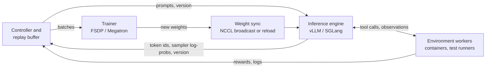

前面的 `train_rl` 在一个进程内采样 64 个回合，等全部结束后更新，再开始下一批。采样和训练不重叠，采样器与训练器共用模型；二者的对数概率误差不超过 $2 \times 10^{-6}$（第 8.6 节）。扩大到真实编程任务后，这些条件往往不再成立：回合耗时差异很大，推理和训练各自使用不同的设备、并行方式与 kernel。本章讨论怎样提高资源利用率，同时记录清楚每批数据由哪个行为策略生成。

本章用四个实验逐步检查这些问题。一个 rollout 流水线的离散事件模拟器，测量同步、提前一步和完全异步（asynchronous）三种设计在吞吐量（throughput）上换来了什么、在陈旧度（staleness）上付出了什么。一个用落后 $k$ 次更新的策略（policy）采样的训练循环，测量陈旧度在有无重要性校正时对 TinyAgent 的影响。一次在真实 Qwen3-0.6B 上的测量，表明即使权重完全相同，推理端和训练端的前向计算给出的对数概率（log-probability）也不一致。最后，针对这种不一致的两种校正，即截断重要性采样（importance sampling）和掩码重要性采样，我们会推导、模拟，并在一个故意制造不一致的采样器上用 TinyAgent 进行测试。

```python
#@save
import copy
import heapq
import math
import torch
import agentrl as arl
```

```python
torch.set_num_threads(4)                       # the shared check host is heavily loaded
tok = arl.build_tokenizer(arl.make_tasks('all'))
train_tasks, heldout_tasks = arl.make_tasks('train'), arl.make_tasks('heldout')
rl_base = arl.make_rl_base(tok)
```

## 13.1 RL 系统的组成部分

面向智能体的生产级 RL 系统有四类组件。各框架对它们的命名不同，但职责相同。



- **推理引擎**（vLLM、SGLang）负责生成 token。它管理 KV cache，用连续批处理（continuous batching）同时批量处理数千条并发序列，返回 token id，以及每个被采样 token 在其采样分布下的对数概率。它的 kernel 针对解码吞吐量调优：分页注意力（paged attention）、融合采样，权重常用 bf16 或 FP8。*故障模式：*长回合中 KV cache 增长导致显存溢出，内存压力下序列被抢占并重新计算，以及对数概率与训练器不一致（第 13.6 节）。
- **训练器**（FSDP 或 Megatron，嵌在 verl、slime、OpenRLHF 或 AReaL 等框架中）重新计算对数概率、计算优势（advantage）并执行梯度步。它把参数、梯度和优化器状态切分到多个加速器上。*故障模式：*长序列导致内存暴涨（[第 14 章](/tutorial/zh/chapters/14-scaling-and-efficiency)），跨微批次（microbatch）的梯度归一化 bug，以及当数据来自另一个策略而非它所假定的策略时出现的无声发散。
- **环境 worker** 运行工具：每个回合一个容器，其中检出了代码仓库，有一个 shell 和一个测试运行器。它们受 CPU 限制、速度慢且不可靠。*故障模式：*容器启动延迟、测试进程挂起、不稳定（flaky）测试、worker 在回合中途崩溃，以及数千个回合同时运行时的资源耗尽。
- **权重同步**（weight sync）在每次更新后把新参数从训练器搬到引擎：可以在两个进程组之间做 NCCL 广播，可以在两者共用加速器时（“共置”，colocated）原地重切分，也可以写一个检查点让引擎重新加载。*故障模式：*同步要花几秒到几分钟，期间生成停滞；不完整的同步让引擎混用新旧层；如果版本计数器没有附在每个样本上，陈旧度就无法测量。

**控制器**把它们串起来：它跟踪策略版本，决定何时启动回合、何时训练，并在缓冲区中保存已完成的回合。[第 20 章](/tutorial/zh/chapters/20-frontier#20-6-异步强化学习与训推不一致) 引用的框架文档描述了 verl、slime 和 OpenRLHF 中的这些部件；我们读的是它们的文档和 README，而不是代码。

本书的代码里已经有这四个组件的缩微版：`rollout_batch` 是引擎，`BugFixEnv` 是环境 worker，`rl_update` 是训练器，而权重同步没有成本，因为采样器和训练器是同一个 `nn.Module`。真实的同步搬运的是参数。下面的代码块为 TinyAgent 统计参数量，并在标明的带宽假设下，对真实模型规模做估算。

```python
n_params = sum(p.numel() for p in rl_base.parameters())
print(f'TinyAgent: {n_params:,} parameters, {4 * n_params / 1e6:.2f} MB in fp32')
# Assumed effective bandwidths: 100 GB/s within a node, 10 GB/s across nodes, 1 GB/s via a checkpoint reload.
for name, billions in [('Qwen3-0.6B', 0.6), ('Qwen3-8B', 8.2), ('Qwen3-32B', 32.8)]:
    gigabytes = 2 * billions                                   # bf16 weights
    times = ', '.join(f'{gigabytes / bw:6.2f} s at {bw:>3} GB/s' for bw in (100, 10, 1))
    print(f'{name:<11} {gigabytes:5.1f} GB in bf16 | {times}')
```

Output:

```text
TinyAgent: 157,244 parameters, 0.63 MB in fp32
Qwen3-0.6B    1.2 GB in bf16 |   0.01 s at 100 GB/s,   0.12 s at  10 GB/s,   1.20 s at   1 GB/s
Qwen3-8B     16.4 GB in bf16 |   0.16 s at 100 GB/s,   1.64 s at  10 GB/s,  16.40 s at   1 GB/s
Qwen3-32B    65.6 GB in bf16 |   0.66 s at 100 GB/s,   6.56 s at  10 GB/s,  65.60 s at   1 GB/s
```

一个 32B 模型的权重在 bf16 下是 66 GB。在节点内传输不到一秒；跨节点需要几秒；通过重新加载检查点则需要约一分钟，而且每一步都要付出。正是这些数字，而不是模型的 FLOPs，决定了共置设计要原地重切分、分离式设计要走 NCCL 广播。它们也是模拟器的输入：同步开销位于每一步的关键路径上。

## 13.2 时间花在哪里：长尾回合

第二个输入是回合时长。智能体回合在生成和工具调用之间交替。每一轮生成几百个 token，单条序列的解码速率是每秒几十个 token（引擎的总吞吐量很高，但每条序列每个解码步只前进一个 token），然后等待工具：读文件在毫秒级返回，跑测试套件需要几秒到几分钟。轮数随任务和尝试而变化。`agent_episode_durations` 按这种结构采样时长：几何分布的轮数，每轮均匀分布的 token 数，以及对数正态分布的工具延迟。默认参数是为了模仿编程智能体而选的假设，不是对编程智能体的测量。

```python
#@save
def agent_episode_durations(n, generator, mean_turns=8, max_turns=40, tokens_per_turn=(100, 600),
                            decode_rate=40.0, tool_median=2.0, tool_sigma=1.0):
    """Simulated wall-clock seconds of n agent episodes -> [n]. Turns ~ geometric, tool latency ~ log-normal."""
    u = torch.rand(n, generator=generator)
    turns = (torch.log1p(-u) / math.log(1 - 1 / mean_turns)).ceil().clamp(1, max_turns)     # [n]
    lo, hi = tokens_per_turn
    decode = (lo + (hi - lo) * torch.rand(n, max_turns, generator=generator)) / decode_rate  # [n, max_turns]
    tool = tool_median * torch.exp(tool_sigma * torch.randn(n, max_turns, generator=generator))
    used = torch.arange(max_turns) < turns[:, None]                                         # [n, max_turns]
    return ((decode + tool) * used).sum(-1)
```

对同步步骤而言，重要的不是平均时长，而是批次中 $B$ 个回合里最慢那一个的时长，因为训练器必须等全部回合到齐才能开始。我们抽取一个大样本池，把它切分成多个批次来估计批次最大值的期望，并与平均值比较。

```python
durations = agent_episode_durations(65_536, torch.Generator().manual_seed(0))      # [N] seconds
q = durations.quantile(torch.tensor([0.5, 0.9, 0.99]))
print(f'mean {durations.mean():.0f} s | median {q[0]:.0f} s | p90 {q[1]:.0f} s | p99 {q[2]:.0f} s | max {durations.max():.0f} s')
for B in [8, 64, 512]:
    batch_max = durations.view(-1, B).max(-1).values.mean()
    print(f'B = {B:3d}: expected slowest episode {batch_max:4.0f} s = {batch_max / durations.mean():.1f} x the mean')
```

Output:

```text
mean 96 s | median 68 s | p90 215 s | p99 430 s | max 624 s
B =   8: expected slowest episode  251 s = 2.6 x the mean
B =  64: expected slowest episode  415 s = 4.3 x the mean
B = 512: expected slowest episode  515 s = 5.4 x the mean
```

回合时长的中位数约一分钟，平均值约一分半，但每一百个回合中就有一个耗时数倍于此。批次中最慢的回合随批大小增长，行为类似分布的高分位数：期望的拖尾回合（straggler）在 $B = 8$ 时是平均值的 2.6 倍，$B = 64$ 时是 4.3 倍，$B = 512$ 时是 5.4 倍。同步系统每一步都在等这个拖尾回合，而在等待期间，回合已经结束的槽位什么也不做。这就是拖尾问题，而且批次越大它越*严重*，这与扩大批次本来的目的恰好相反。

## 13.3 同步、提前一步与异步流水线

三种设计以不同方式应对拖尾问题。

- **同步**（on-policy）。用版本 $v$ 采样一个批次，在其上训练，同步到 $v+1$，重复。每个回合都由生成它的版本来训练，因此梯度正是[第 6 章](/tutorial/zh/chapters/06-policy-gradient)的 on-policy 估计量（estimator）。步长时间为 $\mathbb{E}[\max_{i \le B} d_i] + t_{\text{train}} + t_{\text{sync}}$，生成与训练从不重叠。
- **提前一步**（一步 off-policy，one-step off-policy）。训练器在批次 $n$ 上训练时，引擎已经在用版本 $v_n$ 采样批次 $n+1$。训练与生成重叠，每个回合恰好陈旧一个版本。verl 的文档描述了这种模式（[第 20 章](/tutorial/zh/chapters/20-frontier#20-6-异步强化学习与训推不一致)）。
- **完全异步。**生成槽位从不等待：每当一个回合结束，该槽位就用最新权重启动另一个回合。训练器只要空闲，就取最早完成的 $B$ 个回合。**陈旧度上界** $\eta$ 对生成进行节流，使其领先训练不超过 $\eta$ 个批次；第 20 章引用的 AReaL 条件是，只有当已启动的回合数小于 $(v + 1 + \eta) B$ 时才允许启动新回合。当 $\eta = 0$ 时，这一设计退化为同步设计。

在异步系统中，权重同步会遇到仍在运行的回合。引擎要么**排空**（drain，停止启动新回合，等在途回合在旧权重下跑完，再同步），要么**中断**它们：在途回合在同步期间暂停，之后在新权重下继续。第二种做法称为**部分 rollout**（partial rollout；AReaL 称之为可中断 rollout，Kimi k1.5 的部分 rollout 为每次迭代设定 token 预算上限，之后再续跑）。被中断回合的前段 token 来自版本 $v$，后段来自 $v+1$ 或更新的版本，因此没有任何单一策略生成了它。

下面的模拟器恰好建模了这些选择。它有 `n_slots` 个生成槽位（引擎中的并发回合），一个训练器，每步消耗 `batch_size` 个回合、耗时 `train_time` 秒，以及一次耗时 `sync_time` 秒、会暂停所有生成的同步。这是一个离散事件模拟：时间从一个事件（某个回合结束、某个训练步结束、某次同步结束）跳到下一个事件。回合时长从同一个张量中按顺序取用，因此每种设计看到的是相同的回合。它记录所模拟的每个时间区间，以便绘制时间线，并报告吞吐量、槽位利用率，以及每个被训练回合的陈旧度：训练器在该步开始时的版本减去启动该回合的版本。

```python
#@save
def simulate_pipeline(durations, n_slots, batch_size, train_time, sync_time, max_staleness=0,
                      interrupt=True, steps=10):
    """Discrete-event rollout/trainer pipeline; durations [N] s -> dict(events, time, throughput, staleness, ...)."""
    durs, t, version, started = iter(durations.tolist()), 0.0, 0, 0
    running, buffer, events, trained = {}, [], [], []    # slot -> [end, start, version, duration]
    train_end = sync_end = None
    pending = False                                      # trained, waiting to sync
    while version < steps:
        while (sync_end is None and not (pending and not interrupt) and len(running) < n_slots
               and started < (version + 1 + max_staleness) * batch_size):          # staleness throttle
            slot, d = min(set(range(n_slots)) - set(running)), next(durs)
            running[slot], started = [t + d, t, version, d], started + 1
        if train_end is None and sync_end is None and not pending and len(buffer) >= batch_size:
            batch, buffer = buffer[:batch_size], buffer[batch_size:]          # oldest finished first
            trained += [(version - v, d) for v, d in batch]
            train_end = t + train_time
            events.append(('train', 0, t, train_end, version))
        t = min([r[0] for r in running.values()] + [x for x in (train_end, sync_end) if x is not None])
        if sync_end == t:
            sync_end, version = None, version + 1
        if train_end == t:
            train_end, pending = None, True
        for slot in [s for s, r in running.items() if r[0] == t]:
            end, start, v, d = running.pop(slot)
            buffer.append((v, d))
            events.append(('gen', slot, start, end, v))
        if pending and (interrupt or not running):                          # drain mode waits for in-flight
            pending, sync_end = False, t + sync_time
            events.append(('sync', 0, t, sync_end, version))
            for r in running.values():
                r[0] += sync_time                                            # generation pauses during sync
    stale = torch.tensor([s for s, _ in trained], dtype=torch.float)
    busy = sum(e[3] - e[2] for e in events if e[0] == 'gen')
    return dict(events=events, time=t, throughput=steps * batch_size / t * 3600, gen_util=busy / (n_slots * t),
                staleness_mean=stale.mean().item(), staleness_max=int(stale.max()),
                trained_duration=sum(d for _, d in trained) / len(trained))
```

外层循环每一轮做四件事。只要节流允许，它就填充空闲槽位，除非正在同步，或在排空模式下正在等待同步。如果训练器空闲且至少有 `batch_size` 个回合已完成，它就启动一个训练步，并记录每个回合的陈旧度。它把时间推进到最早的待处理事件。然后处理该事件：同步结束则发布下一个版本，训练步结束则请求一次同步，回合结束则加入缓冲区。在部分 rollout 模式下，请求的同步立即开始，并把每个在途回合的结束时间推后 `sync_time`；在排空模式下，同步只在没有在途回合时才开始。槽位利用率把被中断回合的暂停时间算作忙碌时间，这会略微高估。

我们在相同配置下运行五种设计：64 个槽位，每步 64 个回合，训练 60 秒，同步 10 秒，共 20 步。

```python
DESIGNS = {'synchronous': dict(max_staleness=0), 'one step ahead, drain': dict(max_staleness=1, interrupt=False),
           'async eta=1, partial': dict(max_staleness=1), 'async eta=2, partial': dict(max_staleness=2),
           'async eta=4, drain': dict(max_staleness=4, interrupt=False)}
print(f'{"design":<22} | episodes/hour | slot util | staleness mean, max | trained episode mean (s)')
for name, kw in DESIGNS.items():
    r = simulate_pipeline(durations, 64, 64, 60.0, 10.0, steps=20, **kw)
    print(f'{name:<22} | {r["throughput"]:13.0f} | {r["gen_util"]:9.2f} | {r["staleness_mean"]:8.2f}, {r["staleness_max"]:2d}'
          f'      | {r["trained_duration"]:6.1f}')
```

Output:

```text
design                 | episodes/hour | slot util | staleness mean, max | trained episode mean (s)
synchronous            |           451 |      0.19 |     0.00,  0      |   97.7
one step ahead, drain  |           506 |      0.22 |     0.95,  1      |   97.7
async eta=1, partial   |          1836 |      0.81 |     0.93,  5      |   94.1
async eta=2, partial   |          2077 |      0.95 |     1.50,  7      |   93.2
async eta=4, drain     |           490 |      0.25 |     3.19,  4      |   97.7
```

同步流水线每小时训练 451 个回合，槽位只有 19% 的时间处于忙碌状态。这两个数字都可以从第 13.2 节推出：一步的时长约等于 64 个回合中最慢那个的时长（期望 415 s）加上 70 s 的训练和同步，$64 / 485\ \text{s} \approx 475$ 个回合每小时；模拟结果略低，因为最慢回合的时长在批次之间有波动。让训练与生成重叠、但每次同步前仍然排空（“提前一步，排空”）只提升了 12%，因为在一个主要由等待拖尾回合构成的步骤中，训练只占 60 s。不排空时，情况完全不同。使用部分 rollout 且 $\eta = 1$ 时，槽位有 81% 的时间处于忙碌状态，吞吐量是同步设计的 4.1 倍；$\eta = 2$ 时分别是 95% 和 4.6 倍。此时的瓶颈不再是拖尾回合，而是生成容量：64 个槽位各自完成一个 96 秒的回合，每小时最多 $64 / 96 \times 3600 \approx 2{,}400$ 个回合，再扣除同步造成的暂停。设置宽松陈旧度上界但仍排空的配置（$\eta = 4$，排空）和同步设计一样慢，因为每次同步仍然要等在途时间最长的回合。

有两列显示了代价。在 $\eta = 1$ 时被训练回合的平均陈旧度约为 1，$\eta = 2$ 时约为 1.5，但*最大*陈旧度分别是 5 和 7：节流统计的是已启动的回合数，因此一个在版本 0 启动的拖尾回合会一直运行，较新的回合超过它，它在四五个版本之后才被训练。此外，被训练回合的平均时长比同步设计略短（93 到 94 s，对比 98 s）：优先取最早*完成*的回合，意味着批次被快的回合填满，慢的回合要么较晚才被训练，要么在运行结束时根本不被训练。这两种效应在吞吐量监控面板（dashboard）上都看不出来。


图 13.1 绘制了模拟器在一个 8 槽位小型流水线上的事件。图的同步部分，每一步形状相同：大多数槽位提前完成，然后空闲等待，直到批次中最长的回合结束；接着训练器运行，所有槽位再次等待。四步共用了 1,130 个模拟秒。图的异步部分，槽位的上一个回合一结束就启动新回合，训练器在 8 个回合完成后立即开始，四步共用了 493 s。注意那些穿过黄色同步带的长条：它们是部分 rollout，即在一个版本下启动、在下一个版本下完成的回合，而每个条形上的标签只是*启动*它的版本。


图 13.2 扫描了上界。使用部分 rollout 时，吞吐量从 $\eta = 0$ 到 $\eta = 2$ 急剧上升，之后趋于平坦，因为生成容量成了限制；排空则让各个上界下的吞吐量都停留在同步水平附近。右图中，被训练回合的平均陈旧度保持在上界以下，并在 1.5 处停止增长，但当 $\eta \le 6$ 时最大陈旧度超过了上界。设计上的启示是：异步带来的大部分吞吐量在陈旧度上界为 1 或 2 时就能获得；而对生成设定的上界并不能限制最老数据的年龄，除非在训练器消耗回合时也执行这一上界。

> **证据。**本节的所有内容都是在明确假设下的模拟：第 13.2 节的时长模型、固定的训练时间，以及一次会暂停所有生成的同步。它展示的是机制（等待拖尾回合、重叠、排空的代价、基于计数的节流无法限制的陈旧度）。真实系统报告的加速比（AReaL 为 2.77x，ROLL Flash 在智能体任务上为 2.72x；见第 20 章）来自不同的工作负载，这里没有复现。

## 13.4 针对行为策略的重要性校正

异步改变了估计量。令 $\mu$ 为**行为策略**（behavior policy），即实际生成这些 token 的分布，可能来自：落后 $k$ 次更新的权重版本、数值行为不同的推理引擎，或一个被中断回合内多个版本的混合。训练器持有 $\pi_\theta$。[第 6 章](/tutorial/zh/chapters/06-policy-gradient)的策略梯度（policy gradient）是 $\pi_\theta$ 下的期望，而数据来自 $\mu$。采用 [第 8.1 节](/tutorial/zh/chapters/08-ppo#8-1-off-policy-复用与重要性采样)的逐 token 近似，对每个 token 有

$$
\nabla_\theta J \approx \mathbb{E}_{y \sim \mu}\Big[\frac{\pi_\theta(y \mid c)}{\mu(y \mid c)}\, \hat A\, \nabla_\theta \log \pi_\theta(y \mid c)\Big].
$$

忽略这个比率（`rl_update` 用训练器重新计算 `old_logp` 时正是这么做的），估计的其实是 $\mathbb{E}_\mu[\hat A \nabla \log \pi_\theta]$。这是我们想要的梯度的有偏估计，偏差（bias）随 $\mu$ 与 $\pi_\theta$ 之间的距离增长。对固定前缀，引入该比率可校正动作分布；要完全校正轨迹分布仍需第 8 章的比率乘积。此外，大权重又带回方差问题：比率没有上界，当 $\mu$ 在 $\pi_\theta$ 偏好的 token 上概率质量很小时，其方差（variance）会爆炸。

PPO 的裁剪（clipping）解决不了这个问题。裁剪限制的是 $\pi_\theta / \pi_{\text{old}}$，其中 $\pi_{\text{old}}$ 是训练器在本次更新开始时持有的策略副本。当 $\mu \ne \pi_{\text{old}}$ 时存在两个比率，AReaL 的**解耦**（decoupled）目标（第 20 章）把它们分开：行为权重 $\pi_{\text{old}}/\mu$ 校正*数据由哪个分布采样*，PPO 的裁剪比率 $\pi_\theta/\pi_{\text{old}}$ 限制*本次更新走多远*。把 $w = \pi_{\text{old}}/\mu$ 视为常数，

$$
L(\theta) = -\,\mathbb{E}_{y\sim\mu}\Big[\, w \cdot \min\big(\rho\, \hat A,\ \mathrm{clip}(\rho, 1-\epsilon_{\text{low}}, 1+\epsilon_{\text{high}})\, \hat A\big)\Big], \qquad \rho = \frac{\pi_\theta}{\pi_{\text{old}}}.
$$

由于 $w \ge 0$，$w \min(\rho \hat A, \mathrm{clip}(\rho)\hat A) = \min(\rho\, w\hat A, \mathrm{clip}(\rho)\, w \hat A)$，因此解耦损失就是第 8 章的 `ppo_policy_loss`，只是逐 token 优势换成了 $w \hat A$。下面的代码正是这样实现的。实践中常用两种方式限制 $w$ 的影响：

- **截断重要性采样（truncated importance sampling，TIS）**：$w = \min(\pi_{\text{old}}/\mu,\ C)$。TIS 博文（Yao et al., 2025；第 20 章）针对采样器–训练器不一致提出了它，verl 的 rollout 校正预设使用 $C = 2$。截断把每个加权项的二阶矩限制在未加权项的 $C^2$ 倍以内，但留下了偏差：$\pi_{\text{old}}/\mu > C$ 的 token 权重偏低，这意味着采样器相对训练器采样不足的 token 仍然代表性不足。
- **掩码重要性采样（masked importance sampling，MIS）**，即 Ring-1T 报告中的 IcePop：在区间 $[\alpha, \beta]$ 内 $w = \pi_{\text{old}}/\mu$，区间外为 $0$，报告中取 $\alpha = 0.5$、$\beta = 5$。两个概率的差异超出该区间的 token 被视为噪声，从梯度中移除，而不是以封顶的权重保留。

两者都保存为以两个对数概率张量和动作掩码（action mask）为输入的函数。它们返回分离（detached）的权重，掩码之外为零。

```python
#@save
def tis_weights(logp_trainer, logp_sampler, mask, cap=2.0):
    """Truncated IS weights min(pi/mu, cap) per token, detached: [B, T] -> [B, T], 0 where mask is 0."""
    log_ratio = (logp_trainer - logp_sampler).detach()
    return log_ratio.clamp(max=math.log(cap)).exp() * mask


def mis_weights(logp_trainer, logp_sampler, mask, low=0.5, high=5.0):
    """Masked IS weights (IcePop): pi/mu inside [low, high], else 0; detached [B, T] -> [B, T]."""
    ratio = (logp_trainer - logp_sampler).detach().exp()
    return ratio * ((ratio >= low) & (ratio <= high)) * mask
```

每种权重会留下多少偏差和方差？一个单步问题可以精确地回答这个问题，因为在那里真实梯度是已知的。取一个在 $V = 100$ 个 token 上的 softmax 策略，logits 为 $z$，每个 token 有固定奖励。$\mathbb{E}_{\pi}[r]$ 关于 $z$ 的梯度是 $\pi \odot (r - \mathbb{E}_\pi r)$。采样器的 logits 是 $z$ 加上尺度为 $\sigma$ 的高斯噪声，用来模拟逐渐增大的不一致。每次估计使用 64 个采样 token 和批均值基线（baseline），重复 4,000 次，测量其平方偏差和方差，两者都相对于真实梯度的平方范数。

```python
gen = torch.Generator().manual_seed(0)
V, N, REPS = 100, 64, 4000
z, reward = 2.0 * torch.randn(V, generator=gen), torch.randn(V, generator=gen)
logpi = torch.log_softmax(z, -1)                                        # [V]
true_grad = logpi.exp() * (reward - (logpi.exp() * reward).sum())       # [V]

def estimator_error(logmu, weight_fn):
    """Relative squared bias and variance of the weighted score-function gradient from mu's samples."""
    a = torch.multinomial(logmu.exp().expand(REPS, V), N, replacement=True, generator=gen)   # [REPS, N]
    adv = reward[a] - reward[a].mean(-1, keepdim=True)
    w = weight_fn(logpi[a], logmu[a], torch.ones_like(adv))
    grads = ((w * adv)[..., None] * (torch.nn.functional.one_hot(a, V) - logpi.exp())).mean(1)  # [REPS, V]
    scale = true_grad.pow(2).sum()
    return ((grads.mean(0) - true_grad).pow(2).sum() / scale).item(), (grads.var(0).sum() / scale).item()
```

```python
WEIGHTS = {'none': lambda lp, lm, m: m, 'full IS': lambda lp, lm, m: (lp - lm).exp() * m,
           'TIS C=2': tis_weights, 'MIS [0.5, 5]': mis_weights}
print(f'{"sigma":>5} {"KL(mu||pi)":>10} | ' + ' | '.join(f'{k:>14}' for k in WEIGHTS) + '   (bias^2, variance)')
for sigma in [0.1, 0.5, 1.0, 2.0]:
    logmu = torch.log_softmax(z + sigma * torch.randn(V, generator=gen), -1)
    kl = (logmu.exp() * (logmu - logpi)).sum().item()
    cells = [estimator_error(logmu, fn) for fn in WEIGHTS.values()]
    print(f'{sigma:5.1f} {kl:10.3f} | ' + ' | '.join(f'{b:6.3f}, {v:6.3f}' for b, v in cells))
```

Output:

```text
sigma KL(mu||pi) |           none |        full IS |        TIS C=2 |   MIS [0.5, 5]   (bias^2, variance)
  0.1      0.008 |  0.012,  0.166 |  0.000,  0.133 |  0.000,  0.131 |  0.000,  0.132
  0.5      0.033 |  0.046,  0.166 |  0.000,  0.152 |  0.001,  0.138 |  0.002,  0.150
  1.0      0.161 |  0.291,  0.117 |  0.000,  1.300 |  0.265,  0.163 |  0.368,  0.190
  2.0      0.425 |  0.737,  0.043 |  0.005, 10.202 |  0.741,  0.074 |  0.819,  0.127
```

每个单元格读作（平方偏差，方差），两者都相对于 $\lVert\nabla J\rVert^2$；均方误差是两者之和。对于小的不一致（$\sigma \le 0.5$，KL 约为 0.03 nats 或更小），忽略比率已经会留下相当于梯度平方范数 1% 到 5% 的偏差，而三种校正都能在不增加方差的情况下消除它，因为几乎没有比率接近上限或区间边界。对于大的不一致，三种校正拉开了差距。完整 IS 保持无偏，但方差增长到真实梯度平方的 1.3 倍，继而 10.2 倍：一个 $\mu$ 很少采样而 $\pi$ 偏好的 token 会携带极大的权重。TIS 让方差保持在接近不校正的水平，代价是放弃了大部分偏差校正，因为需要大于 2 的权重的 token 只得到了 2。在 $\sigma \ge 1$ 时，MIS 比不校正更差：它恰好移除了携带最大校正量的 token。截断和掩码 IS 是用于*小*的不一致加上偶发离群值的工具，第 13.6 节将表明，数值不一致正处于这个区间；它们治不了一个已经远离数据的策略。

## 13.5 TinyAgent 上的陈旧策略

模拟器告诉我们数据会变得多陈旧，却无法告诉我们陈旧度对学习有什么影响。为此，我们用一个落后训练器固定次数更新的行为策略来训练 TinyAgent。`offpolicy_update` 就是第 9 章的 `rl_update`，只改了一处：批次的 `sample_logp`，即行为策略在采样时记录的对数概率，通过解耦权重进入计算。当 `correction='none'` 时，权重就是动作掩码，更新与 `rl_update` 完全相同：训练器重新计算 `old_logp`，从不看 $\mu$。它还报告 $\pi_{\text{old}}$ 与 $\mu$ 之间对数比的平均绝对值（`mismatch`），以及比率超过上限的策略 token 所占比例（`over_cap`）。

```python
#@save
def offpolicy_update(model, optimizer, batch, advantages, cfg, correction='none', cap=2.0, generator=None):
    """Decoupled clipped update on data from a behavior policy mu (batch['sample_logp']) -> dict of stats."""
    ids, mask, sampler_logp = batch['ids'], batch['action_mask'], batch['sample_logp']        # [B, T], [B, T-1]
    with torch.no_grad():
        old_logp = arl.selected_log_probs(model(ids)[:, :-1] / cfg.temperature, ids[:, 1:])   # pi_old, [B, T-1]
    if correction == 'tis':
        weights = tis_weights(old_logp, sampler_logp, mask, cap)
    elif correction == 'mis':
        weights = mis_weights(old_logp, sampler_logp, mask)
    else:
        weights = mask                                                       # 'none': ignore mu entirely
    logs = []
    for rows in torch.randperm(len(ids), generator=generator).chunk(cfg.minibatches):
        logp = arl.selected_log_probs(model(ids[rows])[:, :-1] / cfg.temperature, ids[rows, 1:])
        loss, stats = arl.policy_loss(logp, old_logp[rows], advantages[rows, None] * weights[rows], mask[rows], cfg)
        optimizer.zero_grad()
        loss.backward()
        torch.nn.utils.clip_grad_norm_(model.parameters(), cfg.max_grad_norm)
        optimizer.step()
        logs.append(stats)
    log_ratio, n = (old_logp - sampler_logp) * mask, mask.sum()
    return dict({k: sum(s[k] for s in logs) / len(logs) for k in logs[0]},
                mismatch=(log_ratio.abs().sum() / n).item(),
                over_cap=((log_ratio > math.log(cap)).float() * mask).sum().item() / n.item())
```

`train_offpolicy` 保留最近 `lag + 1` 个权重版本，每一步都用最老的版本采样，因此在前 `lag` 步之后，每个批次都恰好陈旧 `lag` 次更新：`lag=1` 时对应提前一步流水线，一般情况对应陈旧度固定的异步流水线。可选的 `sampler` 函数在采样前变换行为模型；第 13.6 节用它构造一个数值上不同的采样器。

```python
#@save
def train_offpolicy(model, tasks, tok, cfg, steps, lag=0, correction='none', cap=2.0, sampler=None):
    """train_rl with a behavior policy `lag` updates old (optionally sampler(model)) -> history of dicts."""
    torch.manual_seed(cfg.seed)
    gen = torch.Generator().manual_seed(cfg.seed)
    optimizer = torch.optim.Adam(model.parameters(), lr=cfg.lr)
    versions, behavior, history = [copy.deepcopy(model.state_dict())], copy.deepcopy(model), []
    for step in range(steps):
        behavior.load_state_dict(versions[0])                                  # oldest kept version
        kept, sampled = arl.sample_step(sampler(behavior) if sampler else behavior, lambda: arl.make_env(cfg),
                                        tasks, tok, cfg, gen)
        batch = arl.collate(kept, tok.pad_id)
        record = dict(step=step, staleness=len(versions) - 1, **arl.behavior_stats(sampled))
        record.update(offpolicy_update(model, optimizer, batch, arl.compute_advantages(batch, cfg), cfg,
                                       correction, cap, gen))
        versions = (versions + [copy.deepcopy(model.state_dict())])[-(lag + 1):]
        history.append(record)
    return history
```

当 `lag=0` 且不校正时，它必须与 `train_rl` 逐步一致，因为两者以相同顺序消耗相同的随机数流。在相信任何比较之前先检查这一点，只需五步。

```python
reference = arl.train_rl(copy.deepcopy(rl_base), train_tasks, tok, arl.RLConfig(), steps=5)
same = train_offpolicy(copy.deepcopy(rl_base), train_tasks, tok, arl.RLConfig(), steps=5)
print('train_rl        rewards:', [round(h['reward'], 3) for h in reference])
print('train_offpolicy rewards:', [round(h['reward'], 3) for h in same])
```

Output:

```text
train_rl        rewards: [0.172, 0.172, 0.219, 0.203, 0.344]
train_offpolicy rewards: [0.172, 0.172, 0.219, 0.203, 0.344]
```

每一步的奖励都所有打印位都一致，因此下面实验中的任何差异都来自陈旧度和校正，而不是循环本身。

现在开始实验：从 RL 基座智能体出发，用默认配置训练 40 步，行为策略分别陈旧 0、2、4 或 8 次更新，均不做校正；另外在 4 和 8 时使用 TIS（$C = 2$），在 8 时使用 MIS（$[0.5, 5]$）。

```python
def stale_run(lag, correction, steps=40, **kw):
    """Train a copy of the RL base agent with stale sampling -> (history, held-out stats with 8 episodes per task)."""
    model, cfg = copy.deepcopy(rl_base), arl.RLConfig()
    history = train_offpolicy(model, train_tasks, tok, cfg, steps, lag, correction, **kw)
    held = arl.evaluate(model, heldout_tasks, tok, 8, generator=torch.Generator().manual_seed(0), cfg=cfg)
    return history, held

print(f'{"lag":>3} {"correction":<10} | reward by 10-step window | mismatch | over cap | clip_frac | held-out | reads')
stale = {}
for lag, correction in [(0, 'none'), (2, 'none'), (4, 'none'), (8, 'none'), (4, 'tis'), (8, 'tis'), (8, 'mis')]:
    hist, held = stale[lag, correction] = stale_run(lag, correction)
    window = ' '.join(f'{sum(h["reward"] for h in hist[i:i + 10]) / 10:.2f}' for i in range(0, 40, 10))
    mean = lambda key: sum(h[key] for h in hist) / len(hist)
    print(f'{lag:3d} {correction:<10} | {window:<24} | {mean("mismatch"):8.3f} | {mean("over_cap"):8.3f} |'
          f' {mean("clip_frac"):9.4f} | {held["pass_rate"]:8.3f} | {held["reads"]:5.2f}')
```

Output:

```text
lag correction | reward by 10-step window | mismatch | over cap | clip_frac | held-out | reads
  0 none       | 0.25 0.55 0.66 0.71      |    0.000 |    0.000 |    0.0016 |    0.700 |  0.95
  2 none       | 0.22 0.34 0.52 0.72      |    0.072 |    0.003 |    0.0070 |    0.762 |  1.02
  4 none       | 0.20 0.24 0.43 0.62      |    0.197 |    0.016 |    0.0169 |    0.438 |  0.99
  8 none       | 0.17 0.17 0.30 0.38      |    0.695 |    0.029 |    0.0255 |    0.000 |  0.14
  4 tis        | 0.20 0.28 0.48 0.62      |    0.142 |    0.016 |    0.0084 |    0.700 |  0.99
  8 tis        | 0.17 0.21 0.30 0.56      |    0.275 |    0.022 |    0.0067 |    0.550 |  0.99
  8 mis        | 0.17 0.24 0.30 0.29      |    0.308 |    0.030 |    0.0035 |    0.637 |  1.52
```

不校正时，在这次运行中陈旧度 2 没有造成损害：留出（held-out）通过率为 0.76，on-policy 基线为 0.70，差异在单随机种子噪声范围内（80 个回合上标准误约 0.05）。陈旧度 4 减缓了学习，第 20 到 29 步的训练奖励为 0.43，对比 0.66，最终留出通过率为 0.44。陈旧度 8 摧毁了这项技能：每回合读取次数降到 0.14，留出通过率降到 0.00，低于盲猜的 0.20。mismatch 列解释了这种剂量–反应关系。每个策略 token 的平均 $|\log \pi_{\text{old}} - \log \mu|$ 在 lag 2 时为 0.07 nats，lag 4 时为 0.20，lag 8 时为 0.70：TinyAgent 的策略变化很快（在第 9 章的运行中，其熵在 40 步内从 0.57 降到约 0.1），因此八次更新是一段很大的距离，而用一个读取更少的策略的样本计算出的未校正梯度，会把当前策略推向错误的方向。

校正挽回了大部分损失。使用 TIS（$C = 2$）时，lag 4 的留出通过率达到 0.70，与 on-policy 持平，lag 8 达到 0.55；lag 8 使用 MIS 时为 0.64。只有 1.6% 到 3% 的策略 token 比率超过 2，所以起作用的并不是上限，而是小于 1 的权重。这与第 13.4 节单步模拟的区间不同，那里的不一致是 logits 上的对称噪声，携带偏差的是超过上限的大比率。陈旧度是一种系统性偏移：当前策略已经变得更尖锐，所以在这些运行中，平均绝对对数比为 0.14 到 0.70 nats，而比率超过 2 的很少，大部分不一致是小于 1 的比率，TIS 会原样保留它们：陈旧策略偏好而当前策略不偏好的 token 被降权，这正是未校正更新看不见的偏差。MIS 的运行还显示了一个副作用：每回合 1.5 次读取，多于其他任何运行。一个合理的原因（我们没有验证）是，掩码恰好丢掉了概率变化最大的那些 token 的梯度，其中包括本可以抑制多余读取的 token。

> **证据。**本书测得，每种配置一个随机种子，在一个 157k 参数的策略上训练 40 步。其中的排序（不校正时随 lag 退化；TIS 和 MIS 挽回了其中很大一部分）就是本节讨论的机制。TinyAgent 在哪个 lag 崩溃，具体取决于它的学习率和策略变化速度；以 $10^{-6}$ 学习率训练的大模型每次更新的移动要小得多，这就是公开的异步系统能容忍 4 到 8 的陈旧度上界的原因（AReaL 报告的默认值，第 20 章）。

## 13.6 训推不一致

陈旧度是我们主动选择的不一致。第二种不一致则不请自来。在生产系统中，行为策略就是推理引擎，即使权重相同，它的概率也和训练器的不同。引擎在一个解码步中计算每个被采样 token 的分布：每条序列一个新 token，基于 KV cache 做注意力，批次的组成随着序列的开始和结束而逐步变化，kernel 也针对该形状选择。训练器在对整条序列做的一次前向传播中计算相同的分布，批次不同、填充（padding）不同，往往并行方式和 kernel 也不同。浮点加法不满足结合律，所以不同的归约顺序给出不同的结果，而 bf16 的 8 位尾数让这些差异变得可见。[第 3.6 节](/tutorial/zh/chapters/03-language-models-as-policies#3-6-真实词表：qwen3-0-6b)在一条序列上测量了精度这一部分；这里我们在真实的 Qwen3-0.6B 上测量整条路径，模型从检查主机的缓存加载，有 GPU 时在 GPU 上运行。

```python
from transformers import AutoTokenizer, AutoModelForCausalLM
device = 'cuda' if torch.cuda.is_available() else 'cpu'
qtok = AutoTokenizer.from_pretrained('Qwen/Qwen3-0.6B')
qwen16 = AutoModelForCausalLM.from_pretrained('Qwen/Qwen3-0.6B', dtype=torch.bfloat16).to(device).eval()
prompts = [f'{t.issue}\n{t.source}# the bug is' for t in arl.make_tasks('all')]       # 30 gym prompts
```

`engine_sample` 模仿推理引擎，但并不是推理引擎：左填充的批次、KV cache、每个 token 一个解码步、温度为 1 的采样，被采样 token 的对数概率取自该步的 logits（像 `selected_log_probs` 那样在 fp32 中归一化）。vLLM 和 SGLang 还加入了分页注意力、连续批处理和融合采样 kernel，这会进一步改变数值；这里是同一计算路径的最小版本。

```python
def engine_sample(model, prompts, n_new=32, seed=0):
    """Engine-style sampling: left-padded batch, KV cache, one decode step per token -> prompts, ids, logp."""
    enc = qtok(prompts, return_tensors='pt', padding=True, padding_side='left').to(device)
    attn, gen = enc.attention_mask, torch.Generator(device=device).manual_seed(seed)
    pos = (attn.cumsum(-1) - 1).clamp(min=0)                                    # positions skip the padding
    new_ids, new_logp, past, step_ids = [], [], None, enc.input_ids
    with torch.no_grad():
        for _ in range(n_new):
            out = model(input_ids=step_ids, attention_mask=attn, position_ids=pos, past_key_values=past,
                        use_cache=True)
            logp = torch.log_softmax(out.logits[:, -1].float(), -1)            # [B, V]
            step_ids = torch.multinomial(logp.exp(), 1, generator=gen)          # [B, 1]
            new_ids.append(step_ids)
            new_logp.append(logp.gather(-1, step_ids))
            past, pos = out.past_key_values, pos[:, -1:] + 1
            attn = torch.cat([attn, torch.ones_like(step_ids)], -1)
    prompt_ids = [row[mask.bool()] for row, mask in zip(enc.input_ids, enc.attention_mask)]
    return prompt_ids, torch.cat(new_ids, -1), torch.cat(new_logp, -1)          # [B, n_new] x 2

prompt_ids, new_ids, engine_logp = engine_sample(qwen16, prompts)
```

训练器一侧像真实训练器那样，对一批完整序列做一次右填充的完整前向传播，重新计算被采样 token 的对数概率。`batch_size` 决定多少条序列共享一次前向传播。

```python
def trainer_log_probs(model, prompt_ids, new_ids, batch_size=1):
    """Trainer-style recomputation: full forward over prompt + sampled tokens -> logp [B, n_new]."""
    seqs, n_new, out = [torch.cat([p, n]) for p, n in zip(prompt_ids, new_ids)], new_ids.shape[1], []
    for start in range(0, len(seqs), batch_size):
        chunk = seqs[start:start + batch_size]
        T = max(len(s) for s in chunk)
        ids = torch.stack([torch.nn.functional.pad(s, (0, T - len(s)), value=qtok.pad_token_id) for s in chunk])
        attn = torch.stack([torch.arange(T, device=device) < len(s) for s in chunk]).long()
        with torch.no_grad():
            logits = model(input_ids=ids, attention_mask=attn).logits                  # [b, T, V]
        for row, s in enumerate(chunk):
            P = len(s) - n_new
            out.append(arl.selected_log_probs(logits[row, P - 1:len(s) - 1], s[P:]))
    return torch.stack(out)
```

我们把引擎与两个 bf16 训练器比较：一个对每条序列单独打分，另一个把全部 30 条序列放在一个填充批次中打分；然后用 fp32 权重重复。最后两行是训练器之间的比较：权重和精度相同，只有批次组成不同。

```python
qwen32 = AutoModelForCausalLM.from_pretrained('Qwen/Qwen3-0.6B', dtype=torch.float32).to(device).eval()
scores = {'engine': engine_logp}
for name, model in [('bf16', qwen16), ('fp32', qwen32)]:
    for b in [1, 30]:
        scores[f'{name} trainer, batch {b}'] = trainer_log_probs(model, prompt_ids, new_ids, b)

def mismatch_row(name, a, b):
    d = (a - b).float().cpu()                                                 # [30, 32] log-prob differences
    q = d.abs().flatten().quantile(torch.tensor([0.5, 0.99]))
    print(f'{name:<38} | {d.abs().mean():.1e} | {q[0]:.1e} | {q[1]:.1e} | {d.abs().max():.1e} | {d.sum(-1).abs().max():.2f}')

print(f'{"comparison (960 sampled tokens)":<38} | mean|d| |  median |     p99 |     max | max |seq sum|')
for name in ['bf16 trainer, batch 1', 'bf16 trainer, batch 30', 'fp32 trainer, batch 1']:
    mismatch_row(f'{name} vs engine', scores[name], engine_logp)
mismatch_row('bf16 trainer: batch 1 vs batch 30', scores['bf16 trainer, batch 1'], scores['bf16 trainer, batch 30'])
mismatch_row('fp32 trainer: batch 1 vs batch 30', scores['fp32 trainer, batch 1'], scores['fp32 trainer, batch 30'])
```

Output:

```text
comparison (960 sampled tokens)        | mean|d| |  median |     p99 |     max | max |seq sum|
bf16 trainer, batch 1 vs engine        | 3.1e-02 | 1.9e-02 | 1.3e-01 | 2.3e-01 | 0.68
bf16 trainer, batch 30 vs engine       | 2.9e-02 | 1.7e-02 | 1.2e-01 | 2.5e-01 | 0.69
fp32 trainer, batch 1 vs engine        | 2.5e-02 | 1.8e-02 | 1.0e-01 | 2.0e-01 | 0.58
bf16 trainer: batch 1 vs batch 30      | 3.1e-02 | 1.8e-02 | 1.3e-01 | 2.0e-01 | 0.58
fp32 trainer: batch 1 vs batch 30      | 5.6e-06 | 3.8e-06 | 2.4e-05 | 3.1e-05 | 0.00
```

在 bf16 下，推理端和训练端前向传播平均每个 token 相差 0.03 nats，中位数 0.019，第 99 百分位数 0.13；单个 token 的最大差距为 0.23 nats，即概率比 1.26。在 32 个 token 的续写上累加，差距达到 0.68 nats，序列级比率约为 2。三组比较定位了来源。用 fp32 代替 bf16 重新计算，与 bf16 引擎的不一致只略微减小（均值 0.025），因为引擎自身的 bf16 数值与 fp32 的距离，和 bf16 训练器与 fp32 的距离一样远。第四行对实践最重要：*同一个* bf16 训练器给出的对数概率，仅仅因为每条序列是单独打分还是放在 30 条序列的填充批次中打分，平均就相差 0.03 nats，与整个引擎–训练器不一致一样大。在 fp32 下，同样的比较只相差 $6 \times 10^{-6}$。bf16 kernel 不是**批不变的**（batch-invariant）：批次形状会改变矩阵乘法的分块和归约顺序，而 8 位尾数让差异变得可见。推理引擎在每个解码步都会改变批次组成，因此不能仅凭权重相同，就假定它与训练器前向传播的数值完全一致。

这次测量是确定性的：在同一块 GPU 上用新进程重跑，每个数字都能复现。这里的非确定性指的是对批次的依赖，而不是两次运行之间的随机性。

不一致集中在哪里？我们按引擎概率把 960 个 token 分箱。

```python
p = engine_logp.exp().flatten().cpu()
gap = (scores['bf16 trainer, batch 1'] - engine_logp).abs().flatten().cpu()
for lo, hi in [(0, 0.1), (0.1, 0.5), (0.5, 0.9), (0.9, 1.01)]:
    inside = (p >= lo) & (p < hi)
    print(f'engine probability in [{lo:.1f}, {min(hi, 1):.1f}): {int(inside.sum()):3d} tokens | mean |d| {gap[inside].mean():.4f}')
ratios = (scores['bf16 trainer, batch 1'] - engine_logp).exp()
print(f'token ratios pi/mu in [{ratios.min():.3f}, {ratios.max():.3f}];'
      f' sequence ratios in [{ratios.prod(-1).min():.3f}, {ratios.prod(-1).max():.3f}]')
```

Output:

```text
engine probability in [0.0, 0.1): 354 tokens | mean |d| 0.0446
engine probability in [0.1, 0.5): 308 tokens | mean |d| 0.0361
engine probability in [0.5, 0.9): 181 tokens | mean |d| 0.0157
engine probability in [0.9, 1.0): 117 tokens | mean |d| 0.0017
token ratios pi/mu in [0.792, 1.223]; sequence ratios in [0.505, 1.641]
```

不一致集中在不确定的 token 上：引擎以低于 0.1 的概率采样的 token 平均相差 0.045 nats，高于 0.9 的只相差 0.002。这与 *When Speed Kills Stability* 的报告一致，即不一致集中在低概率 token 上（第 20 章）。从比率看，所有 token 级比率 $\pi/\mu$ 都落在 $[0.79, 1.22]$ 内，远在 TIS 上限 2 和 IcePop 区间 $[0.5, 5]$ 之内，因此在这个模型规模和这一步上，token 级 TIS 和 MIS 除了按接近 1 的比率重新加权之外什么也没改变。仅 32 个 token，序列级比率就分布在 0.51 到 1.64 之间；对一条 30,000 个 token 的智能体轨迹做序列级校正，比率会跨越多个数量级，这就是为什么针对长序列的公开方案在序列级做掩码或截断，而不是直接用原始乘积加权。


图 13.3 以分布的形式展示了这两个事实。bf16 引擎与训练器之间差距的累积分布，和两个 bf16 训练器之间差距的累积分布几乎重合，fp32 训练器只是略微偏左：不一致是 bf16 kernel 在批次形状变化下的属性，只在两者之一中提高精度并不能消除它。右图显示了它对 token 概率的依赖。在最左端，约 3% 的 token 在每组比较中的差异都小于 $10^{-4}$ nats。

### TinyAgent 上的不一致采样器

这种量级的不一致会损害训练吗？校正有帮助吗？TinyAgent 的采样器和训练器在同一个进程中，所以我们故意让采样器不同。FP8 rollout 是 TIS 博文的动机之一：引擎为了速度使用低精度权重，而训练器保持全精度。`fp8_copy` 把副本的每个权重四舍五入到 `float8_e4m3fn` 再转回来，即 3 位尾数。

```python
def fp8_copy(model):
    """Copy of model whose weights are rounded to float8 (e4m3) and back: a cheaper, different sampler."""
    rounded = copy.deepcopy(model)
    with torch.no_grad():
        for p in rounded.parameters():
            p.copy_(p.to(torch.float8_e4m3fn).float())
    return rounded

fp8 = {c: stale_run(0, c, sampler=fp8_copy) for c in ['none', 'tis']}
for c, (hist, held) in fp8.items():
    mean = lambda key: sum(h[key] for h in hist) / len(hist)
    print(f'fp8 sampler, {c:<4} | mismatch {mean("mismatch"):.4f} | over cap {mean("over_cap"):.3f} |'
          f' last-10 reward {sum(h["reward"] for h in hist[-10:]) / 10:.3f} | held-out {held["pass_rate"]:.3f}')
```

Output:

```text
fp8 sampler, none | mismatch 0.0087 | over cap 0.000 | last-10 reward 0.730 | held-out 0.750
fp8 sampler, tis  | mismatch 0.0074 | over cap 0.000 | last-10 reward 0.806 | held-out 0.750
```

FP8 舍入后的采样器与训练器在每个策略 token 上相差 0.009 nats，不到 Qwen3-0.6B bf16 不一致的三分之一，并且没有任何 token 的比率超过上限。两次运行的留出通过率都达到 0.75，而第 13.5 节中精确采样器为 0.70；奖励曲线的差异属于采样噪声。在这次实验中，没有观察到 TIS 带来的收益。这与 TIS 博文自己的报告一致：在概率差异很小时，TIS 不带来收益（第 20 章）。

对设计评审（design review）来说，这也是一个有用的负面结果：在加入校正之前，先测量不一致的分布，以及比率落在区间之外的 token 所占比例。没有 token 触及上限，并不表示权重校正完全没有作用；这里的结果只能说明，这一量级的不一致没有造成可测的性能损失。更值得检查的是持续增大的不一致，例如陈旧度、更大模型的量化误差，或混合专家模型的路由变化（附录 B，问题 20）。

## 13.7 实践中的设计问题

> **问题：拖尾回合。**
>
> **现象：** 推理集群的加速器利用率随批次增大而下降；步长时间跟随最慢的回合；每次任务组合变化，回合时长直方图的尾部都会移动。
>
> **原因：** 同步步骤要等批次上的 $\max_i d_i$，它的增长类似时长分布的高分位数（第 13.2 节）。
>
> **可选方案：** (a) 使用部分 rollout 的异步生成，消除等待，但增加陈旧度。(b) 按实际耗时或轮数设置**超时**以截断尾部，这会改变任务：被截断的回合需要一个处理策略（[第 12 章](/tutorial/zh/chapters/12-multi-turn-and-long-horizons)），而把它们从损失中掩掉（DeepSWE 的紧凑过滤）会让训练偏向能快速完成的任务。(c) **过采样**：启动多于 $B$ 个回合，用最先完成的 $B$ 个训练，这是同一种长度偏差的另一种形式。
>
> **建议做法：** 本书推荐 (a)，同时记录被训练回合与已启动回合的时长，并设置一个宽松的超时作为安全网。下面的代码块测量在第 95 百分位处设置超时能为同步流水线带来多少收益。

```python
cap95 = durations.quantile(0.95).item()
for name, d in [('no timeout', durations), (f'timeout at p95 ({cap95:.0f} s)', durations.clamp(max=cap95))]:
    r = simulate_pipeline(d, 64, 64, 60.0, 10.0, max_staleness=0, steps=20)
    print(f'synchronous, {name:<24} | {r["throughput"]:5.0f} episodes/hour | slot utilization {r["gen_util"]:.2f}')
print(f'episodes truncated by the timeout: {(durations > cap95).float().mean():.1%}')
```

Output:

```text
synchronous, no timeout               |   451 episodes/hour | slot utilization 0.19
synchronous, timeout at p95 (279 s)   |   661 episodes/hour | slot utilization 0.27
episodes truncated by the timeout: 5.0%
```

在 279 s 处截断最长的 5% 回合，把同步吞吐量从每小时 451 个回合提高到 661 个，提升 47%，而异步的收益是它的三倍；同时它改变了训练数据：每个被截断的回合都需要一个奖励决策，而被截断的并不是随机的 5%。

> **问题：选择陈旧度上限。**
>
> **现象：** 异步运行每小时更快，但按样本数计比同步基线更差；训练器的 `old_logp` 与采样器对数概率之间的 `mismatch` 随吞吐量上升；最坏情况下策略崩溃。
>
> **原因：** 梯度是基于 $\mu \ne \pi_{\text{old}}$ 估计的。第 13.5 节在 TinyAgent 上测得了剂量–反应关系：陈旧度 2 无害，4 在不校正时损失了约三分之一的留出通过率，8 摧毁了技能。
>
> **可选方案：** (a) 紧的上界（1 或 2），这会限制吞吐量（图 13.2 显示大部分收益此时已经获得）。(b) 更宽松的上界，配合解耦的 TIS 或 MIS。(c) 在*消耗*时也执行上界，丢弃陈旧度超过 $\eta$ 的回合，因为基于计数的节流只限制平均陈旧度，不限制最大值。
>
> **建议做法：** 本书推荐 $\eta \in \{1, 2\}$，从一开始就使用 TIS，并记录每个被训练批次的陈旧度直方图，而不只是均值。策略变化速度和上界同样重要：陈旧度以更新次数计量，而更大的学习率让每次更新迈出更大的一步。

> **问题：权重同步的开销。**
>
> **现象：** 步长时间有一个固定下限，不随推理容量增加而缩小；引擎的吞吐量曲线出现周期性缺口。
>
> **原因：** 每次更新都必须到达每个引擎副本，同步期间生成暂停（第 13.1 节估算 32B 模型每次同步需要几秒到一分钟）。
>
> **可选方案：** (a) 引擎与训练器共置并原地重切分，避免了网络传输，但让生成和训练串行化。(b) 从训练器通过 NCCL 广播到分离部署的引擎。(c) 降低同步频率（多次更新同步一次），这会提高陈旧度。(d) 让广播与生成重叠并原子地切换权重，代价是需要两份权重的内存。
>
> **建议做法：** (b)，并把同步时间作为独立阶段记录。下面的代码块展示同步设计和异步设计对同步开销的反应。

```python
print(f'{"sync time (s)":>13} | synchronous | async eta=2, partial   (episodes/hour)')
for sync_time in [1.0, 10.0, 60.0]:
    rows = [simulate_pipeline(durations, 64, 64, 60.0, sync_time, steps=20, **kw)['throughput']
            for kw in [dict(max_staleness=0), dict(max_staleness=2)]]
    print(f'{sync_time:13.0f} | {rows[0]:11.0f} | {rows[1]:11.0f}')
```

Output:

```text
sync time (s) | synchronous | async eta=2, partial   (episodes/hour)
            1 |         459 |        2261
           10 |         451 |        2077
           60 |         410 |        1432
```

把同步开销从 1 s 提高到 60 s，同步设计损失 11% 的吞吐量，因为它的步骤主要由拖尾回合主导。异步设计则损失 37%，因为在一个已经消除了拖尾等待的设计中，同步暂停占了剩余时间的很大一部分。流水线越快，同步就越重要。

> **问题：环境 worker 故障与重试。**
>
> **现象：** 百分之几的回合以 worker 错误结束（容器崩溃、测试进程挂起、内存溢出）；幸存回合的奖励看起来比应有的更好，或者被训练的批次向短任务漂移。
>
> **原因：** 故障与回合并不独立。如果 worker 以每秒恒定的风险率发生故障，长回合更可能失败，因此丢弃失败回合会优先移除长回合，而静默重试会让它们的成本翻倍。
>
> **可选方案：** (a) 丢弃失败回合并接受偏差。(b) 在新的 worker 上重试，从头开始或从检查点状态开始，并把重试成本计算在内。(c) 把该回合标记为环境故障，不给梯度，并把它的任务保留到下一个批次，以保持任务组合不变。
>
> **建议做法：** (c)，把基础设施故障与智能体失败分开记录，绝不记为奖励 0：给崩溃的容器奖励 0，会教策略去回避任何导致容器崩溃的行为。下面的代码块在每 2,000 秒一次故障的风险率下，测量丢弃故障回合造成的长度偏差。

```python
fail = torch.rand(len(durations), generator=torch.Generator().manual_seed(1)) < 1 - torch.exp(-durations / 2000)
long = durations > durations.quantile(0.9)
print(f'episodes failing: {fail.float().mean():.1%} | among the longest 10%: {fail[long].float().mean():.1%}')
print(f'mean duration: all {durations.mean():.0f} s | survivors {durations[~fail].mean():.0f} s')
```

Output:

```text
episodes failing: 4.5% | among the longest 10%: 13.6%
mean duration: all 96 s | survivors 92 s
```

在恒定风险率下，全部回合中有 4.5% 失败，但最长的十分之一回合中有 13.6% 失败，是平均水平的三倍。丢弃失败回合让幸存回合的平均时长从 96 s 缩短到 92 s。如果长度与难度相关（编程任务正是如此），丢弃失败回合也就丢掉了困难任务。

> **问题：非确定性。**
>
> **现象：** 同一随机种子在重跑时给出不同的 rollout；在第 0 步，比率 $\pi_{\text{old}}/\mu$ 就不严格等于 1；bug 无法复现。
>
> **原因：** 第 13.6 节测得：在 bf16 下，同一个训练器使用相同权重，仅仅因为批次中有哪些其他序列，给出的对数概率每个 token 就相差约 0.03 nats，而在 fp32 下两者在这块 GPU 上完全一致。推理引擎在每个解码步都改变批次组成。
>
> **可选方案：** (a) 接受它，在训练器中重新计算 `old_logp`，并用 TIS 或 MIS 校正剩余的采样器不一致。(b) 批不变 kernel，让结果与批次组成无关，代价是吞吐量；Thinking Machines 的博文报告了逐位一致的采样器和训练器，KL 恰好为 0（第 20 章）。(c) 对最重要的部分使用更高精度（如 MiniMax-M1 所报告的，LM head 和 log-softmax 用 fp32）。
>
> **建议做法：** (a) 加 (c)，并把第 0 步的不一致分布（$|\log \pi_{\text{old}} - \log \mu|$ 的均值、p99、最大值）作为运行指标进行监控：它突然上升意味着 kernel、精度或版本 bug，而不是学习。

## 小结

- 生产级 RL 系统包含推理引擎、训练器、环境 worker 和权重同步。每个组件都有自己的故障模式，而且必须记录生成每个样本的策略版本，否则无法测量陈旧度。
- 智能体回合时长呈长尾分布，因此同步步骤要等最慢的回合：在模拟器中，每步 64 个回合时，这一等待是平均时长的 4.3 倍，槽位只有 19% 的时间处于忙碌状态。使用部分 rollout 的异步生成把模拟吞吐量提高了 4.1 到 4.6 倍；每次同步前排空则几乎抵消了全部收益。基于计数的陈旧度上界限制了平均陈旧度，但没有限制最大值。
- off-policy 数据需要解耦视角：用行为权重 $\pi_{\text{old}}/\mu$ 处理采样分布，用 PPO 的裁剪处理更新。在单步模拟中，TIS 和 MIS 在不增加方差的情况下消除了小的不一致带来的偏差，但修复不了大的不一致；完整 IS 修复了偏差，代价是方差爆炸。
- 在 TinyAgent 上，用落后 8 次更新的策略采样，使留出通过率崩溃到 0.00；TIS 恢复到 0.55，MIS 恢复到 0.64（各一个随机种子）。陈旧度 2 没有造成损害。
- 在权重相同的 Qwen3-0.6B 上，推理端与训练端 bf16 对数概率平均每个 token 相差 0.03 nats（第 99 百分位数 0.13），集中在低概率 token 上；两次 bf16 训练器前向传播仅因批次组成不同就相差同样多；fp32 前向传播的一致性在 $10^{-5}$ 以内。token 级比率保持在 $[0.79, 1.22]$ 内。

## 练习

1. 对均值为 $m$ 的指数分布时长，推导同步步骤的期望时间 $\mathbb{E}[\max_{i \le B} d_i] + t_{\text{train}} + t_{\text{sync}}$，并证明它像 $m \ln B$ 那样增长。用指数分布时长运行 `simulate_pipeline`，检验这一预测。
2. 扩展 `simulate_pipeline`，让训练器在消耗时丢弃陈旧度超过 `max_staleness` 的回合。画出吞吐量和被丢弃回合比例随 $\eta$ 的变化。上界取多大时，丢弃不再损失吞吐量？
3. 改变一个假设：用 `RLConfig(lr=3e-4)` 重跑第 13.5 节的陈旧度实验。lag 8 还会崩溃吗？用 `mismatch` 列解释结果。
4. 实现序列级 TIS：每个回合一个权重 $\min(\exp(\sum_t \log \pi_{\text{old}} - \log \mu), C)$，广播到该回合的所有 token。在 lag 8 下将它与 token 级 TIS 比较。哪一种有更多权重处于上限，为什么？
5. 测量 LM head 和 log-softmax 使用 fp32、模型其余部分使用 bf16（两侧都如此）时 Qwen3-0.6B 的不一致。它消除了多少不一致？把你的结果与第 20 章引用的 MiniMax-M1 报告联系起来。
6. 在 `engine_sample` 中，把同样的 30 个提示分别按批大小 1、10 和 30 解码。引擎自身的批次组成不一致有多大？这对比较同一引擎两次运行的对数概率意味着什么？
7. 设计评审：你的异步智能体运行使用 $\eta = 4$，每小时训练速度是同步基线的 3 倍，但在相同样本数下留出通过率更低。列出你会要求的测量（陈旧度直方图、不一致分布、被训练回合与已启动回合的长度、处于上限的比率所占比例），以及每项测量为哪个决策提供依据。
